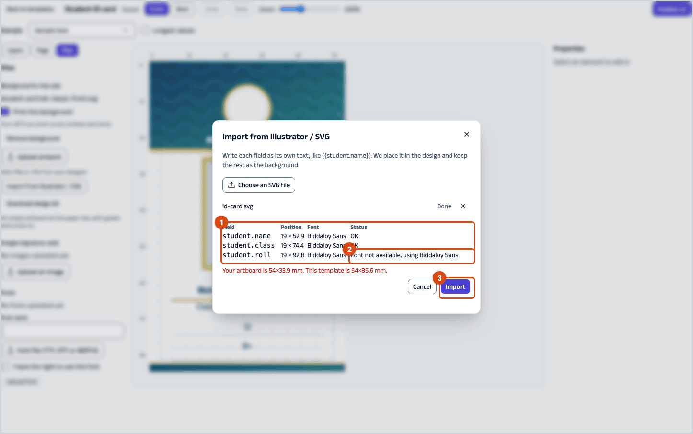

<!-- guide:meta
feature: administration.printDesignerGuide
title: Designer's guide
summary: Get the design kit, send it to a designer, import the drawn SVG, check the fields and publish.
roles: [ADMIN]
sources:
  - client-admin/src/routes/_staff/print-templates/$templateId.edit.tsx
  - server/src/modules/print/templates/
labels:
  [
    printEditor:publish.*,
    printEditor:topbar.*,
    printEditor:fields.*,
    printEditor:help.*,
  ]
helpIds: [administration.printDesignerGuide]
devices: [desktop]
entry: []
keywords:
  [designer, SVG, kit, import, fields, placeholder, publish]
appVersion: 0.1.0 (f3b2a529e)
owner: tareq89
lastVerified: 2026-10-25
knownIssues: []
-->

# Designer's guide

Draw the card's background in Illustrator, Inkscape, Affinity or Figma, hand over one SVG file, and the school turns it into a design in one step.

**Where to go:** the **Files** panel in the design editor. Reach the editor from **Administration → Print designs** by pressing **Edit design** in the design's row ([Print designs](../print-templates.md)).
**Before you start:** to change a design you must be an Admin. If you are an outside designer, ask the school's Admin to download the design kit for you.

The **background** is the colours, logo, border and fixed text. Where the name, class or roll will go, you write a **placeholder**, for example `{{student.name}}`. On import the app turns each placeholder into an editable field and removes that text from the picture, so nothing prints twice.

[Draw and import](#task-main) · [Size and safe zone](#safe-bleed) · [What the warnings mean](#trouble)

**On this page**

- [From the design kit to the import](#task-main)
- [How to know the import worked](#confirm)
- [Other situations](#other)
  - [Size, safe zone and bleed](#safe-bleed)
  - [Text: fixed text outlined, placeholders live](#text)
  - [Export settings for each program](#export)
  - [Upload fonts and images (signature, seal)](#assets)
- [Problems and fixes](#trouble)
- [Who can do what](#roles)
- [Learn more](#more)

---

## From the design kit to the import 

1. In the editor open the **Files** panel and press **Download design kit**.

   → Two files download: `design-kit.svg` (an empty artboard at this paper size) and `design-kit-README.txt` (a short how-to in English, for an outside designer).

2. Open `design-kit.svg`. It has three layers: **guides** (the edges and a 3 mm safe-zone line), **artwork** (empty), and **fields** (a sample `{{…}}` for every text box of this document).
3. Draw in the **artwork** layer. Where the name, class and so on will go, copy that `{{…}}` from the **fields** layer and paste it.
4. Outline the fixed text and keep the placeholders live ([Text](#text)).
5. Delete the **guides** layer and export as SVG ([Export settings](#export)).
6. In the editor, in the **Files** panel press **Import from Illustrator / SVG**, then **Choose an SVG file**.

   → A list appears: **Field**, **Position**, **Font**, **Status**. If all is well, **Status** says **OK**.

7. Press **Import**.

   → The background is placed, and every placeholder becomes its own field. Wait until the top says **Saved**.

8. Place the photo, the school logo and the QR code in the editor yourself; they do not come from placeholder text.
9. Publish the design ([Change a design and publish it again](../print-templates.md#task-edit)).

> **Remember:** what is drawn in the artwork layer does not change. If you type a name or roll there, every card prints that same name. Always use `{{…}}` for text that changes.

---

## How to know the import worked 

| State                           | How you know                                                             | What next                     |
| ------------------------------- | ------------------------------------------------------------------------ | ----------------------------- |
| **Only changed on screen**      | After the import the top says **Saving…**                                | Wait                          |
| **Reached the school's system** | The top says **Saved**; the **Layers** panel shows each field separately | Publish                       |
| **Ready to print**              | The message **Published v…**                                             | Check one card in the preview |

**To check:** open the print preview for one student and see whether the real name and photo land in the right places.

---

## Other situations 

### Size, safe zone and bleed 

Sizes are in millimetres. The design kit always comes at the size set in the design's **Page setup**.

| **Paper**                | Width × height                |
| ------------------------ | ----------------------------- |
| **CR80 card, portrait**  | 54 × 85.6 mm                  |
| **CR80 card, landscape** | 85.6 × 54 mm                  |
| **Custom size**          | whatever is set in Page setup |

- **Safe zone 3 mm:** keep names, photos and logos at least 3 mm inside every edge. A printer may trim the edge a little.
- **Bleed:** if a colour runs to the edge, stretch it a little past the edge in your drawing. An office printer does not print to the edge, so a thin white border can appear; a card printer prints to the edge ([Printers and calibration](printers-and-calibration.md)).

### Text: fixed text outlined, placeholders live 

- Turn all **fixed text** (for example the school name) into **outlines**, meaning shapes. Then it looks the same on every computer.
- Keep every `{{…}}` as **plain, live text**, and **each in its own text box**. `Name: {{student.name}}` in one box will not import.
- The font, size, colour and alignment you give a placeholder are copied on import.
- Which placeholders work depends on the document type. The exact list is in the kit's **fields** layer; copy from there.

### Export settings for each program 

First delete the **guides** layer.

| Program               | How to export                                                                                                                     |
| --------------------- | --------------------------------------------------------------------------------------------------------------------------------- |
| **Illustrator**       | File → Save As → SVG; SVG Profiles: SVG 1.1, Styling: Internal CSS, Fonts: SVG, Images: Embed, Decimal places: 3, Responsive: off |
| **Inkscape**          | Save as **Plain SVG**                                                                                                             |
| **Affinity Designer** | Export → SVG; use "Export text as curves" only for fixed text                                                                     |
| **Figma**             | Export as SVG; outline the fixed text, keep the `{{…}}` layers as text                                                            |

### Upload fonts and images (signature, seal) 

In the **Files** panel:

- **Fonts** → fill in **Font name** and **Font file (TTF, OTF or WOFF2)**, tick **I have the right to use this font**, and press **Upload font**.
- **Images (signature, seal)** → **Upload an image**, then **Add to design**.
- To give only a background without an SVG, use **Background for this side** and press **Upload artwork** (SVG, PNG or JPG).

---

## Problems and fixes 

| What you see                                                             | What to do                                                                                             | Who can help |
| ------------------------------------------------------------------------ | ------------------------------------------------------------------------------------------------------ | ------------ |
| **… is not a field of this document. It was left in the artwork.**       | The name is wrong for this document; check the spelling against the kit's **fields** layer             | Designer     |
| **Font not available, using Biddaloy Sans**                              | [Upload the font](#assets), or ask the designer to use the school's font                               | Admin        |
| **Your artboard is … mm. This template is … mm.**                        | The artboard is not the paper size; export again at the right size                                     | Designer     |
| **"…" mixes a field with other words. …**                                | Put each `{{…}}` in its own text box                                                                   | Designer     |
| **No … texts were found. The file will be used as the background only.** | The placeholders were outlined; export again with live text                                            | Designer     |
| **This file could not be read as an SVG.**                               | Export as SVG again with the settings above                                                            | Designer     |
| Text at the edge is cut off in print                                     | Move things inside the 3 mm safe zone, then [fix the alignment](printers-and-calibration.md#calibrate) | Admin        |

---

## Who can do what 

| Role       | Download the kit, import, change a design and publish |
| ---------- | ----------------------------------------------------- |
| Admin      | Yes                                                   |
| All others | No                                                    |

An outside designer does not need to sign in to the app: the Admin sends the kit, the designer sends back the SVG, the Admin imports it.

---

## Learn more 

<strong>What happens on import</strong>

<figure>
  
  <figcaption><em>From SVG to design: the background and the changing fields</em></figcaption>
</figure>

<strong>Check before you send the file</strong>

- [ ] The artboard is exactly the paper size.
- [ ] Important things are 3 mm inside the edge.
- [ ] Fixed text is outlined.
- [ ] Every `{{…}}` is live text, in its own box.
- [ ] The guides layer is deleted.
- [ ] Exported as SVG with images embedded.

**Related pages**

- [**Print designs**](../print-templates.md) — the main page: make, publish, default.
- [**Printers and calibration**](printers-and-calibration.md) — get the print in the right place, cards printed in advance.
- [**Printing ID cards**](id-cards.md) — printing cards after the design is published.
- [**Exam documents**](exam-documents.md) — admit cards, seat lists, marks sheets, result certificates.
- [**Certificates**](certificates.md) — transfer certificates, testimonials; serial numbers and the register.

---

_Version 0.1.0 · last verified 2026-10-25_
