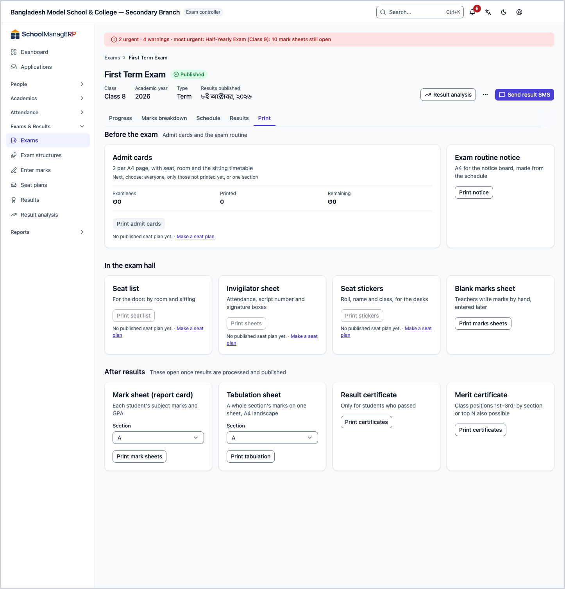
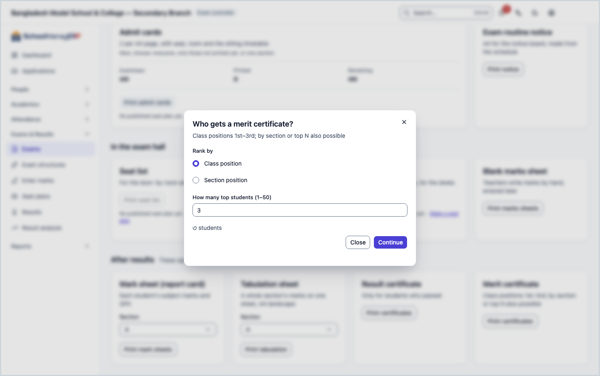

<!-- guide:meta
feature: administration.printExamDocuments
title: Printing exam documents
summary: Print admit cards, seat slips, mark sheets and result documents for an exam, one at a time or in batches.
roles: [ADMIN, ACCOUNTANT, OFFICE_STAFF, EXAM_CONTROLLER]
sources:
  - client-admin/src/routes/_staff/print/document.tsx
  - server/src/modules/print/jobs/
labels:
  [
    examDocuments:fields.*,
    examDocuments:help.*,
    printPreview:*,
  ]
helpIds: []
devices: [desktop]
entry: []
keywords:
  [exam, admit card, seat slip, mark sheet, result, print]
appVersion: 0.1.0 (f3b2a529e)
owner: tareq89
lastVerified: 2026-10-25
knownIssues: []
-->

# Printing exam documents

Print all the papers of one exam from one place: admit cards, the routine notice, seat lists, invigilator sheets, seat stickers, blank marks sheets, mark sheets, tabulation, result certificates and merit certificates.

**Where to go:** in the left menu **Exams & Results → Exams**, open the exam, then the **Print** tab. While on the exam page you can also press **Ctrl+K** and type **Print admit cards** to land on this tab.
**Before you start:** you need a published design for the kind of paper ([Print designs](../print-templates.md)) and at least one printer ([Printers and calibration](printers-and-calibration.md)).

On the **Print** tab the papers are arranged in three parts, in the order you need them: **Before the exam**, **In the exam hall**, **After results**. If a paper cannot be printed yet, its card shows why and a button to fix it.

[Admit cards](#task-main) · [Hall papers](#hall) · [Papers after results](#after) · [Why a card is grey](#unavailable) · [Problems and fixes](#trouble)

**On this page**

- [Print admit cards](#task-main)
- [How to know they are printed](#confirm)
- [Other situations](#other)
  - [Exam routine notice](#routine)
  - [Seat list, invigilator sheet, seat stickers, marks sheet](#hall)
  - [Mark sheets, tabulation, result and merit certificates](#after)
  - [Why a card is grey](#unavailable)
  - [When a guardian prints the admit card themselves](#portal)
- [Problems and fixes](#trouble)
- [Who can do what](#roles)
- [Learn more](#more)

---

## Print admit cards 

1. On the exam's **Print** tab look at the **Admit cards** card. It shows **Examinees**, **Printed** and **Remaining**.
2. Press **Print admit cards**.

   → **Print preview** opens.

3. Under **Which admit cards?** choose **Everyone**, **Not printed yet** (those not printed so far), or **One section**. If you choose a section, pick it under **Choose a section**.
4. Press **Preview** and look through the cards. Each A4 page holds 2 admit cards, with the seat, room and the timetable of the sittings.
5. Choose a printer and press **Print** ([why you choose it yourself](printers-and-calibration.md#why-printer)).

   → The browser's print window opens. When printing is done, the app asks whether everything printed correctly; answer it.

**Warning about dues:** if the school keeps **Withhold admit cards when fees are due** on (Settings → **Printing** → **Documents and certificates**), the card says **… students owe fees. They are marked in the list; you can still print.** You can print; only a guardian cannot print from the portal ([when a guardian prints](#portal)).

---

## How to know they are printed 

| State                           | How you know                                                            | What next     |
| ------------------------------- | ----------------------------------------------------------------------- | ------------- |
| **Only changed on screen**      | The paper shows on screen, you have not pressed **Print** yet           | Print         |
| **Reached the school's system** | The browser's print window has opened                                   | Print         |
| **Done**                        | On the Admit cards card **Printed** went up and **Remaining** went down | Hand them out |

When you press **Print**, the print record is made first. If it cannot be made, the app shows **The print could not be recorded, so it was not printed. Try again.** and nothing prints.

---

## Other situations 

### Exam routine notice 

One A4 for the notice board, made from the exam schedule. On the **Exam routine notice** card press **Print notice**.

### Seat list, invigilator sheet, seat stickers, marks sheet 

The first three need a published seat plan first ([Seat plans](../../exams-results/seat-plans.md)).

| Paper                 | What it has                                             | Button                 |
| --------------------- | ------------------------------------------------------- | ---------------------- |
| **Seat list**         | For the door; one page per room per sitting             | **Print seat list**    |
| **Invigilator sheet** | Attendance, script number and signature boxes           | **Print sheets**       |
| **Seat stickers**     | Roll, name and class for the desks                      | **Print stickers**     |
| **Blank marks sheet** | Teachers write marks by hand, entered later; by section | **Print marks sheets** |

1. Press the card's button.

   → The paper opens in a new page (**Preparing the document…**).

2. Press **Print**. When done, press **Close** to go back to the exam's **Print** tab.

### Mark sheets, tabulation, result and merit certificates 

| Paper                        | When it opens               | What to do                                                                                            |
| ---------------------------- | --------------------------- | ----------------------------------------------------------------------------------------------------- |
| **Mark sheet (report card)** | After results are published | Choose a **Section**, press **Print mark sheets**                                                     |
| **Tabulation sheet**         | After results are processed | Choose a **Section**, press **Print tabulation**; a whole section on one A4 landscape page            |
| **Result certificate**       | After results are published | Press **Print certificates**; only students who passed get one, in roll order                         |
| **Merit certificate**        | After results are published | Press **Print certificates** → in the **Who gets a merit certificate?** window follow the steps below |

In the merit certificate window:

1. Choose **Rank by**: **Class position** or **Section position**.
2. Enter **How many top students (1–50)**.
3. Press **Continue**.

   → The preview opens, then print the same way.

Result certificates and merit certificates get a serial number too (`RES-2026-00001`, `MRT-2026-00001`), one per student; a reprint keeps the same number ([Certificates](certificates.md#serial)).

### Why a card is grey 

A paper that cannot be printed yet has a grey card. The card says why and shows a button to fix it:

| What the card says                 | Which papers                                             | Button to fix        |
| ---------------------------------- | -------------------------------------------------------- | -------------------- |
| **No published seat plan yet.**    | Admit cards, seat list, invigilator sheet, seat stickers | **Make a seat plan** |
| **The exam has no schedule yet.**  | Routine notice                                           | **Add the schedule** |
| **No marks parts are set up yet.** | Blank marks sheet                                        | **Set up marks**     |
| **Results are not processed yet.** | Tabulation                                               | **See progress**     |
| **Results are not published yet.** | Mark sheets, result certificate, merit certificate       | **Go to Results**    |

If there is no design, the card does not turn grey; opening the preview shows **No design for this document yet**, with **Create one from a suggestion** ([Print designs](../print-templates.md#task-main)).

### When a guardian prints the admit card themselves 

In the guardian portal, on the **Exam schedule** page, the guardian presses **Print admit card**. It holds only their own child's admit card. If the school withholds it for dues, they see **The admit card cannot be printed now** and the amount due; after payment they can print from the same page.

---

## Problems and fixes 

| What you see                                                                 | What to do                                                          | Who can help    |
| ---------------------------------------------------------------------------- | ------------------------------------------------------------------- | --------------- |
| The exam page has no **Print** tab                                           | You need print permission; ask an Admin                             | Admin           |
| A card is grey                                                               | Press the card's fix button ([why a card is grey](#unavailable))    | Exam controller |
| **No design for this document yet**                                          | Publish a design ([Print designs](../print-templates.md#task-main)) | Admin           |
| **No student passed this exam, so there is no result certificate to print.** | Check the results ([Results](../../exams-results/results.md))       | Exam controller |
| **Could not load the results. Try again.**                                   | Press **Print certificates** again                                  | You             |
| **No students found.** (merit certificate)                                   | Change **Rank by**, and check that results are published            | Exam controller |
| **The print could not be recorded, so it was not printed. Try again.**       | Press **Print** again                                               | You             |
| **Nothing to print.**                                                        | Open it again from the exam's **Print** tab                         | You             |
| The print is shifted or cut on the paper                                     | [Fix the measurements](printers-and-calibration.md#calibrate)       | Admin           |

More help with this: [What to do when something goes wrong](../../help/troubleshooting.md#print).

---

## Who can do what 

| Role            | Print exam papers (Print tab) | Own child's admit card |
| --------------- | ----------------------------- | ---------------------- |
| Admin           | Yes                           | —                      |
| Exam controller | Yes                           | —                      |
| Guardian        | No                            | Yes, from the portal   |

To see the **Print** tab you need both the permission to manage exams and the print permission. The Accountant and Office staff have the print permission but not the permission to open the exam page, so they cannot print from here.

---

## Learn more 

<strong>Which paper opens when</strong>

<figure>
  
  <figcaption><em>Exam papers: what each one needs first</em></figcaption>
</figure>

- An admit card takes its seat and room from the published seat plan, so with no seat plan the admit card is grey too.
- Tabulation opens as soon as results are processed; the other result papers after publishing.

**Related pages**

- [**Print designs**](../print-templates.md) — the main page; designs and print preview.
- [**Printers and calibration**](printers-and-calibration.md) — add a printer, fix the measurements.
- [**Certificates**](certificates.md) — transfer certificates, testimonials and other student certificates.
- [**Printing ID cards**](id-cards.md) — student and staff cards.
- [**Exams**](../../exams-results/exams.md) — exams, schedules, marks parts.
- [**Seat plans**](../../exams-results/seat-plans.md) — make and publish a seat plan.
- [**Results**](../../exams-results/results.md) — process and publish results.
- [**Designer's guide**](designer-guide.md) — Get the design kit, send it to a designer, import the drawn SVG, check the fields and publish.

---

_Version 0.1.0 · last verified 2026-10-25_
