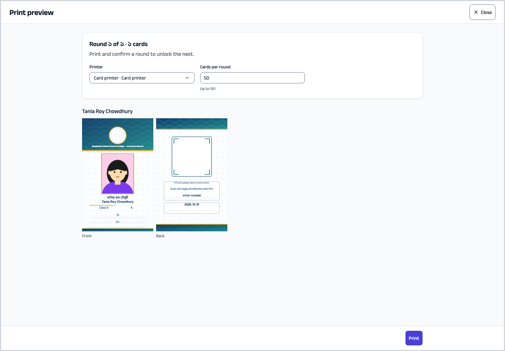
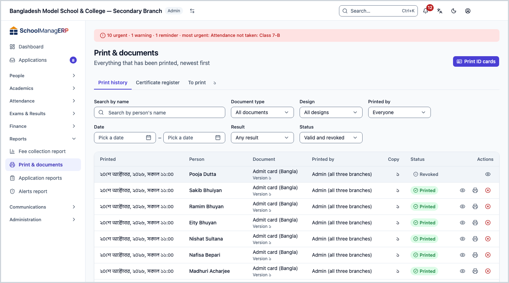

<!-- guide:meta
feature: administration.printIdCards
title: Printing ID cards
summary: Print ID cards for one student or staff member, a few people or a whole section; revoke a lost card so its QR no longer shows as valid.
roles: [ADMIN, ACCOUNTANT, OFFICE_STAFF, EXAM_CONTROLLER]
sources:
  - client-admin/src/routes/_staff/print/document.tsx
  - client-admin/src/routes/_staff/print/preview.tsx
  - client-admin/src/components/print/preview/print-preview.tsx
  - server/src/modules/print/jobs/
  - server/src/modules/print/verify/
labels:
  [
    printPreview:*,
    printHistory:actions.*,
    printHistory:revoke.*,
    verify:*,
  ]
helpIds: []
devices: [desktop]
entry: []
keywords:
  [ID card, print, QR, revoke, lost card, batch, section]
appVersion: 0.1.0 (f3b2a529e)
owner: tareq89
lastVerified: 2026-10-25
knownIssues: []
-->

# Printing ID cards

Print ID cards for one student or staff member, a few, or a whole section; reprint when needed, or revoke a lost card.

**Where to go:** a student's page, **Print ID card**, or the **Students** list. Staff cards come from the **Staff** list or the staff member's page.
**Before you start:** you need a published design for this document type ([Print designs](../print-templates.md)) and at least one printer ([Printers and calibration](printers-and-calibration.md)).

Every printed card is a **copy**: copy 1 the first time, copy 2 when you print again, and so on. Each copy has its own QR code, so revoking one copy makes only that copy invalid.

[One card](#task-main) · [Several people](#many) · [Reprint](#reprint) · [Revoke a lost card](#revoke) · [Problems and fixes](#trouble)

**On this page**

- [Print one person's card](#task-main)
- [How to know the card is printed](#confirm)
- [Other situations](#other)
  - [Several people or a whole section](#many)
  - [A big section: printing in rounds](#batches)
  - [Reprint a card](#reprint)
  - [See the print history](#history)
  - [Revoke a lost card](#revoke)
- [Problems and fixes](#trouble)
- [Who can do what](#roles)
- [Learn more](#more)

---

## Print one person's card 

1. Open the student's page ([Students](../../people/students.md)). For a staff member, open the staff page ([Staff](../../people/staff.md)).
2. Press **Print ID card**. The student's **Documents** tab also has this button; there you can add or change the card photo.

   → **Print preview** opens and shows the card with the real name and photo. The default design is chosen.

3. Under **Printer** choose **Choose a printer** ([why you choose it yourself](printers-and-calibration.md#why-printer)).
4. Press **Print**.

   → The browser's print window opens. Print with the same printer, **Margins: None** and **Scale: 100%** ([print window settings](printers-and-calibration.md#browser-settings)).

5. The app asks **Did all 1 cards print correctly?** — press **Yes, all printed**.

   → The message **Recorded.** appears, and you go back to where you started.

> **Remember:** pressing **Print** writes the card into the print history straight away, before any paper comes out. So answer the question at the end, so that the history stays right.

---

## How to know the card is printed 

| State                           | How you know                                                   | What next          |
| ------------------------------- | -------------------------------------------------------------- | ------------------ |
| **Only changed on screen**      | The preview shows the card, you have not pressed **Print** yet | Print              |
| **Reached the school's system** | The question **Did all … cards print correctly?** has appeared | Answer it          |
| **Done**                        | The message **Recorded.**; in the history **Printed**          | Hand over the card |

**To check:** find the row in [**Reports → Print & documents**](#history), or scan the card's QR code and see **Valid document** ([Check a card by its QR code](../print-templates.md#qr-check)).

---

## Other situations 

### Several people or a whole section 

| What you want          | What to do                                                                                                      |
| ---------------------- | --------------------------------------------------------------------------------------------------------------- |
| A few people           | In the **Students** (or **Staff**) list tick whose cards you need, then press **Print ID cards (n)** at the top |
| A whole section        | In the **Students** list filter by class and section, then press **Print ID cards for whole …**                 |
| Without opening a list | In the **Print ID cards** window choose **Who is it for?**, then **Choose by name** or **Whole section**        |

The preview and printing are then the same as for one person ([Print one person's card](#task-main)).

If a card has a **Check** mark, the list above says **… of … cards need attention**, for example **No photo** or **Text does not fit**. Fix it and come back, or press **Print this round anyway**.

### A big section: printing in rounds 

With many cards the app splits them into **rounds**. The round size comes from the design's **Cards per round** (50 at the start, at most 200). In the preview you can lower **Cards per round**, but not above the design's value.

1. Print the first round.
2. Answer the question:

| You press            | What happens                                                                                                            |
| -------------------- | ----------------------------------------------------------------------------------------------------------------------- |
| **Yes, all printed** | The round is recorded and the next round opens                                                                          |
| **Some failed…**     | Tick the cards that did not print correctly and press **Confirm**; then press **Reprint n failed** and only those print |

3. Keep going until all rounds are done. You cannot move to the next round without answering.

> **Remember:** once printing starts, the **Design** can no longer be changed. The whole section prints on one design.

### Reprint a card 

If a card is torn or printed wrong:

1. Open the student's **Documents** tab and **Print history**, or open [**Reports → Print & documents**](#history).
2. In the card's row press **Reprint**.

   → A **Reprint …** window opens: **This prints the same card exactly as before, as a new copy with its own QR code.**

3. Choose a **Printer** and press **Print**.

   → The new card gets the next **Copy** number and prints on the same design version as before. If the design has a **Label on reprints** (for example "Copy {n}"), it is printed on the card, so nobody mistakes it for the first card.

The old copy stays valid. For a lost card, first [revoke it](#revoke), then print again. A revoked card cannot be reprinted; print a new card from the student's page.

### See the print history 

[**Reports → Print & documents**](../../reports/printables.md) → **Print history** tab.

- Columns: **Printed**, **Printed by**, **Document**, **Person**, **Copy**, **Status**.
- Filters: **Document type**, **Design**, **Printed by**, **Date**, **Result**, **Status** (**Valid only** / **Revoked only**), and **Search by name**.
- Press **View** to see exactly what was printed, front and back. The QR code is not stored, so it does not show there.

### Revoke a lost card 

Only an Admin can do this.

1. In **Reports → Print & documents**, in the card's row press **Revoke**.

   → A **Revoke …** window opens: **Anyone scanning this card's QR code will see it is no longer valid.**

2. Write a **Reason**, for example "lost" (required, up to 280 characters; staff see it, the public does not).
3. Press **Revoke card**.

   → The message **Card revoked** appears. The row's status becomes **Revoked**. Scanning the QR code shows **This document has been revoked**.

> **Remember:** a revoke cannot be undone. Only this copy is revoked; the same person's other copies stay valid. Match the **Copy** number to pick the right card.

---

## Problems and fixes 

| What you see                                               | What to do                                                                                               | Who can help |
| ---------------------------------------------------------- | -------------------------------------------------------------------------------------------------------- | ------------ |
| **No design for this document yet**                        | Ask an Admin to publish a design ([Print designs](../print-templates.md#task-main))                      | Admin        |
| **Add your first printer to be able to print.**            | Ask an Admin to [add a printer](printers-and-calibration.md#task-main)                                   | Admin        |
| **Your browser blocked the print window. …**               | Allow pop-ups for this site and press **Print** again                                                    | You          |
| **Could not start printing. Nothing was printed.**         | Try again in a little while                                                                              | You          |
| **Confirm the current round before the next one unlocks.** | Answer the question of the earlier round                                                                 | You          |
| The card shows **No photo**                                | Add a photo in the student's **Documents** tab                                                           | You          |
| Printing a staff card says you have no permission          | A staff card also needs permission to see staff HR details; ask an Admin                                 | Admin        |
| **Reprint** does not work because the card is revoked      | A revoked card cannot be reprinted; print a new one from the student's page                              | You          |
| **Could not revoke this card.**                            | Try again                                                                                                | Admin        |
| The print is shifted or cut on the paper                   | Set **Scale 100%**, **Margins None**, then [fix the measurements](printers-and-calibration.md#calibrate) | Admin        |

More help with this: [What to do when something goes wrong](../../help/troubleshooting.md#print).

---

## Who can do what 

| Role            | Print and reprint student cards | Print staff cards | See print history | Revoke cards |
| --------------- | ------------------------------- | ----------------- | ----------------- | ------------ |
| Admin           | Yes                             | Yes               | Yes               | Yes          |
| Accountant      | Yes                             | No                | No                | No           |
| Office staff    | Yes                             | No                | Yes               | No           |
| Exam controller | Yes                             | No                | Yes               | No           |

To print a staff card you need the print permission and also the permission to see staff HR details; for now only an Admin has both.

---

## Learn more 

<strong>How copies, QR codes and revoking fit together</strong>

<figure>
  
  <figcaption><em>ID cards: print, reprint, revoke</em></figcaption>
</figure>

- At most 200 cards per job; more than that are split into rounds.
- A reprinted card keeps the design version of the original, even if the design changed later.

**Related pages**

- [**Print designs**](../print-templates.md) — the main page; [check a card by its QR code](../print-templates.md#qr-check).
- [**Printers and calibration**](printers-and-calibration.md) — add a printer, fix the measurements.
- [**Designer's guide**](designer-guide.md) — drawing the card background.
- [**Exam documents**](exam-documents.md) — admit cards, seat lists, marks sheets, result certificates.
- [**Certificates**](certificates.md) — transfer certificates, testimonials; serial numbers and the register.
- [**Students**](../../people/students.md) — the student's page and its **Documents** tab.
- [**Staff**](../../people/staff.md) — the staff member's page.
- [**Print & documents**](../../reports/printables.md) — print history, reprint and revoke

---

_Version 0.1.0 · last verified 2026-10-25_
