<!-- guide:meta
feature: administration.printPrinters
title: Printers and calibration
summary: Add a printer and its paper size, print the measuring page and fix the offset so the print lands exactly on the card.
roles: [ADMIN, ACCOUNTANT, OFFICE_STAFF, EXAM_CONTROLLER]
sources:
  - client-admin/src/routes/_staff/print/preview.tsx
  - client-admin/src/components/print/preview/print-preview.tsx
  - client-admin/src/components/print/preview/run-print.ts
  - server/src/modules/print/printers/
labels:
  [
    printPreview:*,
  ]
helpIds: [administration.printPrinters]
devices: [desktop]
entry: []
keywords:
  [printer, calibration, paper, offset, measuring page, alignment]
appVersion: 0.1.0 (f3b2a529e)
owner: tareq89
lastVerified: 2026-10-25
knownIssues: []
-->

# Printers and calibration

Add each of the school's printers once and fix its measurements, so that cards print in the right place.

**Where to go:** [**Settings → Printing → Printers**](../settings.md).
**Before you start:** to add a printer and fix its measurements you must be an Admin. Keep a ruler at hand.

Here a **printer** is a name plus a few measurements: what kind of printer it is, how much blank space it leaves at the paper's edge, and how many millimetres the print must be shifted. When you choose a printer from this list while printing, the app applies those measurements to the page.

[Add a printer](#task-main) · [Fix the measurements](#calibrate) · [Why you choose the printer yourself](#why-printer) · [Problems and fixes](#trouble)

**On this page**

- [Add a printer](#task-main)
- [How to know the printer is added](#confirm)
- [Why I have to choose the printer myself](#why-printer)
- [Other situations](#other)
  - [Print the measuring page and fix the measurements](#calibrate)
  - [Print window settings](#browser-settings)
  - [Print on pre-printed cards](#preprinted)
  - [Archive a printer](#archive)
- [Problems and fixes](#trouble)
- [Who can do what](#roles)
- [Learn more](#more)

---

## Add a printer 

1. Open **Settings → Printing**.

   → The **Printers** section appears. If there is no printer, it says **Add your first printer**.

2. Press **Add printer**.

   → The **Add printer** window opens.

3. Give it a **Name** everyone will recognise, for example "Office card printer".
4. Choose the **Printer type**:
   - **Card printer** — prints one card at a time, edge to edge.
   - **Office printer** — prints many cards on an A4 sheet, which you cut out afterwards.
5. Choose **Printing on both sides**: **Automatic both sides**, or **I turn the stack over by hand**.
6. For an office printer you can also give **Cutting gap between cards (mm)**.
7. Press **Save**.

   → The printer appears in the list. The **Shift (mm)** column starts at 0.

> **Remember:** the blank space at the paper's edge is set by the app itself: 0 mm for a card printer, 5 mm for an office printer. You usually do not need to change it.

---

## How to know the printer is added 

| State                           | How you know                                           | What next                                |
| ------------------------------- | ------------------------------------------------------ | ---------------------------------------- |
| **Only changed on screen**      | The window says **Saving…**                            | Wait, do not close the window            |
| **Reached the school's system** | The window closes and the printer shows in the list    | [Print the measuring page](#calibrate)   |
| **Ready to print**              | On the measuring page the cross lands at exactly 20 mm | Done, choose this printer in the preview |

**To check:** open any print preview and look for the name in the **Printer** list.

**If it did not save:** the window says **Could not save the printer.**; press **Save** again.

---

## Why I have to choose the printer myself 

When you press **Print**, the browser opens its own print window, and you choose a printer there. **The app cannot see which printer you chose there.** That is a browser rule.

But every printer prints a little differently: one prints 1 mm to the right, another leaves more space at the edge. The app can correct for this, but only if it knows which printer it is. So **before** printing, choose the same printer in the **Printer** box of the print preview. The printer type also sets the page size: with a card printer one page is one card; with an office printer one A4 page holds several cards.

The simple rule: **choose the same printer in the app and in the browser's print window.** This computer remembers your last choice, separately for each school.

---

## Other situations 

### Print the measuring page and fix the measurements 

Do this once for every printer. Do it again when you change the paper or card type. The measuring page is only a test page; it is not written to the print history.

1. In the list, in the printer's row, press **Print measuring page**.

   → The browser's print window opens. A **…: fix the measurements** guide appears beside it.

2. In the print window choose the same printer, set **Margins: None** and **Scale: 100%** ([print window settings](#browser-settings)). Print.
3. On the printed page measure **from the top-left corner of the paper to the first cross**. It should be exactly 20 mm.
4. Press **Change the shift**.

   → The **Edit printer** window opens with **Measurements (advanced)** already open.

5. Enter how many millimetres it is off:

| Where the cross landed  | Which box                 | What to enter |
| ----------------------- | ------------------------- | ------------- |
| 1 mm too far **right**  | **Shift left–right (mm)** | −1            |
| 1 mm too far **left**   | **Shift left–right (mm)** | 1             |
| 0.5 mm too far **down** | **Shift up–down (mm)**    | −0.5          |
| 0.5 mm too far **up**   | **Shift up–down (mm)**    | 0.5           |

The value must be between −10 and 10 mm. If the whole print is too small or too big, change **Size** (1 = actual size, from 0.90 to 1.10).

6. Press **Save**.

   → The **Shift (mm)** column shows the new value, for example **Shift left–right −1 · Shift up–down 0**.

7. Press **Print measuring page** again. The new page prints with the new values. If the cross is now at 20 mm you are done: press **Done**. If not, repeat from step 3.

<!-- image pending: printed measuring page, ruler from the top-left corner to the cross; desktop -->

> **Remember:** the app has no separate "tested" or "verified" mark. When the cross lands at 20 mm on the second measuring page, you know the printer is right.

### Print window settings 

Set these in the browser's print window every time you print:

| Setting             | Value                                          |
| ------------------- | ---------------------------------------------- |
| Printer             | the one you chose in the app's **Printer** box |
| Margins             | **None**                                       |
| Scale               | **100%** (not "Fit to page")                   |
| Headers and footers | off                                            |
| Background graphics | on                                             |

### Print on pre-printed cards 

If the school buys blank cards that already have the design printed on them, only the name, photo and QR code need printing.

1. In the design editor open the **Files** panel ([Designer's guide](designer-guide.md)).
2. Turn off **Print the background**.

   → The background shows on screen but does not print. Publish the design again ([Change a design and publish it again](../print-templates.md#task-edit)).

### Archive a printer 

1. In the printer's row press **Archive**.

   → **Archive …? Past prints keep their record.**

| You press   | What happens                                                   | Changed? |
| ----------- | -------------------------------------------------------------- | -------- |
| **Archive** | The printer leaves the list and no longer shows in the preview | Yes      |
| **Cancel**  | Nothing changes                                                | No       |

---

## Problems and fixes 

| What you see                                                      | What to do                                                                                                                   | Who can help |
| ----------------------------------------------------------------- | ---------------------------------------------------------------------------------------------------------------------------- | ------------ |
| The **Printers** section is missing under **Settings → Printing** | Only an Admin sees it; ask an Admin                                                                                          | Admin        |
| **Your browser blocked the print window. …**                      | Allow pop-ups for this site and try again                                                                                    | You          |
| **Could not open the print window.**                              | Refresh the page and press **Print measuring page** again                                                                    | You          |
| **The shift must be between −10 and 10 mm.**                      | If it is off by more than 10 mm, first check the print window's **Scale** and **Margins**                                    | You          |
| The print is still shifted                                        | Check that you chose the same printer in the preview and in the print window, then fix the measurements again                | Admin        |
| A thin white border around the card                               | An office printer does not print to the edge; use a card printer, or add [bleed](designer-guide.md#safe-bleed) in the design | Admin        |
| The whole print is a little small or big                          | Check that **Scale** is 100%, then fix **Size**                                                                              | Admin        |

More help with this: [What to do when something goes wrong](../../help/troubleshooting.md#print).

---

## Who can do what 

| Role            | Add printers, fix measurements, archive | Choose the printer when printing |
| --------------- | --------------------------------------- | -------------------------------- |
| Admin           | Yes                                     | Yes                              |
| Accountant      | No                                      | Yes                              |
| Office staff    | No                                      | Yes                              |
| Exam controller | No                                      | Yes                              |

---

## Learn more 

<strong>How the measuring page works</strong>

<figure>
  
  <figcaption><em>From the measuring page to the right shift</em></figcaption>
</figure>

- The measuring page prints with the printer's **current** shift and size, so the second page shows whether the correction worked.
- With a card printer the page is card-sized (85.6 × 54 mm); with an office printer it is A4.

**Related pages**

- [**Print designs**](../print-templates.md) — the main page; [check the preview and print](../print-templates.md#preview-print).
- [**Designer's guide**](designer-guide.md) — safe zone, bleed, the background.
- [**Printing ID cards**](id-cards.md) — one person, a few people or a whole section.
- [**Exam documents**](exam-documents.md) — admit cards, seat lists, marks sheets, result certificates.
- [**Certificates**](certificates.md) — transfer certificates, testimonials; serial numbers and the register.
- [**Changing the school's settings**](../settings.md) — Set the school's profile, academic rules, fee rules, communication, printing, sign-in, backup and alerts on one page, in nine categories.
- [**Invoices**](../../finance/invoices.md) — Find the invoice and credit note of every payment, print them, send them to a guardian by WhatsApp or SMS, and give a 30-day share link.
- [**Payments**](../../finance/payments.md) — Find every payment taken at the school, open one to see which bills the money went to, print the receipt again, and reverse a wrong payment.
- [**Record payment**](../../finance/record-payment.md) — Take money against the open bills of one or more students — the money is split across the oldest bills, give a discount if needed, work out.

---

_Version 0.1.0 · last verified 2026-10-25_
