<!-- guide:meta
feature: administration.seatCoupon
title: Using a coupon
summary: Type a coupon when you buy seats, see the new price before you pay, and know what happens when a coupon makes the order free.
roles: [ADMIN]
sources:
  - client-admin/src/features/billing/BuySeatsDialog.tsx
  - client-admin/src/features/billing/CouponRow.tsx
  - client-admin/src/features/billing/SeatsBillingSection.tsx
  - server/src/modules/coupons/
labels: [billing:coupon.*, billing:buy.*]
helpIds: [administration.seatCoupon]
devices: [desktop]
entry: [sidebar]
keywords: [coupon, discount, free seats, seat order, কুপন, ছাড়, সিট]
appVersion: 0.1.0 (cce2fcbf9)
owner: tareq89
lastVerified: 2026-11-14
knownIssues: []
-->

# Using a coupon

A coupon gives your school a discount when you buy seats. You type the code, see the new price, and only then buy.

**Go to:** **Administration → [Settings](settings.md)** in the left menu, then the category **Seats & billing**, then **Buy seats**. View this page on a computer.
**Before you start:** be an Admin and have the coupon code from Biddaloy.

A coupon is for **seats only**. It does not work on SMS packages.

[Use a coupon](#task-main) · [Free by coupon](#task-free) · [Problems and fixes](#trouble)

**On this page**

- [Use a coupon](#task-main)
- [How to know it worked](#confirm)
- [Other situations](#other)
  - [A coupon makes the order free](#task-free)
  - [Which months get the discount](#task-months)
- [Problems and fixes](#trouble)
- [Who can do what](#roles)
- [Learn more](#more)

---

## Use a coupon 

1. Open **Administration → Settings**, press **Seats & billing**, then **Buy seats**.
2. Enter **Seats (students)** and **Months**. See [Changing the school's settings](settings.md#task-billing).
3. Press **Have a coupon?** A box **Coupon code** opens.
4. Type the code and press **Apply**.

   → While it checks it says **Checking…**. Then you see three lines: **Price**, **Coupon** (with a minus sign) and **New total**. Nothing is bought yet.

5. Press **Create order**, then **Pay with bKash**, as for any order.

<figure>
  
  <figcaption><em>A coupon on a seat order</em></figcaption>
</figure>

> **Change seats or months after Apply?** The new total is cleared, because the discount depends on them. Press **Apply** again.

---

## How to know it worked 

| What you see                                     | What it means                                   | What next                                      |
| ------------------------------------------------ | ----------------------------------------------- | ---------------------------------------------- |
| **Price**, **Coupon**, **New total**             | The coupon is accepted and shows the new price. | Press **Create order**.                        |
| **This coupon cannot be used.**                  | The code did not work. The page never says why. | Check the code, or ask Biddaloy for a new one. |
| **Too many tries, wait a little and try again.** | You tried too many times.                       | Wait about 15 minutes and try again.           |

---

## Other situations 

### A coupon makes the order free 

If the coupon takes the whole price off, the **New total** is 0.00 and the button becomes **Get seats free** (instead of **Create order**). Press it. There is no bKash step.

→ **Your seats are active. There is nothing to pay.** Press **Download receipt**. The receipt says "free by coupon". It is still an order: it shows in the **Orders** list with its receipt, like any other.

**Example.** At 10.00 per seat per month, you enter 200 seats for 3 months with a coupon that takes 50 percent off. **Price** 6,000.00, **Coupon** 3,000.00, **New total** 3,000.00. You pay 3,000.00 with bKash. With a coupon for 100 percent the total is 0.00 and you press **Get seats free**.

A free order cannot be refunded.

### Which months get the discount 

A coupon works on **one order**. Some coupons give the discount only for the first months of the order, for example the first 3 of 12. The **New total** already counts this, so the price you see is the price you pay. Seats you buy later in a new order are priced without it, unless you apply a coupon again.

---

## Problems and fixes 

| What you see                                     | What to do                                                               | Who can help |
| ------------------------------------------------ | ------------------------------------------------------------------------ | ------------ |
| **This coupon cannot be used.**                  | Check the code letter by letter. Capital or small letters do not matter. | Biddaloy     |
| **Too many tries, wait a little and try again.** | Wait, then try once more.                                                | —            |
| **We could not create the order. Try again.**    | Press **Create order** again.                                            | —            |
| The **Have a coupon?** line is not there         | Open **Seats & billing** from an Admin account.                          | —            |

---

## Who can do what 

| Role                    | Use a coupon |
| ----------------------- | ------------ |
| Admin                   | Yes          |
| Every other school role | No access    |

---

## Learn more 

<strong>Why does it never say why a coupon failed?</strong>

So that nobody can guess other schools' coupon codes. Every failure gets the same sentence.

**Related pages**

- [**Changing the school's settings**](settings.md) — **Seats & billing**, where you buy seats.
- [**Buying an SMS package**](sms-packages.md) — SMS are bought separately; a coupon does not apply there.

---

_Version 0.1.0 · Last checked 2026-11-14_
