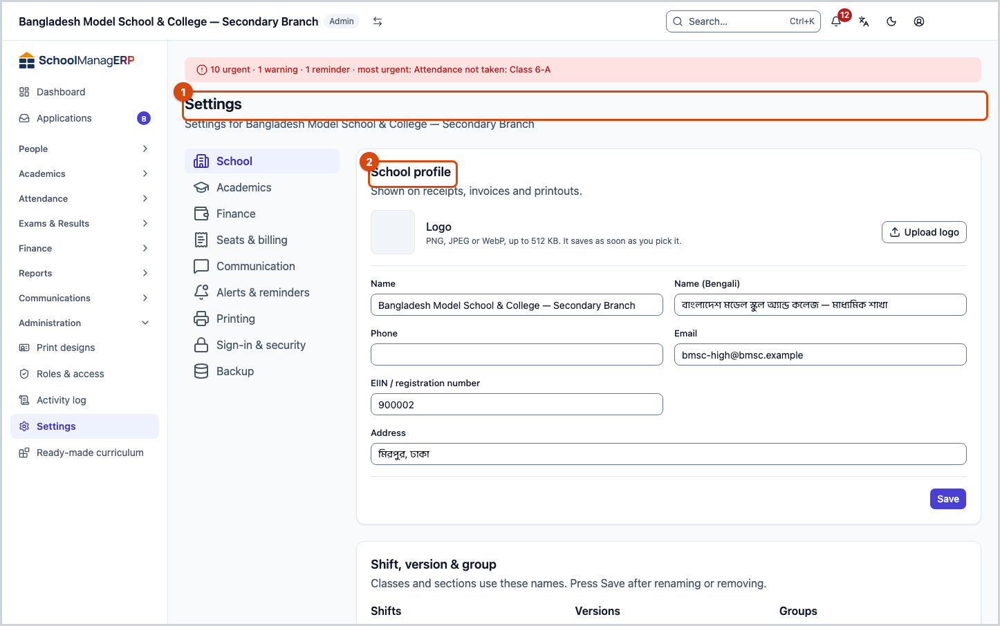
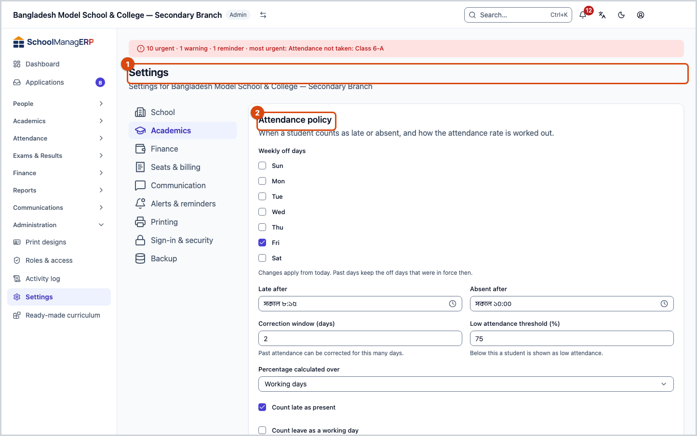
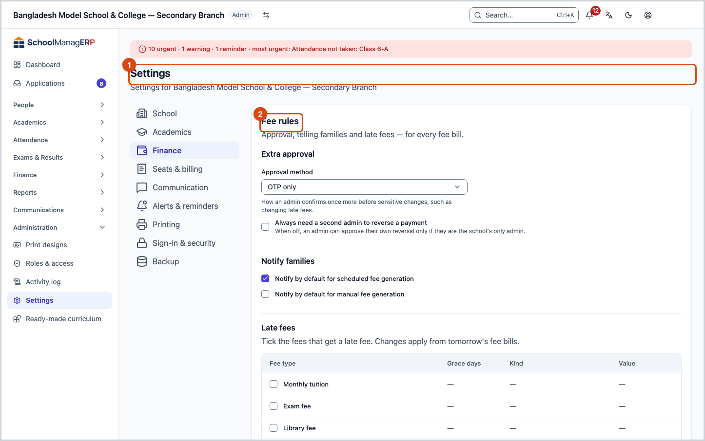
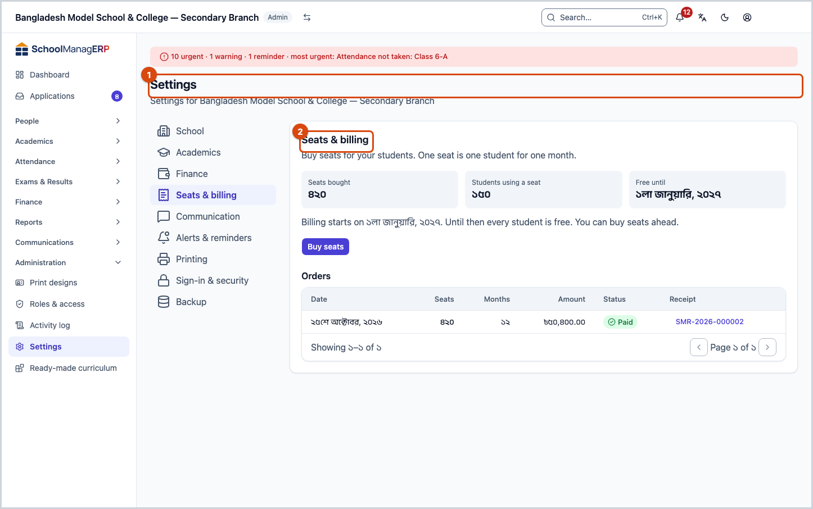
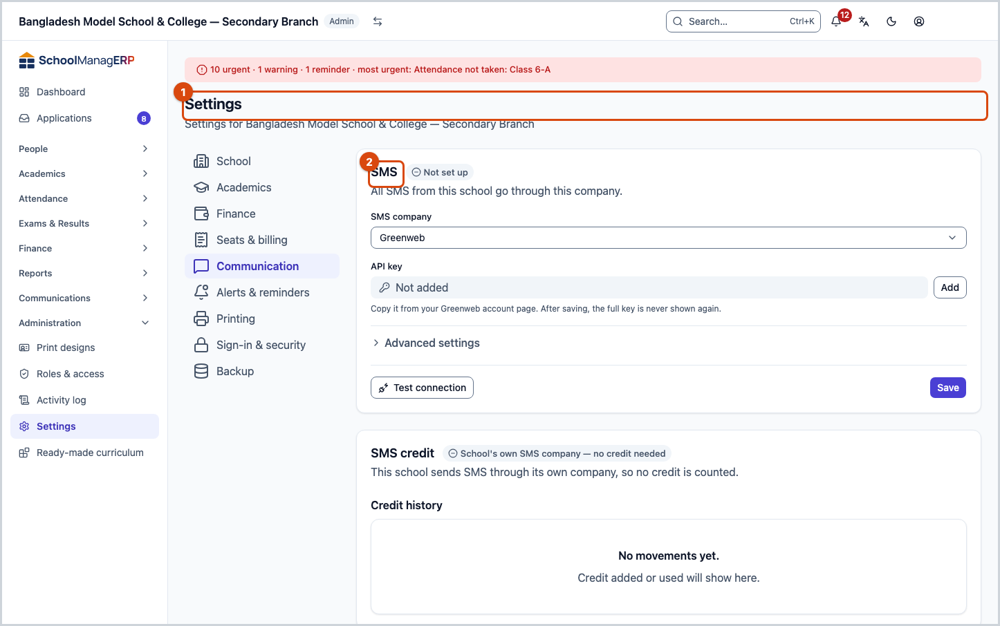
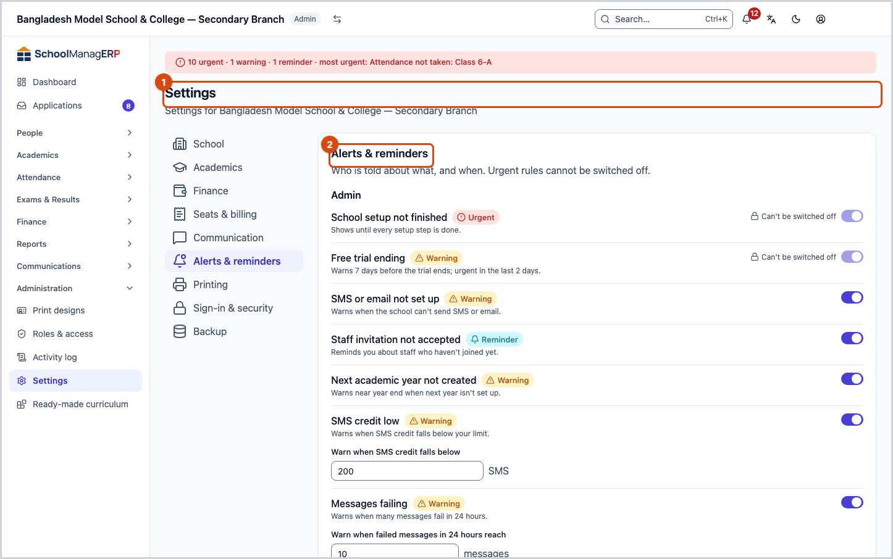
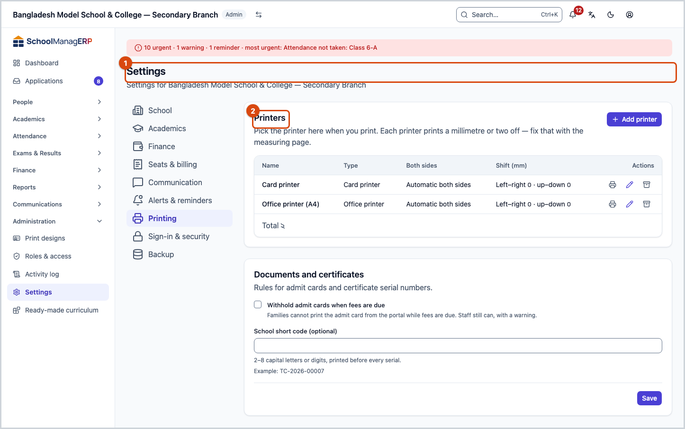
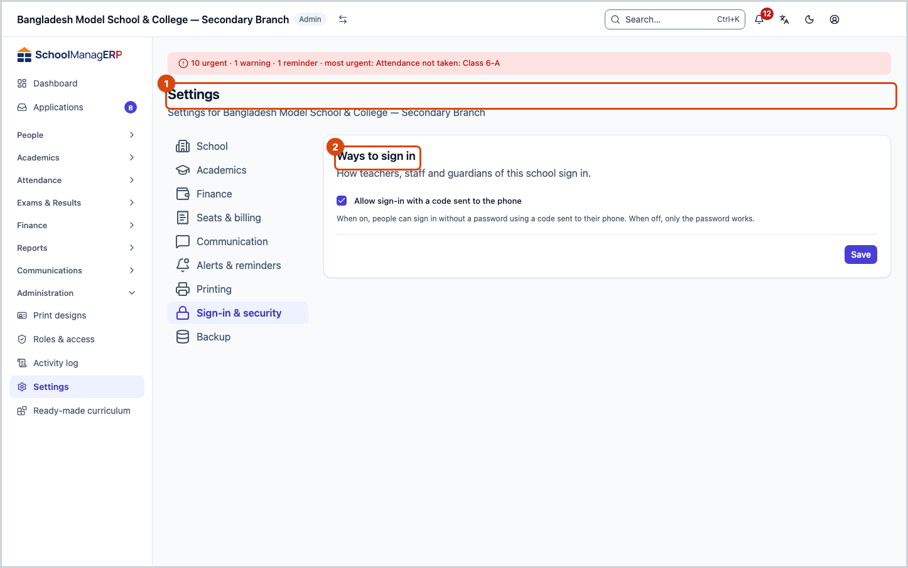
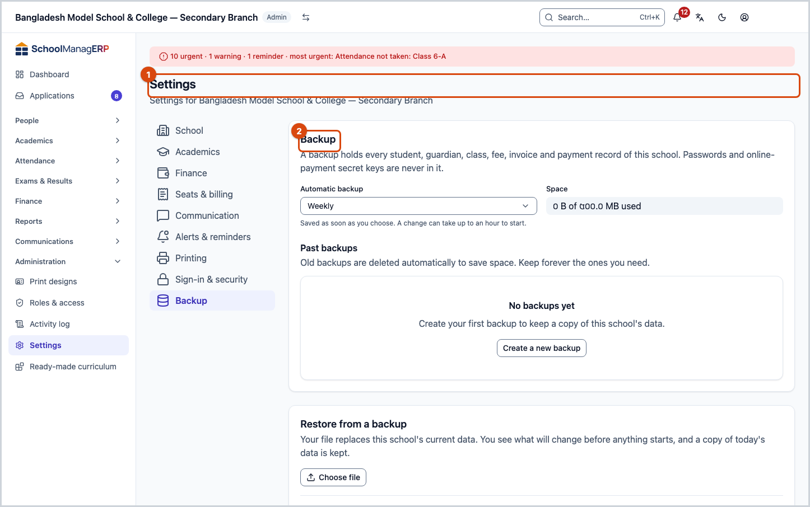

<!-- guide:meta
feature: administration.settings
title: Changing the school's settings
summary: Set the school's profile, academic rules, fee rules, communication, printing, sign-in, backup and alerts on one page, in nine categories.
roles: [ADMIN]
sources:
  - client-admin/src/routes/_staff/settings.tsx
  - client-admin/src/pages/SchoolSettingsPage.tsx
  - client-admin/src/pages/settings/
  - client-admin/src/features/sign-in-methods/
  - client-admin/src/features/push/
  - client-admin/src/features/billing/
  - client-admin/src/route-permissions.ts
  - server/src/modules/schools/
  - server/src/modules/workbook/
labels:
  [
    settings:*,
    backup:*,
    signInMethods:*,
    push:*,
    evaluations:acr.criteriaSettings.*,
    curriculumPreset:settingsLink.*,
    bulkImport:confirm,
    bulkImport:chooseFile,
    bulkImport:fileWrongType,
    nav:items.settings,
    nav:groups.administration,
  ]
helpIds:
  [
    administration.settings,
    administration.settings.field.logo,
    administration.settings.section.organisation#task-school,
    administration.settings.section.attendance#task-academics,
    administration.settings.field.autoAbsentEnabled,
    administration.settings.field.approvalMode,
    administration.settings.field.requireSecondApprover,
    administration.settings.section.lateFees#task-finance,
    administration.settings.action.buySeats#task-billing,
    administration.settings.field.smsProvider,
    administration.settings.section.smsCredit#task-communication,
    administration.settings.section.guardianSmsFallback#task-alerts,
    administration.settings.section.printers#task-printing,
    administration.settings.field.otpLoginEnabled,
    administration.settings.section.backup#task-backup,
    administration.settings.field.schedule,
    administration.settings.section.restore#task-restore,
  ]
devices: [desktop]
entry: [sidebar, palette]
keywords:
  [সেটিংস, স্কুল প্রোফাইল, লোগো, উপস্থিতি নীতি, বিলম্ব ফি, অনুমোদন, শিফট, settings, school profile, logo, late fee, প্রিন্টার, ব্যাকআপ, পুনরুদ্ধার, সাইন-ইন, printer, backup, restore, sign-in]
appVersion: 0.1.0 (94db6def4)
owner: tareq89
lastVerified: 2026-10-25
knownIssues: []
-->

# Changing the school's settings

Set the rules for how the school runs, on one page.

**Go to:** **Administration → [Settings](#task-main)** in the left menu. View this page on a computer.
**Before you start:** be an Admin. The menu of every other role does not have this page.

The **Settings** page is split into **categories**, such as **School** or **Finance**. Press a category in the list on the left and its parts open on the right. Every part has its own **Save** button; saving one part does not change the others.

[Change one setting](#task-main) · [School](#task-school) · [Academics](#task-academics) · [Finance](#task-finance) · [Problems and fixes](#trouble)

**On this page**

- [Change one setting](#task-main)
- [How to know it was saved](#confirm)
- [The categories](#other)
  - [School: profile, logo, shift, language and calendar](#task-school)
  - [Academics: attendance, evaluations, dashboard and more](#task-academics)
  - [Finance: fee rules](#task-finance)
  - [Seats & billing](#task-billing)
  - [Communication](#task-communication)
  - [Alerts & reminders](#task-alerts)
  - [Printing](#task-printing)
  - [Sign-in & security](#task-security)
  - [Backup](#task-backup)
- [Problems and fixes](#trouble)
- [Who can do what](#roles)
- [Learn more](#more)

---

## Change one setting 

1. Press **Administration** in the left menu, then press **Settings**.

   → The title **Settings** at the top. On the left, the list of categories: **School**, **Academics**, **Finance**, **Seats & billing**, **Communication**, **Alerts & reminders**, **Printing**, **Sign-in & security**, **Backup**. **School** is open first.

2. On the left, press the category you want to change.

   → The parts of that category show on the right, for example **School profile** or **Attendance policy**.

3. Change the fields in one part. If a part has **Advanced settings** at the bottom, press it to open the fields you need less often.

4. Press **Save** at the bottom of that part.

   → **Saved** shows next to the button.

> **Remember:** nothing goes to the school's system until you press **Save**. Only the logo is different: it is saved as soon as you pick the image.

---

## How to know it was saved 

| State                           | How to tell                                          | What next      |
| ------------------------------- | ---------------------------------------------------- | -------------- |
| **Changed on screen only**      | The field has the new value, but no message appeared | Press **Save** |
| **Reached the school's system** | The message **Saved** next to the button             | You are done   |

**To check:** refresh the page. The saved values come back in the fields.

**If no message came:** see [Problems and fixes](#trouble). What you typed stays in the fields as long as you do not leave the page.

---

## The categories 

### School: profile, logo, shift, language and calendar 

This category has four parts.

**1. School profile.** "Shown on receipts, invoices and printouts."

| Field                          | What to enter                                                     |
| ------------------------------ | ----------------------------------------------------------------- |
| **Name**                       | The school's name. It cannot be left empty.                       |
| **Name (Bengali)**             | The school's name in Bangla.                                      |
| **Phone**, **Email**           | The school's contact details.                                     |
| **EIIN / registration number** | The government registration number.                               |
| **Address**                    | The school's address.                                             |
| **Logo**                       | A PNG, JPEG or WebP image, up to 512 KB and 2048 pixels per side. |

To add a logo, press **Upload logo** and pick an image. It is saved as soon as you pick it; you do not need **Save**. The school's system keeps the image as a PNG of at most 512×512 pixels. To take the logo off, press **Remove logo**; at the question "Remove the school logo?" press **Remove**. Receipts and printouts then show no logo, and you can upload one again later.

**2. Shift, version & group.** Names used to arrange classes and sections, for example the shift "Morning" or the version "English". Type a name in the field and press **Add**; next to one, press **Rename** or **Remove**. Then press **Save**.

- The same name cannot be in one list twice.
- When you rename a name, the new name is also put on the classes and sections that had it, all at once.
- A name that a class or section still uses cannot be removed. A message shows and nothing is saved. Rename it instead.

**3. Language, numbers and dates.** "How numbers, money and dates appear on every page."

| Field                                     | What to choose                                                                                                                                                                                                                            |
| ----------------------------------------- | ----------------------------------------------------------------------------------------------------------------------------------------------------------------------------------------------------------------------------------------- |
| **Language of messages the school sends** | **Bangla (Bangladesh)** or **English (Bangladesh)**. SMS, emails, letters and alerts from this school use this language. It does not change anyone's screen: each person picks their own ([Changing the language](../start/language.md)). |
| **Numeral system**                        | **Bengali (০-৯)** or **Latin (0-9)**                                                                                                                                                                                                      |
| **First day of week**                     | The day the week starts                                                                                                                                                                                                                   |
| **Academic year start month**             | A month from 1 to 12                                                                                                                                                                                                                      |
| **Currency**                              | The symbol, **Symbol position**, **Decimal places** (0 to 4), **Number grouping** (**Lakh/crore** or **Thousand**); a sample shows below                                                                                                  |

Press **Advanced settings** for more fields: **Timezone**, **Currency code**, the phone number rule, the address parts and the ID number check rules. The app itself says: "Time zone, phone, address and ID rules. You rarely need to change these; a wrong value can stop phone or ID checks from working." If a field has a mistake, the part opens by itself.

**4. Calendar.** "Exams, holidays and terms are arranged with this."

- **What do you call a grading period?** — **Term**, **Semester** or **Trimester**.
- **Country** — public holidays come from this country.
- **Week start / weekend** — only shown here. To change it, press **Change the first day of the week** (the part above) or **Change weekly off days (Academics)**.

Holidays and events are added on the [**Calendar**](../people/calendar.md) page.

### Academics: attendance, evaluations, dashboard and more 

Each part saves on its own.

**Attendance policy.** "When a student counts as late or absent, and how the attendance rate is worked out."

| Field                                 | What it does                                                                                                    |
| ------------------------------------- | --------------------------------------------------------------------------------------------------------------- |
| **Weekly off days**                   | The days the school is closed. "Changes apply from today. Past days keep the off days that were in force then." |
| **Late after**                        | A student who arrives after this time is late.                                                                  |
| **Absent after**                      | A student who arrives after this time is absent.                                                                |
| **Correction window (days)**          | Past attendance can be corrected for this many days; 0 to 365.                                                  |
| **Low attendance threshold (%)**      | A student below this is shown as "low attendance"; 0 to 100.                                                    |
| **Percentage calculated over**        | **Working days** or **Marked days**.                                                                            |
| Three checkboxes                      | Count late as present, count leave as a working day, and allow marking future dates.                            |
| **Automatic absence message**         | Tell the guardian by itself when a student is absent, and **Send by** (the latest time to send).                |
| **Times per shift**                   | When the school has shifts, each one's own late and absent times. Leave a row empty to use the school's times.  |
| **Period attendance**                 | When on, teachers can take attendance in every period of the routine.                                           |
| **Special timings (Ramadan, winter)** | Different period times and late times, for some dates only.                                                     |

When you tick **Automatic absence message**, a question comes up: **Turn on automatic absence messages?** — "Enabling this sends every absent student's guardian a notification automatically, every school day. Are you sure?" Press **Yes, enable it**, then **Save**.

**Arrival notices.** Two switches, both off at first: **Send arrival notices** lets guardians ask to be told when their child reaches school (the **Arrival notices** card then shows on their Attendance page), and **Allow SMS for arrival notices** lets the message go by SMS, which uses the school's SMS credit. With only the first on, messages go in the app. Turning the first off also turns SMS off, so SMS has to be ticked again when notices come back on. Press **Save**. How guardians and teachers use it: [guardian](../portal/attendance.md#task-arrival), [class teacher](../academics/my-class.md#task-arrival).

To add a **special timing**, press **Add special timing**. Give a name (up to 60 characters), **From**, **To**, the shift, and the periods whose time you want to change. It will not save if two entries for the same shift have dates that overlap. How daily attendance is taken: [**Attendance**](../attendance/attendance.md).

**Evaluations.** **Send an SMS when a new incident report is filed**. The SMS only says that a new report exists, not what it says. Push notifications are always on. See: [**Evaluations**](../people/evaluations.md).

**Dashboard.** Three parts:

- **At-risk students** — a student is listed when any 2 of these signs match. The signs: **Absent in a row (days)** (1–30), **Attendance in the last 30 days below (%)** (1–100), **Failed subjects in the latest published exam (at least)** (1–20), **Oldest unpaid bill older than (days)** (1–365). The list updates a few minutes after you save.
- **Committee** — **Attendance target (%)** (1–100), a line on the committee's attendance chart.
- **Morning summary** — **Send at**. It is not sent on holidays.

See: [**Dashboard**](../dashboard/dashboard.md).

[**Study plans.**](../academics/syllabus.md) Who is told, and when, if a teacher does not report the status of every period.

- **Status deadline** — on the same school day; reporting after this still counts, but late.
- **Teacher reminder** — on the next school day, only if something is still open.
- **Tell the academic coordinator and admin after** — this many school days not reported; 1 to 10, holidays are not counted.
- **Weekly summary time** — on the last working day of the week, to guardians and the committee.
- **Also send the guardians' weekly summary by SMS** — push is always sent, at no cost. If you turn SMS on, it uses credit every week.

The box **What happens with these settings** at the top shows the current rules in plain words.

**Homework.** Two checkboxes; both are off until you turn them on: **Text guardians when homework is assigned** and **Text guardians when homework is not submitted**. See: [**Homework**](../academics/homework.md).

**Applications.** **Tell guardians the decision by SMS** — only the final decision (approved or rejected). The in-app notice always goes. See: [**Applications**](../applications/applications.md).

The SMS for evaluations, study plans, homework and applications go only when an SMS company is added in the [**Communication**](#task-communication) category. If none is, the part shows a warning and the link **Communication › add SMS company**.

**ACR criteria.** The criteria every ACR is scored against. Press **Add criterion**; for each one give the **Code**, the **Block** (**Block 2: Performance** or **Block 3: Personal qualities**), **Name (Bangla)** and **Name (English)**. To change the order, press **Move up** / **Move down**. Then press **Save criteria**.

- The code and both names are required; each code must be unique.
- Every save makes a new version. The change applies to new ACRs only; ACRs that already started keep the earlier criteria.

**Ready-made curriculum.** Here there is only a card and its link. A ready-made curriculum is added on the [**Ready-made curriculum**](curriculum-preset.md) page.

### Finance: fee rules 

This category has one part: **Fee rules**. "Approval, telling families and late fees — for every fee bill."

**Extra approval**

| Field                                               | What it does                                                                                                                                           |
| --------------------------------------------------- | ------------------------------------------------------------------------------------------------------------------------------------------------------ |
| **Approval method**                                 | How to confirm once more before a sensitive action: **OTP only** or **OTP or password**.                                                               |
| **Always need a second admin to reverse a payment** | When on, cancelling a payment always needs a second person. When off, if the school has only one admin, that admin can approve their own cancellation. |

**Notify families** — two checkboxes: **Notify by default for scheduled fee generation** and **Notify by default for manual fee generation**. They decide whether telling families is on at the start when bills are created ([**Fee bills created**](../finance/generate-fees.md), [**Automatic billing**](../finance/recurring-schedules.md)).

**Late fees** — "Tick the fees that get a late fee." One row for each fee type (except the late fee itself):

| Field          | What to enter                                                      |
| -------------- | ------------------------------------------------------------------ |
| Checkbox       | Whether this fee gets a late fee.                                  |
| **Grace days** | No late fee for this many days after the bill's due date; 0 to 60. |
| **Kind**       | **Percent** or **Flat amount**.                                    |
| **Value**      | For a percentage, 0 to 100. For a flat amount, zero or more taka.  |

"Changes apply from tomorrow's fee bills." A late fee is added to a bill only once; and only to a bill that has a due date and an amount still unpaid. A fine never gets a late fee ([**Fines**](../finance/fines.md)).

> **Remember:** late fees and the approval method involve money. Talk to the accountant before you change them.

### Seats & billing 

This category has one part: **Seats & billing**. "One seat is one student for one month." At the top there are three boxes: **Seats bought**, **Students using a seat**, and **Paid until** (in the free period, **Free until**).

**Buy seats**

1. Press **Buy seats**.
2. Enter **Seats (students)** and **Months**. The seats are filled in for you: as many as the students who have no seat, but at least 100.
3. See the **Total** below. The price is 10 taka per seat per month, so total = seats × months × 10 taka. The server works out the real price again.
4. Press **Create order**. The order is made in the state **Waiting for payment**.
5. Press **Pay with bKash**. You are taken to the bKash page. After you pay, bKash sends you back to this part.

| Field                | What to enter                     |
| -------------------- | --------------------------------- |
| **Seats (students)** | A whole number from 1 to 100,000. |
| **Months**           | A whole number from 1 to 24.      |

**When it starts.** If you buy as many seats as are active now, or more, it is a renewal: it starts on the day the current seats end, and months are added. If you buy fewer, it starts on the day you pay, and seats are added.

**After you come back from bKash** the part shows a message:

| Message                                          | What it means                                                                  |
| ------------------------------------------------ | ------------------------------------------------------------------------------ |
| **Payment received. Your seats are active.**     | You are done. The receipt is in the **Orders** list and is also sent by email. |
| **We are confirming your payment with bKash. …** | Wait; the page updates by itself and watches for at most 2 minutes.            |
| **We are still waiting for bKash. …**            | 2 minutes have passed. Check the list again after a few minutes.               |
| **This order was not paid. …**                   | Buy seats again and pay again.                                                 |

The **Orders** list shows the last 20 orders: **Date**, **Seats**, **Months**, **Amount**, **Status** and **Receipt**. Press the receipt number of a paid order to open the receipt.

**Expiry.** After the free period ends, you can keep as many active students as the seats you bought. From 30 days before the end, the message **Your seats end on … .** shows. If there are more active students than seats, the school becomes view-only for 7 days after the paid period ends, and then it is suspended. It starts again when you pay.

> **Remember:** this part uses real money. If money was taken but the order does not show as paid, wait a little; do not pay twice.

### Communication 

This category has five parts: **SMS**, **SMS credit**, **WhatsApp**, **Messenger** and **Email**. At the top of the **SMS**, **WhatsApp**, **Messenger** and **Email** parts it says **Set up** or **Not set up**. This comes from the saved details and does not change while you type.

The **Test connection** button tests with what is in the fields now, without saving. If it is fine it shows **Connection works**; then press **Save**.

After saving, a secret key or token is never shown in full again, only **Added — ends …**. Press **Change** to replace it, **Remove** to take it away.

**SMS** — "All SMS from this school go through this company."

| Field                       | What to enter                                                                                                                   |
| --------------------------- | ------------------------------------------------------------------------------------------------------------------------------- |
| **SMS company**             | **Greenweb**, **MimSMS** or **OneCodeSoft**.                                                                                    |
| **API key**                 | Copy it from the company's account page.                                                                                        |
| **Sender name (Sender ID)** | Required for MimSMS; optional for OneCodeSoft. Use the name the company approved.                                               |
| **API address (optional)**  | In the **Advanced settings** part. If empty, the company's own address is used.                                                 |
| **API address**             | Only for OneCodeSoft, and then it is required. Copy the base address from OneCodeSoft Dashboard › API; it must end with `/api`. |

Under **Test connection**, the SMS and Email parts also have **Send a test message**. Enter a phone number (or, for Email, an address) and press the button; a real message is sent with the details in the fields now. When it goes, the part says **Sent.** with the link **See it in Message log**. If the company refuses the message, the part says **Couldn't send the test message. Check the details and try again.**, and the link opens the failed messages. A school can send 20 test messages a day; after that it says so and you can try again the next day. You can type the number in Bangla digits too.

A saved key or password is used as it is; you do not need to type it again to test. If you change the server or API address, type the key or password again too.

| The part says                                                                   | What to do                                                                 |
| ------------------------------------------------------------------------------- | -------------------------------------------------------------------------- |
| **Not enough SMS credit to send the test message. …**                           | The school is on platform credit and has too little. Ask for more credit.  |
| **That number or address isn't valid. Check it and try again.**                 | Fix the number or address.                                                 |
| **We couldn't confirm it was sent. Check the Message log before trying again.** | The reply was lost. Open **Message log** first; the message may have gone. |

**SMS credit** — this part is view-only; you cannot change anything here. There are two kinds:

- **School's own SMS company — no credit needed**: the school pays its own company, so credit is not counted.
- **Platform credit**: every SMS uses credit. Only the platform's super admin adds credit.

One credit = one part of an SMS. An English message is 160 characters in one part (153 per part if longer). A Bangla message is 70 characters in one part (67 per part if longer). So a Bangla message uses more credit.

| Field                | What it means                                                                                  |
| -------------------- | ---------------------------------------------------------------------------------------------- |
| **Available**        | Credit that can be spent now.                                                                  |
| **Held for sending** | Set aside for SMS that have started sending. If they do not go, it comes back as **Returned**. |

Below is the **Credit history**, newest first, 25 to a page: **Added**, **Held**, **Used**, **Returned** or **Adjusted**. With platform credit, when credit is low, sending mass messages or reminders is held back. Set when the low-credit warning comes in the [Alerts & reminders](#task-alerts) category.

**WhatsApp** — your Meta Business account details.

| Field                      | What to enter                                                                       |
| -------------------------- | ----------------------------------------------------------------------------------- |
| **Phone number ID**        | Required. Find it in Meta's WhatsApp Manager; it is not a phone number.             |
| **Access token**           | Copy it from Meta Business.                                                         |
| **API version (optional)** | In the **Advanced settings** part. If empty, the version the app is set to is used. |

**Messenger** — the school's Facebook page.

| Field                | What to enter                                     |
| -------------------- | ------------------------------------------------- |
| **Facebook Page ID** | Required. Find it under the page's About section. |
| **Access token**     | Copy it from Meta Business.                       |

**Email** — "Emails from this school are sent through this server."

| Field                   | What to enter                                               |
| ----------------------- | ----------------------------------------------------------- |
| **Email server (SMTP)** | Required.                                                   |
| **Server username**     | Required.                                                   |
| **Send emails from**    | Required; a valid email address.                            |
| **Server password**     | The server's password.                                      |
| **Port**                | In the **Advanced settings** part; 1 to 65535. Usually 587. |

### Alerts & reminders 

This category has one part: **Alerts & reminders**. "Who is told about what, and when. Urgent rules cannot be switched off."

**The list of rules.** The rules are grouped by who they tell. Every row has a name, a mark for how important it is, and a switch. An urgent rule says **Can't be switched off**, and its switch cannot be pressed. A new school has every rule on. Some rules have a number field:

| Field                                           | What to enter      | At the start |
| ----------------------------------------------- | ------------------ | ------------ |
| **Grace time after the first period starts**    | 0 to 120 minutes   | 15           |
| **Remind teachers this long before a period**   | 0 to 60 minutes    | 10           |
| **Warn when SMS credit falls below**            | 0 to 100,000 SMS   | 200          |
| **Warn when failed messages in 24 hours reach** | 1 to 1000 messages | 10           |

**Also tell the academic coordinator and admin when attendance is very late** — a checkbox, on at the start.

**When reminders go out**

| Field                                     | At the start |
| ----------------------------------------- | ------------ |
| **Morning reminders at**                  | 07:00        |
| **Evening reminders (about tomorrow) at** | 17:00        |

**Quiet hours for push messages** — **Quiet hours start** (21:00 at the start) and **Quiet hours end** (07:00 at the start). "In this time only urgent alerts make a sound. The rest arrive when it ends."

**Guardians without the app**

| Field                                               | What it does                                                                                                          |
| --------------------------------------------------- | --------------------------------------------------------------------------------------------------------------------- |
| **Send an SMS when the app can't reach a guardian** | When on, a guardian who has no app or no push gets an SMS. Off at the start. This SMS does not go during quiet hours. |
| **Most SMS per guardian per day**                   | Shows only when the switch is on; 0 to 10, 2 at the start.                                                            |

> **Remember:** this SMS uses credit. If there is no credit, the SMS does not go ([SMS credit](#task-communication)).

### Printing 

This category has two parts: **Printers** and **Documents and certificates**. To see the category you need the permission to manage print templates, which the Admin has.

**Printers** — "Pick the printer here when you print." If there is no printer, the **Add printer** button shows. Every row in the list has three actions: **Print measuring page**, **Edit** and **Archive**.

| Field                                              | What to enter                                                             |
| -------------------------------------------------- | ------------------------------------------------------------------------- |
| **Name**                                           | Required; up to 80 characters.                                            |
| **Printer type**                                   | **Card printer** or **Office printer**.                                   |
| **Printing on both sides**                         | Whether the printer turns the paper itself or you turn the stack by hand. |
| **Cutting gap between cards (mm)**                 | Office printers only; 0 to 20.                                            |
| **Shift left–right (mm)** / **Shift up–down (mm)** | In the **Measurements (advanced)** part; −10 to 10.                       |
| **Size**                                           | In the **Measurements (advanced)** part; 0.90 to 1.10, 1 = actual size.   |

**Print measuring page** prints a test page and shows steps in three parts: measure from the corner of the paper to the first cross (it should be exactly 20 mm), enter the difference in **Change the shift**, then print again. This page does not go into any print record. When you archive a printer, the records of past prints stay. More: [**Setting up printers and sizes**](print-templates/printers-and-calibration.md).

**Documents and certificates** — "Rules for admit cards and certificate serial numbers."

| Field                                      | What it does                                                                                                                       |
| ------------------------------------------ | ---------------------------------------------------------------------------------------------------------------------------------- |
| **Withhold admit cards when fees are due** | When on, a family cannot print the admit card of a student with dues from the portal; staff can, with a warning. Off at the start. |
| **School short code (optional)**           | 2 to 8 capital letters or digits; it is printed before every serial number. An example number shows below.                         |

See: [**Exam documents**](print-templates/exam-documents.md), [**Certificates**](print-templates/certificates.md).

### Sign-in & security 

This category has one part: **Ways to sign in**. "How teachers, staff and guardians of this school sign in."

| Field                                           | What it does                                                                                                            | At the start |
| ----------------------------------------------- | ----------------------------------------------------------------------------------------------------------------------- | ------------ |
| **Allow sign-in with a code sent to the phone** | When on, people can sign in without a password using a code that comes to the phone. When off, only the password works. | On           |

> **Careful:** before you turn it off, make sure everyone has a password. Someone who signs in only with a code must sign in with a password after it is off.

- **More than one school:** if someone is in several schools, sign-in with a code is off for them as soon as the switch is off in any one school. Then, to add a new school, they must first sign in with a password.
- **What is not here:** each person sees their own password, connecting Google or Facebook, and their own devices on the **Security** page of their own account ([**Your account**](../start/account.md#task-methods)). There, to remove the last way in, a password must be set first. Each person also turns on their own push notifications ([**Seeing and settling alerts**](../dashboard/alerts.md)); the school's quiet hours are in [**Alerts & reminders**](#task-alerts).

### Backup 

This category has two parts: **Backup** and **Restore from a backup**. To see the category you need the permission to manage backups, which the Admin has.

**What a backup holds:** this school's data in one .xlsx file, one sheet for each kind: the school profile, academic years, classes, sections, subjects, holidays, users, teachers, guardians, students, enrollments, fees, invoices, payments, exams and results, routines, and more.

**What it never holds:** passwords and the secret keys of online payment. These are also not in it yet: student attendance sessions and records, attendance devices, student wallets, discount rules, automatic billing schedules, fee generation runs, terms, SMS credit, and the answers to anonymous surveys.

#### Take a backup 

1. Press **Create a new backup**.

   → "We'll email you when it's ready." A new row comes in the **Past backups** list: **Queued**, then **In progress**, then **Done**.

2. Press **Download** on the row, or open the link in the email.

   → The link opens the **Backup** category on this page (the address ends with `?backup=<job number>`) and the file starts downloading by itself.

**Automatic backup** — **Off**, **Weekly** or **Daily**. Off at the start. It is saved as soon as you choose; it can take up to an hour to start. When an automatic backup succeeds, no email comes; when it fails, every admin of the school gets an email. For a backup you took yourself, whoever took it gets an email, whether it succeeded or failed.

**How long things are kept**

| Rule                            | What happens                                                                                                                 |
| ------------------------------- | ---------------------------------------------------------------------------------------------------------------------------- |
| Download time                   | 30 days after the backup finishes (not for a backup you pressed **Keep forever**). After that it shows **Download expired**. |
| Backups you took yourself       | The newest 3 are kept; older ones are deleted by themselves.                                                                 |
| Automatic backups               | The newest 8 are kept.                                                                                                       |
| The copy taken before a restore | Kept for 30 days.                                                                                                            |
| Total space                     | 500 MB for each school. If it goes over, the oldest backup is deleted. The **Space** field shows the use.                    |

Press **Keep forever** and that backup is not deleted by itself.

#### Restore from a backup 

> **Warning: this cannot be undone.** When you restore, this school's current data is replaced by the data in the file. Rows that are not in the file are deleted (the school profile, printers and print designs are not deleted). Whatever you added or changed after the backup is lost.

1. With **Choose file**, give an .xlsx backup from this app (up to 64 MB).

   → The file is checked. Nothing changes yet. The **What will change** table shows, for each kind of data, the numbers **Create**, **Update**, **Unchanged** and **Delete**, with warnings.

2. Look at the table carefully. If a red line says "… records will be deleted", stop and be sure.

3. In the box, type the school's name exactly. If the name does not match, **Confirm** cannot be pressed. It also cannot be pressed if the file has an error or there is nothing to change.

4. If you want, tick **Send invitations to restored users**. Restored users have no passwords.

5. Press **Confirm**.

   → First a copy of the current data is kept (**Copy taken before a restore**). Then the kinds of data are put in one by one. At the end: **Restore complete** and the numbers for each kind.

**While it runs:** the school is view-only; nobody can save anything. Only one restore runs at a time.

**Users:** existing users keep their passwords. But each user's role in this school becomes the one in the file, and people who are not in the file are removed from this school (the account that first set up the school is kept). **What does not change:** payments, invoices, student fees, exams, marks/results, exam parts and grading scales are only added; earlier rows are not changed or deleted. To correct those, use the app itself. A backup of another school cannot be restored here; only platform support can do that.

**If it stops halfway:** it shows "The restore stopped at …". The kinds before that were already put in. To go back, press **Download the copy taken before the restore**, then restore that file the same way. There is no separate "go back" button.

**First data in a new school:** **Download starter file** gives a small file with only academic years, classes, sections, subjects and fee structures. To bring a whole school from another system, use **Download blank template**. An empty template deletes nothing.

---

## Problems and fixes 

| What you see                                                                             | What to do                                                                                                                           | Who can help |
| ---------------------------------------------------------------------------------------- | ------------------------------------------------------------------------------------------------------------------------------------ | ------------ |
| **Settings** is not in the menu                                                          | This page is only for the Admin.                                                                                                     | Admin        |
| **Couldn't load settings for this school. Try refreshing the page.**                     | Refresh the page.                                                                                                                    | Admin        |
| **Couldn't save. Try again.**                                                            | Check the internet and press **Save** again. What you typed is not lost.                                                             | Admin        |
| **You don't have permission to do this.**                                                | Only the Admin can do this.                                                                                                          | Admin        |
| **Couldn't upload that image. …**                                                        | Use a PNG, JPEG or WebP image, up to 512 KB and 2048 pixels.                                                                         | Admin        |
| **That file is larger than 512KB.**                                                      | Make the image smaller and give it again.                                                                                            | Admin        |
| **"…" is still used by classes or sections, so it can't be removed. Rename it instead.** | Press **Undo remove**, then change the name, or first take the name off that class/section ([**Classes**](../academics/classes.md)). | Admin        |
| **Another entry for the same shift already covers some of these dates.**                 | Change the dates of the special timing so they do not overlap.                                                                       | Admin        |
| **Code and both names are required.** / **Each code must be unique.**                    | Fill in every ACR row and keep the codes different.                                                                                  | Admin        |
| SMS is not going, a warning in the part                                                  | Add an SMS company in the [**Communication**](#task-communication) category.                                                         | Admin        |
| **This file type isn't supported — choose a .csv or .xlsx file**                         | Give an .xlsx backup taken from this app.                                                                                            | Admin        |
| **Confirm** cannot be pressed                                                            | Type the school's name exactly. Also check the **What will change** table for an error, or nothing to change.                        | Admin        |
| **This backup is bigger than this app can restore. You can still download it.**          | Download the file and keep it.                                                                                                       | Support      |
| **Download expired** / **This backup has expired — request a new one.**                  | 30 days have passed or the backup was deleted. Press **Create a new backup**.                                                        | Admin        |
| **The restore stopped at …**                                                             | **Download the copy taken before the restore**, then restore it.                                                                     | Admin        |
| Nothing saves while a restore is running                                                 | Wait until the restore ends.                                                                                                         | Admin        |
| **Your browser blocked the print window. …**                                             | Allow pop-ups for this site and press **Print measuring page** again.                                                                | Admin        |
| **Printing** or **Backup** is not in the category list                                   | These two categories show only with a separate permission ([Who can do what](#roles)).                                               | Admin        |

---

## Who can do what 

| Role                                                                                       | See this page | Change anything |
| ------------------------------------------------------------------------------------------ | ------------- | --------------- |
| Admin                                                                                      | Yes           | Yes             |
| Accountant, Academic coordinator, Teacher, Exam controller, Office staff, Committee member | No            | No              |

To open this page you need the permission to change settings, which only the Admin has. Some categories need a separate permission too:

| Category            | What is needed                                              |
| ------------------- | ----------------------------------------------------------- |
| **Printing**        | The permission to manage print templates (the Admin has it) |
| **Backup**          | The permission to manage backups (the Admin has it)         |
| **Seats & billing** | This category does not show to the platform's super admin   |

See: [**Roles & access**](roles.md).

---

## Learn more 

<strong>What the fields mean</strong>

<!-- guide:generated:fields:settings -->

| Field                                           | What to enter                                                                                                                                                                                   | Required?   |
| ----------------------------------------------- | ----------------------------------------------------------------------------------------------------------------------------------------------------------------------------------------------- | ----------- |
| Name                                            | The school's name. It shows on receipts, invoices and printouts. It cannot be left empty.                                                                                                       | Yes         |
| Logo                                            | PNG, JPEG or WebP, up to 512 KB and 2048 pixels per side. It saves as soon as you pick the image.                                                                                               | No          |
| Shift, version & group                          | Names used to arrange classes and sections. A value that a class or section still uses cannot be removed; rename it instead.                                                                    | No          |
| Academic year start month                       | The month the academic year starts, 1 to 12.                                                                                                                                                    | No          |
| What do you call a grading period?              | What a grading period is called in exams and results: Term, Semester or Trimester.                                                                                                              | No          |
| Country                                         | Public holidays come from this country.                                                                                                                                                         | No          |
| Late after                                      | A student who arrives after this time is marked late.                                                                                                                                           | Yes         |
| Absent after                                    | A student who arrives after this time is marked absent.                                                                                                                                         | Yes         |
| Correction window (days)                        | Past attendance can be corrected for this many days; 0 to 365.                                                                                                                                  | Yes         |
| Low attendance threshold (%)                    | A student below this is shown as low attendance; 0 to 100.                                                                                                                                      | Yes         |
| Automatic absence message                       | When on, the guardian of every absent student gets a message automatically, every day. You confirm once before it turns on.                                                                     | No          |
| Arrival notices                                 | When on, a guardian who asks for it gets a message when their child arrives at school.                                                                                                          | No          |
| SMS for arrival notices                         | When on, the arrival message can go by SMS, which spends the school's SMS credit.                                                                                                               | No          |
| Tell the head teacher and admin after           | If a status is not reported for this many school days, the head teacher and admin are told; 1 to 10, holidays are not counted.                                                                  | No          |
| Approval method                                 | How an admin confirms once more before a sensitive action: OTP only, or OTP or password.                                                                                                        | No          |
| Always need a second admin to reverse a payment | When on, cancelling a payment always needs a second person. When off, the only admin can approve it themselves.                                                                                 | No          |
| Grace days                                      | No late fee is charged for this many days after the bill's due date; 0 to 60.                                                                                                                   | No          |
| Value                                           | For a percentage, 0 to 100. For a flat amount, zero or more taka.                                                                                                                               | No          |
| SMS company                                     | The company all of this school's SMS go through. Test the connection before you change it.                                                                                                      | No          |
| Sender name (Sender ID)                         | Required for MimSMS; optional for OneCodeSoft. Use the name the company approved.                                                                                                               | MimSMS only |
| Phone number ID                                 | The long number in Meta's WhatsApp Manager, not a phone number. It cannot be left empty.                                                                                                        | Yes         |
| Facebook Page ID                                | The ID of the school's Facebook page. Find it under the page's About section. It cannot be left empty.                                                                                          | Yes         |
| Send emails from                                | The address the recipient sees. Enter a valid email address.                                                                                                                                    | Yes         |
| Port                                            | 1 to 65535; usually 587. Do not change it unless your email server says so.                                                                                                                     | No          |
| Withhold admit cards when fees are due          | When on, a family cannot print the admit card of a student with dues from the portal. Staff can still print it, with a warning. Off at the start.                                               | No          |
| School short code (optional)                    | 2 to 8 capital English letters or digits. It goes before every certificate serial number. It can be left empty.                                                                                 | No          |
| Name                                            | 1 to 80 characters. You pick the printer by this name when you print.                                                                                                                           | Yes         |
| Shift left–right (mm)                           | Enter how many mm the measuring page printed off; −10 to 10. The up–down field has the same limit.                                                                                              | No          |
| Size                                            | 1 means actual size; 0.90 to 1.10.                                                                                                                                                              | No          |
| Cutting gap between cards (mm)                  | Office printers only; 0 to 20 mm.                                                                                                                                                               | No          |
| Allow sign-in with a code sent to the phone     | When off, everyone in this school must sign in with a password. If someone is in several schools, sign-in with a code is off for them as soon as it is off in any one of them. On at the start. | No          |

<!-- /guide:generated -->

<!-- guide:generated:fields:backup -->

| Field                              | What to enter                                                                                                                                                                                | Required? |
| ---------------------------------- | -------------------------------------------------------------------------------------------------------------------------------------------------------------------------------------------- | --------- |
| Automatic backup                   | Off, weekly or daily. It saves as soon as you choose; a change can take up to an hour to start. No email is sent when an automatic backup succeeds; if one fails, every admin gets an email. | No        |
| Choose file                        | An .xlsx backup taken from this app, up to 64 MB. It is only checked; nothing changes before you press Confirm.                                                                              | No        |
| Type the school's name to confirm  | Type the school's name exactly. If it does not match, the restore does not start.                                                                                                            | Yes       |
| Send invitations to restored users | Restored users come back without passwords. Tick this to email them an invitation. Not ticked at the start.                                                                                  | No        |

<!-- /guide:generated -->

<strong>How settings work</strong> — categories, parts and saving

<figure>
  
  <figcaption><em>The categories and parts of Settings</em></figcaption>
</figure>

- **Every part is separate:** saving one part changes only the values of that part.
- **It applies across the whole school:** for example, when you change **Language, numbers and dates**, money and dates show the new way on every page.
- **Who changed it:** every save is kept in the [**Activity log**](audit-logs.md).

**Related pages**

- [**Roles & access**](roles.md) — who can open Settings.
- [**Taking attendance**](../attendance/attendance.md) — where the attendance policy applies.
- [**Creating fee bills**](../finance/generate-fees.md) — where the fee rules apply.
- [**Ready-made curriculum**](curriculum-preset.md) — put the subjects and classes of a new school in at once.
- [**Setting up printers and sizes**](print-templates/printers-and-calibration.md) — add a printer and fix its measurements.
- [**Your account**](../start/account.md) — your own ways to sign in and your devices.
- [**Seeing and settling alerts**](../dashboard/alerts.md) — your own push notifications.
- [**Printing ID cards, certificates and exam papers**](print-templates.md) — print designs; printer settings are here
- [**Send a message**](../communications/send-message.md) — sending a message to one guardian
- [**Activity log**](audit-logs.md) — who changed what, and when

---

_Version 0.1.0 · Last checked 2026-10-25_
