<!-- guide:meta
feature: administration.smsPackages
title: Buying an SMS package
summary: See how many SMS your school has left and when they end, buy a package with bKash, and know what to do when SMS are almost finished.
roles: [ADMIN]
sources:
  - client-admin/src/pages/settings/SmsCreditSection.tsx
  - client-admin/src/pages/settings/SmsCreditSectionView.tsx
  - client-admin/src/pages/settings/SmsBundlesPanel.tsx
  - client-admin/src/pages/settings/BuySmsBundleDialog.tsx
  - client-admin/src/pages/settings/SmsSourceCard.tsx
  - server/src/modules/sms-bundles/
labels: [smsBundles:*, settings:smsCredit.*]
helpIds: []
devices: [desktop]
entry: [sidebar, dashboard:attention]
keywords: [sms package, buy sms, sms credit, sms expiry, bkash, unmasked sms, এসএমএস প্যাকেজ, এসএমএস কিনুন]
appVersion: 0.1.0 (cce2fcbf9)
owner: tareq89
lastVerified: 2026-11-14
knownIssues:
  - { id: no-switch-back-button, checked: 2026-11-14, issue: 4145 }
  - { id: no-package-receipt-link, checked: 2026-11-14, issue: 4146 }
-->

# Buying an SMS package

Your school needs SMS credit to send messages. Here you see how many SMS are left, buy more with bKash, and learn when they end.

**Go to:** **Administration → [Settings](settings.md)** in the left menu, then the category **Communication**, then the part **SMS credit**. View this page on a computer.
**Before you start:** be an Admin. Your school must send SMS with **SchoolManagerP SMS**. If it sends with its own SMS company, [switch first](#task-own).

Buying SMS is like buying a recharge: you pay once, the SMS are added, each SMS part you send uses one (a long message, or one in Bangla, is more than one part; see [Settings](settings.md#task-communication)), and what you do not use ends on the end date.

[Buy a package](#task-main) · [Expiry](#task-expiry) · [Almost finished](#task-low) · [Own SMS company](#task-own) · [Problems and fixes](#trouble)

**On this page**

- [How to come to this page](#arrive)
- [Buy a package](#task-main)
- [How to know it was paid](#confirm)
- [Other situations](#other)
  - [When your SMS end](#task-expiry)
  - [The red notice "SMS is almost finished or has stopped"](#task-low)
  - [Your school sends with its own SMS company](#task-own)
  - [The sender shows as a number](#task-unmasked)
  - [The receipt](#task-receipt)
- [Problems and fixes](#trouble)
- [Who can do what](#roles)
- [Learn more](#more)

---

## How to come to this page 

**From the red notice**

1. On the dashboard you see the red card **SMS is almost finished or has stopped**, with how many SMS are left.
2. Press **Buy SMS**. → **Settings → Communication** opens and a window **Buy … SMS** for the smallest package is already open. Press **Cancel**, or pick another in the **Package** box, if you want a different one.

**From the menu**

1. Open **Administration → Settings**, press **Communication**, then **SMS credit**.

---

## Buy a package 

1. Under **Your SMS** read how many are left and when they end. Under **SMS packages** every package shows its number of SMS, its price and "Valid … days".

   → Each package has a **Buy** button.

2. Press **Buy** on the package you want. A window "Buy … SMS" opens with the price and the days.
3. Press **Buy with bKash**.

   → **Order ready.** "… SMS for …. Pay with bKash to add them."

4. Press **Pay with bKash**. You go to the bKash page. Pay there. bKash sends you back to this part.

<figure>
  
  <figcaption><em>From choosing a package to the last SMS</em></figcaption>
</figure>

> **Remember:** this uses real money. If money was taken but the SMS do not show, wait a little. Do not pay twice.

---

## How to know it was paid 

| What you see                                     | What it means                   | What next                                     |
| ------------------------------------------------ | ------------------------------- | --------------------------------------------- |
| **Payment received. Your SMS is added.**         | You are done.                   | The number under **Your SMS** went up.        |
| **We are confirming your payment with bKash. …** | bKash has not answered yet.     | Wait. The page updates by itself.             |
| **We are still waiting for bKash. …**            | It took longer than usual.      | Look at this page again in a few minutes.     |
| **This order was not paid. …**                   | The payment did not go through. | Press **Buy** and pay again.                  |
| **We could not confirm the payment. …**          | The page could not check.       | If money was taken, your SMS shows here soon. |

---

## Other situations 

### When your SMS end 

Every package has an end date: the day you pay plus the days written on the package. Under **Your SMS** each part shows how many are left and its end date. A part that ends within 7 days shows **Ends soon**.

SMS left on the end date are lost. They cannot be sent. SMS from the part that ends first are used first.

**Example.** On 1 November you buy a package of 1,000 SMS valid 30 days. It ends on 1 December. If 200 are still unused that day, those 200 end.

You also get a card **Some SMS will expire soon** from 7 days before (amber) and again when 1 day is left (red). It says how many SMS end and on which date. Send your messages before that date, or buy a new package.

### The red notice "SMS is almost finished or has stopped" 

When few SMS are left, or none, this red card shows for admins. It says "… SMS are left. When none are left, sending stops and absence notices and reminders do not go out." Press **Buy SMS** and buy a package. The card goes away on its own once the new package is added.

### Your school sends with its own SMS company 

If your school sends with its own SMS company, the packages are shown but the SMS you buy cannot be used until you switch. When you press **Buy**, the card **Send with SchoolManagerP SMS** opens: "Right now your school sends SMS through its own SMS company. To use the SMS you buy here, switch to SchoolManagerP SMS."

Press **Switch and continue**. The buy window opens. Press **Not now** to stay as you are. The same card also shows lower in the **SMS credit** part, with the button **Switch to SchoolManagerP SMS**. Your own SMS company details stay saved: "Your own SMS company details stay saved."

> **Not built yet:** the card says "You can switch back in one click", but there is no button on this page to switch back to your own SMS company. Your saved details are kept, so nothing is lost when it is added.

### The sender shows as a number 

Under the packages you read: "For now SchoolManagerP only sends unmasked SMS (the sender shows as a number, not your school's name)." So for now guardians see a phone number as the sender, not your school's name.

### The receipt 

Every paid package gets a numbered receipt, in the same series as your seat receipts. This page does not show a link to download it yet; that is not built.

---

## Problems and fixes 

| What you see                                              | What to do                                                                 | Who can help     |
| --------------------------------------------------------- | -------------------------------------------------------------------------- | ---------------- |
| **We could not load the SMS packages. Try again.**        | Press **Try again**.                                                       | —                |
| **No SMS packages are on sale right now.**                | Come back later.                                                           | Biddaloy support |
| **We cannot sell SMS right now. Please try again later.** | Wait and try later.                                                        | Biddaloy support |
| **Something went wrong. Try again.**                      | Press **Buy with bKash** again.                                            | —                |
| **We could not switch. Try again.**                       | Press **Switch and continue** (or **Switch to SchoolManagerP SMS**) again. | —                |

---

## Who can do what 

| Role                    | See SMS left | Buy a package |
| ----------------------- | ------------ | ------------- |
| Admin                   | Yes          | Yes           |
| Every other school role | No access    | No access     |

---

## Learn more 

<strong>Why do SMS end?</strong>

Packages are sold with a number of days. An end date keeps every package the same kind of deal and stops old, unused SMS from piling up.

**Related pages**

- [**Changing the school's settings**](settings.md) — the Settings page this part lives in.
- [**Using a coupon**](seat-coupon.md) — a coupon for seats.

---

_Version 0.1.0 · Last checked 2026-11-14_
