<!-- guide:meta
feature: administration.supportAccess
title: Biddaloy support access
summary: Decide whether Biddaloy support may log in to your school, read the 90-day list, approve or turn down a request, and end a login that is live.
roles: [ADMIN]
sources:
  - client-admin/src/pages/settings/SupportAccessSection.tsx
  - client-admin/src/pages/settings/SupportAccessSessionsList.tsx
  - client-admin/src/routes/welcome.support-access.tsx
  - client-admin/src/routes/_staff/support-access/
  - server/src/modules/support-access/
labels: [supportAccess:*, supportWelcome:*, supportBanner:*]
helpIds: [administration.supportAccess]
devices: [desktop]
entry: [sidebar, palette]
keywords: [support access, biddaloy support, allowed, ask each time, blocked, emergency, সহায়তা প্রবেশ]
appVersion: 0.1.0 (485d3ac71)
owner: tareq89
lastVerified: 2026-11-12
knownIssues: []
-->

# Biddaloy support access

You decide who from Biddaloy can sign in to your school, and you can see every time they did.

**Go to:** **Administration → [Settings](settings.md)** in the left menu, then the category **Biddaloy support access**. View this page on a computer.
**Before you start:** be an Admin. Only a school admin can change this; Biddaloy never changes it for you.

If something goes wrong at your school, Biddaloy support can log in to help. You can see who logged in, why, and for how long.

[Choose](#task-main) · [Read the list](#task-list) · [Approve a request](#task-approve) · [End a login](#task-end) · [Problems and fixes](#trouble)

**On this page**

- [Choose who can log in](#task-main)
- [How to know it was saved](#confirm)
- [Other situations](#other)
  - [Emergency access](#task-emergency)
  - [Read the last 90 days](#task-list)
  - [Approve or say Not now to a request](#task-approve)
  - [End a login that is live](#task-end)
  - [The first sign-in page](#task-welcome)
- [Problems and fixes](#trouble)
- [Who can do what](#roles)
- [Learn more](#more)

---

## Choose who can log in 

1. Open **Administration → Settings** and press **Biddaloy support access**.

   → "Choose whether Biddaloy support can log in to help your school."

2. Pick one of the three choices.

   | Choice            | In plain words                                                                  |
   | ----------------- | ------------------------------------------------------------------------------- |
   | **Allowed**       | Biddaloy support can log in when they need to. You see every login in the list. |
   | **Ask each time** | Biddaloy support must ask, and an admin here approves each time.                |
   | **Blocked**       | Biddaloy support cannot log in. Anyone logged in now is ended at once.          |

   Under the choice the page tells you what saving will do, for example "Saving makes Biddaloy support ask for your approval each time."

3. Press **Save**. If you picked **Blocked**, you are asked "Block Biddaloy support?"; press **Block**.

   → **Saved.**

<figure>
  
  <figcaption><em>Your three choices, and emergency access</em></figcaption>
</figure>

---

## How to know it was saved 

| What you see                   | What it means           | What next                              |
| ------------------------------ | ----------------------- | -------------------------------------- |
| **Saved.** next to the button  | Your choice is in force | —                                      |
| **Could not save. Try again.** | Nothing changed         | Check your internet and press **Save** |

---

## Other situations 

### Emergency access 

Even when you choose **Blocked**, emergency access still exists. Biddaloy support must give a reason, and your admins are told right away. It starts as view only. If Biddaloy support asks to write, a request arrives; when an admin presses **Approve**, the view-only lock on that visit is removed and they can change your school's data. **Not now** keeps the lock. Read the reason before you approve. It shows in the list as **Emergency**.

### Read the last 90 days 

Under **Last 90 days** the table "Biddaloy support logins in the last 90 days" has the columns **Who**, **When**, **Reason**, **Type** (**Normal** or **Emergency**), **Changes** and **Action**. **View only** is written on a visit that could change nothing. A visit that is still going shows **Logged in now**. Below it, **Other actions by Biddaloy support** lists anything else Biddaloy support did in your school in the last 90 days. This page shows at most 100 logins and has no next page, so with more than 100 in the last 90 days you will not see them all. If the list is empty it says nobody logged in during that time.

### Approve or say Not now to a request 

With **Ask each time**, a request shows under **Requests**. Press **Open**.

1. Read "Biddaloy support asks to log in as (name) (role)", the **Reason**, when it was asked and "Valid until (time)".
2. Press **Approve**, or **Not now**. The first answer counts, so you cannot change it after.

   → **Approved. Biddaloy support can log in now.** or **Not now. Biddaloy support was told.**

A request that ran out says "This request has run out. Biddaloy support can ask again." Press **Back to settings** to leave.

### End a live login 

In the list, on the row marked **Logged in now**, press **End**, then confirm "End this login?" The person leaves your school at once. Choosing **Blocked** ends every live login too.

### The first sign-in page 

The first time an admin signs in, the page **Biddaloy support access** shows **Allow Biddaloy support access**, already ticked. Leave it ticked and Biddaloy support can log in; clear it and they cannot. Decide what you want, then press **Save and continue**. "You can change this later in Settings."

---

## Problems and fixes 

| What you see                             | What to do                                  | Who can help |
| ---------------------------------------- | ------------------------------------------- | ------------ |
| **Could not open this part. Try again.** | Press **Try again**                         | —            |
| **We could not find this request.**      | Open it again from **Requests** in Settings | —            |
| **This request was already approved.**   | Nothing to do                               | —            |
| **Could not end it. Try again.**         | Press **End** again                         | —            |

---

## Who can do what 

| Role                    | Change the choice, answer requests, end a login |
| ----------------------- | ----------------------------------------------- |
| Admin                   | Yes                                             |
| Every other school role | No access                                       |

---

## Learn more 

<strong>Why can Biddaloy sign in?</strong>

When something breaks, a person who can see your school's screen finds the cause faster. You stay in charge: you choose, you see every login, and you can end one.

**Related pages**

- [**Changing the school's settings**](settings.md) — the Settings page this part lives in.
- [**Logging in as a school's person**](../platform-owner/login-as.md) — what the Biddaloy side does.

---

_Version 0.1.0 · Last checked 2026-11-12_
