<!--
guide:meta
feature: administration.website
title: School website
summary: Set up your school website in a few steps, look at it first, publish it, and turn it on or off.
roles: [ADMIN]
sources:
  - client-admin/src/routes/_staff/website/index.tsx
  - client-admin/src/routes/_staff/website/-wizard.tsx
  - client-admin/src/routes/_staff/website/-theme-card.tsx
  - client-admin/src/routes/_staff/website/pages.tsx
  - client-admin/src/routes/_staff/website/design.tsx
  - client-admin/src/routes/_staff/website/address.tsx
  - client-admin/src/routes/_staff/website/analytics.tsx
  - client-admin/src/routes/_staff/website/gallery.tsx
  - client-admin/src/routes/_staff/website/-gallery-section-card.tsx
  - client-admin/src/routes/_staff/exams/-detail/website-publish-dialog.tsx
  - site/src/pages/[lang]/results.astro
  - site/src/pages/[lang]/gallery.astro
  - client-admin/src/routes/_staff/website/-section-editor-modal.tsx
  - client-admin/src/routes/_staff/website/-announcements-editor.tsx
  - client-admin/src/routes/_staff/website/-draft-editor.tsx
labels: [website:*, nav:items.website, nav:groups.administration]
helpIds: [administration.website]
devices: [desktop]
entry: [sidebar, palette]
keywords: [website, web address, publish, homepage, site, preview, ওয়েবসাইট]
appVersion: 0.1.0 (e7daf66d4)
owner: tareq89
lastVerified: 2026-11-07
knownIssues: []
-->

# School website

Set up a public website for your school, see it before anyone else, then publish it.

**Go to:** **Administration → Website** in the left menu. Do this work on a computer.

**Before you start:** be an Admin. Other roles do not see this page ([who can do what](#roles)).

The **website** is the public page of your school, at its own web address. People do not need to log in to read it. Only what you **publish** is visible.

<figure>
  
  <figcaption><em>How the school website goes live</em></figcaption>
</figure>

[Set up the website](#task-main) · [Change the web address](#task-address) · [Use your own address](#task-own-address) · [See visitors](#task-visitors) · [Publish changes](#task-publish) · [Turn the website off or on](#task-onoff) · [Problems and fixes](#trouble)

---

## Set up the website 

1. Open **Administration → Website**. If you have no website yet, press **Set up website**.

   → The **Set up your school website** page opens with three steps: **Web address**, **Design**, **Publish**.

2. In **Your web address**, type a short name, for example `greenfield`. Use 3 to 30 English letters, numbers or hyphens. Do not start or end with a hyphen.

   → The page checks it: **This address is free.** or **This address is already used. Try another one.** You can also pick one from **Addresses we suggest**.

3. Press **Next**. Pick a **design**, then **colours**, then a **text style**.
4. Press **Next**. You can add the school logo (optional, JPG, PNG or WebP, under 20 MB). Press **Use this photo** to keep it.
5. Press **Publish and turn on**.

   → **Your website is ready.** The website is on and everyone can see it at its link.

> **Remember:** nothing is public until you press **Publish and turn on** here, or **Publish** on the overview page.

---

## Edit pages 

1. Open **Administration → Website**, then the **Pages** tab.
2. Pick a page: **Home**, **About us**, **Academics** and so on.
3. Switch a section on or off, or use the up and down arrows to move it. The front banner always stays first.
4. Press **Edit** beside a section. Write the Bangla text, and the English text if you want it. Add photos if the section has a place for them.
5. Press **Save**. The editor closes. → **You have changes that are not saved.** shows at the bottom.
6. Press **Save draft**. → **Saved.**

> **Remember:** the website does not change for visitors until you press **Publish** on the **Overview** tab. Unsaved changes stay while you move between tabs, but are lost if you reload the page.

## Add an announcement 

1. On the **Pages** tab, find the **Announcements** card at the top.
2. Press **Add an announcement**. You can keep at most 5.
3. Write the Bangla text (needed). English is optional. Add a link that starts with `/`, like `/notices`, if you want one.
4. Pick **Show from** and **Show until** dates if the announcement is only for some days.
5. Choose **How it shows**: **Moving text** or **Still text**.
6. Press **Save draft**.

## Change the design 

1. Open the **Design** tab.
2. Press another design. A box asks **Change the design?** Your own text stays; only empty fields get the new design's text.
3. Press **Change design**, then **Save draft**.
4. To see a design first, press **Preview this design** under it.

## Change colours and fonts 

1. Open the **Design** tab.
2. Under **Colours**, press the colour set you like.
3. Under **Text style**, pick a font for **Bangla** and one for **English**.
4. Press **Save draft**. To see the result, press **Preview**.

---

## Change the web address 

1. Open **Administration → Website**, then the **Address** tab.
2. In **Web address** press **Change the address**.
3. Type the **New address**, or press one of the **Addresses we suggest**. → The page checks it: **This address is free.** or **This address cannot be used. Try another one.**
4. Press **Save address**, then confirm **Change address**.
   → **Web address changed.** The old address keeps working for 30 days and sends people to the new one.

## Use your own address 

If your school already owns an address, like `www.myschool.edu.bd`, your website can open on it too. The **Your own address** card shows only when this is available for your school.

1. On the **Address** tab, type your address in **Your address**, then press **Add**.
2. The card shows two lines, **Line 1** and **Line 2**. Press **Copy** beside each **Name** and **Value**.
3. Go to the place where you bought your address. Add these two lines in its address settings.
4. Wait. The card checks by itself. The chip changes: **Waiting for the two lines**, then **Almost ready**, then **Working**. This can take a few hours.
5. Press **Check again** if you want to look now. You can press it once a minute.

To stop using it, press **Remove this address**, then confirm **Remove**. Your website keeps working on the web address above.

## See visitors 

Open the **Visitors** tab. You see **Visitors** and **Pages seen** for the last 30 days. If you see **Visitor numbers are not available**, nothing is wrong with your website. Try again later.

## Show exam results on the website 

Parents can look up a result on your website. You need the **Result publish** permission, and the exam must be **Published** first.

1. Open the exam, then press **Show results on the website** ([Exams](../exams-results/exams.md#task-website)).
2. Leave **Show student names** on, or turn it off. Off hides only the name column; roll number, GPA, grade and pass/fail still show.
3. Press **Show on website**. → **Results are now on the website.**
4. On the **Pages** tab, in the **Results page** card, switch on **Show the Results page on my website**. Anyone who knows a class, section and roll can then look up a result. Press **Save draft**, then **Publish** on the **Overview** tab. It is off until you do this.

<figure>

<figcaption><em>How a result reaches a visitor</em></figcaption>
</figure>

What a visitor does: opens the **Results** page, picks **Exam**, **Class** and **Section**, optionally types one **Roll**, ticks the box that says they are a person, then presses **Show results**. They see roll, grade and result, and can press **Print**.

To take the results off, press **Take results off the website** on the exam, then confirm. They leave the website at once.

**Remember:** if you **Reopen** an exam, its results leave the website too. After you publish the results again, show them on the website again.

If you see **Set up the school website first to show results on it.**, finish the website first ([Set up the website](#task-main)).

## Use your own address: what to expect 

Your own address works only when two things are done: you added the two lines where you bought the address, and our team has finished the setup on our side. If the chip says **Waiting for the two lines**, we cannot see them yet.

- If it says **Did not work**, check both lines carefully, then press **Check again**. If it still does not work after some time, the address is released. You can add it again.
- If you see **This address cannot be added. Try another one.**, that address cannot be used here. The message is the same for every reason on purpose.
- An address without **www** may be refused by the place you bought it. Use one that starts with **www**.

Until it works, your website keeps opening on the web address above.

## Read the visitor numbers 

On the **Visitors** tab you see **Visitors** and **Pages seen** for the last 30 days. These are counts only. They do not show who the visitors are. If you see **No visitors yet.**, nobody opened the website in the last 30 days. If you see **Visitor numbers are not available**, the counting is not set up or cannot be reached now. Your website is not affected.

## Photo gallery 

A gallery shows your school photos in groups called **gallery sections**, for example "Annual sports". You can have 20 gallery sections, and 60 photos in each.

**Add photos**

1. Open **Administration → Website**, then the **Gallery** tab.
2. Press **New gallery section**, type a name, then press **Save name**.
3. Press **Choose photos** and pick many photos at once (JPEG, PNG or WebP, up to 8 MB each). You do not need to prepare them. Each photo is cut to the same 3:2 shape, 1200 × 800, for you.
4. Each photo shows **Waiting**, **Sending**, then **Done**. If one shows **Failed**, press **Try again** beside it.
5. Type a **Caption** (up to 120 characters). It is optional. It helps people who use a screen reader.

If you see **Photo space is full. Delete some photos you do not need.**, delete photos you do not want. The space is 100 MB. It is shared with the other pictures of your website (about 700 photos fit).

**Change the order, or delete**

- Use the up and down arrows beside a photo or a gallery section to move it.
- Press **Delete photo**, then **Delete** to confirm, or **Keep**.
- Press **Delete this gallery section** to remove the whole section. A box tells you its photos go too, and this cannot be undone. Press **Delete section**.

Do not put up photos of children's faces without a guardian's permission.

**Show it on the website**

1. On the **Pages** tab, open the **Home** page and edit the **Photo gallery** section.
2. In **Which gallery section to show**, pick one, or keep **The first section that has photos**. The home page shows up to 12 photos.
3. Switch on **Show a separate page with all photos** if you want visitors to get a link to a page with every photo.
4. Press **Save**, **Save draft**, then **Publish** on the **Overview** tab. Photos and their order are live as soon as they are saved, once the Gallery page is on; they need no separate **Publish**. Changes to the page settings still need **Publish**.

## Add a YouTube video 

1. On the **Pages** tab, edit a **Video** section.
2. On YouTube press **Share**, then **Embed**, then **Copy**. Paste it in **Paste the YouTube video embed code or link**. A plain video link works too. Only YouTube works, for safety.
3. When you see **Video found**, the preview shows. If you see **This is not a YouTube code or link**, copy again.
4. Choose if the heading is **Above the video** or **Below the video**. You may type **Start at** in seconds.
5. Press **Save**, **Save draft**, then **Publish**.

The video loads only when a visitor presses play. It never starts by itself, and it does not use cookies. Press **Remove video** to take it away.

---

## Publish changes 

On the overview page you see **Your website is on** or **Draft**, and **Changes not published** when you have edits that people cannot see yet.

1. Press **Preview** to look at it first.
2. Press **Publish**. A box asks **Publish website?**
3. Confirm. → **Published.** Everyone now sees your changes.

Copy the web address with **Copy link** under **Your website link**.

Notices you mark **Show on the website** while giving a notice are listed on the website after you publish it. Teachers and office staff appear if you turn on **Show on the website** in their **Website profile** tab ([Staff](../people/staff.md)).

---

## How to know it worked 

After **Publish** you see **Published.** and the badge says **Your website is on**. Open **Your website link** in another browser to check. If **Changes not published** is still there, press **Publish** again.

---

## Other situations 

### Turn the website off or on 

1. On the overview page press **Turn website off**. A box asks **Turn website off?**
2. Confirm. People can no longer see the website. Nothing is deleted.
3. To bring it back, press **Turn website on**, then confirm.

---

## The other tabs 

| Tab                | What you do there                                                |
| ------------------ | ---------------------------------------------------------------- |
| **Overview**       | Status, link, publish, preview, turn off or on, photo space used |
| **Pages**          | Edit the words and photos of each page, show or hide a page      |
| **Design**         | Change the design, colours, text style and logo                  |
| **News and posts** | Write, publish and delete posts                                  |
| **Enquiries**      | Read messages people sent from the website, mark them as seen    |
| **Address**        | Change the web address, add your own address                     |
| **Visitors**       | See visitors and pages seen in the last 30 days                  |

---

## Problems and fixes 

| What you see                                            | What to do                                                                    | Who can help |
| ------------------------------------------------------- | ----------------------------------------------------------------------------- | ------------ |
| **This address is already used. Try another one.**      | Pick another address or one of the suggestions.                               | —            |
| **Someone else changed website. Reload and try again.** | Reload the page and do it again.                                              | Admin        |
| **We could not save that. Please try again.**           | Check your internet connection and try again.                                 | —            |
| **The preview is not ready. Please try again.**         | Wait a moment and press **Preview** again.                                    | —            |
| People say the website does not open                    | Check that it says **Your website is on**; if not, press **Turn website on**. | Admin        |

---

## Who can do what 

| Role             | See and change the website |
| ---------------- | -------------------------- |
| Admin            | Yes                        |
| Every other role | No                         |

---

## Learn more 

**Related pages**

- [**Staff**](../people/staff.md) — the **Website profile** tab decides how a teacher appears on the website.
- [**Notices**](../communications/notices.md) — **Show on the website** and **Pin on the home page**.

---

_Version 0.1.0 · Last checked 2026-11-07_
