<!-- guide:meta
feature: applications
title: Applications
summary: Submit school applications such as leave, fee waiver, transfer certificate, testimonial and section change, enter a guardian's paper application into the app, and approve or reject applications waiting for your decision. When the last step is approved, work such as leave or a waiver happens by itself.
roles: [ADMIN, ACCOUNTANT, TEACHER, EXECUTIVE, OFFICE_STAFF, EXAM_CONTROLLER]
sources:
  - client-admin/src/routes/_staff/applications/index.tsx
  - client-admin/src/routes/_staff/applications/new.tsx
  - client-admin/src/routes/_staff/applications/$applicationId.tsx
  - client-admin/src/routes/_staff/applications/-list/applications-table.tsx
  - client-admin/src/routes/_staff/applications/-list/bulk-approve.tsx
  - client-admin/src/routes/_staff/applications/-new/type-step.tsx
  - client-admin/src/routes/_staff/applications/-new/subject-card.tsx
  - client-admin/src/routes/_staff/applications/-new/addressee-step.tsx
  - client-admin/src/routes/_staff/applications/-new/attachments-step.tsx
  - client-admin/src/routes/_staff/applications/-detail/decision-dialogs.tsx
  - client-admin/src/routes/_staff/applications/-detail/activity-panel.tsx
  - client-admin/src/features/applications/forms/registry.ts
  - shared/src/enums/applications.ts
  - server/src/modules/applications/applications.controller.ts
  - server/src/modules/applications/application-decisions.controller.ts
  - server/src/modules/applications/application-attachments.controller.ts
  - server/src/modules/applications/reviewer-scope.ts
  - server/src/modules/applications/applications.service.ts
labels:
  [
    applications:*,
    applicationsList:*,
    applicationsNew:*,
    applicationsDetail:*,
    applicationForms:*,
    approval:*,
    nav:items.applications,
    nav:items.applicationDetail,
  ]
helpIds:
  [
    applications,
    applications.action.submit,
    applications.action.approve,
    applications.action.reject,
    applications.action.bulkApprove,
    applications.action.cancelLeave,
    applications.action.withdraw,
    applications.field.addressee,
    applications.field.applicant,
    applications.field.attachments,
  ]
devices: [desktop]
entry: [sidebar, palette]
keywords:
  [আবেদন, আবেদনপত্র, ছুটির আবেদন, ফি মওকুফ, ছাড়পত্র, টিসি, প্রশংসাপত্র, অনুমোদন, নামঞ্জুর, application, leave, approve, reject, waiver]
appVersion: 0.1.0 (63bfc7884)
owner: tareq89
lastVerified: 2026-10-25
knownIssues: []
-->

# Applications

Submit an application, and decide on the applications that come to you.

**Go to:** **Applications** at the very top of the left menu. Beside it shows how many applications are waiting for you, for example **3 pending**. Do the work on this page on a computer.
**Before you start:** be an Admin, Accountant, Academic coordinator, Teacher, Office staff or Exam controller. For your own leave application you need a staff profile ([**Staff**](../people/staff.md)). To decide as a class teacher, you must be made the class teacher of the section ([**Teacher assignments**](../people/teaching-assignments.md)).

Every application has a **type**, and the type decides whose hands it passes through. For example a student's leave goes to the class teacher; a transfer certificate goes first to the class teacher, then to the headmaster. When the last step is approved, for many types the work happens by itself, for example leave is put in the attendance or a waiver is put on the fees. To see the count of all applications, see the [**Applications report**](../reports/applications.md).

[Submit an application](#task-main) · [Decide](#task-decide) · [Enter a paper application](#task-paper) · [Problems and fixes](#trouble)

**On this page**

- [Submit an application for yourself](#task-main)
- [How to know the application was submitted](#confirm)
- [Other situations](#other)
  - [Decide on an application that came to you](#task-decide)
  - [Approve many applications at once](#task-bulk)
  - [Enter a guardian's or another staff member's paper application](#task-paper)
  - [Withdraw an application](#task-withdraw)
  - [Cancel approved leave](#task-cancel)
  - [Comments and tags](#task-comment)
- [Which application goes to whom](#routes)
- [Problems and fixes](#trouble)
- [Who can do what](#roles)
- [Learn more](#more)

---

## Submit an application for yourself 

Example: a teacher wants two days of casual leave.

1. Press **Applications** in the left menu.

   → The **Applications** page opens, with the tabs **Awaiting decision** and **My applications**. If nothing is waiting for you, **My applications** is open.

2. Press **New application** at the top.

   → The **New application** page opens, with **Step 1 of …** at the top. The steps are: **Type**, **Details**, **Addressee**, **Attachments**, **Review letter**.

3. In **What do you want to apply for?** choose **Staff leave**, then press **Next**.

   → A type that is not open to you is grey, with the reason below it, for example "Applications on behalf of a student are recorded by the office".

4. In the **Details** step, choose the **Leave type** (at first **Casual**), give the **From** and **To** dates, and write the **Reason**.

   → Below the leave type it says how many days are left this year, for example **Left this year: 10 days**. You can also apply for leave on past dates.

5. Press **Next**. In the **Addressee** step see who it will go to, for example **Steps: Leave approver**. If you want, add someone in **Tags (optional)**.
6. Press **Next**. If needed, add files in **Attachments (optional)**, for example a doctor's paper.
7. Press **Next**. In the **Review letter** step read the letter and the **Summary**. The letter says **Draft**; it will be saved when you submit.
8. Press **Submit application**.

   → A green message appears, **Application submitted · …**, with the application number. Press **View the application** to open the application's page.

<!-- image pending: New application, staff leave details step; 1 · the row of steps 2 · leave type and days left 3 · From and To dates 4 · Reason 5 · Next; teacher, desktop -->

> **Remember:** you can never decide on your own application, not even if you are the Admin. Your application does not come to your **Awaiting decision** tab.

---

## How to know the application was submitted 

| State                           | How you can tell                                                                                                                  | What next                                        |
| ------------------------------- | --------------------------------------------------------------------------------------------------------------------------------- | ------------------------------------------------ |
| **Only written on the screen**  | The **New application** page is open; the letter says **Draft**                                                                   | Press **Submit application**                     |
| **Reached the school's system** | The message **Application submitted · …**; on the **My applications** tab the application is **Pending**, with its number and **Step** (for example **1/1 · …**) | Wait for the decision; you are told when it is decided |

This page does not keep anything separately on a phone or computer, so there is no "saved on this device" state. If you leave the page before submitting, what you wrote is lost.

**If the message says "The application was submitted, but the files could not be attached.":** the application was submitted; only the files did not go up. Press **Retry attaching files**, or add the files from the application's page. Do not submit the application again, or there will be two applications.

---

## Other situations 

### Decide on an application that came to you 

1. Open **Applications**. The **Awaiting decision** tab opens.

   → At the top it says, for example, "3 applications waiting for your decision · oldest 5 days old". Each row has: **Number**, **Applicant**, **Type**, **For**, **Step**, **Status**.

2. Press a row.

   → The application's page opens: the application letter, **Application details**, **Attachments**, and beside them **Activity**.

3. Press one of the three:

| You press                  | What you give in the window                              | What happens                                                                                                                  |
| -------------------------- | -------------------------------------------------------- | ----------------------------------------------------------------------------------------------------------------------------- |
| **Approve**                | **Note (optional)**                                      | If there is a next step, the application goes there. If it is the last step, it becomes **Approved**, and the work happens by itself. The applicant is told. |
| **Reject**                 | **Reason for rejecting**, required, within 500 characters | It becomes **Rejected**. The applicant learns it with the reason.                                                            |
| **Keep under consideration** | **Note (optional)**                                    | It becomes **Under consideration**; the step does not change. The applicant sees that it is being looked at. Later approve or reject it. |

**What happens by itself when the last step is approved:**

| Type                                                       | After approval                                                                                                          |
| ---------------------------------------------------------- | ----------------------------------------------------------------------------------------------------------------------- |
| Staff leave                                                | The leave is put in the staff member's attendance, and the days are taken from the leave balance.                       |
| Student leave                                              | Leave is marked on the student's attendance for the school days in the range. The student must still be active.        |
| Fee waiver                                                 | The waiver is put on the student's fees. Before approval the Admin's check is needed (see below).                       |
| Transfer certificate (TC)                                  | The student is marked as having left the school.                                                                        |
| Readmission                                                | The student comes back to the chosen section.                                                                           |
| Section change                                             | The student's active enrolment moves to the new section. A section of another class also needs the right to promote students (Admin). |
| Testimonial, ID card reprint, script recheck               | Nothing happens by itself; do the work by hand after approval. A button for the next job may appear on the application's page, for example **View marks**. |
| General application                                        | Nothing happens by itself.                                                                                              |

**Extra check for a fee waiver:** when you press **Approve** at the last step, a window comes up: "This action needs a second check before it goes through." An Admin gives their **Email or phone** there, then gives a **Password** or a **One-time code**, and presses **Verify**. Only an Admin can give this check. If the check does not pass, nothing is approved.

### Approve many applications at once 

1. On the **Awaiting decision** tab, tick the box at the left of the rows. At most 50 at a time.
2. Press **Approve selected**, then **Approve** in the window.

   → Each application is approved at its current step. The result comes, for example **9 of 10 approved**, with the reason for any that were not.

Fee waivers cannot be approved together; open them one by one.

### Enter a guardian's or another staff member's paper application 

The Admin, Academic coordinator and Office staff can enter applications received on paper into the app.

1. Press **New application** and choose the type, for example **Student leave**.
2. In **Who is this for?**, in the **Student** field, search by name or roll and choose the student.
3. Choose the **Applicant**: the student themselves or their guardian. If the applicant has no login in the app, choose **No login: type the name** and write the **Applicant's name**.

   → It says **This will be recorded as a paper application.**

4. The rest of the steps are the same as for [your own application](#task-main). Submit it.

For another staff member's paper application, tick **I am writing another staff member's paper application** and choose the **Staff member**. ID card reprint and General application can be for a staff member or a student; for a student, tick **I am writing a student's paper application**.

### Withdraw an application 

On your own application's page press **Withdraw**, then **Withdraw** in the window. The application becomes **Withdrawn** and is no longer looked at. You can apply again later. You can withdraw it while it is **Pending** or **Under consideration**; once it has been decided, it can no longer be withdrawn.

### Cancel approved leave 

Only approved staff leave and student leave can be cancelled. You cannot cancel your own leave yourself.

1. On the leave application's page press **Cancel leave**.
2. Write the **Reason for cancelling** (required, within 500 characters).
3. If staff leave was approved by mistake, tick "This leave was approved by mistake — give back the days already taken too". Then the leave marks on the attendance for those days are removed as well.
4. Press **Cancel leave**.

   → Leave on the days after today is removed and the days go back to the balance. The application becomes **Cancelled**.

Staff leave can be cancelled by whoever can approve leave (Admin, Academic coordinator). Student leave can be cancelled by the Admin, the Academic coordinator or the student's class teacher.

### Comments and tags 

The **Activity** part of the application's page keeps every event in time order: submission, each step's approval, comments, tags. Write in **Write a comment** and press **Send comment**; everyone who is tagged gets a notification. With **Add more people**, tag a staff member or a whole role. Tagged people can view and comment, but cannot decide.

---

## Which application goes to whom 

On the page, the Admin is written as **Headmaster** in the step names.

| Type                   | For                  | Step 1                                                                                                             | Step 2                                    |
| ---------------------- | -------------------- | ------------------------------------------------------------------------------------------------------------------ | ----------------------------------------- |
| Staff leave            | Staff member         | Admin or Academic coordinator                                                                                      | —                                         |
| Student leave          | Student              | Class teacher                                                                                                      | —                                         |
| Fee waiver             | Student              | Class teacher                                                                                                      | Admin or Accountant (Accounts)            |
| Testimonial            | Student              | Class teacher                                                                                                      | Admin                                     |
| Transfer certificate (TC) | Student           | Class teacher                                                                                                      | Admin or Academic coordinator             |
| Readmission            | Student              | Admin or Academic coordinator                                                                                      | —                                         |
| Section change         | Student              | Class teacher                                                                                                      | Admin                                     |
| Script recheck         | Student              | Class teacher                                                                                                      | Exam controller                           |
| ID card reprint        | Staff member or student | Office staff or Admin                                                                                           | —                                         |
| General application    | Staff member or student | Whoever it is **Addressed to**: class teacher, headmaster (Admin), office (Office staff) or a specific staff member | —                                       |

- **If there is no class teacher:** in a two-step application the first step is skipped and it goes straight to step 2. For a staff member's application too, the class teacher's step is skipped. An application with a class-teacher-only step (for example student leave) comes to the **Awaiting decision** tab of the Admin and the Academic coordinator.
- **The Admin and the Academic coordinator** can decide at any step of any open application (except their own), even if it is not in their **Awaiting decision** tab; open it from the **All applications** tab. But approving the last step also needs the permission for the work itself: the Academic coordinator cannot approve the last step of a fee waiver or a section change.

---

## Problems and fixes 

| What you see                                                                                          | What to do                                                                                              | Who can help |
| ----------------------------------------------------------------------------------------------------- | ------------------------------------------------------------------------------------------------------- | ------------ |
| The type is grey, with **Applications on behalf of a student are recorded by the office** below       | A student's application is entered by Office staff, the Admin or the Academic coordinator. Give them the paper. | Office staff |
| The type is grey, with **Your account has no staff profile** below                                    | Ask the Admin to create your staff profile.                                                             | Admin        |
| **Script recheck** is not in the list                                                                 | The Accountant and Office staff do not see this type, because they cannot see the exam list.            | Admin        |
| **This student's section has no class teacher yet. Choose another addressee or ask the office.**      | In a general application choose another **Addressed to**, or have a class teacher set for the section.  | Admin        |
| **You do not decide this application at its current step.**                                           | The application is at another step. Look in the **Step** column to see whose it is.                     | —            |
| **You do not have the permission needed to approve this application.**                                | You do not have the permission for the last step's work. Ask the Admin to approve.                      | Admin        |
| **Someone else has already decided. The page has been refreshed.**                                    | Look at the new state; nothing more to do.                                                              | —            |
| **The leave balance is not enough for these days.**                                                   | Apply for fewer days, or choose another leave type.                                                     | Admin        |
| **No leave policy is set up for this leave type. Ask the office to set it up.**                       | Until the leave policy is set, this type of leave cannot be approved.                                   | Admin        |
| **This overlaps with leave that is already approved.**                                                | Change the dates and apply again.                                                                       | —            |
| **Too many or too large files. Up to 3 files, 5 MB each.**                                            | Add fewer or smaller files; only PDF, JPG or PNG.                                                       | —            |
| **This kind of application cannot be approved in bulk.**                                              | Open the fee waiver and approve it on its own.                                                          | —            |
| **You cannot view this application.**                                                                 | You are not the applicant, a decider or tagged.                                                         | Admin        |
| **Could not load applications.**                                                                      | Press **Retry**.                                                                                        | —            |

---

## Who can do what 

| Role                  | Own applications                                                   | Enter paper applications and see **All applications** | Decides                                                                                                                   |
| --------------------- | ------------------------------------------------------------------ | ----------------------------------------------------- | ------------------------------------------------------------------------------------------------------------------------- |
| Admin                 | Yes                                                                | Yes, and the report                                   | The headmaster's step, ID card, general applications (addressed to the headmaster); any step except their own             |
| Academic coordinator  | Yes                                                                | Yes, and the report                                   | Staff leave, transfer certificate, readmission; any step, but not the last step of a fee waiver or section change         |
| Office staff          | Yes                                                                | Yes, and the report                                   | ID card reprint, general applications addressed to the office                                                             |
| Accountant            | Staff types (leave, ID card, general); not script recheck          | No                                                    | The second step of a fee waiver (the Admin's check is needed)                                                             |
| Exam controller       | Staff types (leave, ID card, general)                              | No                                                    | The second step of a script recheck                                                                                       |
| Teacher               | Staff types (leave, ID card, general)                              | No                                                    | If a class teacher, the class teacher step of the applications of their own section's students                            |
| Committee member      | No                                                                 | No                                                    | No; **Applications** is not in their menu                                                                                 |

Everyone sees the applications they submitted, the ones they are tagged on, and the ones they have acted on before. In a general application addressed to a specific staff member, that staff member decides. An application of another school is never visible.

---

## Learn more 

<strong>The parts of the page</strong> — the Applications list

1. The title **Applications**, the line about how many are waiting, and the **New application** and **Reports** buttons (Reports only for those who see all applications).
2. The tabs — **Awaiting decision**, **My applications**, and **All applications** for those who have permission.
3. The filters — **Search** (name or application number), **Type**, **Status**, **Class**, **Submitted on**.
4. The list — **Number**, **Applicant**, **Type**, **For**, **Step**, **Status**; on the **Awaiting decision** tab the tick boxes and **Approve selected**.

<!-- image pending: Applications list, Awaiting decision tab, four parts marked with numbers, two rows ticked; admin, desktop -->

<!-- image pending: one application's page — letter, application details, activity, Approve / Reject / Keep under consideration; teacher (class teacher), desktop -->

<strong>What the fields mean</strong> — New application

<!-- guide:generated:fields:applicationsNew -->

| Field                   | What to enter                                                                                                                                                                    | Required?                                     |
| ----------------------- | -------------------------------------------------------------------------------------------------------------------------------------------------------------------------------- | --------------------------------------------- |
| Type of application     | What the application is for. A type that is not open to you is greyed out, with the reason beside it.                                                                            | Yes                                           |
| Applicant               | For a student paper application, the person applying: the student or a guardian. Shown only when you write an application for someone else.                                      | Yes when writing for someone else (or a name) |
| Applicant's name        | If the applicant has no login, type their name, up to 150 characters. Pick from the list or type a name, not both.                                                               | Yes if no applicant is picked                 |
| Addressed to            | Chosen only for a general application: class teacher, headmaster, office or a specific staff member. For every other type the app decides who it goes to and only shows it here. | Yes for a general application                 |
| A specific staff member | When you choose a specific staff member, pick the person the letter goes to.                                                                                                     | Yes when a specific staff member is chosen    |
| Tags (optional)         | Staff or roles you want to keep informed. Tagged people can view and comment, but cannot decide.                                                                                 | No                                            |
| Attachments (optional)  | Up to 3 files, 5 MB each; PDF, JPG or PNG only.                                                                                                                                  | No                                            |

<!-- /guide:generated -->

**The details step of each type**

| Type                    | Fields                                                                                                                                                                                                                      |
| ----------------------- | --------------------------------------------------------------------------------------------------------------------------------------------------------------------------------------------------------------------------- |
| Staff leave             | **Leave type**, **From**, **To**, **Reason** — all required                                                                                                                                                                 |
| Student leave           | **Reason for leave** (Illness, Family reasons, Other), **From**, **To**, **Details** — all required                                                                                                                         |
| Fee waiver              | **Kind of waiver** (Percent or Flat amount), **Percent (1 to 100)** or **Amount in taka**, **Fees it applies to** (leave empty to cover all fees), **Valid from (optional)**, **Valid until (optional)**, **Reason**        |
| Testimonial             | **Purpose**, for example "for admission to college", within 300 characters                                                                                                                                                  |
| Transfer certificate (TC) | **Leaving date**, **Going to (optional)**, **Reason**                                                                                                                                                                     |
| Readmission             | **Class**, **Section**, **Date of readmission** (not in the future), **Reason**                                                                                                                                             |
| Section change          | **Move to section**, **Reason**                                                                                                                                                                                             |
| Script recheck          | **Exam**, **Subject**, **Reason**                                                                                                                                                                                           |
| ID card reprint         | **Reason**                                                                                                                                                                                                                  |
| General application     | **Subject of the application** (within 200 characters), **Application** (within 5,000 characters)                                                                                                                           |

A writing field needs at least 3 characters; **Reason** and **Details** are within 1,000 characters. The end date must be on or after the start date.

<strong>How an application moves</strong> — steps, decisions and work that happens by itself

<figure>
  
  <figcaption><em>The path of one application</em></figcaption>
</figure>

- **Status:** **Pending**, **Under consideration**, **Approved**, **Rejected**, **Withdrawn**, **Cancelled**.
- **Two at the same time:** if two people decide together, the first one stays; the second gets a message and the page is refreshed.
- **The letter:** when you submit, an application letter is made and kept; on the application's page you can print it with **Print**.
- **Files:** a file's type is checked by looking at its inside structure, not only at its name.

**Related pages**

- [**Applications report**](../reports/applications.md) — the count of all applications by type and status.
- [**Staff attendance and leave**](../attendance/staff-attendance.md) — where approved staff leave shows.
- [**Teacher assignments**](../people/teaching-assignments.md) — who is the class teacher of which section.
- [**Students**](../people/students.md) — the student an application is for.
- [**Roles and permissions**](../administration/roles.md) — what each role can do.

---

_Version 0.1.0 · Last checked 2026-10-25_
