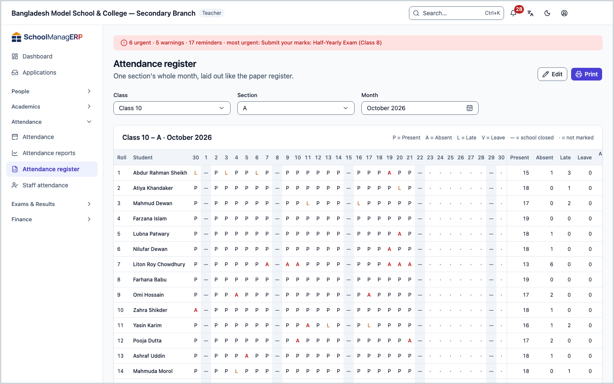
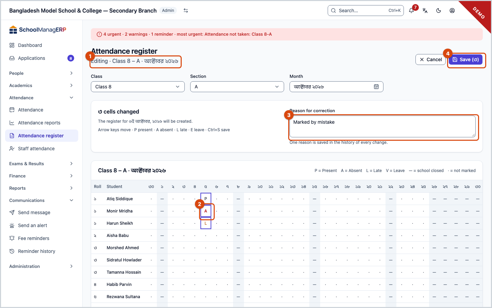
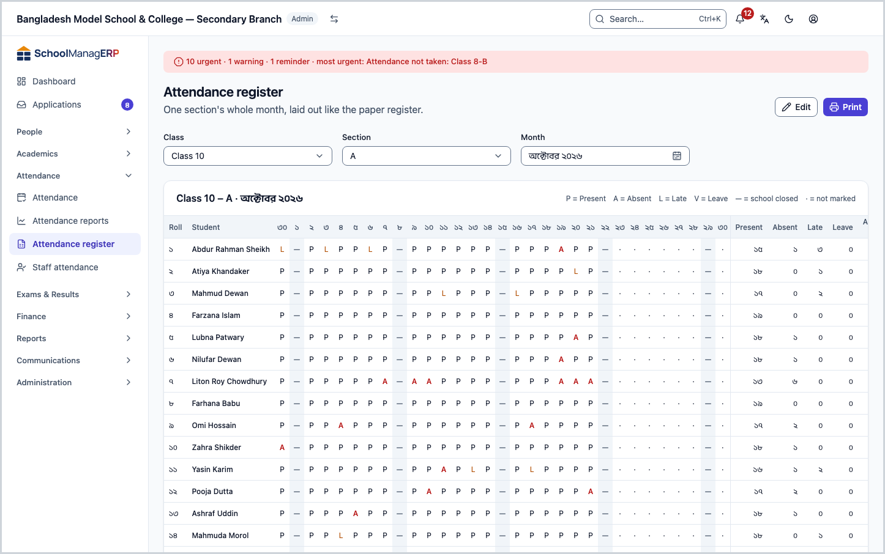

<!-- guide:meta
feature: attendance.attendanceRegister
title: Attendance register
summary: See a section's whole month of attendance laid out like the paper register, print it, and correct several days at once on a computer.
roles: [ADMIN, ACCOUNTANT, TEACHER, EXECUTIVE, OFFICE_STAFF, EXAM_CONTROLLER]
sources:
  - client-admin/src/routes/_staff/attendance/register.tsx
  - client-admin/src/routes/_staff/attendance/-register-edit-grid.tsx
  - client-admin/src/routes/_staff/attendance/-register-print.css
  - client-admin/src/routes/_staff/attendance/-correction-dialog.tsx
  - client-admin/src/routes/_staff/attendance/-record-history-panel.tsx
  - client-admin/src/routes/_staff/attendance/-subject-summary-tab.tsx
  - server/src/modules/attendance/attendance.controller.ts
  - server/src/modules/attendance/attendance.service.ts
  - server/src/modules/attendance/attendance-summary.controller.ts
  - server/src/modules/attendance/attendance-access.service.ts
labels:
  [
    attendance:register.*,
    attendance:mark.errorToast,
    nav:items.attendanceRegister,
  ]
helpIds:
  [
    attendance.attendanceRegister,
    attendance.attendanceRegister.action.print,
    attendance.attendanceRegister.action.edit,
    attendance.attendanceRegister.action.save,
    attendance.attendanceRegister.field.reason,
  ]
devices: [desktop]
entry: [sidebar, palette]
keywords: [উপস্থিতির খাতা, হাজিরা খাতা, মাসিক খাতা, রেজিস্টার, প্রিন্ট, সংশোধন, attendance register, print]
appVersion: 0.1.0 (a5fdbd4ba)
owner: tareq89
lastVerified: 2026-10-25
knownIssues: []
-->

# Attendance register

See a section's whole month of attendance laid out like the paper register, print it, and correct several days at once on a computer.

**Go to:** **Attendance → Attendance register** in the left menu. Editing works only on a computer; on a phone you can view.
**Before you start:** students must be enrolled in the section ([Students](../people/students.md)). If you are a teacher, the section must be assigned to you ([Teacher assignments](../people/teaching-assignments.md)).

Daily attendance is taken on the [Taking attendance](attendance.md) page, one register per day. This page lines those days up side by side into one grid for the month: a row per student, a column per day, and totals at the end.

[View the register](#task-main) · [Print it](#task-print) · [Correct several days](#task-edit) · [Problems and fixes](#trouble)

**On this page**

- [How you get here](#arrive)
- [View a month's register](#task-main)
- [How to know a correction was saved](#confirm)
- [Other situations](#other)
  - [Print the register](#task-print)
  - [Correct several days at once](#task-edit)
  - [Correcting an old day (admin only)](#task-old)
  - [The register on a phone](#task-phone)
- [Problems and fixes](#trouble)
- [Who can do what](#roles)
- [Known issues](#known-issues)
- [Learn more](#more)

---

## How you get here 

**From the left menu:** **Attendance → Attendance register**. It says **No section picked yet**; start at step 1 below.

**From search:** in the search box at the top (Ctrl+K) type "Attendance register" and choose it. How search works: [Finding any page](../start/find-anything.md).

The bell that marks a guardian waiting for an arrival notice shows only when you take attendance, not in this register: [The bell beside a name](attendance.md#task-bell).

---

## View a month's register 

1. In the left menu press **Attendance**, then **Attendance register**.
2. In the **Class** box choose the class.
3. In the **Section** box choose the section.
4. In the **Month** box choose the month. The current month is filled in.

   → The whole month's grid appears. Each cell holds one letter: **P** = present, **A** = absent, **L** = late, **V** = leave. **—** means school closed, and **·** means not marked. On the right are each student's totals: **Present**, **Absent**, **Late**, **Leave** and **Attendance %**.

> **Keep in mind:** **—** where the percentage should be means not one day was marked for that student this month. It is not 0%.

---

## How to know a correction was saved 

| State                         | How you can tell                                                                                                  | What next                      |
| ----------------------------- | ----------------------------------------------------------------------------------------------------------------- | ------------------------------ |
| **Changed on screen only**    | While editing, changed cells look different, and the top says "3 cells changed". You lose them if you leave the page. | Press **Save**.             |
| **Reached the school's system** | The message "Saved 2 days." appears and the register goes back to its normal view.                              | Done.                          |

This page cannot save without internet. If you are offline, fix a single day from the [Taking attendance](attendance.md#task-offline) page instead.

---

## Other situations 

### Print the register 

1. Pick the class, section and month to open the register.
2. Press **Print** at the top.

   → Your computer's print window opens. Only the grid prints, with its title and the letter key; the menu, filters and buttons do not. Every day of the month is printed.

3. Choose a printer and print, or save as a PDF.

If the section has no students, **Print** cannot be pressed. While you are editing the button is hidden; press **Save** or **Cancel** first.

<!-- unverified: পাতার মাপ (A4 আড়াআড়ি?) আর অনেক শিক্ষার্থী হলে পাতা ভাঙার ধরন — -register-print.css-এর @page অংশ চালিয়ে দেখা হয়নি -->

### Correct several days at once 

Only admins and teachers can do this, and only on a computer.

1. Open the register and press **Edit** at the top.

   → The top says **Editing**. The cells in the grid can now be changed. A **Reason for correction** box appears alongside.

2. Press the wrong cell, then press a letter on the keyboard: `P` present, `A` absent, `L` late, `E` leave. `Space` switches present and absent. The arrow keys move to the next cell.

   → The top says "3 cells changed". If you change a day that had no register before, it says "The register for … will be created."

3. If you like, write a **Reason for correction**. One reason is saved in the history of every change.
4. Press **Save (3)** (or `Ctrl + S`).

   → The message "Saved 2 days." appears and the register returns to its normal view.

**Which days can be changed:**

- Nobody can change a future day or a day the school is closed (**—**).
- A teacher can change only their own section, and only days within the school's correction window (usually 2 days). An older day with no register yet can also be filled in for the first time, but at least one student must be marked.
- For days outside the window, or a final register, see [Correcting an old day](#task-old).

**To give up halfway:** press **Cancel** or `Esc`. If anything changed, the app asks **Discard your changes?**; press **Discard** and the changed cells are lost.

### Correcting an old day (admin only) 

When you change a day outside the correction window, the top says "… is outside the correction window, so a reason is needed." and the **Reason for correction** box shows a \*.

1. Change the cells as above.
2. In **Reason for correction** write at least 3 letters, for example `Leave as per guardian's letter`.
3. Press **Save**.

If the reason is too short, the box says **Write a reason of at least 3 letters.** Who changed what, and when, is kept in each student's row history ([Fixing an earlier day](attendance.md#task-fix)).

**Effect on fines:** if absence [fines](../help/glossary.md#fine) are turned on, they are counted from the **Absent** marks in the register. So changing an absence shows up in later fine calculations too.

<!-- unverified: ইতিমধ্যে ধরা জরিমানা অনুপস্থিত চিহ্ন বদলালে নিজে থেকে বাদ যায় কি না — fees/fines/fine-sweep.service.ts পুরো পড়া হয়নি -->

### The register on a phone 

On a phone, swipe sideways to see the whole grid. There is no edit button; it says "A whole month cannot be edited on a phone. Tap a date to open that day's register." Tapping a date above the grid opens that day's register on the [Taking attendance](attendance.md#task-fix) page.

---

## Problems and fixes 

| What you see                                                                    | What to do                                                                                                                         | Who can help                      |
| ------------------------------------------------------------------------------- | ---------------------------------------------------------------------------------------------------------------------------------- | --------------------------------- |
| **Could not load the register.** (teacher)                                      | The list shows every class, but you can only open sections assigned to you. Pick your own section.                                 | Admin (**Teacher assignments**)   |
| **No students in this section.**                                                | The register appears once students are enrolled.                                                                                   | Admin                             |
| **Nothing was saved** — "Someone changed … while you were editing."             | Someone else submitted that day while you were editing. Press **Reload the month**, then make your changes again.                   | —                                 |
| "… cannot be marked: it is a future date or a day without school."              | Press **Remove these days from my changes**, then save the rest.                                                                   | —                                 |
| "… can only be changed by someone who can correct attendance."                  | The day is outside the window. Press **Remove these days from my changes** and ask an admin to make the correction.                | Admin                             |
| **Write a reason of at least 3 letters.**                                       | Write a slightly longer reason in **Reason for correction**.                                                                       | —                                 |
| No **Edit** button                                                              | You are on a phone, or your role cannot edit ([Who can do what](#roles)).                                                          | —                                 |

---

## Who can do what 

| Role                 | View and print           | Correct within the window | Correct outside the window |
| -------------------- | ------------------------ | ------------------------- | -------------------------- |
| Admin                | All sections             | Yes                       | Yes, with a reason         |
| Teacher              | Only sections assigned to them | Yes, their own section | No                         |
| Academic coordinator | All sections             | No                        | No                         |
| Accountant           | All sections             | No                        | No                         |
| Office staff         | All sections             | No                        | No                         |
| Exam controller      | All sections             | No                        | No                         |

People who cannot correct attendance do not see the **Edit** button.

---

## Known issues 

Checked in the code for version 0.1.0 on 2026-10-25. There are no known issues on this page right now.

---

## Learn more 

<strong>Parts of the page</strong> — top to bottom

1. **Attendance register** — the title; **Print** and **Edit** on the right.
2. **Which register** — **Class**, **Section**, **Month**.
3. **Register title and letter key** — for example "Class 6 – A · October 2026".
4. **The grid** — **Roll**, **Student**, every day of the month, then the totals.

<strong>Keyboard shortcuts</strong> (while editing)

| Key             | What it does                   |
| --------------- | ------------------------------ |
| `P`             | Present                        |
| `A`             | Absent                         |
| `L`             | Late                           |
| `E`             | Leave                          |
| `Space`         | Present ↔ absent               |
| `←` `→` `↑` `↓` | Move to the next cell          |
| `Home` / `End`  | First / last cell in the row   |
| `Esc`           | Cancel editing                 |
| `Ctrl + S`      | Save                           |

<strong>What each field means</strong>

<!-- guide:generated:fields:attendanceRegister -->

| Field                 | What to enter                                                                                   | Required?                                   |
| --------------------- | ----------------------------------------------------------------------------------------------- | ------------------------------------------- |
| Class                 | Which class. Changing it empties the section.                                                   | Yes                                         |
| Section               | Which section.                                                                                  | Yes                                         |
| Month                 | Which month's register. The current month is filled in.                                         | Yes                                         |
| Reason for correction | Why you are changing it. At least 3 letters. The same reason is kept in every change's history. | Only when changing a day outside the window |

<!-- /guide:generated -->

<strong>How the register works</strong> — view, print, correct

<figure>
  
  <figcaption><em>The monthly register: view, print, edit</em></figcaption>
</figure>

- One save covers all the days together: if one day has a problem, none of the days are saved.
- The register's numbers and the [Attendance reports](attendance-reports.md) numbers come from the same place.
- A section whose attendance for today is still to do shows on the [Dashboard](../dashboard/dashboard.md) as **Attendance left to take**.

**Related pages**

- [**Taking attendance**](attendance.md) — daily attendance, one day's register.
- [**Attendance reports**](attendance-reports.md) — the month summary and the low-attendance list.
- [**Teacher assignments**](../people/teaching-assignments.md) — which sections a teacher can open.
- [**Students**](../people/students.md) — enrolling students in a section.

---

_Version 0.1.0 · Last verified 2026-10-25_
