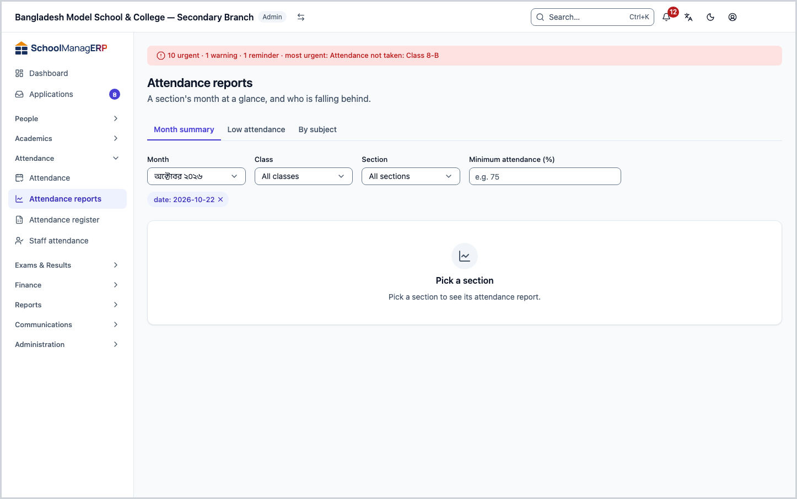
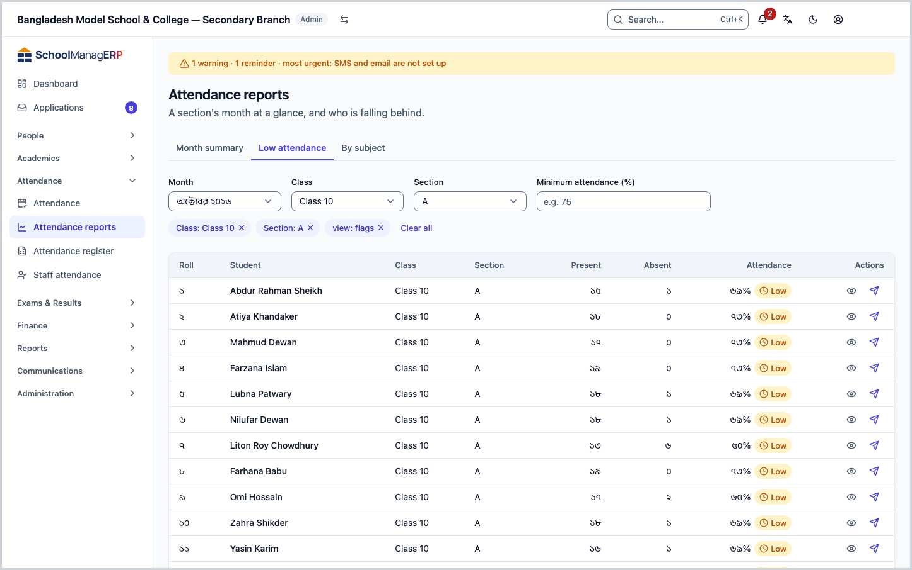

<!-- guide:meta
feature: attendance.attendanceReports
title: Attendance reports
summary: See a section's monthly attendance figures, find who is falling behind, and send a reminder if needed.
roles: [ADMIN, ACCOUNTANT, TEACHER, EXECUTIVE, OFFICE_STAFF, EXAM_CONTROLLER]
sources:
  - client-admin/src/routes/_staff/attendance/reports.tsx
  - client-admin/src/routes/_staff/attendance/-subject-summary-tab.tsx
  - server/src/modules/attendance/attendance-summary.controller.ts
  - server/src/modules/attendance/attendance-summary.service.ts
  - server/src/modules/attendance/attendance-access.service.ts
labels:
  [
    attendance:reports.*,
    attendance:mark.rollNumber,
    nav:items.attendanceReports,
  ]
helpIds:
  [
    attendance.attendanceReports,
    attendance.attendanceReports.action.sendReminder,
    attendance.attendanceReports.field.threshold,
    attendance.attendanceReports.section.summary#task-main,
    attendance.attendanceReports.section.flags#task-low,
    attendance.attendanceReports.section.subjects#task-subjects,
  ]
devices: [desktop]
entry: [sidebar, palette]
keywords: [উপস্থিতি প্রতিবেদন, হাজিরার হিসাব, কম উপস্থিতি, শতাংশ, attendance report, low attendance]
appVersion: 0.1.0 (a5fdbd4ba)
owner: tareq89
lastVerified: 2026-10-25
knownIssues: []
-->

# Attendance reports

See a section's monthly attendance figures, find who is falling behind, and send a reminder if needed.

**Go to:** **Attendance → Attendance reports** in the left menu. Do this on a computer.
**Before you start:** the section must have at least a few days of attendance taken ([Taking attendance](attendance.md)).

A report never writes anything itself. Teachers take attendance every day, and this page only counts it. So if the attendance is wrong, the report is wrong too; fix it in the [Attendance register](attendance-register.md).

[Month summary](#task-main) · [Low attendance](#task-low) · [Reminder](#task-reminder) · [Problems and fixes](#trouble)

**On this page**

- [How you get here](#arrive)
- [See a section's month](#task-main)
- [How to know the figures are right](#confirm)
- [Other situations](#other)
  - [Find who has low attendance](#task-low)
  - [Send a reminder](#task-reminder)
  - [Attendance by subject](#task-subjects)
- [Problems and fixes](#trouble)
- [Who can do what](#roles)
- [Learn more](#more)

---

## How you get here 

**From the left menu:** **Attendance → Attendance reports**. The page opens on the **Month summary** tab; start at step 1 below.

**From search:** in the search box at the top (Ctrl+K) type "Attendance reports" and choose it. How search works: [Finding any page](../start/find-anything.md).

---

## See a section's month 

1. In the left menu press **Attendance**, then **Attendance reports**.

   → Three tabs (or two) across the top: **Month summary**, **Low attendance**, and, for admins when per-period attendance is on, **By subject**. In the middle it says **Pick a section**.

2. In the **Month** box choose the month. The current month is filled in; you can go back up to 12 months.
3. In the **Class** box choose the class, then in the **Section** box the section.

   → One row per student in that section: **Roll**, **Student**, **Present**, **Absent**, **Late**, **Leave**, **Working days**, **Attendance** (a percentage).

4. To see one student in detail, press **View** at the end of the row. → The [student's page](../people/students.md) opens.

> **Keep in mind:** changing the class empties the section box. Pick the section again.

---

## How to know the figures are right 

| What you see                               | What it means                                                                                                           |
| ------------------------------------------ | ----------------------------------------------------------------------------------------------------------------------- |
| **—** where the percentage should be       | Not one day was marked for that student this month. This is not 0%.                                                     |
| **Low** next to the percentage             | The percentage is below the number in the **Minimum attendance (%)** box. If the box is empty, the tag does not appear. |
| **No attendance records for this filter.** | The section has no attendance this month. Check that you picked the right month.                                        |

To cross-check the numbers, open the same section and month in the [Attendance register](attendance-register.md). Both pages read the same records.

---

## Other situations 

### Find who has low attendance 

1. Press the **Low attendance** tab.

   → The list for the whole school appears, with no section needed: students whose attendance this month is below the limit. Each row also shows **Class** and **Section**.

2. To change the limit, type a number in the **Minimum attendance (%)** box, for example `75`. If you leave it empty, the limit set in the school's settings is used.
3. If you like, pick a **Class** or **Section** to shorten the list.

Students with no marked day this month do not appear in this list. If nobody is below the limit it says **Nobody is below the minimum this month**.

### Send a reminder 

1. In the **Month summary** or **Low attendance** list, press **Send reminder** at the end of the student's row.
2. In the box that opens, read the message and send it.

<!-- unverified: রিমাইন্ডারের ঘরে ঠিক কী লেখা থাকে আর বার্তা কার কাছে যায় (অভিভাবক?) — students/-send-reminder-dialog.tsx পড়া হয়নি -->

Only admins, accountants and office staff see this button ([Who can do what](#roles)).

### Attendance by subject 

When the school turns on per-period attendance under **Settings › Attendance policy**, the **By subject** tab appears, for admins only (the page reads this switch from the school's settings, which only admins can open). Pick a section and a month, and each student's row shows "came / held" for every subject, for example `18/20`. If no period attendance was taken that month it says **No period attendance this month**. How to take period attendance: [Per-period attendance](attendance.md#task-period).

---

## Problems and fixes 

| What you see                                        | What to do                                                                                               | Who can help                    |
| --------------------------------------------------- | -------------------------------------------------------------------------------------------------------- | ------------------------------- |
| **Pick a section**                                  | Choose both **Class** and **Section**. The month summary shows one section at a time.                    | —                               |
| **Could not load the attendance report.** (teacher) | You can only see sections assigned to you. Choosing another section gives this message. Pick your own.   | Admin (**Teacher assignments**) |
| **No attendance records for this filter.**          | Attendance was not taken that month. Ask the teacher to [take it](attendance.md), or pick another month. | Teacher                         |
| The percentage looks wrong                          | A day's mark is wrong. Correct it in the [Attendance register](attendance-register.md#task-edit).        | Teacher or admin                |

---

## Who can do what 

| Role                 | Month summary and by subject   | Low attendance | Send reminder |
| -------------------- | ------------------------------ | -------------- | ------------- |
| Admin                | All sections                   | Yes            | Yes           |
| Accountant           | All sections                   | Yes            | Yes           |
| Office staff         | All sections                   | Yes            | Yes           |
| Academic coordinator | All sections                   | Yes            | No            |
| Exam controller      | All sections                   | Yes            | No            |
| Teacher              | Only sections assigned to them | No             | No            |

This page is view-only. Nobody can change attendance here, and there is no download or print button. If you need paper, print the [Attendance register](attendance-register.md#task-print).

---

## Learn more 

<strong>Parts of the page</strong> — top to bottom

1. **Attendance reports** — the title.
2. **Tabs** — **Month summary**, **Low attendance**, **By subject**.
3. **Filter row** — **Month**, **Class**, **Section**, **Minimum attendance (%)**.
4. **The list** — at the end of each row, **View** and (if you are allowed) **Send reminder**.

<strong>What each field means</strong>

<!-- guide:generated:fields:attendanceReports -->

| Field                  | What to enter                                                                                    | Required?              |
| ---------------------- | ------------------------------------------------------------------------------------------------ | ---------------------- |
| Month                  | Which month. The current month is filled in; you can pick back up to 12 months.                  | Yes                    |
| Class                  | Which class. Changing it empties the section.                                                    | Yes, for month summary |
| Section                | Which section.                                                                                   | Yes, for month summary |
| Minimum attendance (%) | The percentage limit, for example 75. If empty, low attendance uses the school's settings limit. | No                     |

<!-- /guide:generated -->

<strong>How the report is built</strong> — counting from the register

<figure>
  
  <figcaption><em>Reports built from the attendance register</em></figcaption>
</figure>

- The percentage counts only marked days. If no day is marked, the percentage is **—**.
- Days when school is closed are not counted in **Working days**.
- If the school has an absence [fine](../help/glossary.md#fine) rule turned on, fines are also counted from the same **Absent** marks in the register.

**Related pages**

- [**Taking attendance**](attendance.md) — the daily attendance these figures come from.
- [**Attendance register**](attendance-register.md) — the same figures day by day, with printing and corrections.
- [**Students**](../people/students.md) — a student's full details.
- [**Dashboard**](../dashboard/dashboard.md) — today's attendance at a glance.

---

_Version 0.1.0 · Last verified 2026-10-25_
