<!-- guide:meta
feature: attendance.attendance
title: Taking attendance
summary: Take your section's attendance, mark late arrivals and leave, and fix mistakes.
roles: [TEACHER, ADMIN, EXECUTIVE, ACCOUNTANT, OFFICE_STAFF, EXAM_CONTROLLER]
sources:
  - client-admin/src/routes/_staff/attendance/index.tsx
  - client-admin/src/routes/_staff/attendance/$sectionId.tsx
  - client-admin/src/routes/_staff/attendance/-*.tsx
  - ui/src/hooks/attendance.ts
  - ui/src/api/mutation-queue.ts
labels:
  [
    attendance:list.*,
    attendance:mark.*,
    attendance:period.*,
    attendance:statusControl.*,
    attendance:conflict.*,
    attendance:history.*,
    common:sync.*,
    nav:items.attendance,
  ]
helpIds:
  [
    attendance.attendance,
    attendance.attendance.action.allPresent,
    attendance.attendance.action.submit,
    attendance.attendance.field.date,
  ]
devices: [desktop, phone]
entry: [sidebar, palette, dashboard:my-pending-sections]
keywords:
  [হাজিরা, উপস্থিতি, রোল কল, অনুপস্থিত, attendance, roll call, absent, routine, timetable]
appVersion: 0.1.0 (7b776974b)
owner: tareq89
lastVerified: 2026-10-23
knownIssues: []
-->

# Taking attendance

Take your section's attendance, mark late arrivals and leave, and fix mistakes.

**Go to:** **Attendance → Attendance** in the left menu. On a phone, the **Attendance** button at the bottom of the screen.
**Before you start:** at least one section must be assigned to you (an admin does this on the **Teacher assignments** page).

Every section (for example Class 6, section B) has one **register** per day. This page is where you fill it in; the monthly register and the reports are built from it.

[Today's attendance](#task-main) · [Late or on leave](#task-late-leave) · [Fix an earlier day](#task-fix) · [Problems and fixes](#trouble)

**On this page**

- [How you get here](#arrive)
- [Take today's attendance](#task-main)
- [How to know the attendance was submitted](#confirm)
- [Other situations](#other)
  - [When a student is late or on leave](#task-late-leave)
  - [Submitting before everyone is marked](#task-unmarked)
  - [Fixing an earlier day](#task-fix)
  - [Per-period attendance](#task-period)
  - [Attendance without internet](#task-offline)
- [Problems and fixes](#trouble)
- [Who can do what](#roles)
- [Learn more](#more)

---

## How you get here 

**From the left menu:** **Attendance → Attendance**. The section list opens; start at step 1 below.

**From the dashboard:** after signing in, the **Attendance left to take** card on the dashboard lists today's sections still to do. Press a name. → That section's register opens directly, on today's date; start at step 3 below.

**From search:** in the search box at the top (Ctrl+K) type "attendance" and choose **Attendance**. The section list opens.

---

## Take today's attendance 

1. In the left menu press **Attendance**, then the inner **Attendance**. On a phone, press **Attendance** at the bottom.

   → Your sections appear. A section still to do says **Not started**.

<figure>
  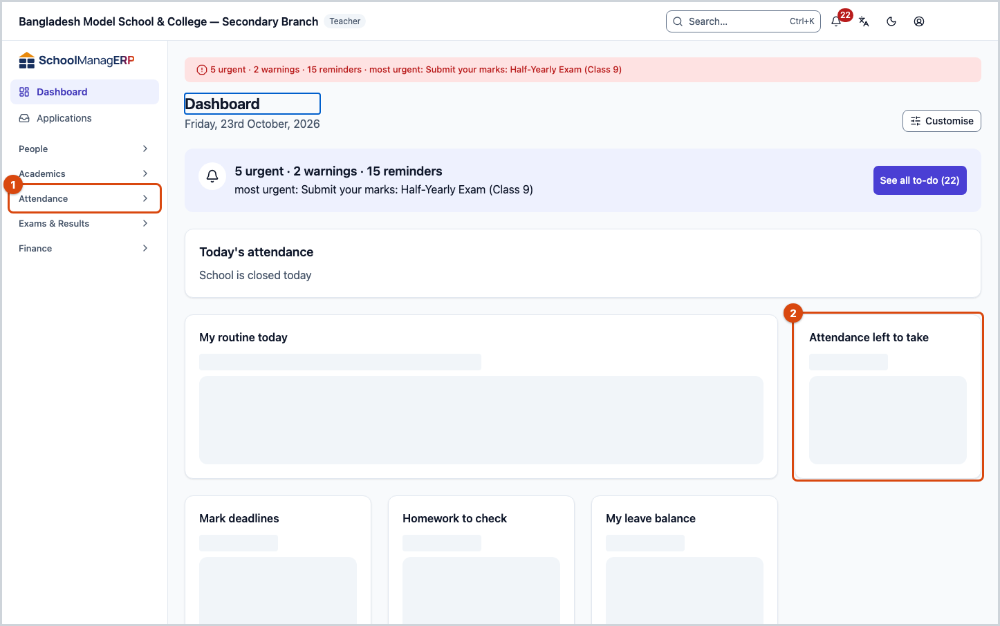
  <figcaption><em>1 · Attendance in the left menu &nbsp; 2 · the dashboard's "Attendance left to take" card also opens a register directly</em></figcaption>
</figure>

2. Press the card of the section you are marking.

   → Every student appears by roll number. Each says **Unmarked**.

3. Press **All present** at the top right.

   → Every student you have not marked yet turns green **Present**. Marks you already set — absent, late or leave — are not changed. Pressed it by mistake? Press **Undo** in the message at the bottom.

4. Press the **name** of each student who did not come today, once.

   → That student turns red **Absent**, and the **Absent** count at the top goes up.

<figure>
  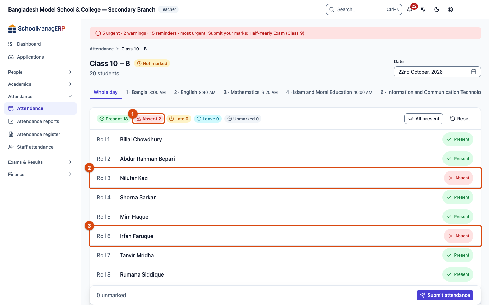
  <figcaption><em>After step 4: two students absent, Absent 2 in the counts</em></figcaption>
</figure>

5. Before submitting, check the **Absent**, **Late** and **Leave** counts at the top once. Then press **Submit attendance** at the bottom.

   → You see **Attendance saved**, and the app takes you back to the section list.

**On a phone** the same five steps; only the buttons sit elsewhere:

<figure>
  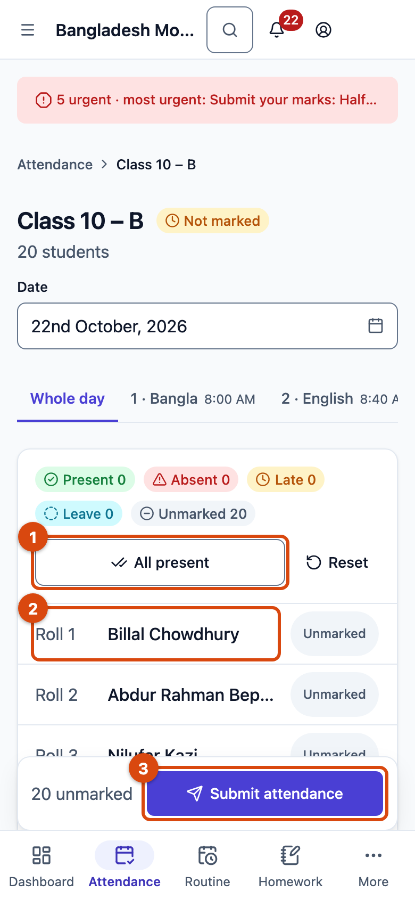
  <figcaption><em>1 · All present &nbsp; 2 · Student name &nbsp; 3 · Submit attendance</em></figcaption>
</figure>

> **Keep in mind:** pressing a name or a button only changes the mark on your screen. Nothing reaches the school's system until you press **Submit attendance**.

---

## How to know the attendance was submitted 

A mark can be in one of three states. This is how to tell which:

| State                           | How you can tell                                                                                                     | What next                                                                  |
| ------------------------------- | -------------------------------------------------------------------------------------------------------------------- | -------------------------------------------------------------------------- |
| **Changed on screen only**      | The mark is next to the name, but you have not submitted. The marks survive a reload on this device.                 | Press **Submit attendance**.                                               |
| **Saved on this device**        | The message **Saved on device — will sync when back online**, and "1 change waiting to send" at the top of the page. | It is sent by itself once the internet is back — [details](#task-offline). |
| **Reached the school's system** | The message **Attendance saved**, and the section shows **Draft** or **Submitted** in the section list.              | Done.                                                                      |

**To verify:** press the section's card again in the list. If every mark you set is there next to the names, it is in the system.

<figure>
  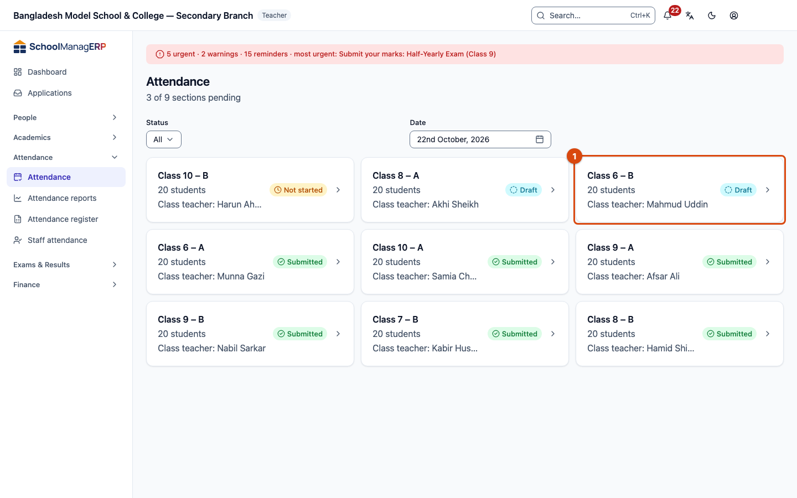
  <figcaption><em>The section list after submitting: the section is no longer "Not started"</em></figcaption>
</figure>

**No message?** See [Problems and fixes](#trouble). Your marks are not lost.

---

## Other situations 

### When a student is late or on leave 

1. On that student's row, press the **status button** on the right (the one that says **Present** or **Unmarked**).

   → A small list opens: **Present**, **Absent**, **Late**, **Leave**.

2. Press **Late** or **Leave**.
3. For **Late**, a **Minutes late** box appears underneath. Type the minutes in Latin digits, for example `15` (0 to 1440). Leave it empty if you don't know.
4. Press outside the list. The right of the row shows a yellow **Late** or a blue **Leave**.
5. Finally press **Submit attendance**. Only when you see **Attendance saved** has the mark reached the system.

<figure>
  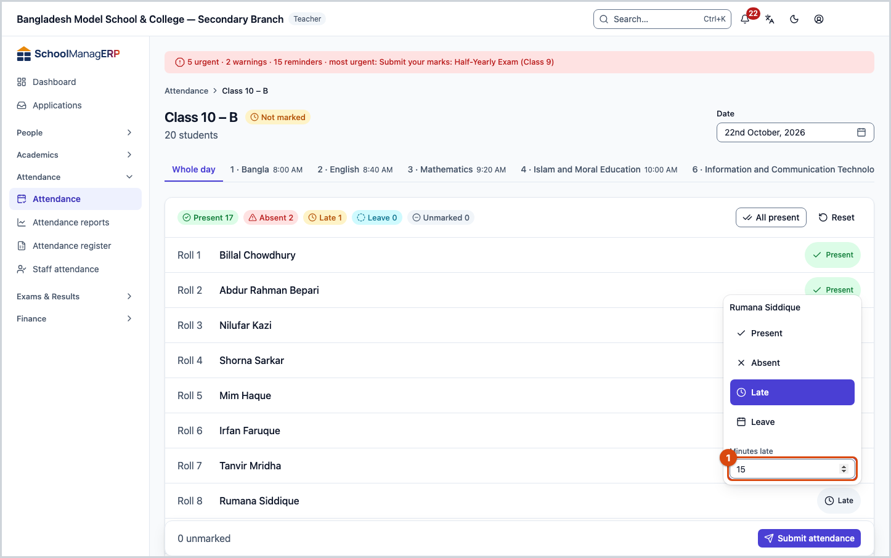
  <figcaption><em>The Minutes late box, after choosing Late</em></figcaption>
</figure>

**Leave in advance:** the **Date** box on the section list does not accept a future date. A school can turn on leave-in-advance under **Settings › Attendance policy**; then a future day's register allows only **Leave**, and the top of the register says "Future date — only Leave can be marked ahead of time."

### Submitting before everyone is marked 

If anyone still says **Unmarked** when you press **Submit attendance**, the app asks:

<figure>
  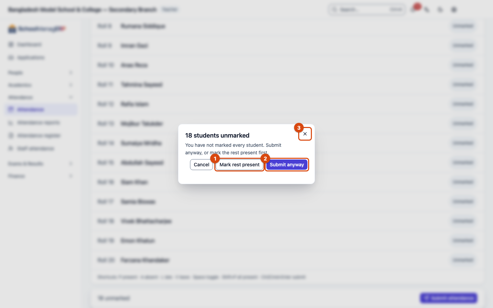
  <figcaption><em>1 · Mark rest present &nbsp; 2 · Submit anyway &nbsp; 3 · Close</em></figcaption>
</figure>

| You press                   | What happens                                                                                                                                                   | Submitted?                         |
| --------------------------- | -------------------------------------------------------------------------------------------------------------------------------------------------------------- | ---------------------------------- |
| **Mark rest present**       | Everyone unmarked becomes **Present**. You are back on the register; press **Submit attendance** again.                                                        | Not yet                            |
| **Submit anyway**           | Only the marked students go to the system. The unmarked ones stay **Unmarked** in the reports — they are not counted as absent. The register stays incomplete. | Yes — you see **Attendance saved** |
| **✕ (Close)** or **Cancel** | Nothing changes. Your marks stay on screen.                                                                                                                    | No                                 |

To mark the remaining students later, see [Fixing an earlier day](#task-fix).

### Fixing an earlier day 

Within the school's correction window (usually 2 days) you can fix it yourself:

1. On the section list, choose that day in **Date**.
2. Press the section card.
3. Press the name or the **status button** of the student whose mark is wrong, and set it right.
4. Press **Submit attendance**. When you see **Attendance saved**, the correction is in the system.

After the window, the top of the register says "This register is older than 2 days. Ask an administrator to correct it." You can only look at it then; ask an admin to make the change. When an admin changes such a register, a **Why are you changing this register?** box appears; they write a reason of at least 3 characters, which other staff can see. The **⋮** button on each row shows the **History**: who changed what, and when.

<figure>
  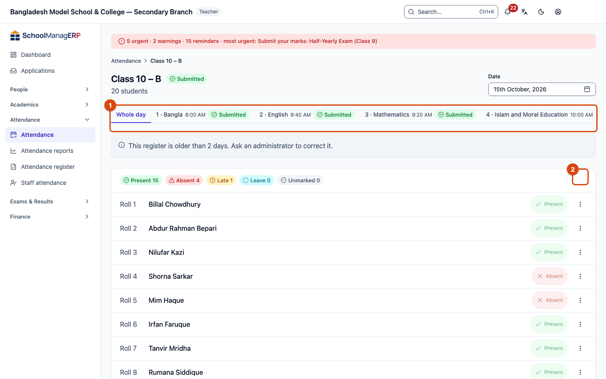
  <figcaption><em>1 · The message teachers see after the window &nbsp; 2 · The ⋮ button on a row (History)</em></figcaption>
</figure>

### The bell beside a name 

A small bell beside a student's name means a guardian has asked to be told when this child arrives. Hold or hover over it to read **Guardian waits for the arrival notice**. Mark the student present as usual; the message goes by itself. The bell is only a reminder. To answer the request, see [Answer arrival notice requests](../academics/my-class.md#task-arrival).

### Per-period attendance 

If the school turns on per-period attendance under **Settings › Attendance policy** and the class routine is published, the register shows a tab per period next to **Whole day**. Press your period's tab, then follow the same five steps. Each period's register is submitted separately.

### Attendance without internet 

Without internet, the submit button says **Save on device**. When you press it:

- You see **Saved on device — will sync when back online**. The attendance is stored only on this phone or computer; it has not reached the school's system yet.
- The top of the page says **You are offline — 1 change waiting to send**.
- Closing the tab or restarting the phone does not lose it. But it is sent only while the app is open: once the internet is back, open the app (on this device) or keep it open.
- When it is sent you see **1 offline change saved.** The **Your changes** panel at the top then says **All your changes are saved.**

**If it is not sent:** if "waiting to send" stays after the internet is back, open the **Your changes** panel.

- **This changed elsewhere while waiting** — someone else has already submitted this register. Choose which version to keep from the panel.
- **This could not be sent after several attempts** — open the register again, check the marks, and press **Submit attendance**. If that fails too, tell an admin.

More help with this: [What to do when something goes wrong](../help/troubleshooting.md#offline).

---

## Problems and fixes 

| What you see                                                 | What to do                                                                                                                                | Who can help                         |
| ------------------------------------------------------------ | ----------------------------------------------------------------------------------------------------------------------------------------- | ------------------------------------ |
| **No sections assigned yet**                                 | No section is in your name.                                                                                                               | Admin (**Teacher assignments** page) |
| **School is closed on this day**                             | A weekly off day or a holiday in the calendar. No attendance needed. If that looks wrong, tell an admin.                                  | Admin (calendar)                     |
| A section is missing from the list                           | The section has no students, or its class is off today. Set the **Status** filter to **Done** to check whether it was already submitted.  | Admin                                |
| **Could not save attendance**                                | Check the internet and press **Submit attendance** again. The marks stay on screen. If it keeps failing, tell an admin, with the message. | Admin                                |
| The button says **Save on device**                           | No internet. See [Attendance without internet](#task-offline).                                                                            | —                                    |
| **This register changed since you loaded it**                | See below.                                                                                                                                | —                                    |
| **This register is older than 2 days…**                      | The correction window has passed. Tell an admin which student, which date, and what to change.                                            | Admin                                |

**If "This register changed" appears:** someone else (for example an admin) submitted this register after you opened it. A list shows only the students whose mark differs between you and them, **Your mark** next to **Current mark**.

- **Keep mine** — your whole register (every student's mark) is submitted over their version. For the students in the list, their mark is discarded.
- **Take theirs** — all your unsubmitted marks are discarded and the register reloads with their version. You can change and submit again afterwards.

It is worth a word with that person about the listed students before you decide.

<figure>
  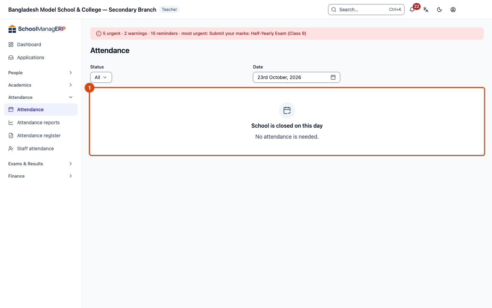
  <figcaption><em>What the page shows on a closed day</em></figcaption>
</figure>

---

## Who can do what 

| Role                                      | Sections seen | Can take attendance | Can correct                                                                       | Gets late alerts    |
| ----------------------------------------- | ------------- | ------------------- | --------------------------------------------------------------------------------- | ------------------- |
| Teacher                                   | Own assigned  | Yes                 | Within the window (usually 2 days)                                                | Yes, own sections   |
| Admin                                     | All           | Yes, any day        | Any day, with a reason | Yes, when very late |
| Headmaster / principal                    | All           | No                  | No                                                                                | Yes, when very late |
| Accountant, office staff, exam controller | All           | No                  | No                                                                                | No                  |

For those who cannot take attendance, the register has no **All present** and no **Submit attendance** button.

---

## Learn more 

<strong>Parts of the page</strong> — what is where on the section list and the register

**The section list**

<figure>
  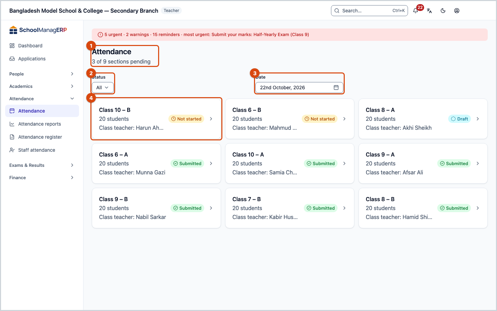
  <figcaption><em>1 · Title &nbsp; 2 · Status &nbsp; 3 · Date &nbsp; 4 · Section card</em></figcaption>
</figure>

1. **Attendance** — the page name. Under it, how many sections are pending, for example "3 of 9 sections pending".
2. **Status** — show only **Pending** or only **Done** sections.
3. **Date** — today is filled in. Change it to see an earlier day; a future date cannot be chosen.
4. **Section card** — name, number of students, class teacher and the register's state: **Not started**, **Draft** (in the system), **Submitted** (final).

**The register**

<figure>
  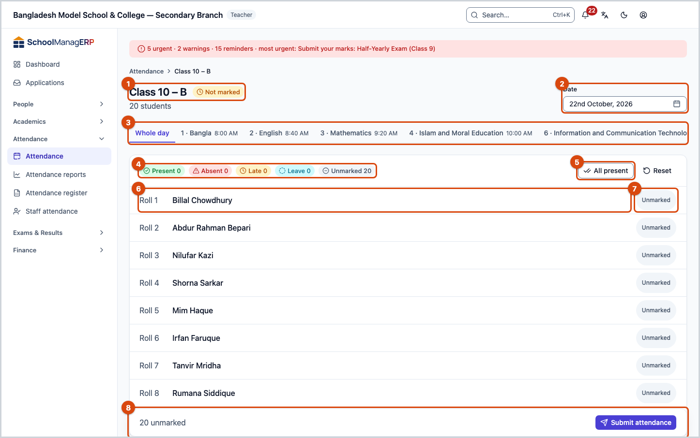
  <figcaption><em>1 · Section and state &nbsp; 2 · Date &nbsp; 3 · Whole day and periods &nbsp; 4 · Counts &nbsp; 5 · All present &nbsp; 6 · Student name &nbsp; 7 · Status button &nbsp; 8 · Submit attendance</em></figcaption>
</figure>

1. **Section name and register state** — for example "Class 10 – B" and **Not marked**. Under it, the number of students.
2. **Date** — the day being marked.
3. **Whole day and periods** — **Whole day** for daily attendance; a tab per period when per-period attendance is on.
4. **Counts** — how many present, absent, late, on leave, unmarked.
5. **All present** — marks everyone unmarked as present.
6. **Student name** — press to switch present ↔ absent.
7. **Status button** — for late or leave.
8. **Submit attendance** — on the left, how many are still unmarked.

<strong>Keyboard shortcuts</strong> (on a computer)

After you press one name:

| Key            | Does                    |
| -------------- | ----------------------- |
| `P`            | Present                 |
| `A`            | Absent                  |
| `L`            | Late                    |
| `V`            | Leave                   |
| `Space`        | Present ↔ Absent        |
| `↑` `↓`        | Previous / next student |
| `Shift + P`    | All present             |
| `Ctrl + Enter` | Submit                  |

<strong>What each field means</strong>

<!-- guide:generated:fields:attendance -->

| Field                 | What to enter                                                                                | Required?                         |
| --------------------- | -------------------------------------------------------------------------------------------- | --------------------------------- |
| Date                  | Which day you are marking. Today is filled in. A future date cannot be chosen from the list. | Yes                               |
| Status (each student) | Present, Absent, Late or Leave. On a future day (when leave-in-advance is on), only Leave.   | No — the app asks if any are left |
| Minutes late          | How many minutes late, only with **Late**. Latin digits, 0 to 1440.                          | No                                |

<!-- /guide:generated -->

<strong>How attendance fits together</strong> — from the register to reports and alerts

<figure>
  
  <figcaption><em>How attendance fits together</em></figcaption>
</figure>

- Every section has one register per day.
- The [**Attendance reports**](attendance-reports.md) and the monthly [**Attendance register**](attendance-register.md) are built from it.
- If attendance is not taken on time, the teacher gets a reminder; if it is very late, the headmaster and the admin too.

<strong>The whole job in one go</strong> — on a computer and on a phone

<figure>
  
  <figcaption><em>On a computer</em></figcaption>
</figure>

<figure>
  
  <figcaption><em>On a phone</em></figcaption>
</figure>

**Related pages**

- [**Giving teachers class and section duties**](../people/teaching-assignments.md) — where an admin assigns sections.
- [**Arranging a class's weekly routine**](../academics/routine-builder.md) — needed for per-period attendance.
- [**Attendance reports**](attendance-reports.md) and [**Attendance register**](attendance-register.md) — built from the attendance taken here.
- [**Staff attendance and leave**](staff-attendance.md) — teachers' and staff's own attendance and leave.
- **Settings › Attendance policy** (admin) — weekly off days, the correction window, per-period attendance, leave in advance.
- [**Seeing your own class on one page**](../academics/my-class.md) — your section on one page, with today's attendance.
- [**Adding students and viewing their details**](../people/students.md) — students whose attendance is taken here.
- [**Changing the school's settings**](../administration/settings.md) — Set the school's profile, academic rules, fee rules, communication, printing, sign-in, backup and alerts on one page, in nine categories.
- [**Attendance**](../portal/attendance.md) — what the guardian sees of the attendance you take.

---

_Version 0.1.0 · Last verified 2026-10-23_
