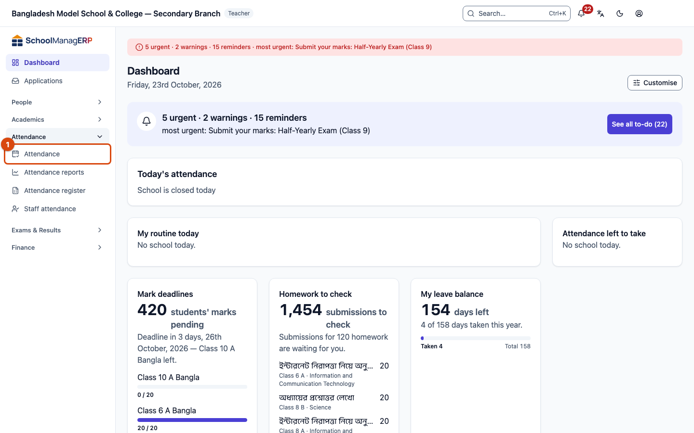
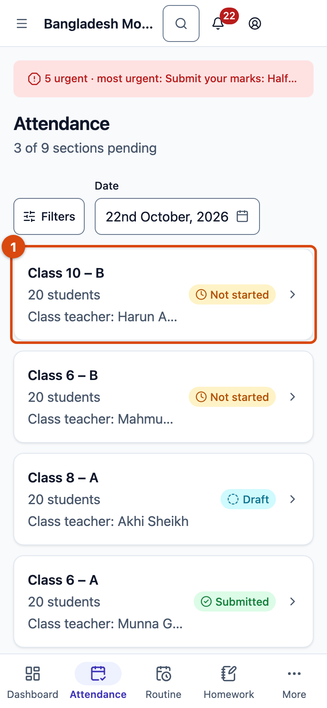

# Taking attendance

Calling the roll from a paper register every morning takes time. Registers get lost, and adding up the month takes even longer.

In SchoolManager you take attendance from a phone or a computer in **about two minutes**. For example, Class 10 – B has 20 students. You press **All present**, tap the two students who did not come, and press **Submit attendance**. That's it. The monthly register and the reports are built for you.

## At a glance

- Every section has **one register per day**.
- A **teacher** marks the register of their own sections.
- The **Attendance reports** and the monthly **Attendance register** are built from it.
- An **admin** can see and change any section's register.
- If attendance is not taken on time, the teacher gets a **reminder**. If it is very late, it can go to the headmaster and the admin too.

The daily job is just five steps:

## Where to find it

1. **Attendance in the left menu.** Press it and a few more items open under it.
2. **The "Attendance left to take" card on the dashboard.** It lists the sections whose attendance is not taken yet. Press a name to go straight to its register.

After the menu opens, press the inner **Attendance**.

**On a phone:** press **Attendance** in the bar at the very bottom of the screen. Your sections are listed one under another:

## Parts of the page

### The section list

1. **Attendance** — the page name. Under it you see how many sections are still pending, for example "3 of 9 sections pending".
2. **Status** — choose **Pending** or **Done** to see only those sections.
3. **Date** — today's date is filled in for you. Change it to see an earlier day.
4. **Section card** — the section name, number of students, class teacher and the register's state:
   - **Not started** — nobody has taken attendance today yet.
   - **Draft** — attendance is taken (see the warning below).
   - **Submitted** — the register is final.

### The register

1. **Section name and register state** — for example "Class 10 – B" and **Not marked**. Under it, the number of students.
2. **Date** — the day you are marking.
3. **Whole day and periods** — keep **Whole day** for daily attendance. If your school takes attendance per period, each period has its own tab; press yours.
4. **Counts** — how many are present, absent, late, on leave, and how many are still **Unmarked**.
5. **All present** — one press marks everyone who is still unmarked as present.
6. **Student name** — pressing a name switches present ↔ absent.
7. **Status button** — press it to mark late or leave.
8. **Submit attendance** — press it at the end. On the left you see how many are still unmarked.

## Tasks

### Taking the daily attendance

<!-- slot:before -->

> **Before you start**
>
> - You are a **teacher**, and an admin has assigned the section to you.
> - The day is a school day.
> - A phone or computer with internet. It also works without internet (see below).

1. In the left menu press **Attendance**, then the inner **Attendance**. On a phone, press **Attendance** at the bottom.
   <!-- slot:see -->

   → You will now see your sections. A section still to do says **Not started**.

2. Press the card of the section you are marking.

   → You will now see every student by roll number. Each says **Unmarked**.

3. At the top right, press **All present**.

   → Everyone now shows a green **Present**. Pressed by mistake? Press **Undo** in the message at the bottom.

4. Press the **name** of a student who did not come, once. Do this for each absent student.

   → That student now shows a red **Absent**, and the **Absent** count at the top goes up.

   

5. At the bottom, press **Submit attendance**.

   → You will see **Attendance saved**, and the app takes you back to the section list.

**The same job on a phone:**

<!-- slot:check -->

> **Check it worked**
> Go back to the section list. Your section no longer says **Not started**.


**Known issue:** after you submit, the section may show **Draft** instead of **Submitted**, and it may still be counted as pending. Your attendance is saved. We are fixing this.


<!-- slot:trouble -->

> **If something goes wrong**
>
> - **"No sections assigned yet"** — you have no section yet. Ask an admin to assign you one on the **Teacher assignments** page.
> - **"School is closed on this day"** — the day is a weekly off day or a holiday in the calendar. No attendance is needed.
> - **A section is missing from the list** — a section with no students, or whose class is off that day, is not shown.
> - **"Could not save attendance"** — check the internet and press **Submit attendance** again. Your marks are still there.
> - **No internet** — the button then says **Save on device**. Press it. The attendance is sent by itself when the internet is back. Keep the page open until then.
> - **"This register changed since you loaded it"** — someone else saved this register at the same time. Compare the two lists, then press **Keep mine** or **Take theirs**.

### When a student is late or on leave

<!-- slot:before -->

> **Before you start:** the register is open.

1. On that student's row, press the **status button** on the right (it says **Present** or **Unmarked**).
   <!-- slot:see -->

   → A small list opens: **Present**, **Absent**, **Late**, **Leave**.

2. Press **Late** or **Leave**.
3. If you chose **Late**, type how many minutes late in **Minutes late**, for example `15`. You may leave it empty if you don't know.
4. Press anywhere outside the list.

<!-- slot:check -->

> **Check it worked:** the right of the row now shows a yellow **Late** or a blue **Leave**.

<!-- slot:trouble -->

> **If something goes wrong:** on a future date only **Leave** can be marked (if your school allows it). The page then says "Future date — only Leave can be marked ahead of time."

### Submitting before everyone is marked

<!-- slot:before -->

> **Before you start:** some students still say **Unmarked**.

When you press **Submit attendance**, the app asks first.

<!-- slot:see -->

1. **Mark rest present** — marks everyone left as present. Then press **Submit attendance** again.
2. **Submit anyway** — submits without the unmarked students.
3. **✕ (Close)** — goes back to the register without doing anything.

<!-- slot:check -->

> **Check it worked:** you see **Attendance saved**.

<!-- slot:trouble -->

> **If something goes wrong:** in Bangla, the **বাতিল** (Cancel) button under this question is cut off and cannot be pressed. Press **✕** at the top to go back. We are fixing this.

### Fixing a mistake

<!-- slot:before -->

> **Before you start:** you are a **teacher**, and the register is not more than **2 days** old (your school can change this number).

1. On the section list, choose that day in **Date**.
2. Press the section card.
3. Fix it by pressing the student's name or **status button**.
4. Press **Submit attendance** again.

<!-- slot:check -->

> **Check it worked:** you see **Attendance saved**.

<!-- slot:trouble -->

> **If something goes wrong:** if the register is more than 2 days old, the top says "This register is older than 2 days. Ask an administrator to correct it." You can only look at it then. Ask an admin.

On an old register each row has a **⋮** button on the right. Press it to see the **History**: who changed what, and when.

## Faster on a computer (keyboard)

After you press one name, you can mark with the keyboard:

| Key            | Does                    |
| -------------- | ----------------------- |
| `P`            | Present                 |
| `A`            | Absent                  |
| `L`            | Late                    |
| `V`            | Leave                   |
| `Space`        | Present ↔ Absent        |
| `↑` `↓`        | Previous / next student |
| `Shift + P`    | All present             |
| `Ctrl + Enter` | Submit                  |

## Works together with

- **Teacher assignments** — an admin assigns your sections here. Without it your list is empty.
- **Class routine** — once the routine is published and per-period attendance is on, the register shows period tabs.
- **Attendance reports** and **Attendance register** — built from the attendance taken here.
- **Dashboard** — the "Attendance left to take" card shows today's pending sections.
- **Settings › Attendance policy** (admin only) — weekly off days, how many days a teacher can still fix a register (2 at first), and per-period attendance.

## What each field means

<!-- guide:generated:fields:attendance -->

| Field                 | What to enter                                                                  | Required?                         |
| --------------------- | ------------------------------------------------------------------------------ | --------------------------------- |
| Date                  | Which day you are marking. Today is filled in; a future date cannot be chosen. | Yes                               |
| Status (each student) | Present, Absent, Late or Leave.                                                | No — the app asks if any are left |
| Minutes late          | How many minutes late, only with **Late**. 0 to 1440.                          | No                                |

<!-- /guide:generated -->

## Who can do what

### For teachers

- See only **your own assigned sections**.
- Take and fix attendance for today and the last 2 days.
- Older registers you can only look at.

### For admins

- See **every section**, and take attendance for today or any earlier day.
- If a teacher cannot take a section's attendance, you can take it yourself.
- If a section's attendance is very late, you can get an alert.


**Known issue:** if you change a register older than 2 days and press **Submit attendance**, the app now shows "Could not save attendance". The box for the reason does not appear on the page yet. We are fixing this.


### For headmasters, principals, accountants, office staff and exam controllers

- You can see **every section's** register, but not change it. **All present** and **Submit** are not shown.
- **Headmasters and principals:** if a section's attendance is very late, you can get an alert too.

## Video

<!-- guide:generated:video:attendance.attendance -->

_Video coming soon._
<!-- /guide:generated -->

---

_This page is written for SchoolManager 0.1.0 (7b776974b)._
