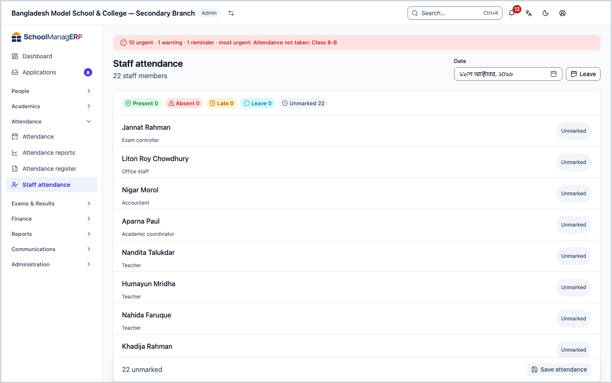

<!-- guide:meta
feature: attendance.staffAttendance
title: Staff attendance and leave
summary: Record teachers' and staff attendance every day, check your own leave balance, request leave, and approve requests.
roles: [ADMIN, ACCOUNTANT, TEACHER, EXECUTIVE, OFFICE_STAFF, EXAM_CONTROLLER]
sources:
  - client-admin/src/routes/_staff/attendance/staff/index.tsx
  - client-admin/src/routes/_staff/attendance/staff/-staff-attendance-grid.tsx
  - client-admin/src/routes/_staff/attendance/staff/leave.tsx
  - server/src/modules/staff-attendance/staff-attendance.controller.ts
  - server/src/modules/staff-attendance/staff-attendance.service.ts
  - server/src/modules/leave/leave.controller.ts
  - server/src/modules/leave/leave.service.ts
  - server/src/modules/applications/reviewer-scope.ts
labels:
  [
    staffAttendance:grid.*,
    leave:myLeave.*,
    leave:page.*,
    leave:type.*,
    applicationsDetail:actions.approve,
    applicationsDetail:actions.reject,
    applicationsDetail:actions.cancel,
    applications:types.STAFF_LEAVE,
    nav:items.staffAttendance,
    nav:items.leave,
  ]
helpIds:
  [
    attendance.staffAttendance,
    attendance.staffAttendance.action.submit,
    attendance.staffAttendance.action.requestLeave,
    attendance.staffAttendance.action.approveLeave,
    attendance.staffAttendance.field.date,
    attendance.staffAttendance.section.leaveBalance,
  ]
devices: [desktop]
entry: [sidebar, palette]
keywords: [কর্মীর উপস্থিতি, শিক্ষকের হাজিরা, ছুটি, ছুটির আবেদন, ছুটির ব্যালেন্স, staff attendance, leave, leave balance]
appVersion: 0.1.0 (a5fdbd4ba)
owner: tareq89
lastVerified: 2026-10-25
knownIssues: []
-->

# Staff attendance and leave

Record teachers' and staff attendance every day, check your own leave balance, request leave, and approve requests.

**Go to:** **Attendance → Staff attendance** in the left menu. For leave, the **Leave** button at the top of that page.
**Before you start:** the people whose attendance you take must have a staff profile ([Staff](../people/staff.md)). You also need your own staff profile to request leave.

Student attendance is taken by section ([Taking attendance](attendance.md)). Staff attendance is one list for the whole school, once a day. When a leave request is approved, those days become **Leave** in this list on their own.

[Today's attendance](#task-main) · [My leave](#task-my-leave) · [Request leave](#task-request) · [Approve](#task-approve) · [Problems and fixes](#trouble)

**On this page**

- [How you get here](#arrive)
- [Take today's staff attendance](#task-main)
- [How to know attendance was saved](#confirm)
- [Other situations](#other)
  - [An earlier day's attendance](#task-other-day)
  - [See my leave balance](#task-my-leave)
  - [Request leave](#task-request)
  - [Approve or reject a leave request](#task-approve)
  - [Cancel approved leave](#task-cancel)
- [Problems and fixes](#trouble)
- [Who can do what](#roles)
- [Learn more](#more)

---

## How you get here 

**From the left menu:** **Attendance → Staff attendance**. The staff list opens on today's date; start at step 2 below.

**From search:** in the search box at the top (Ctrl+K) type "Staff attendance" and choose it. How search works: [Finding any page](../start/find-anything.md).

---

## Take today's staff attendance 

Admins and academic coordinators see all staff. Everyone else sees only their own row ([who can do what](#roles)).

1. In the left menu press **Attendance**, then **Staff attendance**.

   → The top says **Staff attendance**, and below it "12 staff members". Each person shows their name, their role, and a status button on the right. The counts at the top read **Present 0**, **Absent 0**, **Late 0**, **Leave 0**, **Unmarked 12**.

2. Press the **name** of everyone who came. → They become **Present**. Press again and they become **Absent**.
3. For someone late or on leave, press the **status button** at the right of the row and choose **Late** or **Leave**.

4. At the bottom left see how many are left, for example "2 unmarked". Then press **Save attendance**.

   → The button says **Saving…**, then at the left it says **Attendance saved**.

> **Keep in mind:** nothing is sent for people you did not mark. You can save without marking everyone, and come back later to mark the rest.

---

## How to know attendance was saved 

| State                           | How you can tell                                                                                                      | What next                  |
| ------------------------------- | --------------------------------------------------------------------------------------------------------------------- | -------------------------- |
| **Changed on screen only**      | A mark sits next to the name, and the bottom says "… unmarked". You lose it if you change the date or leave the page. | Press **Save attendance**. |
| **Reached the school's system** | At the bottom left it says **Attendance saved**.                                                                      | Done.                      |

This page cannot save without internet. If saving fails it says **Couldn't save attendance. Try again.** The marks stay on screen; press save again.

---

## Other situations 

### An earlier day's attendance 

1. In the **Date** box at the top choose the day. → The list empties and opens for that day.
2. Mark people and press **Save attendance**.

Rules:

- On a future day you can only give **Leave**.
- Nothing saves on a day the school is closed.
- To change a day that already has attendance and is older than the school's correction window (usually 2 days), a **Why are you changing this day?** box appears above **Save attendance**. Write a reason of at least 3 characters; other staff can see it.

Changing the date throws away marks you had not saved for the previous date.

### See my leave balance 

1. At the top of the **Staff attendance** page press **Leave**.

   → The **My leave** page opens: "How many days of each kind of leave you have left this year". The **My leave** table lists each type (for example **Casual**, **Sick**), **Annual quota (days)**, **Used (days)** and **Remaining (days)**.

If there is no quota it shows **No limit**. Only approved leave counts as **Used**, and only on school days.

### Request leave 

1. At the top of the **My leave** page press **Request leave**.

   → The new application form opens, with the type **Staff leave** already chosen.

2. Enter the type of leave and the start and end dates, then submit the application.

<!-- unverified: আবেদন ফর্মের ঘর ও বোতামের নাম (applications/new.tsx পড়া হয়নি); ধাপ ২ সাধারণ ভাষায় লেখা -->

The request goes to the admin and the academic coordinator. Your balance does not go down until it is approved.

### Approve or reject a leave request 

Admins and academic coordinators only. Nobody can approve their own request.

1. At the bottom of the **My leave** page press **Pending leave applications**. → The list of pending staff leave requests opens.
2. Open a request.
3. Press **Approve** or **Reject**.

When you press **Approve**, the app checks:

| Check                                            | If it fails  |
| ------------------------------------------------ | ------------ |
| At least one of the dates is a school day        | Not approved |
| It is no more than the year's remaining leave    | Not approved |
| It does not overlap other leave already approved | Not approved |

Once approved, those days become **Leave** in **Staff attendance**; if they were marked **Absent** before, they become **Leave** too. If the person is a teacher, arrange cover for their classes: [Substitute teachers](../academics/routine-substitutions.md).

### Cancel approved leave 

An admin or academic coordinator can open the request and press **Cancel leave**. The person who requested it cannot cancel it themselves. When it is cancelled, the **Leave** marks on the days still to come are removed.

---

## Problems and fixes 

| What you see                                         | What to do                                                                                                        | Who can help |
| ---------------------------------------------------- | ----------------------------------------------------------------------------------------------------------------- | ------------ |
| **Couldn't load staff for this day.**                | Check your internet and reload the page.                                                                          | Admin        |
| **Write a reason of at least 3 characters.**         | The day is older than the correction window. Write why you are changing it in the box, then save.                 | —            |
| **No staff yet**                                     | Press **Add staff**, or give people a staff profile ([Staff](../people/staff.md)).                                | Admin        |
| One staff member is missing from the list            | They have no staff profile. Add one from the [Staff](../people/staff.md) page.                                    | Admin        |
| **You have no staff profile**                        | Leave is tracked for staff only. Ask an admin to create your staff profile.                                       | Admin        |
| **No leave rules yet**                               | The school has not set up leave types and quotas.                                                                 | Admin        |
| **Couldn't save attendance. Try again.** when saving | Check your internet. It will not save for a day the school is closed, or a mark other than Leave on a future day. | Admin        |

<!-- unverified: ছুটির কোটা কোন পাতা থেকে বদলায় (server PUT /leave/policies/:type আছে; UI পাতা খোঁজা হয়নি) -->

---

## Who can do what 

| Role                 | Take staff attendance      | Own leave balance and requests | Approve and cancel leave |
| -------------------- | -------------------------- | ------------------------------ | ------------------------ |
| Admin                | Yes, all staff, any day    | Yes                            | Yes, except their own    |
| Academic coordinator | Yes, all staff, any day    | Yes                            | Yes, except their own    |
| Teacher              | Only their own, only today | Yes                            | No                       |
| Accountant           | Only their own, only today | Yes                            | No                       |
| Office staff         | Only their own, only today | Yes                            | No                       |
| Exam controller      | Only their own, only today | Yes                            | No                       |

**Staff attendance** is in every role's menu. Teachers, accountants, office staff and exam controllers can give only their own attendance, only for today, and only once. The **Pending leave applications** link is seen only by admins and academic coordinators.

---

## Learn more 

<strong>Parts of the page</strong> — Staff attendance

1. **Staff attendance** — the title, with how many staff below it.
2. **Date** — which day's attendance; today is filled in.
3. **Leave** — the button that goes to the leave page.
4. **Counts** — present, absent, late, leave, unmarked.
5. **Staff list** — name, role, status button.
6. **Save attendance** — with how many are unmarked at the left.

<strong>Keyboard shortcuts</strong> (on a computer)

While on a name:

| Key     | What it does     |
| ------- | ---------------- |
| `Enter` | Present          |
| `L`     | Leave            |
| `Space` | Present ↔ absent |
| `Tab`   | Next cell        |

<strong>What each field means</strong>

<!-- guide:generated:fields:staffAttendance -->

| Field                | What to enter                                                            | Required?                                |
| -------------------- | ------------------------------------------------------------------------ | ---------------------------------------- |
| Date                 | Which day's attendance. Today is filled in. On a future day, only Leave. | Yes                                      |
| Status (each person) | Present, Absent, Late or Leave.                                          | No — nothing is sent for unmarked people |

<!-- /guide:generated -->

<strong>How staff attendance and leave connect</strong>

<figure>
  
  <figcaption><em>Staff attendance and leave</em></figcaption>
</figure>

- The leave balance is worked out fresh each time: the quota minus that year's approved leave days.
- If one leave spans two years, each year is counted against its own balance.

**Related pages**

- [**Staff**](../people/staff.md) — add staff and their profiles.
- [**Taking attendance**](attendance.md) — students' daily attendance.
- [**Substitute teachers**](../academics/routine-substitutions.md) — who takes the class of a teacher on leave.
- [**Dashboard**](../dashboard/dashboard.md) — today's summary.
- [**Applications**](../applications/applications.md) — Submit school applications such as leave, fee waiver, transfer certificate, testimonial and section change, enter a guardian's paper.
- [**Application reports**](../reports/applications.md) — application reports, including staff leave counts

---

_Version 0.1.0 · Last verified 2026-10-25_
