<!-- guide:meta
feature: attendance.uploads
title: Upload an attendance sheet
summary: Fill in attendance for one or more sections on an Excel sheet, upload it, check what will change, and save. See every uploaded sheet afterwards and fix a mistake with a corrected file.
roles: [TEACHER, ADMIN, EXECUTIVE, ACCOUNTANT, OFFICE_STAFF, EXAM_CONTROLLER]
sources:
  - client-admin/src/routes/_staff/attendance/import.tsx
  - client-admin/src/routes/_staff/attendance/-import/import-dropzone.tsx
  - client-admin/src/routes/_staff/attendance/-import/import-preview-table.tsx
  - client-admin/src/routes/_staff/attendance/-import/section-date-picker.tsx
  - client-admin/src/routes/_staff/attendance/imports/index.tsx
  - client-admin/src/routes/_staff/attendance/imports/$importId.tsx
  - client-admin/src/routes/_staff/attendance/-imports/import-rows-table.tsx
  - server/src/modules/attendance/import/attendance-import.controller.ts
labels:
  [
    attendanceImport:pick.*,
    attendanceImport:download.*,
    attendanceImport:upload.*,
    attendanceImport:review.*,
    attendanceImport:outcome.*,
    attendanceImport:rowError.*,
    attendanceImport:history.*,
    attendanceImport:detail.*,
    nav:items.upload,
    nav:items.uploads,
  ]
helpIds: [attendance.uploads]
devices: [desktop]
entry: [sidebar, palette]
keywords: [হাজিরা শীট, শীট আপলোড, এক্সেল, হাজিরা আপলোড, attendance sheet, upload attendance, excel, import]
appVersion: 0.1.0 (7c8c659c8)
owner: tareq89
lastVerified: 2026-11-06
knownIssues: []
-->

# Upload an attendance sheet

Fill in attendance for one or more sections on an Excel sheet, upload it, check what will change, and save. See every uploaded sheet afterwards and fix a mistake with a corrected file.

**Go to:** **Attendance → Uploaded sheets** in the left menu, then press **Upload attendance sheet**. Or type **Upload attendance sheet** in the search box at the top (Ctrl+K). Do this on a computer.
**Before you start:** you must be allowed to take attendance for the section (a teacher for their own sections, or an admin). Have the filled-in attendance of the day ready, for example from a paper register.

A **sheet** is an Excel file the app makes for you with your students already listed. You only type a short code beside each name. Nothing is saved until you press **Save** at the end, so you can look before anything changes.

[Upload a sheet](#task-main) · [Read the review](#task-review) · [See past uploads](#task-history) · [Fix a mistake](#task-correct) · [Problems and fixes](#trouble)

**On this page**

- [Upload a sheet](#task-main)
- [How to know it was saved](#confirm)
- [Other situations](#other)
  - [Read the review before saving](#task-review)
  - [See past uploads](#task-history)
  - [Fix a mistake with a corrected file](#task-correct)
- [Problems and fixes](#trouble)
- [Who can do what](#roles)
- [Learn more](#more)

---

## Upload a sheet 

1. In the left menu press **Attendance**, then **Uploaded sheets**. On that page press **Upload attendance sheet** at the top. You can also type **Upload attendance sheet** in the search box at the top (Ctrl+K). The page says **Upload attendance sheet** and **Step 1 of 3**: **Choose what to fill in**.
   <!-- shot: attendance-uploads-01-menu.png — Uploaded sheets in the menu and the Upload attendance sheet button (tour step "uploads: menu") -->
2. Under **Section**, tick the sections you want. You can pick up to 10 at a time. Under **Date**, choose the day.
   <!-- shot: attendance-uploads-02-pick.png — sections ticked, date chosen (tour step "uploads: pick") -->
3. Press **Download sheet**. A file named like `হাজিরা_<class>_<section>_<date>.xlsx` is saved on your computer. If the school uses English, the name starts with `attendance_` instead. If you ticked several sections, the name has only the date, like `হাজিরা_<date>.xlsx`. Tick only sections you take attendance for: if even one is not yours to fill on that day, no sheet is made and the page says **You cannot fill in one of these sections on this day. Pick fewer sections or another date.** Any other failure says **Could not make the sheet. Try again.** The page moves on by itself to **Step 2 of 3**.
   <!-- shot: attendance-uploads-03-download.png — download button (tour step "uploads: download") -->
4. Open the file. For every student, type a code in the last column: `P`, `A`, `L` or `LV`. The table below explains each. Leave a cell empty to keep that student's mark as it is. Save the file.
   <!-- shot: attendance-uploads-04-sheet.png — the sheet in Excel (manual capture, not the app) -->
5. Back in the app, on **Upload your filled sheet**, drop the file on the box that says **Drop the sheet here, or choose a file**, or press **Choose file** and pick it. The file must be .xlsx or .csv and under 5 MB.
   <!-- shot: attendance-uploads-05-drop.png — the drop box (tour step "uploads: drop") -->
6. Press **Review changes**. Wait for **Checking your sheet…**. **Step 3 of 3**, **Review before saving**, opens.
7. Read the yellow banner and the table. See [Read the review before saving](#task-review).
   <!-- shot: attendance-uploads-06-review.png — review table with banner and one error (tour step "uploads: review") -->
8. Press **Save 2 changes** (the number is how many marks will change). → The page of this upload opens. Its title says "Upload on" and the date. Every row of the sheet is listed with its result.
   <!-- shot: attendance-uploads-08-detail.png — detail page after saving (tour step "uploads: detail") -->
9. To see this upload again later, press **Attendance**, then **Uploaded sheets**. Your upload is the top row.

| Code  | Means                                        |
| ----- | -------------------------------------------- |
| `P`   | Present                                      |
| `A`   | Absent                                       |
| `L`   | Late                                         |
| `LV`  | Leave                                        |
| empty | No change: the student's mark stays as it is |

> **Keep in mind:** the roll and the section name in the sheet decide who gets the mark. Do not change the **Date**, **Class**, **Section** and **Roll** columns. If a roll is not in that section, the row shows an error and is not saved.

---

## How to know it was saved 

| State                        | How you tell                                                                                                                    | What next                                                                                                                                                                                                                                                                                |
| ---------------------------- | ------------------------------------------------------------------------------------------------------------------------------- | ---------------------------------------------------------------------------------------------------------------------------------------------------------------------------------------------------------------------------------------------------------------------------------------- |
| **Saved**                    | The page of the upload opens, with **New** and **Changed** counts at the top. The upload is the top row in **Uploaded sheets**. | Open the register of the section to see the marks.                                                                                                                                                                                                                                       |
| **Saved, some rows skipped** | On the upload's page, press **Errors**: the skipped rows are listed with **Error**.                                             | Fix those rows in the sheet and upload it again ([Fix a mistake](#task-correct)).                                                                                                                                                                                                        |
| **Not saved**                | **Could not save. Nothing was changed.**                                                                                        | Nothing changed. Press the button again. If it keeps failing, tell an admin.                                                                                                                                                                                                             |
| **Review expired**           | **This review has expired**                                                                                                     | A review lasts only a few minutes. Drop the file again in the upload box. If saving fails with a message about the file or your permission, the page also goes back to the upload step; if it fails for a network or server reason, you stay on the review and can press **Save** again. |

An upload never finalizes a day. Like a teacher's own save, the register stays a draft until it is finalized as usual.

---

## Other situations 

### Read the review before saving 

The page **Review before saving** lists every row of your sheet, rows with errors first. At the top you see the counts: **new**, **changed**, **unchanged** and **with errors**.

1. Look at the column **Result**. Each row is **New** (no mark before), **Changed** (a mark will be replaced), **Unchanged** (the same as now) or **Error**.
2. In the column **Status: before → after** check the change. For example "Absent → Present".
3. If a **yellow banner** says "3 recorded marks will change", these students already had attendance for that day. Saving replaces it. If that is not what you want, press **Choose a different file**.
4. For an **Error** row, read **What to fix**. See the table in [Problems and fixes](#trouble).
5. If some rows have errors, you have two choices:
   - Tick **Save the correct rows and skip the rows with errors**. Then **Save** saves the good rows only. The error rows are left out.
   - Or press **Choose a different file**, fix the sheet, and upload it again.

Nothing has changed yet. The marks change only when you press **Save**.

### See past uploads 

1. In the left menu press **Attendance**, then **Uploaded sheets**.
2. The table lists, newest first: **When**, **Who**, **File**, **New**, **Changed**, **Errors** and **Status**. **Who** shows your own name as **You**, and **A staff member** when the person's name is not available. Teachers see only the sheets they uploaded. Other roles see all sheets uploaded for the school.
3. **Superseded** means a corrected file was uploaded later for this sheet, and that newer upload is on the same page of this list. **Current** means no such upload is on this page. A **Current** upload can still have marks changed by hand. Use **Changed later** on its detail page to find those marks.
4. Press a row to open its detail page. Use **All**, **Changed** and **Errors** to filter the rows. **Changed later** marks a mark that was changed after this upload.

If nobody has uploaded a sheet yet, the page says **No sheets uploaded yet** with a button **Upload a sheet**.

### Fix a mistake with a corrected file 

You can fix a wrong upload in two ways.

**By a corrected file:**

1. Open the upload from **Uploaded sheets**.
2. Press **Upload corrected file**. The upload page opens.
3. The page starts at step 1. If you already have the corrected file, press **Upload your filled sheet** to skip the download. Otherwise download, fill in, upload and review as above. The review compares with the marks as they are now.
4. Press **Save**. A new row appears in the list. The first upload now says **Superseded**. It is kept; nothing is deleted.

**By hand:** on the upload's page, open a row's **Open register** action and change the mark in the day's register, as in [Fixing an earlier day](attendance.md#task-fix).

There is no "undo the whole upload" button. Correct only what is wrong.

---

## Problems and fixes 

| What you see                                                                                                                 | What to do                                                                                                                                           | Who can help |
| ---------------------------------------------------------------------------------------------------------------------------- | ---------------------------------------------------------------------------------------------------------------------------------------------------- | ------------ |
| **This file type is not supported — choose an .xlsx or .csv file.**                                                          | Save the sheet as Excel (.xlsx) or CSV (.csv), not PDF.                                                                                              | —            |
| **This file is too large — choose a file under 5 MB.**                                                                       | Remove empty rows or pictures from the file.                                                                                                         | —            |
| **This sheet has more than … rows — split it and upload in parts.**                                                          | Make two sheets, with fewer sections each.                                                                                                           | —            |
| **You can pick up to 10 sections at a time.**                                                                                | Do the rest in a second sheet.                                                                                                                       | —            |
| Row error: **This roll is not in … — check the roll.**                                                                       | The roll is wrong or the student moved. Correct the roll in the sheet.                                                                               | —            |
| Row error: **This section was not found — check the section name.**                                                          | The section name was changed, two sections share the name, or the section is not in this school year. Download a fresh sheet.                        | —            |
| Row error: **You do not take attendance for this section.**                                                                  | The section is not in your name.                                                                                                                     | Admin        |
| Row error: **This date is outside the school year**, **The school is closed on this date** or **This date has not come yet** | Pick a school day of this year that is not in the future. Write the date the way the downloaded sheet does.                                          | —            |
| Row error: **You can only fill new days. To change a recorded day, ask an admin.**                                           | The day is already finalized or older than the correction window.                                                                                    | Admin        |
| Row error: **This status is not understood — use P, A, L or LV, or leave it empty.**                                         | Use only the codes in the table above.                                                                                                               | —            |
| Row error: **This student and date appear twice — keep one row.**                                                            | Delete one of the two rows.                                                                                                                          | —            |
| Warning, the row still saves: **The name does not match this roll — check the roll.**                                        | The roll belongs to another student, so that student got the mark. If the roll is wrong, change the mark in the register or upload a corrected file. | —            |

---

## Who can do what 

| Role                 | Upload a sheet                      | See past uploads | Fill a day already finalized |
| -------------------- | ----------------------------------- | ---------------- | ---------------------------- |
| Admin                | Yes, any section                    | Yes              | Yes                          |
| Teacher              | Yes, only sections assigned to them | Yes              | No                           |
| Academic coordinator | No                                  | Yes              | No                           |
| Accountant           | No                                  | Yes              | No                           |
| Office staff         | No                                  | Yes              | No                           |
| Exam controller      | No                                  | Yes              | No                           |

If the school lets only the class teacher, the first-period teacher or the attendance machine take daily attendance, the sheet follows the same rule ([Who marks daily attendance](attendance.md#task-source)).

---

## Known issues 

Checked in the code for version 0.1.0 on 2026-11-06. There are no known issues on this page right now.

---

## Learn more 

<strong>How uploading works</strong> — from sheet to saved marks

<figure>
  
  <figcaption><em>An upload, step by step</em></figcaption>
</figure>

- An upload writes marks the same way a teacher does. The same rules apply: your sections, the correction window, closed days.
- A mark from a sheet shows the badge **From sheet** in the register.
- Past-day uploads do not send absence messages to guardians; the automatic message goes out only for today.

**Related pages**

- [**Taking attendance**](attendance.md) — the daily register, and who may take it.
- [**Attendance register**](attendance-register.md) — the month grid, where marks from a sheet show **From sheet**.

---

_Version 0.1.0 · Last verified 2026-11-06_
