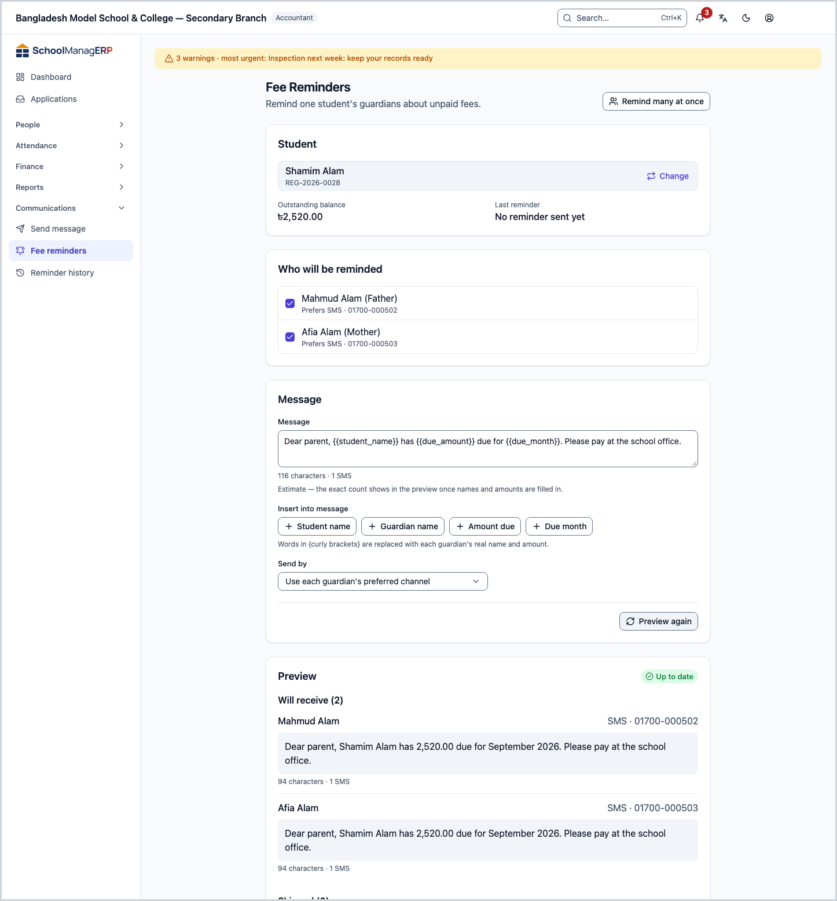
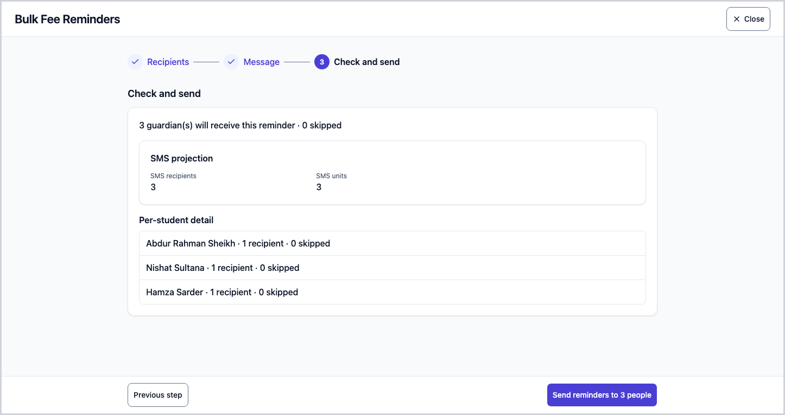

<!-- guide:meta
feature: communications.feeReminders
title: Fee reminders
summary: Remind the guardians of one student, or of up to 500 students at once, about unpaid fees; names and amounts fill in by themselves, and the preview shows who will get it, who is skipped and how many SMS are needed.
roles: [ADMIN, ACCOUNTANT, OFFICE_STAFF]
sources:
  - client-admin/src/routes/_staff/communications/reminders.tsx
  - client-admin/src/routes/_staff/communications/-bulk/bulk-reminder-wizard.tsx
  - client-admin/src/routes/_staff/communications/-bulk/bulk-sms-projection-card.tsx
  - client-admin/src/routes/_staff/communications/-bulk/wizard-steps.tsx
  - client-admin/src/routes/_staff/communications/-shared/recipient-list.tsx
  - client-admin/src/routes/_staff/communications/-shared/template-placeholders.ts
  - client-admin/src/routes/_staff/communications/-shared/placeholder-buttons.tsx
  - client-admin/src/routes/_staff/communications/-shared/skip-reason.ts
  - client-admin/src/routes/_staff/communications/-shared/reminder-limits.ts
  - server/src/modules/communications/communications.controller.ts
  - server/src/modules/communications/single-reminder.service.ts
  - server/src/modules/communications/reminders.service.ts
  - server/src/modules/communications/reminder-recipients.util.ts
  - server/src/modules/communications/reminder-template.util.ts
  - server/src/modules/communications/sms-projection.util.ts
  - server/src/modules/fees/fee-dues.service.ts
labels:
  [
    communications:reminders.*,
    communications:bulk.*,
    communications:recipientList.*,
    communications:skipReasons.*,
    communications:placeholders.*,
    communications:smsCounter.*,
    communications:whatsapp.*,
    communications:notifications.*,
    communications:fields.*,
    communications:help.*,
    communications:helpRequired.*,
    nav:items.feeReminders,
    nav:groups.communications,
  ]
helpIds:
  [
    communications.feeReminders,
    communications.feeReminders.action.preview,
    communications.feeReminders.action.send,
    communications.feeReminders.action.bulkSend,
    communications.feeReminders.field.guardians,
    communications.feeReminders.field.message,
    communications.feeReminders.field.medium,
    communications.feeReminders.field.bulkMediums,
    communications.feeReminders.section.bulkMessage#task-bulk,
  ]
devices: [desktop]
entry: [sidebar, palette]
keywords:
  [reminder, fee reminder, dues, remind, bulk reminder, sms, preview, skipped, sms credit, sms units]
appVersion: 0.1.0 (3f7e424fc)
owner: tareq89
lastVerified: 2026-10-25
knownIssues: []
-->

# Fee reminders

Remind guardians about unpaid fees: for one student, or for many at once.

**Where to go:** in the left menu, **Communications → Fee Reminders**. Do the work on this page on a computer.
**Before you start:** be an Admin, Accountant or Office staff ([who can do what](#roles)). The student must have unpaid bills ([Creating fee bills](../finance/generate-fees.md)). The guardian must have a number or email ([Guardians](../people/guardians.md)).

If you put **{Student name}**, **{Guardian name}**, **{Amount due}** and **{Due month}** in the message, each guardian gets their own real details. Previewing before you send is required. News of a round sent together is in [**Reminder history**](reminder-history.md).

[Send to one](#task-main) · [Many at once](#task-bulk) · [Who is skipped](#task-skipped) · [Problems and fixes](#trouble)

**On this page**

- [Send a reminder to one student's guardians](#task-main)
- [How to know the reminder went](#confirm)
- [Other situations](#other)
  - [Send to the guardians of many students at once](#task-bulk)
  - [See before sending how many SMS it needs](#sms-count)
  - [Who is skipped, and why](#task-skipped)
- [Problems and fixes](#trouble)
- [Who can do what](#roles)
- [Learn more](#more)

---

## Send a reminder to one student's guardians 

1. In the left menu press **Communications**, then press **Fee Reminders**.

   → The **Fee Reminders** page opens: **Remind one student's guardians about unpaid fees.**

2. In the **Search students** box type a name or roll number and pick the student.

   → It shows the **Outstanding balance** and the **Last reminder** (date · channel, or **No reminder sent yet**). Below, the **Who will be reminded** list has every guardian ticked, with each one's preferred channel and number.

3. Untick any guardian you do not want to send to.
4. Write in the **Message** box. To put in a name or amount, press a button under **Insert into message**. For example:

   `Dear {Guardian name}, {Student name} owes ৳{Amount due} since {Due month}.`

5. If needed, change **Send by**. At first it is **Use each guardian's preferred channel**.
6. Press **Preview recipients**.

   → **Preview** appears, with **Up to date** beside it. The **Will receive (…)** list shows the full message each person gets, with real names and amounts; for SMS, the characters and the number of SMS are below it. The **Skipped (…)** list shows who is left out and why.

7. If everything is right, press **Send reminder to … people**.

   → **Reminder sent** appears: **Sent (…)** and **Skipped (…)**.

> **Remember:** if you change anything after the preview, even one letter, the preview hides: **Inputs changed since the last preview — preview again before sending.** A sent message cannot be recalled.

---

## How to know the reminder went 

| State                      | How you know                                                       | What next                                                                  |
| -------------------------- | ------------------------------------------------------------------ | -------------------------------------------------------------------------- |
| **Only written on screen** | The form is open; if you try to leave, a warning appears           | Preview                                                                    |
| **Previewed**              | **Preview** and **Up to date** show; nothing has gone yet          | Press **Send reminder to … people**                                        |
| **Sent to the queue**      | For one student, **Reminder sent**; for many, **Reminders queued** | For a round sent together, see [**Reminder history**](reminder-history.md) |

This page does not keep anything on your phone or computer, so there is no "saved on this device" state.

**If you are not sure, pressing again is safe:** if no answer came and you press the same button again after the same preview, without leaving or reloading the page, the school's system returns the earlier result (it remembers it for 24 hours); the message does not go twice. Once a send has shown as done, pressing again sends a new reminder.

> **Remember:** the app does not stop you from sending another reminder to the same student on the same day. Check **Last reminder** before you send.

---

## Other situations 

### Send to the guardians of many students at once 

1. At the top of the **Fee Reminders** page press **Remind many at once**.

   → **Bulk Fee Reminders** opens, in three steps: **Recipients**, **Message**, **Check and send**.

2. In the **Recipients** step you see the list of students with open dues: **Student**, **Class · section**, **Total due**, **Months overdue**. Filter by **Class**, **Section**, **Month**, **Year** and **Fee status** (**Pending** or **Partially paid**), then tick students.

   → At the top it says **… of 500 students picked**. If you pick more than 500, you cannot go on.

3. Press **Next: message**. Give a **Round name**, for example "March dues — Class 7". Write the **Message template**. Keep ticked the channels you want in **Channels**; all three are ticked at first.
4. Press **Next: check**, then press **Preview recipients**.

   → You see **… guardian(s) will receive this reminder · … skipped**, **Skipped, by reason**, **Per-student detail** and **SMS projection**.

5. Press **Send reminders to … people**.

   → **Reminders queued**: **"…" is being sent in the background.** To follow the progress press **See sending progress**; that round opens in [**Reminder history**](reminder-history.md).

If you change something in an earlier step, the preview goes out of date: **The earlier steps changed since the last preview — preview again before sending.**

### See before sending how many SMS it needs 

- **While writing:** if the message will go by SMS, **… characters · … SMS** appears under it, with **Estimate — the exact count shows in the preview once names and amounts are filled in.** This is because the message gets longer when names and amounts go in.
- **In the preview, for one student:** under each person's message, their real character count and number of SMS.
- **In the preview, for many:** the **SMS projection** box shows **SMS recipients** (how many people get an SMS) and **SMS units** (how many SMS in all). If the school counts credit, it also shows the **Available** credit.

How many characters one SMS holds is on the [**Send a message**](send-message.md#sms-count) page: 70 for Bangla (67 each if more than one), 160 for English only (153 each if more than one).

**Credit:** one SMS = one credit. When you press send, credit for all the SMS of the round is held at once. If the credit is too low, not one goes; for many students, the preview itself says **Not enough SMS credit: … unit(s) needed, only … available (… short).** The credit of a message that cannot be sent is returned.

### Who is skipped, and why 

| Reason (as written in the app)                            | When                                                                     |
| --------------------------------------------------------- | ------------------------------------------------------------------------ |
| **No open dues to remind about**                          | The student has no unpaid, partly paid or overdue bills                  |
| **No guardians on file**                                  | No guardian is linked to the student                                     |
| **Guardian has turned off notifications**                 | The guardian turned notifications off; even if ticked, it does not go    |
| **Preferred channel is not among the requested channels** | For many: the guardian's preferred channel is not ticked in **Channels** |
| **Preferred channel cannot be sent automatically**        | The preferred channel is phone call or Messenger                         |
| **No phone or email on file for the preferred channel**   | There is no number or email for that channel                             |

**Which guardian gets it, when sending to many:** each student's main contact guardian. If there is no main one, or the main one turned notifications off, all the other guardians. **For one student**, everyone who is ticked gets it. A guardian of two picked students gets one message for each student.

---

## Problems and fixes 

| What you see                                                                  | What to do                                                                                          | Who can help |
| ----------------------------------------------------------------------------- | --------------------------------------------------------------------------------------------------- | ------------ |
| You cannot press **Preview recipients**                                       | Check that there is a student, at least one guardian and a message; fix any unknown curly brackets. | —            |
| **{…} isn't recognised. Use the buttons below to insert a name or amount.**   | Delete the text in the curly brackets and put it in with the **Insert into message** buttons.       | —            |
| **A curly bracket is not closed. …**                                          | There is one extra `{` or `}`; delete it.                                                           | —            |
| **The preview could not be made — check the student, guardians and message.** | This also appears when the student has no dues. Check whether there are dues.                       | Accountant   |
| **No one will receive this reminder — every guardian was skipped.**           | See the reasons in the **Skipped** list; pick another channel or add a number.                      | Office staff |
| **Too many bulk requests in a row — wait a moment and try again.**            | A bulk preview and send are allowed at most 5 times a minute. Wait a minute.                        | —            |
| **Not enough SMS credit: …**                                                  | Ask the Admin to add credit, pick fewer students, or keep another channel.                          | Admin        |
| **The reminder could not be sent.**                                           | This also appears for one student when credit is low. Preview again and send, or tell the Admin.    | Admin        |
| **Select at most 500 students — remove … to continue.**                       | Untick some; send the rest in another round.                                                        | —            |
| **The student list could not be loaded.**                                     | Reload the page.                                                                                    | Admin        |

More help with this: [What to do when something goes wrong](../help/troubleshooting.md#sms).

---

## Who can do what 

| Role                                                             | Remind one student | Remind many at once |
| ---------------------------------------------------------------- | ------------------ | ------------------- |
| Admin                                                            | Yes                | Yes                 |
| Accountant                                                       | Yes                | Yes                 |
| Office staff                                                     | Yes                | Yes                 |
| Academic coordinator, Teacher, Exam controller, Committee member | No                 | No                  |

**Admin, Accountant and Office staff:** all three can send both kinds of reminder; there is no difference in the code. Adding credit and turning on SMS is the Admin's job.

For the other roles, **Fee Reminders** is not in the left menu.

---

## Learn more 

<strong>Parts of the page</strong> — one student

1. The **Fee Reminders** title and the **Remind many at once** button.
2. **Student**: search, **Outstanding balance**, **Last reminder**, **Who will be reminded**.
3. **Message**: **Message**, **Insert into message**, **Send by**, the WhatsApp template boxes.
4. **Preview recipients**, then **Preview** and **Send reminder to … people**.

<strong>What each field means</strong>

<!-- guide:generated:fields:communications -->

| Field                     | What to enter                                                                                                                                                                                                                               | Required?         |
| ------------------------- | ------------------------------------------------------------------------------------------------------------------------------------------------------------------------------------------------------------------------------------------- | ----------------- |
| Which guardian to send to | One guardian of the chosen student. Their phone or email shows below; without one you cannot send.                                                                                                                                          | Yes               |
| How to send               | Send message: SMS, WhatsApp or Email; SMS and WhatsApp go to the guardian’s phone, or the alternate phone if there is none. Fee reminder: starts on each guardian’s preferred channel; pick one to send everyone on that channel this time. | No                |
| Message                   | What to send. For SMS, the characters and the number of SMS it uses show below. In a fee reminder, use the buttons below to put in the name, due amount or month; each guardian gets their real details.                                    | Yes               |
| Who to remind             | Every guardian starts ticked. A guardian who turned notifications off does not get it, even when ticked.                                                                                                                                    | Yes, at least one |
| Batch name                | A name for this batch; you find it by this name in Reminder history later.                                                                                                                                                                  | Yes               |
| Channels (bulk reminder)  | A guardian whose preferred channel is not ticked here is skipped. All three start ticked.                                                                                                                                                   | Yes, at least one |
| Status                    | Shows only the rounds in one state: Processing, Completed, Partially failed or Failed. Leave it on All statuses to see every round.                                                                                                         | No                |

<!-- /guide:generated -->

<strong>How reminders work</strong> — dues, recipients, preview and credit

<figure>
  
  <figcaption><em>The steps of a reminder</em></figcaption>
</figure>

- **Which dues:** unpaid, partly paid and overdue bills. Not the bills of a deleted student.
- **{Amount due}:** the total left on these bills = total amount − paid − discount.
- **{Due month}:** the month of the oldest unpaid bill.
- **Changing the channel:** choosing one in **Send by** is for this time only; the guardian's preferred channel does not change.
- **Message length:** at most 2,000 characters. The **Round name** is at most 200 characters.

**Related pages**

- [**Send a message**](send-message.md) — any message you write to one guardian.
- [**Reminder history**](reminder-history.md) — who a round sent together reached.
- [**Creating fee bills**](../finance/generate-fees.md) — the dues come from these bills.
- [**Viewing, fixing and inviting guardians**](../people/guardians.md) — numbers, preferred channel and main contact.

- [**Student dues**](../finance/dues.md) — see who owes what

---

_Version 0.1.0 · last verified 2026-10-25_
