<!-- guide:meta
feature: communications.messageLog
title: Message log
summary: Every message the school sent (not app notifications), in one place. Find one by name or phone, see its status and why it failed, and ask the company whether it was delivered.
roles: [ADMIN, ACCOUNTANT, OFFICE_STAFF]
sources:
  - client-admin/src/routes/_staff/communications/message-log/index.tsx
  - client-admin/src/routes/_staff/communications/message-log/-row-detail.tsx
  - client-admin/src/routes/_staff/communications/-shared/delivery-error.ts
  - server/src/modules/communications/communications.controller.ts
  - server/src/modules/communications/reminders.service.ts
  - server/src/modules/communications/delivery-status.service.ts
labels:
  [
    communications:messageLog.*,
    communications:deliveryErrors.*,
    common:status.communication.*,
    nav:items.messageLog,
    nav:groups.communications,
  ]
helpIds: [communications.messageLog]
devices: [desktop, phone]
entry: [sidebar, palette, page:people.students, page:people.guardians, dashboard:failed-messages]
keywords: [message log, sms, delivered, failed, check status, delivery, sent messages]
appVersion: 0.1.0 (dcf72606a)
owner: tareq89
lastVerified: 2026-10-31
knownIssues: []
-->

# Message log

Every message the school sent, in one place: to whom, when, how, who sent it, and whether it arrived.

App (push) notifications are not in this log. It is not a record of those.

**Where to go:** in the left menu, **Communications → Message log**. It works on a computer or a phone ([On a phone](#task-phone)).
**Before you start:** be an Admin, Accountant or Office staff ([who can do what](#roles)).

[Find a message](#task-main) · [What the statuses mean](#confirm) · [Check status](#task-check) · [Problems and fixes](#trouble)

**On this page**

- [How you get here](#arrive)
- [Find a message and see its details](#task-main)
- [What the statuses mean](#confirm)
- [Other situations](#other)
  - [Ask the company for the status](#task-check)
  - [Narrow the list with filters](#task-filter)
  - [One student's or guardian's messages](#task-scoped)
  - [The **Test** mark](#task-test)
  - [On a phone](#task-phone)
- [Problems and fixes](#trouble)
- [Who can do what](#roles)
- [Learn more](#more)

---

## How you get here 

**From the left menu:** **Communications → Message log**.

**From search:** in the search box at the top (Ctrl+K) type "Message log" and choose it. How search works: [Finding any page](../start/find-anything.md).

**From a student or guardian page:** on a student's page, **Messages** is in the **More actions** (⋯) menu at the top; on a guardian's page it is a **Messages** button at the top. The log opens with that person's messages only ([One student's or guardian's messages](#task-scoped)).

**From the dashboard:** on the **Failed messages** widget, press **See which ones**. The log opens with the failed SMS of the last 7 days.

---

## Find a message and see its details 

On the demo and staging sites nothing is really sent: the messages land in the **test inbox** (see [Where do codes and messages go on the demo?](../start/sign-in.md#task-test-inbox)).

1. In the left menu press **Communications**, then press **Message log**.

   → The **Message log** opens: **Every message the school sent, newest first.** Columns: **Recipient**, **Sent**, **Channel**, **Mobile or email**, **Kind**, **Company**, **Status**, **Why it failed**.

2. In **Search** type the recipient's name, phone number or email. A phone number can be in any form: `01712345678`, `+880 1712-345678` or `8801712345678`.

   → The list shows only the messages that match.

3. Press **View message** on a row.

   → The **Message details** window opens: **Recipient**, **Mobile or email**, **Channel**, **Status**, **Kind**, **Sent by**, **Sent**, **Company**, **Company's message ID**, **SMS parts**, **Reminder round**, **Why it failed**, and the whole **Message** at the bottom. An email also shows its **Subject**. A value the message does not have shows **—**.

4. If the message belongs to a round of reminders, press **Open the round**. The round's page opens ([Reminder history](reminder-history.md)).

<!-- image pending: message-log-01.png, the list with the detail window open (guide:shoot, #3311) -->

---

## What the statuses mean 

| Status        | Meaning                                                                                       | What next                               |
| ------------- | --------------------------------------------------------------------------------------------- | --------------------------------------- |
| **Queued**    | Still waiting to be sent                                                                      | Wait                                    |
| **Sent**      | The SMS or email company has taken the message; whether it reached the phone is not known yet | If you can, [check status](#task-check) |
| **Delivered** | The company says the message reached the phone                                                | Nothing more to do                      |
| **Failed**    | It did not go, or the company says it did not arrive; the reason is in **Why it failed**      | Fix the reason and send again           |

**Kind** says where the message came from: **Sent by staff**, **Reminder (one)**, **Reminder round**, **Automatic**, **Sign-in codes**, **Exam result** or **Arrival notice**.

What **Message** never shows:

- A **Sign-in codes** message never shows the code or link; the log keeps only the rest of the text.
- An invoice link (the receipt after a payment, or **Send to guardian** on a receipt) shows as `…/i/••••••`. The guardian got the working link; the log never shows it, because anyone with the link can open the invoice for 30 days.
- An **Exam result** message shows **Not shown: only staff who can see exam results can read this message.** to an Accountant. Admin and Office staff see it.

This page does not keep anything on your phone or computer, so there is no "saved on this device" state.

---

## Other situations 

### Ask the company for the status 

**Check status** shows only when the message is **Sent**, has a company message ID, and the company that sent it can report delivery (today: OneCodeSoft). On the demo and staging sites it does not show.

1. Press **View message** on the message.
2. Press **Check status**.

   → The button says **Checking…**. When the answer comes, **Status updated.** shows and **Status** changes to **Delivered** or **Failed**. If the company does not know yet, it stays **Sent**.

> **Remember:** one message can be checked once a minute. Pressing sooner shows **The delivery status of this message cannot be checked now.**

### Narrow the list with filters 

Above the list: **Search**, **Channel**, **Status**, **How it was sent**, **Sent by**, **Company**, and **Sent** (**Sent from**, **Sent to**). The filters are kept in the page address, so a link you share opens the same list.

**Sent by** lists the school's staff who sent at least one message (by name, the first 100).

Example: to find the SMS sent to a guardian last Tuesday, type their number in **Search**, choose **SMS** in **Channel**, and give that day in **Sent**.

### One student's or guardian's messages 

Pressing **Messages** on a student's or guardian's page shows only that person's messages. The top says **Showing messages for one student.** or **Showing messages for one guardian.**

Every filter and **Check status** work here too, on that person's messages only. **Clear all** keeps the view on that person. Press **Show all messages** to go back to every message.

### The **Test** mark 

A test message sent from **Settings › Communication** shows a **Test** mark next to **Status** in its details. It is a real message; for SMS it uses credit.

### On a phone 

On a phone each message is a card: the recipient and the **Sent** time at the top, **Status** on the right, the other columns under them, and **View message** at the bottom of the card.

1. **Search** stays at the top. For the other filters press **Filters** (it shows a number when some are set, such as **Filters (2)**).

   → A sheet opens with every filter. The list changes as you choose.

2. Press **Show … results** at the bottom of the sheet.

   → The sheet closes and the list shows.

---

## Problems and fixes 

| What you see                                                                           | What to do                                                                         | Who can help |
| -------------------------------------------------------------------------------------- | ---------------------------------------------------------------------------------- | ------------ |
| **No messages found.**                                                                 | The school has not sent a message yet.                                             | —            |
| **No messages match these filters**                                                    | Clear a filter or widen the dates.                                                 | —            |
| **Could not load the message log.**                                                    | Reload the page.                                                                   | Admin        |
| **The delivery status of this message cannot be checked now.**                         | Press again after a minute. If it still says this, this message cannot be checked. | —            |
| **Could not check the status. Try again in a minute.**                                 | The company did not answer. Press again after a minute.                            | Admin        |
| No **Check status**                                                                    | The message is not **Sent**, or its company does not report delivery.              | —            |
| **Message**: **Not shown: only staff who can see exam results can read this message.** | An exam result. Ask an Admin or Office staff to read it.                           | Admin        |
| **Why it failed**: **Sending by … is not set up for this school. …**                   | An Admin turns it on in **Settings › Communication**, then send again.             | Admin        |

More help with this: [What to do when something goes wrong](../help/troubleshooting.md#sms).

---

## Who can do what 

| Role                                                             | See the log | Check status |
| ---------------------------------------------------------------- | ----------- | ------------ |
| Admin                                                            | Yes         | Yes          |
| Accountant                                                       | Yes         | Yes          |
| Office staff                                                     | Yes         | Yes          |
| Academic coordinator, Teacher, Exam controller, Committee member | No          | No           |

**Admin, Accountant and Office staff:** all three see every message of the school and every filter. One difference: an Accountant does not see the text of an **Exam result** message.

For the other roles, **Message log** is not in the left menu.

---

## Learn more 

<strong>Parts of the page</strong>

1. The **Message log** title.
2. Filters: **Search**, **Channel**, **Status**, **How it was sent**, **Sent by**, **Company**, **Sent**.
3. The list; **View message** on a row.
4. The **Message details** window: **Close** and (when it can work) **Check status**.

<strong>How Check status works</strong>

<figure>
  
  <figcaption><em>The status of one message</em></figcaption>
</figure>

- **The answer sets the status:** delivered → **Delivered**; not delivered → **Failed**; the company does not know yet → stays **Sent**; the company did not answer → nothing changes.
- **Which company is asked:** the one that sent the message, on the account it was sent from.
- **Once a minute:** the minute's wait starts even when no answer comes.
- **One press, one question:** a fast double press still asks the company once.

**Related pages**

- [**Reminder history**](reminder-history.md) — the rounds of reminders sent together.
- [**Send a message**](send-message.md) — your own message to one guardian.

---

_Version 0.1.0 · last verified 2026-10-31_
