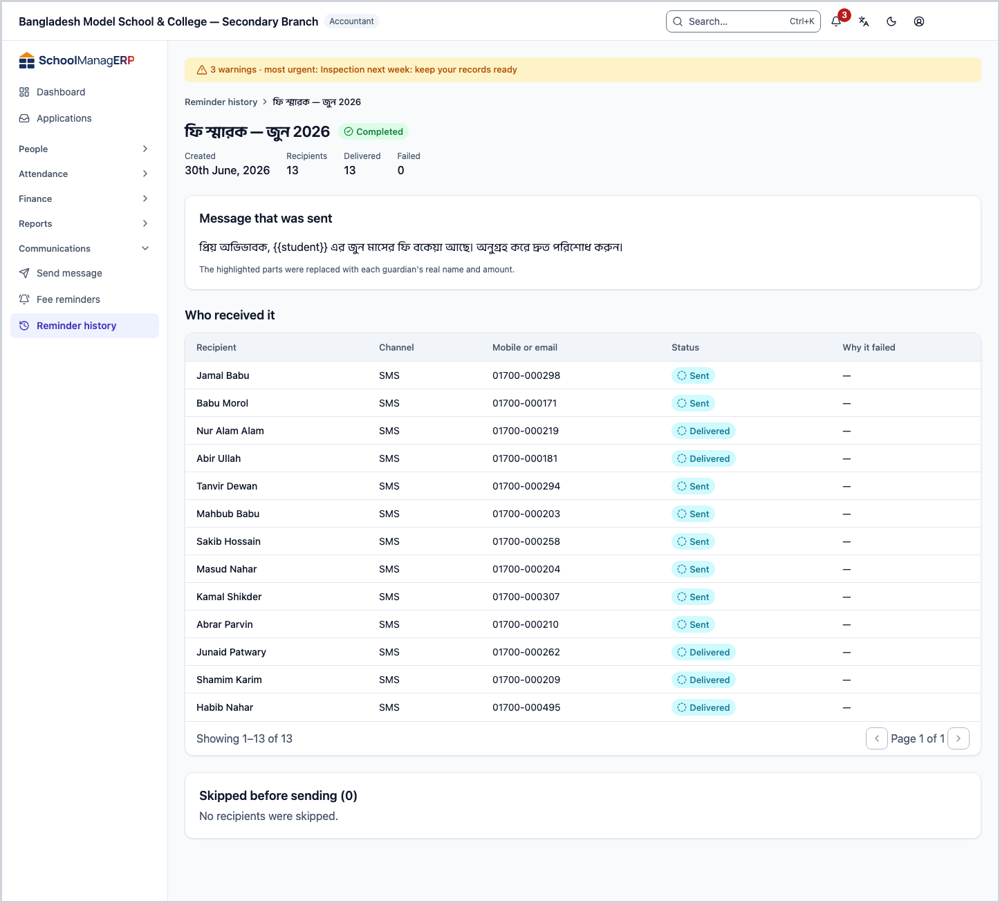
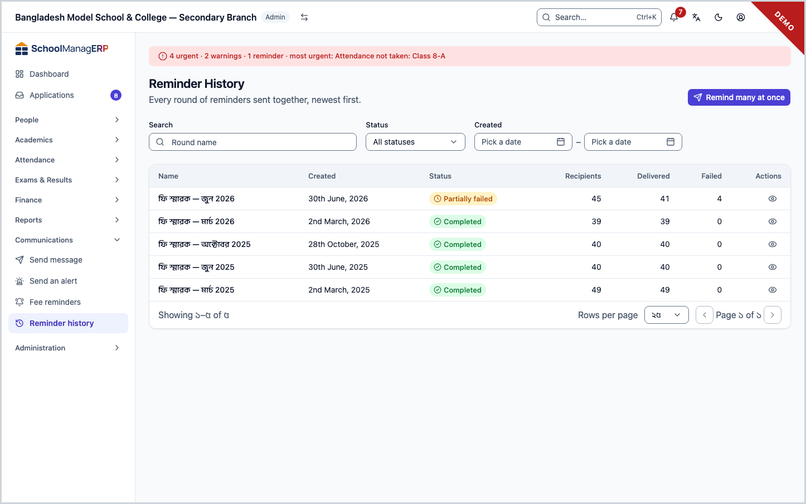

<!-- guide:meta
feature: communications.reminderHistory
title: Reminder history
summary: See every round of fee reminders sent together, which guardians the message reached and which it did not, who was skipped before sending, and retry the failed ones.
roles: [ADMIN, ACCOUNTANT, OFFICE_STAFF]
sources:
  - client-admin/src/routes/_staff/communications/batches/index.tsx
  - client-admin/src/routes/_staff/communications/batches/$batchId.tsx
  - client-admin/src/routes/_staff/communications/-shared/delivery-error.ts
  - client-admin/src/routes/_staff/communications/-shared/skip-reason.ts
  - server/src/modules/communications/communications.controller.ts
  - server/src/modules/communications/reminders.service.ts
  - server/src/modules/communications/reminder-batch-counters.ts
  - server/src/modules/communications/worker/communications.processor.ts
labels:
  [
    communications:batches.*,
    communications:skipReasons.*,
    communications:deliveryErrors.*,
    communications:notifications.*,
    common:status.reminderBatch.*,
    common:status.communication.*,
    nav:items.reminderHistory,
    nav:groups.communications,
  ]
helpIds:
  [
    communications.reminderHistory,
    communications.reminderHistory.action.retryFailed,
    communications.reminderHistory.field.status,
  ]
devices: [desktop]
entry: [sidebar, palette]
keywords:
  [reminder history, round, batch, delivered, failed, retry, resend, delivery log, skipped]
appVersion: 0.1.0 (3f7e424fc)
owner: tareq89
lastVerified: 2026-10-25
knownIssues: []
-->

# Reminder history

See every round of fee reminders sent together: who it reached, who it did not, and why.

**Where to go:** in the left menu, **Communications → Reminder History**. Do the work on this page on a computer.
**Before you start:** be an Admin, Accountant or Office staff ([who can do what](#roles)). Rounds come from pressing **Remind many at once** on the [**Fee reminders**](fee-reminders.md#task-bulk) page.

A reminder sent for one student, and a message from [**Send a message**](send-message.md), do not show here; only rounds sent together do.

[See a round](#task-main) · [What the statuses mean](#confirm) · [Retry the failed](#task-retry) · [Problems and fixes](#trouble)

**On this page**

- [See who a round reached](#task-main)
- [What the round and message statuses mean](#confirm)
- [Other situations](#other)
  - [Retry the failed deliveries](#task-retry)
  - [Who was skipped before sending](#task-skipped)
  - [Find a round](#task-find)
- [Problems and fixes](#trouble)
- [Who can do what](#roles)
- [Learn more](#more)

---

## See who a round reached 

On the demo and staging sites nothing is really sent: the messages of a round land in the **test inbox** (see [Where do codes and messages go on the demo?](../start/sign-in.md#task-test-inbox)).

1. In the left menu press **Communications**, then press **Reminder History**.

   → The **Reminder History** list opens: **Every round of reminders sent together, newest first.** Columns: **Name**, **Created**, **Status**, **Recipients**, **Delivered**, **Failed**.

2. Press **View** on a round.

   → The round's page opens. At the top: **Created**, **Recipients**, **Delivered**, **Failed** and the status. Below: **Message that was sent**.

3. Look at the **Who received it** list: **Recipient**, **Channel**, **Mobile or email**, **Status** and **Why it failed**.

   → While the round is **Processing**, the page refreshes by itself again and again. When it ends, a message appears, for example **Reminder round finished: … sent.**

---

## What the round and message statuses mean 

**Round status**

| Status               | Meaning                           | What next                             |
| -------------------- | --------------------------------- | ------------------------------------- |
| **Processing**       | The messages are still being sent | Wait; the page refreshes by itself    |
| **Completed**        | All messages sent, none failed    | Nothing more to do                    |
| **Partially failed** | Some went, some failed            | [Retry the failed](#task-retry)       |
| **Failed**           | None went                         | See the reason, fix it and send again |

**Status of one message** (in the **Who received it** list)

| Status                  | Meaning                                                    |
| ----------------------- | ---------------------------------------------------------- |
| **Queued**              | Still waiting to be sent                                   |
| **Sent**                | The SMS or email service has taken the message             |
| **Delivered**, **Read** | Not reported yet: the app does not record delivery reports |
| **Failed**              | It did not go; the reason is in **Why it failed**          |

The **Delivered** number at the top means how many messages the service has taken; reaching the phone is not counted separately.

This page does not keep anything on your phone or computer, so there is no "saved on this device" state.

---

## Other situations 

### Retry the failed deliveries 

When a round has finished and at least one failed, **Retry failed** appears at the top.

1. Press **Retry failed**.

   → The **Retry failed deliveries?** window opens. It shows the name of the new round, for example **Retry of March dues**.

2. Read the warning: **every guardian** of the students whose delivery failed is messaged again, including those whose earlier message was delivered.
3. Press **Retry**.

   → A new round is made and its page opens. The same message, the same channel and the same WhatsApp template go. **{Amount due}** and **{Due month}** are filled in again from the dues on the day of sending.

> **Remember:** there is no preview before a retry, and for SMS credit is used again. If you do not fix the reason for the failure (for example, SMS turned off), it will fail again.

### Who was skipped before sending 

At the bottom of the round's page is **Skipped before sending (…)**. It is grouped by reason, with **… students** beside each. The meaning of each reason is on the [**Fee reminders**](fee-reminders.md#task-skipped) page. If nobody was skipped, it says **No recipients were skipped.**

Nothing was sent to these people, so **Retry failed** does not include them.

### Find a round 

In the **Search** box above the list type the round's name. Filter by **Status**, or give dates in **Created**. The filters are kept in the page address.

---

## Problems and fixes 

| What you see                                                          | What to do                                                                             | Who can help |
| --------------------------------------------------------------------- | -------------------------------------------------------------------------------------- | ------------ |
| **No reminder rounds yet.**                                           | Press **Remind many at once** and send the first round.                                | —            |
| **Could not load reminder rounds.** or **Could not load this round.** | Reload the page.                                                                       | Admin        |
| **Could not load delivery logs.**                                     | Reload the page.                                                                       | Admin        |
| **Why it failed**: **Sending by … is not set up for this school. …**  | An Admin turns it on in **Settings › Communication**, then send again.                 | Admin        |
| **Why it failed**: **… cannot be sent automatically.**                | The app cannot send by this channel. Send by another channel.                          | —            |
| No **Retry failed**                                                   | The round is still **Processing**, or nothing failed.                                  | —            |
| **This round has no stored message template, …**                      | Send again yourself: a new round from [**Fee reminders**](fee-reminders.md#task-bulk). | —            |
| **No failed deliveries with a student on file to retry.**             | The failed messages are not linked to a student; send a new round.                     | —            |
| **The retry could not be started.**                                   | Try again. For SMS the credit may be low; tell the Admin.                              | Admin        |
| **Too many bulk requests in a row — …**                               | Wait a minute and press again.                                                         | —            |
| A round stays **Processing** for a long time                          | Some messages are still queued. If it stays long, tell the Admin.                      | Admin        |

More help with this: [What to do when something goes wrong](../help/troubleshooting.md#sms).

---

## Who can do what 

| Role                                                             | View rounds | Retry |
| ---------------------------------------------------------------- | ----------- | ----- |
| Admin                                                            | Yes         | Yes   |
| Accountant                                                       | Yes         | Yes   |
| Office staff                                                     | Yes         | Yes   |
| Academic coordinator, Teacher, Exam controller, Committee member | No          | No    |

**Admin, Accountant and Office staff:** all three see all the school's rounds, not only their own; there is no difference in the code.

For the other roles, **Reminder History** is not in the left menu.

---

## Learn more 

<strong>Parts of the page</strong> — the list of rounds

1. The **Reminder History** title and the **Remind many at once** button.
2. Filters: **Search**, **Status**, **Created** (**Created from**, **Created to**).
3. The list: **Name**, **Created**, **Status**, **Recipients**, **Delivered**, **Failed**; **View** on a row.

<strong>How a round moves</strong>

<figure>
  
  <figcaption><em>The status of a round</em></figcaption>
</figure>

- **How the status is decided:** it is counted as each message finishes. If none failed, **Completed**; if none went, **Failed**; everything else is **Partially failed**.
- **Retry means a new round:** the old round stays as it was. The new round is sent by student, not by guardian.
- **Refreshing:** the page fetches new data by itself only while the round is **Processing**.

<strong>Short help for the boxes (the (?) button)</strong>

<!-- guide:generated:fields:communications -->

| Field                     | What to enter                                                                                                                                                                                                                               | Required?         |
| ------------------------- | ------------------------------------------------------------------------------------------------------------------------------------------------------------------------------------------------------------------------------------------- | ----------------- |
| Which guardian to send to | One guardian of the chosen student. Their phone or email shows below; without one you cannot send.                                                                                                                                          | Yes               |
| How to send               | Send message: SMS, WhatsApp or Email; SMS and WhatsApp go to the guardian’s phone, or the alternate phone if there is none. Fee reminder: starts on each guardian’s preferred channel; pick one to send everyone on that channel this time. | No                |
| Message                   | What to send. For SMS, the characters and the number of SMS it uses show below. In a fee reminder, use the buttons below to put in the name, due amount or month; each guardian gets their real details.                                    | Yes               |
| Who to remind             | Every guardian starts ticked. A guardian who turned notifications off does not get it, even when ticked.                                                                                                                                    | Yes, at least one |
| Batch name                | A name for this batch; you find it by this name in Reminder history later.                                                                                                                                                                  | Yes               |
| Channels (bulk reminder)  | A guardian whose preferred channel is not ticked here is skipped. All three start ticked.                                                                                                                                                   | Yes, at least one |
| Status                    | Shows only the rounds in one state: Processing, Completed, Partially failed or Failed. Leave it on All statuses to see every round.                                                                                                         | No                |

<!-- /guide:generated -->

**Related pages**

- [**Fee reminders**](fee-reminders.md) — rounds are sent from here.
- [**Send a message**](send-message.md) — a separate message to one guardian.

---

_Version 0.1.0 · last verified 2026-10-25_
