<!-- guide:meta
feature: communications.sendAlert
title: Send an alert
summary: Write a short alert by hand and send it to chosen roles, sections, guardians or named staff; it shows in their bar at the top and in their notifications until the end date, and you can withdraw it early.
roles: [ADMIN, EXECUTIVE]
sources:
  - client-admin/src/routes/_staff/communications/send-alert.tsx
  - client-admin/src/features/attention/send-alert/send-alert-form.tsx
  - client-admin/src/features/attention/send-alert/audience-picker.tsx
  - client-admin/src/features/attention/send-alert/link-options.ts
  - client-admin/src/features/attention/send-alert/sent-alerts-card.tsx
  - server/src/modules/attention/manual/manual-alerts.controller.ts
  - server/src/modules/attention/manual/manual-alerts.service.ts
labels: [attention:composer.*, attention:roles.*, attention:severity.*, nav:items.sendAlert, nav:groups.communications]
helpIds: [communications.sendAlert]
devices: [desktop]
entry: [sidebar, palette]
keywords: [alert, send alert, warning, reminder, announce, notice to parents, withdraw alert, সতর্কতা]
appVersion: 0.1.0 (fb209bd7c)
owner: tareq89
lastVerified: 2026-10-25
knownIssues:
  - { id: named-people-first-100-staff, checked: 2026-10-25, issue: null }
  - { id: portal-link-list-misses-pages, checked: 2026-10-25, issue: null }
-->

# Send an alert

Send a short notice that you write yourself to many people at once. It shows in the bar at the top of their app and in their notifications.

**Where to go:** in the left menu, **Communications → Send an alert**. Do the work on this page on a computer.
**Before you start:** be an Admin or Academic coordinator ([who can do what](#roles)). A person gets the alert only if they have an account in the app.

An alert is not an SMS. To text one guardian, use [**Send a message**](send-message.md).

[Send an alert](#task-main) · [Withdraw an alert](#task-withdraw) · [Problems and fixes](#trouble)

**On this page**

- [How to get to this page](#arrive)
- [Send an alert](#task-main)
- [How to know it was sent](#confirm)
- [Other situations](#other)
  - [Choosing who gets it](#task-who)
  - [Add a page to open](#task-link)
  - [Withdraw an alert](#task-withdraw)
- [Problems and fixes](#trouble)
- [Who can do what](#roles)
- [Known issues](#known-issues)
- [Learn more](#more)

---

## How to get to this page 

**From the menu:** in the left menu press **Communications**, then **Send an alert**.

**By search:** press the search button at the top and type "alert".

The page opens over the whole screen. **Cancel** or the close button takes you back to the page you came from. If you opened the link directly, it takes you to [**Send a message**](send-message.md).

---

## Send an alert 

1. Open **Communications → Send an alert**.

   → The **Send an alert** page opens with four parts: **What to send**, **Who gets it**, **How long to show it** and **How people will see it**.

2. Under **Type**, pick **Warning** (important; people can close it or be reminded later) or **Reminder** (just to let people know).

3. Write the **Title** (up to 140 letters) and the **Message** (up to 500 letters).

4. Under **Who gets it**, tick one or more groups and add names from the list ([Choosing who gets it](#task-who)).

   → A grey box shows the total, for example **48 people in total**, and **Someone in two groups gets it once.**

5. Under **Show until**, pick the last day. It starts on tomorrow. You can pick today up to 30 days from today.

6. Look at **How people will see it**. It is a copy of the bar with your title.

7. Press **Send** (or press Ctrl+Enter).

   → A message says **Sent to 48 people** and the page closes.

<!-- image pending: Send an alert page with Warning picked, a title, Guardians of sections with one section, the count box and the preview bar; admin, desktop -->

> **Remember:** **Send** stays grey until there is a title, a message and at least one person. The line above the list says what is still missing, such as **Write a title first.**

---

## How to know it was sent 

Open **Send an alert** again. The **Sent alerts** list at the bottom shows your alert at the top with the status **Active**. The **Seen** column shows how many people have seen it out of how many got it, such as **12 / 48**.

| Status        | What it means                                      |
| ------------- | -------------------------------------------------- |
| **Active**    | It is in people's bars now.                        |
| **Expired**   | The **Until** day is over. It has left the bar.    |
| **Withdrawn** | Someone pressed **Withdraw**. It has left the bar. |

---

## Other situations 

### Choosing who gets it 

Tick a group, then pick from its list. Each pick shows as a chip; press a chip to remove it.

| Group                     | Who gets it                                                                     |
| ------------------------- | ------------------------------------------------------------------------------- |
| **By role**               | Everyone in the school with that role, such as **Teacher** or **Parent**.       |
| **Students of sections**  | Students of the chosen sections who are currently enrolled and have an account. |
| **Guardians of sections** | Guardians of those students who have an account.                                |
| **Named people**          | The staff members you pick by name.                                             |

You can use several groups together. If nobody matches, the box says **Nobody matches these groups.** and you cannot send.

### Add a page to open 

**Page to open (optional)** lets people tap the alert and go straight to a page.

- If only staff get it, the list shows staff pages that every chosen role can open.
- If only parents and students get it, the list shows portal pages, such as **Fees and invoices**.
- If you mix staff with parents or students, the list is off: **A link only works when everyone uses the same app.**

### Withdraw an alert 

1. In **Sent alerts**, find a row with the status **Active**.
2. Press **Withdraw**.

   → A box asks **Withdraw this alert?** and says from how many bars it will disappear.

3. Press **Withdraw** again.

   → **Alert withdrawn**. The status becomes **Withdrawn**. It cannot be sent again; write a new one if needed.

---

## Problems and fixes 

| What you see                                               | What to do                                                                                      | Who can help |
| ---------------------------------------------------------- | ----------------------------------------------------------------------------------------------- | ------------ |
| **Nobody matches these groups.**                           | The chosen people have no account, or the section has no enrolled students. Pick another group. | Admin        |
| **Daily limit of 20 alerts reached. Try again tomorrow.**  | A school can send 20 alerts in any 24 hours. Withdrawn ones count too. Wait.                    | —            |
| **Too many tries. Wait a minute and try again.**           | Wait one minute, then press **Send** again.                                                     | —            |
| **Pick an end date between today and 30 days from today.** | Change **Show until**.                                                                          | —            |
| **Could not refresh the count, so it may be out of date.** | The number may be old. Wait a moment; it updates when you change a group.                       | —            |
| A guardian says they did not get it                        | They need an account in the app. An alert is not sent by SMS.                                   | Admin        |
| No **Urgent** type                                         | **Urgent alerts can't be sent by hand. They come from the school's rules.**                     | —            |

---

## Who can do what 

| Role                 | Can send and withdraw | Sees **Sent alerts** |
| -------------------- | --------------------- | -------------------- |
| Admin                | Yes                   | Yes                  |
| Academic coordinator | Yes                   | Yes                  |

For other roles, **Send an alert** is not in the left menu. They only receive alerts, on [**Seeing and settling alerts**](../dashboard/alerts.md) (staff) or [**Alerts and notifications (parent and student)**](../portal/notifications.md).

---

## Known issues 

| Issue                                                                                                                                           | Who, when                                 | Is data saved? | What to do for now                                  |
| ----------------------------------------------------------------------------------------------------------------------------------------------- | ----------------------------------------- | -------------- | --------------------------------------------------- |
| **Named people** offers only the first 100 staff members, so some staff cannot be found by name                                                 | Schools with more than 100 staff accounts | —              | Use **By role** instead                             |
| **Page to open** for parents and students does not offer [**Homework**](../portal/homework.md) or [**Applications**](../portal/applications.md) | Alerts to parents or students             | —              | Pick **No page** and say in the message where to go |

---

## Learn more 

<strong>Parts of the page</strong>

1. **What to send**: **Type**, **Title**, **Message**, **Page to open (optional)**.
2. **Who gets it**: the four groups and the count box.
3. **How long to show it**: **Show until**.
4. **How people will see it**: a copy of the bar.
5. **Sent alerts**: **Title**, **Type**, **Sent**, **Until**, **Seen**, **Status** and **Withdraw**.

<!-- image pending: Send an alert page, five parts marked with numbers; admin, desktop -->

<strong>How an alert travels</strong>

<figure>
  
  <figcaption><em>The path of one alert</em></figcaption>
</figure>

- **Who is counted:** only people whose account is active in this school. A student or guardian with no account is left out.
- **Until when:** the alert leaves the bar at the end of the **Show until** day, school time.
- **Limit:** 20 alerts per school in any 24 hours.

**Related pages**

- [**Send a message**](send-message.md) — an SMS, WhatsApp or email to one guardian.
- [**Alerts report**](../reports/alerts-report.md) — how many alerts the school's rules raised each month.
- [**Seeing and settling alerts**](../dashboard/alerts.md) — where staff see the alert you sent.
- [**Alerts and notifications (parent and student)**](../portal/notifications.md) — where parents and students see it.

---

_Version 0.1.0 · Last verified 2026-10-25_
