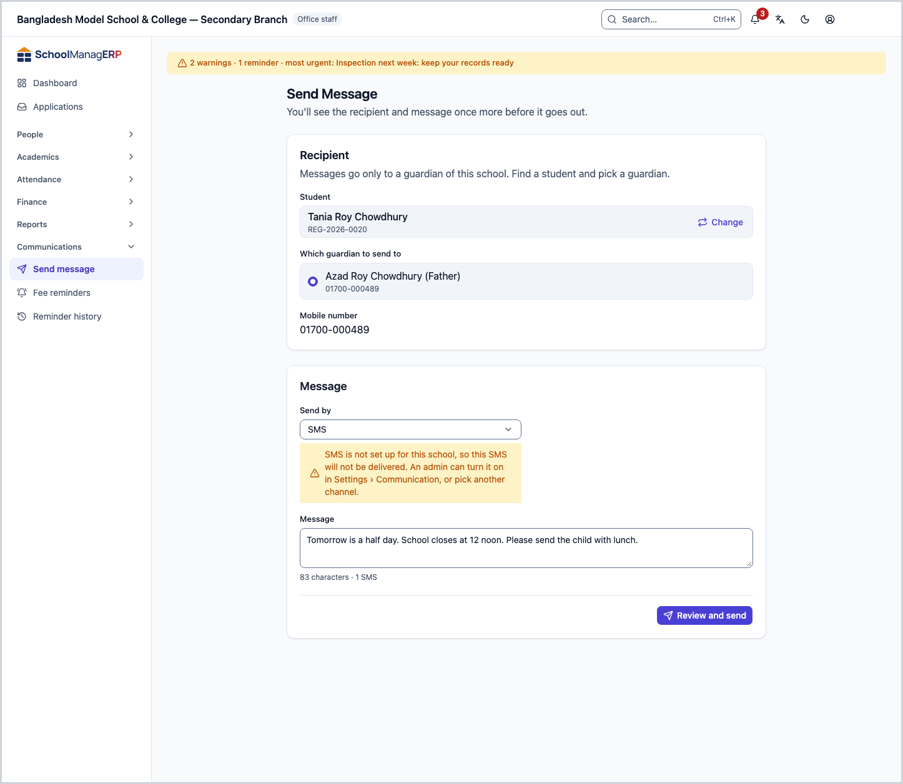
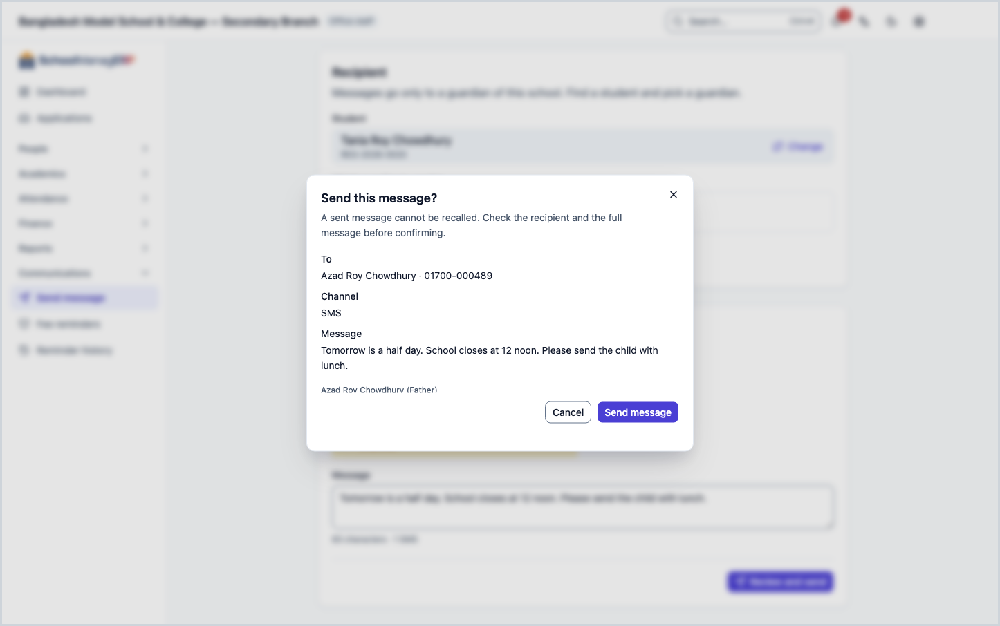

<!-- guide:meta
feature: communications.sendMessage
title: Send a message
summary: Send your own message to one guardian of a student by SMS, WhatsApp or email; check before sending how many SMS it will use, and see afterwards whether it arrived.
roles: [ADMIN, ACCOUNTANT, OFFICE_STAFF]
sources:
  - client-admin/src/routes/_staff/communications/send.tsx
  - client-admin/src/routes/_staff/communications/-shared/sms-segment-counter.tsx
  - client-admin/src/routes/_staff/communications/-shared/sms-readiness.ts
  - client-admin/src/routes/_staff/communications/-shared/student-search.tsx
  - client-admin/src/routes/_staff/communications/-shared/whatsapp-template-fields.tsx
  - client-admin/src/routes/_staff/communications/-shared/delivery-error.ts
  - shared/src/sms/segments.ts
  - server/src/modules/communications/communications.controller.ts
  - server/src/modules/communications/communications.service.ts
  - server/src/modules/communications/credits/sms-credit.service.ts
  - server/src/modules/communications/credits/credits.controller.ts
  - server/src/modules/communications/worker/communications.processor.ts
labels:
  [
    communications:mediums.*,
    communications:smsCounter.*,
    communications:send.*,
    communications:whatsapp.*,
    communications:deliveryErrors.*,
    communications:fields.*,
    communications:help.*,
    communications:helpRequired.*,
    nav:items.sendMessage,
    nav:groups.communications,
  ]
helpIds:
  [
    communications.sendMessage,
    communications.sendMessage.action.send,
    communications.sendMessage.field.guardian,
    communications.sendMessage.field.medium,
    communications.sendMessage.field.message,
  ]
devices: [desktop]
entry: [sidebar, palette]
keywords:
  [message, sms, whatsapp, email, message a guardian, sms credit, how many sms, characters, segments]
appVersion: 0.1.0 (3f7e424fc)
owner: tareq89
lastVerified: 2026-10-25
knownIssues: []
-->

# Send a message

Send one message that you write to one guardian: by SMS, WhatsApp or email.

**Where to go:** in the left menu, **Communications → Send Message**. Do the work on this page on a computer.
**Before you start:** be an Admin, Accountant or Office staff ([who can do what](#roles)). The guardian's phone number or email must be in their details ([Guardians](../people/guardians.md)). The school must have [SMS sending](../administration/settings.md) turned on.

You can send to only one person at a time. To remind many guardians about dues together, use [**Fee reminders**](fee-reminders.md).

[Send a message](#task-main) · [How many SMS](#sms-count) · [Did it arrive](#confirm) · [Problems and fixes](#trouble)

**On this page**

- [Send an SMS to one guardian](#task-main)
- [How to know the message arrived](#confirm)
- [Other situations](#other)
  - [See before sending how many SMS it needs](#sms-count)
  - [Send by email](#task-email)
  - [Send by WhatsApp](#task-whatsapp)
- [Problems and fixes](#trouble)
- [Who can do what](#roles)
- [Learn more](#more)

---

## Send an SMS to one guardian 

1. In the left menu press **Communications**, then press **Send Message**.

   → The **Send Message** page opens. It has two parts: **Recipient** and **Message**.

2. In the **Student** box type a name or roll number, and pick the student from the list.

   → **Guardians of …** appears below. Under each guardian's name is their number; if there is none, it says **no address for this channel**.

3. Pick one guardian.

   → The **Mobile number** box below shows their number. The number comes from the guardian's details; you cannot change it here.

4. Keep **Send by** on **SMS**.
5. Write your message in the **Message** box.

   → A line appears below, for example **95 characters · 2 SMS**. It changes as you type. For how it is counted, see [how many SMS](#sms-count).

6. Press **Review and send**.

   → The **Send this message?** window opens with **To**, **Channel** and the whole **Message**. It says **A sent message cannot be recalled.**

7. If everything is right, press **Send message**.

   → **Message on its way** appears, with the **Delivery status**. If you keep the page open, the status updates by itself.

> **Remember:** even if a guardian turned notifications off, a message from this page still reaches them. This is the way for urgent things; dues reminders do not reach them.

---

## How to know the message arrived 

| State                      | How you know                                                                                       | What next                               |
| -------------------------- | -------------------------------------------------------------------------------------------------- | --------------------------------------- |
| **Only written on screen** | The form is open; if you try to leave, a warning appears                                           | Press **Review and send**               |
| **Queued**                 | **Message on its way**, status **Queued**                                                          | Wait; the school's system is sending it |
| **Sent**                   | Status **Sent**: the SMS or email service has taken the message                                    | Nothing more to do                      |
| **Delivered** or **Read**  | Not reported yet: the app does not record delivery reports, so **Sent** is the last status you see | Nothing more to do                      |
| **Failed**                 | The heading **Message not sent**, with the reason below                                            | See [Problems and fixes](#trouble)      |

This page does not keep anything on your phone or computer, so there is no "saved on this device" state.

**If you are not sure, pressing again is safe:** you cannot close the window while sending. If no answer comes and you press **Send message** again with the same message, without leaving or reloading the page, the school's system returns the earlier result (it remembers it for 24 hours); the message does not go twice. If even one letter is changed, or the first send already showed as done, it is a new message.

---

## Other situations 

### See before sending how many SMS it needs 

One long message becomes several SMS, and each one is charged separately. The line under the **Message** box, for example **95 characters · 2 SMS**, tells you how many. It is counted like this:

| What the message has                                          | Characters in one SMS | Characters in each, if more than one |
| ------------------------------------------------------------- | --------------------- | ------------------------------------ |
| Only English letters, numbers and signs                       | 160                   | 153                                  |
| Even one Bangla letter, emoji or sign outside the English set | 70                    | 67                                   |

**Examples:**

- 70 Bangla characters → 1 SMS. 71 characters → 2 SMS (67 + 4).
- 140 Bangla characters → 3 SMS (67 + 67 + 6).
- 160 English characters → 1 SMS. 161 characters → 2 SMS.
- If an English message has even one Bangla word, the whole message is counted as Bangla.
- In an English message, each of `[ ] { } \ ~ ^ |` counts as two characters.

**When the cost is taken:** if the school has SMS credit, one SMS is one credit. When you press **Send message**, that many credits are held. When the SMS service takes the message, the credit is deducted. If it cannot be sent, for example because SMS is not turned on, the held credit is returned. If the credit is too low, nothing is sent.

> **Remember:** if SMS is not turned on, or the credit has run out, a yellow warning appears below **Send by**. It does not stop you from sending, but the SMS will not arrive. Pick another channel or tell the Admin.

### Send by email 

Choose **Email** in **Send by**. A **Subject** box appears. Under the guardian's name you see their email, and it goes in the **Email address** box. The other steps are the same. Email does not use SMS credit.

### Send by WhatsApp 

Choose **WhatsApp** in **Send by**. The message goes to the guardian's phone number, or the alternate number if there is none.

If the guardian has not replied to the school on WhatsApp in the last 24 hours, a normal message does not arrive. Then fill in an approved template in the **Template name**, **Template language** and **Template parameters (comma separated)** boxes.

---

## Problems and fixes 

| What you see                                                             | What to do                                                                                         | Who can help |
| ------------------------------------------------------------------------ | -------------------------------------------------------------------------------------------------- | ------------ |
| You cannot press **Review and send**                                     | Pick one guardian who has a number or email for this channel.                                      | —            |
| **no address for this channel**                                          | Pick another channel or guardian, or add a number on the [Guardians](../people/guardians.md) page. | Office staff |
| **This guardian has no number or email for this channel. …**             | Same as above.                                                                                     | Office staff |
| **This guardian is not linked to the chosen student.**                   | Pick the student again, then the guardian.                                                         | —            |
| **Something in the number, email or message isn't right. …**             | Check that the message is not empty and the WhatsApp template details are right.                   | —            |
| **SMS is not set up for this school, …**                                 | An Admin turns it on in **Settings › Communication**; for now pick another channel.                | Admin        |
| **This school has no SMS credit left, …**                                | Ask the Admin to add credit; for now pick another channel.                                         | Admin        |
| **Not enough SMS credit to send: … needed, only … available.**           | Shorten the message, or ask the Admin to add credit; for now pick another channel.                 | Admin        |
| **The message could not be sent.** in the window                         | Check your internet and press **Send message** again.                                              | Admin        |
| **Message not sent** — **Sending by … is not set up for this school. …** | Press **Open Settings › Communication** (Admin).                                                   | Admin        |
| **Message not sent** — **Could not be sent.**                            | Press **Send another message** and try again.                                                      | Admin        |

More help with this: [What to do when something goes wrong](../help/troubleshooting.md#sms).

---

## Who can do what 

| Role                                                             | Send a message |
| ---------------------------------------------------------------- | -------------- |
| Admin                                                            | Yes            |
| Accountant                                                       | Yes            |
| Office staff                                                     | Yes            |
| Academic coordinator, Teacher, Exam controller, Committee member | No             |

**Admin, Accountant and Office staff:** all three get the same page; there is no difference in the code. You can send only to a guardian of a student of this school. Turning SMS on and seeing the credit is the Admin's job.

For the other roles, **Send Message** is not in the left menu.

---

## Learn more 

<strong>Parts of the page</strong>

1. The **Send Message** title: **You'll see the recipient and message once more before it goes out.**
2. **Recipient**: **Student**, **Which guardian to send to**, **Mobile number** or **Email address**.
3. **Message**: **Send by**, **Subject** (for email), **Message**, the character-SMS line, the WhatsApp template boxes.
4. **Review and send**.

<strong>What each field means</strong>

<!-- guide:generated:fields:communications -->

| Field                     | What to enter                                                                                                                                                                                                                               | Required?         |
| ------------------------- | ------------------------------------------------------------------------------------------------------------------------------------------------------------------------------------------------------------------------------------------- | ----------------- |
| Which guardian to send to | One guardian of the chosen student. Their phone or email shows below; without one you cannot send.                                                                                                                                          | Yes               |
| How to send               | Send message: SMS, WhatsApp or Email; SMS and WhatsApp go to the guardian’s phone, or the alternate phone if there is none. Fee reminder: starts on each guardian’s preferred channel; pick one to send everyone on that channel this time. | No                |
| Message                   | What to send. For SMS, the characters and the number of SMS it uses show below. In a fee reminder, use the buttons below to put in the name, due amount or month; each guardian gets their real details.                                    | Yes               |
| Who to remind             | Every guardian starts ticked. A guardian who turned notifications off does not get it, even when ticked.                                                                                                                                    | Yes, at least one |
| Batch name                | A name for this batch; you find it by this name in Reminder history later.                                                                                                                                                                  | Yes               |
| Channels (bulk reminder)  | A guardian whose preferred channel is not ticked here is skipped. All three start ticked.                                                                                                                                                   | Yes, at least one |
| Status                    | Shows only the rounds in one state: Processing, Completed, Partially failed or Failed. Leave it on All statuses to see every round.                                                                                                         | No                |

<!-- /guide:generated -->

<strong>How a message goes</strong> — the check, credit and delivery

<figure>
  
  <figcaption><em>The path of one message</em></figcaption>
</figure>

- **Where the number comes from:** the guardian's details. For SMS and WhatsApp, the phone number, or the alternate number if there is none; for email, the email.
- **The queue:** when you press **Send message**, the message goes into a queue; the school's system sends it in the background. So the status is **Queued** at first.
- **Credit:** only at a school that counts SMS credit. One SMS = one credit. Held before sending, deducted when sent, returned if not. If the result is unclear, the credit stays held and is matched by hand later.
- **Never twice:** if a send got no answer and you press again with the same message on the same open page, the earlier result is returned (kept for 24 hours). After a send that showed as done, pressing again sends a new message.

**Related pages**

- [**Fee reminders**](fee-reminders.md) — remind one or many guardians about dues.
- [**Reminder history**](reminder-history.md) — the rounds of reminders sent together.
- [**Viewing, fixing and inviting guardians**](../people/guardians.md) — numbers and emails are fixed here.

- [**Send an alert**](send-alert.md) — a short notice to many people at once, in their app.
- [**Changing the school's settings**](../administration/settings.md) — the school settings

---

_Version 0.1.0 · last verified 2026-10-25_
