<!-- guide:meta
feature: communications.staffMessage
title: Message staff
summary: Send one SMS to your teachers or office staff; see before sending how many people get it, who is left out and how many credits it uses.
roles: [ADMIN, EXECUTIVE]
sources:
  - client-admin/src/routes/_staff/communications/staff-message.tsx
  - client-admin/src/routes/_staff/communications/-staff-message-form.tsx
  - client-admin/src/routes/_staff/communications/send.tsx
  - client-admin/src/routes/_staff/staff/index.tsx
  - client-admin/src/routes/_staff/my-coordination/-notify-dialog.tsx
  - client-admin/src/action-registry.ts
  - server/src/modules/communications/communications.controller.ts
  - server/src/modules/communications/staff-messages.service.ts
  - server/src/modules/communications/dto/staff-message.dto.ts
labels:
  [
    communications:staffMessage.*,
    communications:fields.*,
    communications:help.*,
    communications:helpRequired.*,
  ]
helpIds: [communications.staffMessage]
devices: [desktop]
entry: [palette, page:communications.sendMessage, page:people.staff]
keywords:
  [staff message, message teachers, sms teachers, message staff, send sms to staff, staff sms, sms credit]
appVersion: 0.1.0 (b238c0260)
owner: tareq89
lastVerified: 2026-11-16
knownIssues: []
-->

# Message staff

Send one SMS that you write to your teachers or office staff, and see before it goes how many people get it and what it costs.

**Where to go:** press **Ctrl+K** and type **Message staff**, or follow one of the paths in [How you get here](#arrive). Do the work on this page on a computer.
**Before you start:** be an Admin or an Academic coordinator ([who can do what](#roles)). The school must have [SMS sending](../administration/settings.md) turned on. A staff member needs a phone number in their [profile](../people/staff.md) to get the message.

To message the guardians of a student instead, use [**Send a message**](send-message.md). A Teacher who coordinates other teachers uses [**My coordination**](../academics/my-coordination.md) instead of this page.

[Message your teachers](#task-main) · [Choose other people](#task-more) · [Did it go](#confirm) · [Problems and fixes](#trouble)

**On this page**

- [How you get here](#arrive)
- [Message all your teachers](#task-main)
- [How to know the message went](#confirm)
- [Other situations](#other)
  - [Choose other people](#task-more)
  - [Send by WhatsApp](#task-whatsapp)
  - [People who are left out](#task-skipped)
- [Problems and fixes](#trouble)
- [Who can do what](#roles)
- [Learn more](#more)

---

## How you get here 

**From Send Message**

1. Open **Communications → Send Message** ([Send a message](send-message.md)).
2. In **Send to**, press **Staff**.

   → The **Message staff** page opens.

**From the staff list**

1. Open the [staff list](../people/staff.md) and tick the people you want to message.
2. Press **Send SMS** at the top of the list.

   → This page opens with **To:** and the names you ticked. **These people were picked on the staff list.** Press **Choose a different group** to start again. Nothing is sent by opening the page.

---

## Message all your teachers 

1. Open **Message staff**.

   → **All teachers** is already ticked under **Who gets it**.

2. In the **Message** box type your message.

   → Below it you see the characters and how many SMS each person uses.

3. Press **Check who gets it**.

   → **Check before sending** shows **People**, **With a phone**, **Credits needed** and **Credit balance**, and says how many SMS each person uses.

4. Read the numbers. If some people are left out, see [People who are left out](#task-skipped).
5. Press **Send**.

   → The window **Send this message?** opens: "… people will get it and … credits will be used. A sent message cannot be taken back."

6. Press **Yes, send**.

   → **Message on its way** appears, with how many people will get it. Press **See message log** to follow it, or **Send another message**.

> **Remember:** nothing goes before you press **Yes, send**. **Send** stays grey until you have pressed **Check who gets it**. If you change anything after checking, **You changed something. Check again before sending.** appears; press **Check again**.

---

## How to know the message went 

| State                           | How you know                                              | What next                                         |
| ------------------------------- | --------------------------------------------------------- | ------------------------------------------------- |
| **Changed on screen only**      | The form is filled but you have not pressed **Yes, send** | Press **Check who gets it**, then **Send**        |
| **Reached the school's system** | **Message on its way**, with "… people will get it."      | Press **See message log** to see each one's state |

**To check:** press **See message log**, or open **Communications → Message log** ([Message log](message-log.md)). Each person has their own line.

**If you are not sure it went:** if the screen says **We could not confirm whether it was sent. Look in the message log before sending again.**, look in the message log first. If you send the same message to the same people again within a minute, you get **This message was just sent to the same people. Wait a minute before sending it again.**

---

## Other situations 

### Choose other people 

1. Press **Choose more** under **Who gets it**.

   → New choices open: **Role**, **Designation** and **Pick people**. **All teachers** and **All office staff** stay at the top.

2. To message only the new group, untick **All teachers** first. Then tick **All office staff**, or pick one or more in **Role** or **Designation**, or search a name in **Pick people**.
3. Press **Check who gets it** and continue from step 3 above.

Someone who falls in two groups is messaged once. You can message at most 500 people at once; for more, you see **You can message at most 500 people at once. Choose fewer people.** Press **Show fewer choices** to close the extra choices.

### Send by WhatsApp 

**Send by** shows **WhatsApp** only if your school has set it up. Everyone gets the same words, taken from a template your school has already got approved. Fill in **Template name**, **Template language** and **Template values (comma separated)**. **What will be delivered** shows the template name and the values, not the approved template text.

### People who are left out 

After you press **Check who gets it**, **Left out (…)** lists by name the people who will not get it: **No phone number, so left out**. They cost no credit. Add their number in their [profile](../people/staff.md), then press **Check again**. If nobody has a phone, you see **Nobody to send to**.

---

## Problems and fixes 

| What you see                                                              | What to do                                                                       | Who can help |
| ------------------------------------------------------------------------- | -------------------------------------------------------------------------------- | ------------ |
| **Type a message first.**                                                 | Write something in **Message**.                                                  | —            |
| **You are short by … credits** · **Add credit, or send to fewer people.** | Choose fewer people, or ask the Admin to add credit.                             | Admin        |
| **Nobody matches. Choose someone else.**                                  | The group you chose has no one. Pick another.                                    | —            |
| **None of these people has a phone number. …**                            | Add numbers in the [staff profiles](../people/staff.md), or choose other people. | Admin        |
| **SMS is not set up for this school. …**                                  | An Admin turns it on in **Settings › Communication**.                            | Admin        |
| **WhatsApp is not set up for this school. Send by SMS instead.**          | Use **SMS**.                                                                     | Admin        |
| **We could not check who gets it. Try again.**                            | Check your internet and press **Check again**.                                   | —            |
| **The message was not sent. Try again in a moment.**                      | Check your internet and press **Send** again.                                    | —            |

---

## Who can do what 

| Role                                                        | Message staff                                             |
| ----------------------------------------------------------- | --------------------------------------------------------- |
| Admin                                                       | Yes, to any staff                                         |
| Academic coordinator                                        | Yes                                                       |
| Teacher                                                     | Not on this page; uses **Send as SMS** in My coordination |
| Accountant, Office staff, Exam controller, Committee member | No                                                        |

For the other roles, **Message staff** is not available: the **Staff** tab on **Send Message** and the **Send SMS** button on the staff list are hidden from them. A Teacher who coordinates other teachers presses **Send as SMS** in the **Notify teachers** window of [My coordination](../academics/my-coordination.md); only the teachers they coordinate get it.

---

## Learn more 

<strong>What each field means</strong>

<!-- guide:generated:fields:communications -->

| Field                     | What to enter                                                                                                                                                                                                                                      | Required?                      |
| ------------------------- | -------------------------------------------------------------------------------------------------------------------------------------------------------------------------------------------------------------------------------------------------- | ------------------------------ |
| Which guardian to send to | One guardian of the chosen student. Their phone or email shows below; without one you cannot send.                                                                                                                                                 | Yes                            |
| How to send               | Send message: SMS, WhatsApp or Email; SMS and WhatsApp go to the guardian’s phone, or the alternate phone if there is none. Fee reminder: starts on each guardian’s preferred channel; pick one to send everyone on that channel this time.        | No                             |
| Message                   | What to send. For SMS, the characters and the number of SMS it uses show below. In a fee reminder, use the buttons below to put in the name, due amount or month; each guardian gets their real details.                                           | Yes                            |
| Who to remind             | Every guardian starts ticked. A guardian who turned notifications off does not get it, even when ticked.                                                                                                                                           | Yes, at least one              |
| Batch name                | A name for this batch; you find it by this name in Reminder history later.                                                                                                                                                                         | Yes                            |
| Channels (bulk reminder)  | A guardian whose preferred channel is not ticked here is skipped. All three start ticked.                                                                                                                                                          | Yes, at least one              |
| Status                    | Shows only the rounds in one state: Processing, Completed, Partially failed or Failed. Leave it on All statuses to see every round.                                                                                                                | No                             |
| Who gets it               | Starts on All teachers when the form opens without preselected staff; opened for one or more staff members, those people stay selected instead. Choose more to pick a role, a designation or named people. Someone in two groups is messaged once. | Yes                            |
| Send by                   | SMS uses your school’s SMS credits. WhatsApp needs a template your school has already got approved, and shows only if the school set it up.                                                                                                        | No                             |
| Message                   | What to send. The characters and how many SMS each person uses show below. A credit is one SMS to one person. Staff who have no phone number are left out and listed by name.                                                                      | Yes                            |
| WhatsApp template         | Type the approved template’s name, its language and the values. Everyone gets the same words. The preview shows the template name and the values, not the approved template text.                                                                  | Yes, once WhatsApp is selected |

<!-- /guide:generated -->

<strong>How a staff message goes</strong>

<figure>
  
  <figcaption><em>The path of a staff message</em></figcaption>
</figure>

- **One SMS credit** is one SMS to one person. A long message uses more than one SMS; see [how many SMS](send-message.md#sms-count).
- **Never twice:** the same message to the same people within a minute is refused.

**Related pages**

- [**Send a message**](send-message.md) — message the guardian of a student.
- [**Message log**](message-log.md) — see whether each person got it.
- [**Staff**](../people/staff.md) — fix phone numbers; pick people to message.
- [**My coordination**](../academics/my-coordination.md) — a coordinating Teacher's way to SMS their teachers.

---

_Version 0.1.0 · last verified 2026-11-16_
