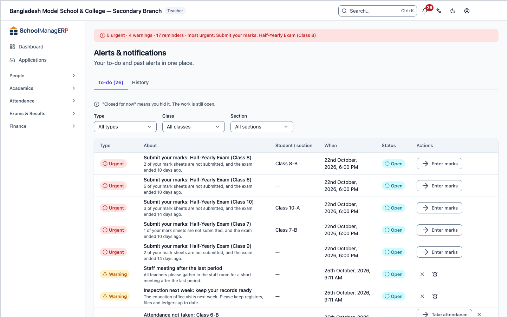
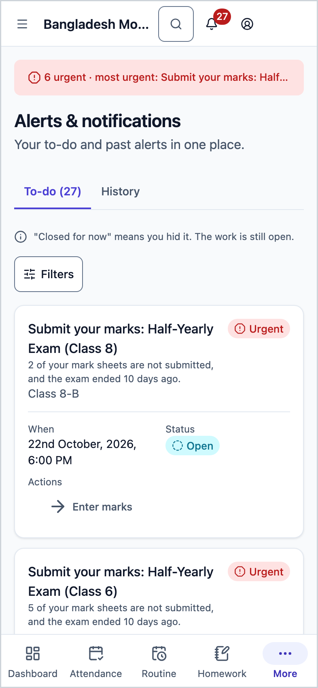
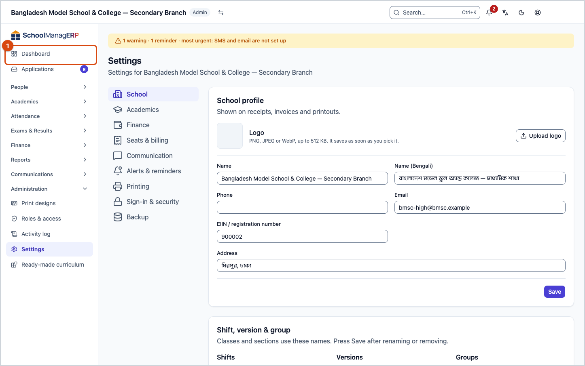

<!-- guide:meta
feature: dashboard.alerts
title: Seeing and settling alerts
summary: See the alerts you need to act on, finish the work or ask to be reminded later, and choose which alerts push to you.
roles: [ADMIN, EXECUTIVE, TEACHER, ACCOUNTANT, OFFICE_STAFF, EXAM_CONTROLLER, COMMITTEE]
sources:
  - client-admin/src/routes/_staff/notifications.tsx
  - client-admin/src/features/attention/attention-worklist.tsx
  - client-admin/src/features/attention/attention-center.tsx
  - client-admin/src/features/attention/notification-prefs/**
  - client-admin/src/components/morning-digest-card.tsx
  - client-admin/src/pages/settings/AlertsSection.tsx
  - client-admin/src/dashboard/layout/briefing-slot.tsx
  - shared/src/attention/rule-catalogue.ts
labels:
  [
    attention:worklist.*,
    attention:item.*,
    attention:snooze.*,
    attention:state.*,
    attention:severity.*,
    attention:category.*,
    attention:rules.*,
    attention:roles.*,
    attention:account.title,
    attention:account.subtitle,
    attention:account.urgentHelp,
    attention:settings.title,
    attention:settings.locked,
    attention:modal.seeAll,
    dashboard:digest.*,
    nav:items.notifications,
    nav:items.security,
    nav:notifications.bellLabel,
    nav:notifications.attentionTitle,
    nav:notifications.attentionTodo,
    settings:categories.alerts,
    settings:save.*,
  ]
helpIds: [dashboard.alerts]
devices: [desktop, phone]
entry: [page:dashboard, notification:alert, palette]
keywords: [alerts, notifications, to-do, reminder, snooze, remind me later, morning summary, push]
appVersion: 0.1.0 (6b36c2549)
owner: tareq89
lastVerified: 2026-10-24
knownIssues: []
-->

# Seeing and settling alerts

See the alerts you need to act on, finish the work or ask to be reminded later, and choose which alerts push to you.

**Go to:** press the bell icon at the top right (**Notifications**), then **See all to-do**. Or, in today's summary on the dashboard, **See all to-do (n)**. On a phone the bell icon is also at the top right.
**Before you start:** nothing.

An **alert** is a to-do that the school's rules create by themselves. For example, if a section's attendance is not taken on time, the teacher gets an **Attendance not taken** alert. When the work is done, the alert turns **Fixed** by itself. Every alert has a level: **Urgent**, **Warning** or **Reminder**.

**Coordinators get some alerts too.** A **Class coordinator** gets **Attendance not taken** for every section of their classes once it turns into a warning, before the admin does. A **Class coordinator** and a **Subject coordinator** both get **Marks overdue** for their classes; a subject coordinator only when their own subject is late. Who is a coordinator: [Teacher assignments](../people/teaching-assignments.md#task-coordinators).

[Settle a to-do](#task-main) · [Remind me later](#task-snooze) · [Morning summary](#task-digest) · [What each alert means](#task-kinds) · [Problems and fixes](#trouble)

**On this page**

- [How you get here](#arrive)
- [Settle a to-do alert](#task-main)
- [How to know an alert is settled](#confirm)
- [Other situations](#other)
  - [Remind me later](#task-snooze)
  - [See only some alerts (filters)](#task-filter)
  - [See earlier alerts (history)](#task-history)
  - [Alerts on a phone](#task-phone)
  - [Morning summary](#task-digest)
  - [Which alerts push to me](#task-push)
  - [Switch the school's alerts on or off (admin)](#task-school)
  - [What each alert means](#task-kinds)
- [Problems and fixes](#trouble)
- [Who can do what](#roles)
- [Learn more](#more)

---

## How you get here 

**From the dashboard:**

1. At the top of the [dashboard](dashboard.md), today's summary, for example **2 urgent · 3 warnings**.
2. Press **See all to-do (n)**. → This page opens, on the **To-do** tab.

**From the bell icon:**

1. Press the bell icon at the top right. → A small list opens: **Needs your attention**.
2. Press **See all to-do**. → This page opens.

**From a push notification:** a notification about an alert arrives on your phone or computer. Press it and the app opens. How to keep the app on your phone: [Open on your phone and install as an app](../start/phone.md).

---

## Settle a to-do alert 

1. On the **Alerts & notifications** page, the **To-do** tab is open.

   → At the top it says **Your to-do and past alerts in one place.** Below is the list: **Type**, **About**, **Student / section**, **When**, **Status**, **Actions**.

2. Look at the **Urgent** rows first. Read **About** to understand what has to be done. What each alert means is in [What each alert means](#task-kinds) below.
3. Press the first button in the row's **Actions** cell (if there is one).

   → The page where the work is done opens.

4. Finish the work there, for example submit the attendance.

   → The next time the rule checks, the alert turns **Fixed** and moves from **To-do** to **History**.

> **Keep in mind:** an alert is settled when the work is done, not when you press something on its row. Pressing **Close** only hides it from your list; the work is still waiting.

---

## How to know an alert is settled 

The **Status** cell holds one of four words:

| Status             | What it means                                                       | What next                               |
| ------------------ | ------------------------------------------------------------------- | --------------------------------------- |
| **Open**           | The work is still waiting                                           | Do the work.                            |
| **Closed for now** | You hid it or asked to be reminded later; the work is still waiting | It is settled when you do the work.     |
| **Fixed**          | The work is done, the alert is settled                              | Done. It stays in **History**.          |
| **Expired**        | The alert no longer applies                                         | Nothing to do. It stays in **History**. |

**To check it:** open the **History** tab. If the alert is there with the status **Fixed**, the work has reached the school's system.

**If no message appears:** if the alert is still **Open** after you finished the work, see [Problems and fixes](#trouble).

---

## Other situations 

### Remind me later 

Only an open row at the **Warning** level, one that can be closed, has a **Remind me later** button. **Urgent** and **Reminder** rows do not have it.

1. Press **Remind me later** on the row.
2. Choose: **In 2 hours**, **Tomorrow morning**, **Next school day** or **Pick a date…**.
3. If you choose **Pick a date…**, in the **Remind me on** box set a **Date** and press **Remind me**.

   → The row becomes **Closed for now**, and says **Snoozed until …**.

| You press           | What happens                                                       | Is the work settled?       |
| ------------------- | ------------------------------------------------------------------ | -------------------------- |
| **Remind me later** | Hidden until the time you chose                                    | No, the work is waiting    |
| **Close**           | Hidden from your list                                              | No, the work is waiting    |
| The action button   | The work page opens; the alert is settled when you finish the work | Yes, once the work is done |

Some alerts have no **Close**; they say **Stays until the work is done**.

### See only some alerts (filters) 

Above the list there are three boxes: **Type** (for example **Attendance**, **Fees**), **Class** and **Section**. Choose one and the list gets shorter. To see everything again, choose **All types**, **All classes**, **All sections**. Filters are cleared when you change tab.

### See earlier alerts (history) 

The **History** tab keeps **Fixed** and **Expired** alerts for 12 months. Below that is **Recent messages on this device**: short messages shown on this device, such as an import finishing. Press **Mark all read** to mark them all as read.

### Alerts on a phone 

Teachers mostly see alerts on a phone. On a phone:

1. Press the bell icon at the top right, then **See all to-do**.
2. Each row of the list becomes a card, with the level (**Urgent**, **Warning** or **Reminder**) at the top.
3. Press the card's action button, or **Remind me later** / **Close**.

### Morning summary 

On school days, the admin, academic coordinator and teacher get a push notification in the morning: how many things need their attention today. Press it and the [dashboard](dashboard.md) opens.

- **When:** at the time set in the school's **Settings**, which starts at 07:30 in the morning ([the school's dashboard settings](customise.md#task-settings)). It does not go out on holidays. If push quiet hours are running, it goes when they end.
- **How:** push notification only. It does not go by SMS or email. It does not go if there is nothing to do.
- **To turn it off for yourself:** from the **Account menu** at the top right, open **Security** ([Your account](../start/account.md)). On the **Morning summary** card, untick **Send me the morning summary**. → **Saved**. This turns it off for all your schools at once.

If notifications are off on this device, the card says **Turn on notifications on this device to receive it.**

### Which alerts push to me 

1. From the **Account menu** open **Security**.
2. On the **Which alerts push to me** card, switch off the kinds of alert you do not want pushed.

- Even when switched off, every alert still shows in the app's bell.
- **Urgent** alerts keep pushing until they are fixed.

### Switch the school's alerts on or off (admin) 

1. Press **Settings** in the left menu, then **Alerts & reminders** in the list on the left.
2. Each rule has a switch beside it. Switch off the rules you do not want in the school.
3. Press **Save**. → **Saved**.

Some rules cannot be switched off; they say **Can't be switched off**. It is not only the urgent ones: some **Warning** level rules are like this too (see the last column of the lists below). In this section you can also set the time of the morning and evening reminders and the quiet hours for push.

### What each alert means 

Arranged by the name in the **Type** filter. Only the alerts that really arrive in today's app are listed. "Who gets it" means which role gets it; a teacher usually gets only the alerts of their own sections. When the work is done, the alert settles by itself.

#### Setup

| Alert                              | When it comes                                    | Who gets it | Type     | Can the school switch it off? |
| ---------------------------------- | ------------------------------------------------ | ----------- | -------- | ----------------------------- |
| **School setup not finished**      | Shows until every setup step is done.            | Admin       | Urgent   | No                            |
| **SMS or email not set up**        | Warns when the school can't send SMS or email.   | Admin       | Warning  | Yes                           |
| **Staff invitation not accepted**  | Reminds you about staff who haven't joined yet.  | Admin       | Reminder | Yes                           |
| **Next academic year not created** | Warns near year end when next year isn't set up. | Admin       | Warning  | Yes                           |

#### System

| Alert                | When it comes                                     | Who gets it | Type    | Can the school switch it off? |
| -------------------- | ------------------------------------------------- | ----------- | ------- | ----------------------------- |
| **SMS credit low**   | Warns when SMS credit falls below your limit.     | Admin       | Warning | Yes                           |
| **Messages failing** | Warns when many messages fail in 24 hours.        | Admin       | Warning | Yes                           |
| **Backup failed**    | Urgent when the last backup failed or is too old. | Admin       | Urgent  | No                            |

#### School structure

| Alert                                 | When it comes                                   | Who gets it | Type    | Can the school switch it off? |
| ------------------------------------- | ----------------------------------------------- | ----------- | ------- | ----------------------------- |
| **Routine not published**             | Warns when this year's routine isn't published. | Admin       | Warning | Yes                           |
| **Section without a class teacher**   | Warns about sections with no class teacher.     | Admin       | Warning | Yes                           |
| **Routine period without a teacher**  | Warns about routine periods with no teacher.    | Admin       | Warning | Yes                           |
| **Guardians without a mobile number** | Warns when guardians have no phone number.      | Admin       | Warning | Yes                           |

#### Attendance

| Alert                    | When it comes                                                                      | Who gets it                          | Type     | Can the school switch it off? |
| ------------------------ | ---------------------------------------------------------------------------------- | ------------------------------------ | -------- | ----------------------------- |
| **Attendance not taken** | Reminds at the first period, warns after the grace time, urgent after the cut-off. | Teacher, academic coordinator, admin | Reminder | No                            |

#### Periods

| Alert                               | When it comes                                         | Who gets it                 | Type     | Can the school switch it off? |
| ----------------------------------- | ----------------------------------------------------- | --------------------------- | -------- | ----------------------------- |
| **Period starting soon**            | Reminds the teacher a few minutes before each period. | Teacher                     | Reminder | Yes                           |
| **Substitute period today**         | Tells a teacher which periods they cover today.       | Teacher                     | Reminder | Yes                           |
| **Periods without a teacher today** | Warns when a teacher on leave has no substitute.      | Academic coordinator, admin | Warning  | Yes                           |

#### Homework

| Alert                      | When it comes                                                    | Who gets it              | Type     | Can the school switch it off? |
| -------------------------- | ---------------------------------------------------------------- | ------------------------ | -------- | ----------------------------- |
| **Homework not submitted** | Tells the student, guardians and teacher when the period starts. | Student, parent, teacher | Warning  | Yes                           |
| **Homework due today**     | Reminds the student in the morning.                              | Student                  | Reminder | Yes                           |
| **Homework due tomorrow**  | Reminds the student and guardians in the evening.                | Student, parent          | Reminder | Yes                           |
| **Homework to mark**       | Reminds the teacher about submitted work to mark.                | Teacher                  | Reminder | Yes                           |

#### My class

| Alert                                    | When it comes                                                 | Who gets it | Type     | Can the school switch it off? |
| ---------------------------------------- | ------------------------------------------------------------- | ----------- | -------- | ----------------------------- |
| **Absent several days in a row**         | Tells the class teacher about students absent day after day.  | Teacher     | Reminder | Yes                           |
| **Guardian contact missing in my class** | Tells the class teacher which guardians have no phone number. | Teacher     | Reminder | Yes                           |

#### Fees

| Alert                                      | When it comes                                      | Who gets it       | Type     | Can the school switch it off? |
| ------------------------------------------ | -------------------------------------------------- | ----------------- | -------- | ----------------------------- |
| **Overdue fees**                           | A daily note of the overdue total.                 | Accountant        | Reminder | Yes                           |
| **Fee reminders to send**                  | Reminds you about dues with no reminder sent.      | Accountant        | Reminder | Yes                           |
| **Students without fees this month**       | Warns about students with no fee assigned.         | Accountant, admin | Warning  | Yes                           |
| **Fee structure missing for the new year** | Warns before the new year when fees aren't set up. | Accountant, admin | Warning  | Yes                           |

#### Exams

| Alert                           | When it comes                                                         | Who gets it                                  | Type     | Can the school switch it off? |
| ------------------------------- | --------------------------------------------------------------------- | -------------------------------------------- | -------- | ----------------------------- |
| **Marks overdue**               | Warns about sections whose marks are late; urgent after the deadline. | Academic coordinator, exam controller        | Warning  | No                            |
| **My marks due**                | Reminds a teacher to submit marks before the deadline.                | Teacher                                      | Warning  | No                            |
| **Results not published**       | Reminds you about processed results not yet published.                | Academic coordinator, exam controller, admin | Reminder | Yes                           |
| **Exam schedule not published** | Warns before an exam when its schedule isn't published.               | Exam controller, admin                       | Warning  | Yes                           |
| **Seat plan missing**           | Warns before an exam when there is no seat plan.                      | Exam controller, admin                       | Warning  | Yes                           |

#### Office

| Alert                              | When it comes                                                   | Who gets it                 | Type     | Can the school switch it off? |
| ---------------------------------- | --------------------------------------------------------------- | --------------------------- | -------- | ----------------------------- |
| **Admission applications waiting** | Reminds you about applications to review.                       | Office staff, admin         | Reminder | Yes                           |
| **Admission opens or closes soon** | Reminds you before an intake opens or closes.                   | Office staff, admin         | Reminder | Yes                           |
| **Student records incomplete**     | Reminds you about missing photos or birth registration numbers. | Office staff, admin         | Reminder | Yes                           |
| **Staff leave waiting**            | Warns about leave requests nobody has decided.                  | Admin, academic coordinator | Warning  | Yes                           |
| **My leave decided**               | Tells you when your leave is approved or turned down.           | The person who applied      | Reminder | Yes                           |
| **ACR not finished**               | Warns evaluators about unfinished ACRs.                         | Admin                       | Warning  | Yes                           |

#### Family

| Alert                             | When it comes                                          | Who gets it     | Type     | Can the school switch it off? |
| --------------------------------- | ------------------------------------------------------ | --------------- | -------- | ----------------------------- |
| **Child absent today**            | Tells guardians when their child is marked absent.     | Parent          | Warning  | No                            |
| **Fee due soon**                  | Reminds guardians before a fee's due date.             | Parent          | Reminder | Yes                           |
| **Fee overdue**                   | Warns guardians about overdue fees.                    | Parent          | Warning  | Yes                           |
| **Exam tomorrow**                 | Reminds the student and guardians the evening before.  | Parent, student | Reminder | Yes                           |
| **Result published**              | Tells the student and guardians when a result is out.  | Parent, student | Reminder | Yes                           |
| **Routine changed today**         | Tells the student and guardians about today's changes. | Parent, student | Reminder | Yes                           |
| **My contact details incomplete** | Asks guardians to add missing contact details.         | Parent          | Warning  | Yes                           |

#### General

| Alert                | When it comes                                  | Who gets it     | Type     | Can the school switch it off? |
| -------------------- | ---------------------------------------------- | --------------- | -------- | ----------------------------- |
| **Survey to answer** | Reminds you about open surveys.                | Parent, student | Reminder | Yes                           |
| **Holiday tomorrow** | Reminds everyone the evening before a holiday. | Everyone        | Reminder | Yes                           |

#### Billing

| Alert                   | When it comes                                                | Who gets it | Type     | Can the school switch it off? |
| ----------------------- | ------------------------------------------------------------ | ----------- | -------- | ----------------------------- |
| **Seats expiring soon** | Warns before your paid seats run out.                        | Admin       | Warning  | No                            |
| **All seats in use**    | Warns when no seat is left for a new student.                | Admin       | Warning  | No                            |
| **Account idle**        | Reminds you when the school has had no activity for a while. | Admin       | Reminder | Yes                           |

An alert **Sent by the school**: it does not come from a rule; someone at the school writes it by hand. It can be a **Warning** or a **Reminder**, not **Urgent**.

---

## Problems and fixes 

| What you see                                         | What to do                                                                                                                                | Who can help |
| ---------------------------------------------------- | ----------------------------------------------------------------------------------------------------------------------------------------- | ------------ |
| I finished the work, but the alert is still **Open** | Wait a little; the rule checks again at set intervals. If it is still there, check on the work page.                                      | Admin        |
| **Could not load alerts.**                           | Reload the page.                                                                                                                          | Admin        |
| There is no **Remind me later** button               | The button only appears on an open row at the **Warning** level.                                                                          | —            |
| **Stays until the work is done**                     | This alert cannot be hidden. Finish the work.                                                                                             | —            |
| **That did not work. Try again.**                    | Press again. Check your internet.                                                                                                         | Yourself     |
| The morning summary does not arrive                  | Check whether the box is ticked on the **Security** page, and whether notifications are on for this device. It does not come on holidays. | Admin        |
| One kind of alert never arrives                      | The school may have switched the rule off. Ask the admin.                                                                                 | Admin        |

---

## Who can do what 

| Role                                                        | Sees their own alerts | Gets the morning summary | Switches the school's rules on or off |
| ----------------------------------------------------------- | --------------------- | ------------------------ | ------------------------------------- |
| Admin                                                       | Yes                   | Yes                      | Yes                                   |
| Academic coordinator, teacher                               | Yes                   | Yes                      | No                                    |
| Accountant, office staff, exam controller, committee member | Yes                   | No                       | No                                    |

Everyone sees only their own alerts. Parents see **Alerts & notifications** in their own app; if they have more than one child, there is also a **Child** filter.

---

## Learn more 

<strong>How alerts work</strong> — from rule to history

<figure>
  
  <figcaption><em>Where alerts come from and where they go</em></figcaption>
</figure>

- Some rules run every 5 minutes, some every hour, and the daily rules run at the school's morning reminder time.
- **Homework due tomorrow**, **Exam tomorrow** and **Holiday tomorrow** run at the evening reminder time.
- **Fixed** and **Expired** alerts stay in **History** for 12 months.

**Related pages**

- [**Seeing today's work on the dashboard**](dashboard.md) — today's summary comes from the to-do on this page.
- [**What the widgets mean**](widgets.md) — the numbers that show alongside alerts.
- [**Customising your dashboard**](customise.md) — where the morning summary time is set.
- [**Changing the school's settings**](../administration/settings.md) — Set the school's profile, academic rules, fee rules, communication, printing, sign-in, backup and alerts on one page, in nine categories.
- [**Alerts and notifications (parent and student)**](../portal/notifications.md) — the alerts a guardian or student gets.
- [**Send an alert**](../communications/send-alert.md) — send your own alert by hand.
- [**Alerts report**](../reports/alerts-report.md) — how many alerts each rule raised in a month.

---

_Version 0.1.0 · Last verified 2026-10-24_
