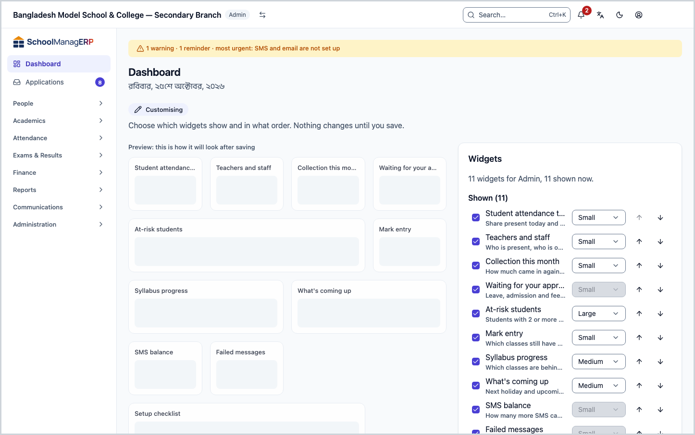
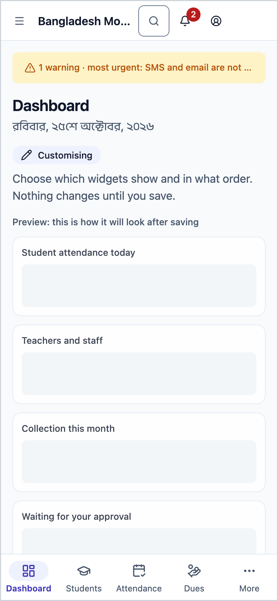

<!-- guide:meta
feature: dashboard.customise
title: Customising your dashboard
summary: Choose which widgets show, which comes first and how big it is; change the school's dashboard settings; print the monthly meeting report.
roles: [ADMIN, EXECUTIVE, TEACHER, ACCOUNTANT, OFFICE_STAFF, EXAM_CONTROLLER, COMMITTEE]
sources:
  - client-admin/src/dashboard/layout/dashboard-page.tsx
  - client-admin/src/dashboard/layout/customise/customise-mode.tsx
  - client-admin/src/dashboard/layout/customise/customise-panel.tsx
  - client-admin/src/dashboard/layout/use-dashboard-prefs.ts
  - client-admin/src/pages/settings/DashboardSection.tsx
  - client-admin/src/routes/_staff/print/committee-report.tsx
labels:
  [
    dashboard:page.customise,
    dashboard:states.allHidden.*,
    dashboard:customise.*,
    dashboard:committeeSummary.printReport,
    dashboard:committeeReport.*,
    settings:dashboard.*,
    settings:categories.academics,
    settings:save.*,
    nav:items.settings,
  ]
helpIds: [dashboard.customise]
devices: [desktop, phone]
entry: [sidebar, palette, page:dashboard]
keywords: [customise, hide widget, change order, dashboard settings, monthly meeting report, layout, committee report]
appVersion: 0.1.0 (6b36c2549)
owner: tareq89
lastVerified: 2026-10-24
knownIssues: []
-->

# Customising your dashboard

Decide for yourself which widgets show, which comes first and how big it is.

**Go to:** **Dashboard** in the left menu, then **Customise** at the top right. The **Customise** button is in the same place on a phone.
**Before you start:** nothing.

Your **layout** is which widgets show, in what order and how big. One layout is saved for each person and each role. When you change it, only your dashboard changes, nobody else's. What a widget is: [What the widgets mean](widgets.md).

[Customise the dashboard](#task-main) · [Reset to default](#task-reset) · [The school's dashboard settings](#task-settings) · [Monthly meeting report](#task-committee-report) · [Problems and fixes](#trouble)

**On this page**

- [How you get here](#arrive)
- [Customise the dashboard](#task-main)
- [How to know the layout was saved](#confirm)
- [Other situations](#other)
  - [Customising on a phone](#task-phone)
  - [With the keyboard only](#task-keyboard)
  - [Reset to default](#task-reset)
  - [The school's dashboard settings (admin)](#task-settings)
  - [Print the monthly meeting report](#task-committee-report)
- [Problems and fixes](#trouble)
- [Who can do what](#roles)
- [Learn more](#more)

---

## How you get here 

**From the dashboard:** at the top right of [Seeing today's work on the dashboard](dashboard.md), press **Customise**. Start at step 1 below.

**If every widget is hidden:** the dashboard says **All widgets are hidden**, with a **Customise** button below. Press it; the same customise panel opens.

---

## Customise the dashboard 

1. At the top right of the dashboard, press **Customise**.

   → **Customising** appears at the top, and the **Widgets** panel opens. The panel has two lists: **Shown** and **Hidden**. Beside it is a preview: **Preview: this is how it will look after saving**.

2. To hide a widget, untick the box on its row. To show it, tick the box.

   → The widget moves to the other list, and the preview changes.

3. To change the order, press the **↑** or **↓** button on the row. Only widgets in **Shown** can be moved. You cannot drag.

   → The widget moves one place up or down.

4. On a computer, to change the size, choose **Small**, **Medium** or **Large** from the size list on the row. If a widget has only one size, the list is greyed out.

5. When everything is right, press **Save** at the bottom.

   → The message **Dashboard saved** appears, and the dashboard returns with the new layout.

> **Keep in mind:** nothing changes until you press **Save**. If you press **Cancel**, everything stays as it was.

---

## How to know the layout was saved 

| State                           | How you can tell                                                                   | What next       |
| ------------------------------- | ---------------------------------------------------------------------------------- | --------------- |
| **Changed on screen only**      | **Customising** at the top, and the new layout in the preview                      | Press **Save**. |
| **Reached the school's system** | The message **Dashboard saved**, and the panel closes and the dashboard comes back | Done.           |

This work is not kept on the device while offline; so there is no "saved on this device" state.

**To check it:** sign in on another computer or phone, with the same account and the same role. You will see the same layout.

<!-- image pending: the dashboard in the new layout after saving, with the Dashboard saved message, admin, desktop -->

**If no message appears:** see [Problems and fixes](#trouble). If the panel is still open, you can press **Save** again.

---

## Other situations 

### Customising on a phone 

On a phone, **Customise** opens the panel as a page that rises from the bottom, with a small bar at the top. Everything else is the same, except:

- You cannot change the size; size is only on a computer.
- A widget's short description is not shown, only its name.

### With the keyboard only 

The panel says **Space to show or hide, Alt + ↑ / ↓ to move**.

| Key           | What it does   |
| ------------- | -------------- |
| `Space`       | Show / hide    |
| `Alt + ↑` `↓` | Move up / down |
| `Enter`       | Save           |
| `Esc`         | Cancel         |

A screen reader announces every change, for example "… is now at position 2".

### Reset to default 

1. Open **Customise**.
2. At the bottom, press **Reset to default**. → The preview goes back to your role's starting layout. It is not saved yet.
3. Press **Save**. → **Dashboard saved**.

| You press            | What happens                                                | Saved?              |
| -------------------- | ----------------------------------------------------------- | ------------------- |
| **Reset to default** | The preview goes back to the role's starting layout         | No, not yet         |
| **Cancel**           | The panel closes, and your earlier saved layout stays       | No, nothing changes |
| **Save**             | The dashboard becomes like the preview, **Dashboard saved** | Yes                 |

### The school's dashboard settings (admin) 

Some widgets follow limits that the school sets. These are for the whole school, and only an admin can change them.

1. Press **Settings** in the left menu, then **Academics** in the list on the left.
2. Scroll down to the **Dashboard** section.
3. Change the boxes (see the table below).
4. At the bottom of the section, press **Save**. → **Saved** appears.

**At-risk students:** a student shows in the **At-risk students** widget when any 2 of the 4 signs below match. The list changes a few minutes after you save.

| Box                                                         | What it means                                                                    | Starts at | What you can enter |
| ----------------------------------------------------------- | -------------------------------------------------------------------------------- | --------- | ------------------ |
| **Absent in a row (days)**                                  | If a student has been absent this many days in a row or more                     | 3         | 1 to 30            |
| **Attendance in the last 30 days below (%)**                | If attendance in the last 30 days falls below this                               | 75        | 1 to 100           |
| **Failed subjects in the latest published exam (at least)** | If the student failed this many subjects or more in the latest published exam    | 1         | 1 to 20            |
| **Oldest unpaid bill older than (days)**                    | If the oldest unpaid bill is this many days past its due date or more            | 60        | 1 to 365           |
| **Attendance target (%)** (Committee section)               | Shows as a line on the committee's attendance chart                              | 90        | 1 to 100           |
| **Send at** (Morning summary section)                       | At what school time the morning summary goes out; it does not go out on holidays | 07:30     | Any time           |

If you enter something outside the limits, a message appears under the box, for example **Enter a whole number from 1 to 30.**

Turning the morning summary off for yourself: [Alerts and notifications → Morning summary](alerts.md#task-digest).

### Print the monthly meeting report 

A one-page report of totals for this month, up to today, for the committee meeting.

1. As a committee member, press **Print monthly meeting report** at the top of the dashboard.

   → The **Monthly meeting report** page opens. Its sections are **Key numbers**, **Enrollment**, **Attendance**, **Collection and dues** and **Pass rate by class**. At the bottom it says **Totals only. No student, guardian or staff details are printed.**

2. Press **Print**.

   → The browser's own print box opens. Choose a printer and print, or choose "Save as PDF" as the destination to keep a file.

3. To go back, press **Back to dashboard**.

<!-- image pending: the monthly meeting report page, committee member, desktop -->

The numbers in the report always match the committee widgets on the dashboard, because both come from the same figures. Where there is no data, "—" is printed. The report is not emailed by itself and is not made on any fixed day; print it from here when you need it.

---

## Problems and fixes 

| What you see                                        | What to do                                                                   | Who can help |
| --------------------------------------------------- | ---------------------------------------------------------------------------- | ------------ |
| There is no size list                               | You are on a phone. Size only changes on a computer.                         | Yourself     |
| The size list is greyed out                         | This widget has only one size. It cannot be changed.                         | —            |
| The widget you want is not in the list              | It is not for your role, or you do not have permission to see it.            | Admin        |
| The layout is different when you switch role        | That is fine: each role's layout is saved separately.                        | Yourself     |
| **Enter a whole number from 1 to 30.**              | Type a whole number within the limits in the box, then press **Save** again. | Admin        |
| **The report could not load.**                      | Reload the page.                                                             | Admin        |
| There is no **Print monthly meeting report** button | The button only appears on the committee member's dashboard.                 | Admin        |

If a page or button is missing, see [Why can't I see this?](../help/cant-see-this.md).

---

## Who can do what 

| Role                                                                     | Customise their own dashboard | The school's dashboard settings | Monthly meeting report |
| ------------------------------------------------------------------------ | ----------------------------- | ------------------------------- | ---------------------- |
| Admin                                                                    | Yes                           | Yes                             | No                     |
| Academic coordinator, teacher, accountant, office staff, exam controller | Yes                           | No                              | No                     |
| Committee member                                                         | Yes                           | No                              | Yes                    |

---

## Learn more 

<strong>How customising works</strong> — from the panel to saving

<figure>
  
  <figcaption><em>How customising works</em></figcaption>
</figure>

- One layout is saved for each person and each role; it is the same on every device.
- If the saved layout cannot be fetched, the role's starting layout is shown.
- If a new widget is added to your role's starting layout, you see it at the end even if you have your own layout.

**Related pages**

- [**Seeing today's work on the dashboard**](dashboard.md) — the page you are customising.
- [**What the widgets mean**](widgets.md) — read this before deciding which widgets to keep.
- [**Alerts and notifications**](alerts.md) — the morning summary and the alert settings.

---

_Version 0.1.0 · Last verified 2026-10-24_
