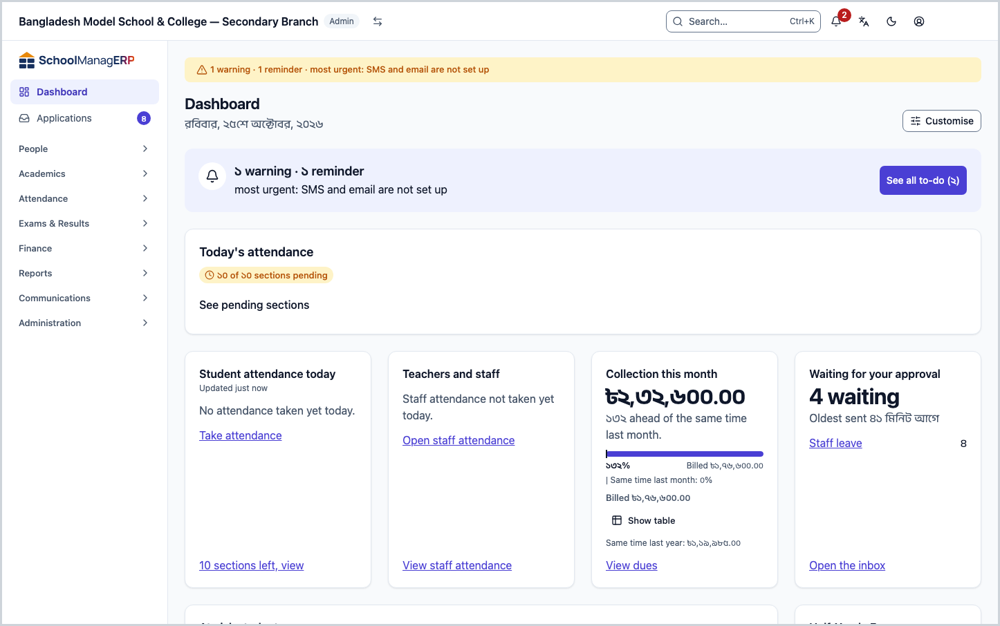
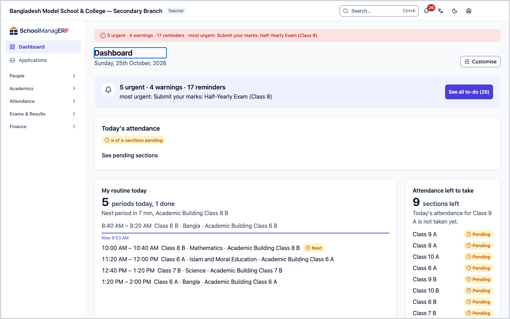
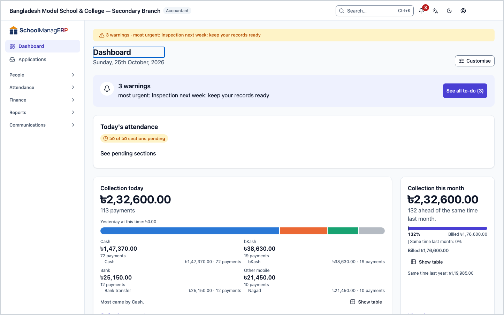
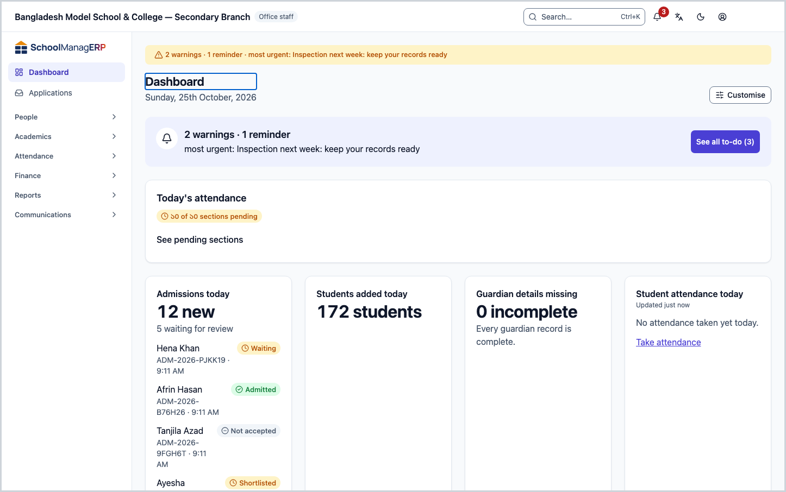
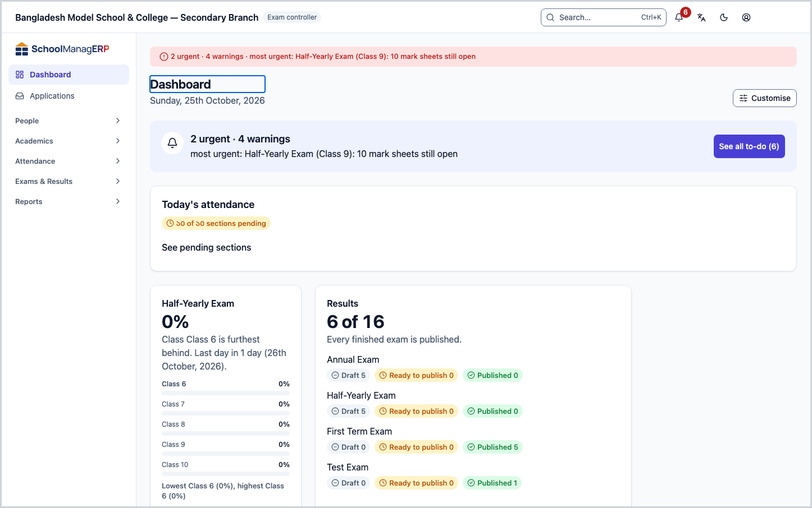
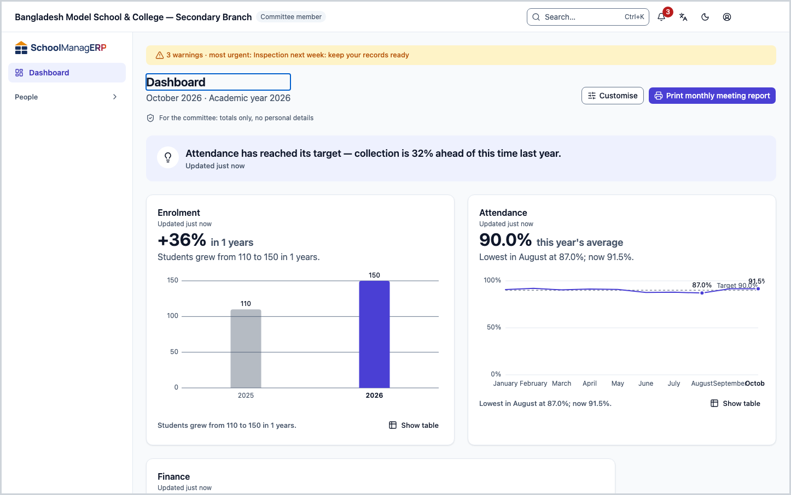
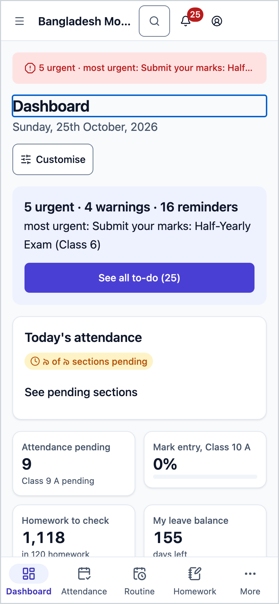
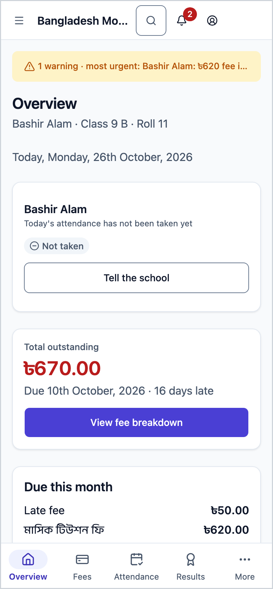

<!-- guide:meta
feature: dashboard
title: Seeing today's work on the dashboard
summary: See on the first page after sign-in what needs your attention today, and go to the right page in one press.
roles: [ADMIN, EXECUTIVE, TEACHER, ACCOUNTANT, OFFICE_STAFF, EXAM_CONTROLLER, COMMITTEE]
sources:
  - client-admin/src/dashboard/layout/dashboard-page.tsx
  - client-admin/src/dashboard/layout/briefing-slot.tsx
  - client-admin/src/dashboard/layout/dashboard-grid.tsx
  - client-admin/src/dashboard/layout/widget-slot.tsx
  - client-admin/src/dashboard/layout/committee-summary.tsx
  - client-admin/src/dashboard/report-cards/report-cards.tsx
  - client-admin/src/dashboard/report-cards/report-prefs.ts
  - client-admin/src/routes/portal/index.tsx
  - shared/src/dashboard/widget-catalogue.ts
labels:
  [
    dashboard:page.*,
    dashboard:states.*,
    dashboard:committeeSummary.privacyNote,
    dashboard:committeeSummary.printReport,
    attention:bar.*,
    attention:modal.empty,
    attention:modal.seeAll,
    reports:pinned.*,
    reports:usefulCard.*,
    portal:today.*,
    portal:heatmap.title,
    portal:homeworkCard.title,
    portal:latestResult.title,
    portal:nextHoliday.title,
    portal:fees.dueThisMonth,
    nav:items.dashboard,
    nav:items.portalOverview,
  ]
helpIds: [dashboard]
devices: [desktop, phone]
entry: [sidebar, palette, notification:morning-digest]
keywords: [dashboard, home, first page, today's work, to-do, widgets, briefing]
appVersion: 0.1.0 (6b36c2549)
owner: tareq89
lastVerified: 2026-10-31
knownIssues:
  - { id: report-cards-this-browser-only, checked: 2026-10-31, issue: null }
-->

# Seeing today's work on the dashboard

See on the first page after sign-in what needs your attention today, and go to the right page in one press.

**Go to:** **Dashboard** in the left menu. On a phone, the **☰** menu at the top left ([opening on a phone](../start/phone.md)).
**Before you start:** nothing. The dashboard is already set up for every staff role.

The **dashboard** ([glossary](../help/glossary.md#dashboard)) is a page of **widgets**. A widget is a small card: it holds a number or a short list, and a link to the place where you do that work. Your role decides which widgets you get; a teacher and an accountant do not see the same page.

[See today's work](#task-main) · [Dashboard by role](#task-roles) · [Report cards](#task-report-cards) · [On a phone](#task-phone) · [Problems and fixes](#trouble)

**On this page**

- [How you get here](#arrive)
- [See today's work](#task-main)
- [How to know the dashboard loaded properly](#confirm)
- [Other situations](#other)
  - [Dashboard by role](#task-roles)
  - [Report cards](#task-report-cards)
  - [The committee member's dashboard](#task-committee)
  - [The dashboard on a phone](#task-phone)
  - [The guardian's Overview page](#task-portal)
- [Problems and fixes](#trouble)
- [Who can do what](#roles)
- [Known issues](#known-issues)
- [Learn more](#more)

---

## How you get here 

**From the left menu:** press **Dashboard**. Start at step 1 below.

**From search:** in the search box at the top (Ctrl+K) type "dashboard" and choose it. How search works: [Find any page](../start/find-anything.md).

**From the morning summary notification:**

1. On a school day, a notification arrives on your phone or computer in the morning, saying how many things need your attention today. How to turn it on or off: [Alerts and notifications](alerts.md#task-digest).
2. Press the notification. → The dashboard opens. Start at step 1 below.

---

## See today's work 

1. Press **Dashboard** in the left menu.

   → The **Dashboard** title at the top, with today's weekday and date below it. The **Customise** button is on the right.

2. Read the long row just under the title. This is today's summary: how many alerts are open for you.

   → For example **2 urgent · 3 warnings**, with **most urgent: …** below. If there is nothing, it says **Nothing needs you right now.**

3. To see the full list, press **See all to-do (n)** on the summary.

   → The **Alerts & notifications** page opens, on the **To-do** tab. What each alert means and what to do: [Alerts and notifications](alerts.md).

4. Scroll down. Look at the number on each widget, and press the link for the work you want to do.

   → The page for that work opens. What each widget means: [What the widgets mean](widgets.md).

> **Keep in mind:** the dashboard only shows. Pressing something here changes no data; the work happens on the page the link opens.

To change the order or which widgets show: [Customising the dashboard](customise.md).

---

## How to know the dashboard loaded properly 

This page saves nothing. Each widget loads on its own, so you can tell the state of one widget like this:

| State                   | How you can tell                                           | What next                                                  |
| ----------------------- | ---------------------------------------------------------- | ---------------------------------------------------------- |
| **Loading**             | A grey empty box where the card will be                    | Wait a moment.                                             |
| **Showing old figures** | **Showing the last saved figures.** at the top of the card | New figures arrive by themselves when you are back online. |
| **Did not load**        | **This widget could not load.** and a **Try again** button | Press **Try again**. The other widgets are fine.           |
| **All good**            | You can see the number, the short sentence and the link    | Done.                                                      |

**If no message appears:** see [Problems and fixes](#trouble). Even if the dashboard does not appear, none of your data is lost.

---

## Other situations 

### Dashboard by role 

Every role has its own starting layout. The list below is generated from the app's own list; press a name to open the meaning of that widget. If you have changed things yourself, your dashboard may differ from this.

<!-- guide:generated:widgets:roles -->

### Admin

1. [Student attendance today](widgets.md#widget.attendance-today) — Share present today and sections left (shown as a small tile on a phone)
2. [Teachers and staff](widgets.md#widget.staff-today) — Who is present, who is on leave
3. [Collection this month](widgets.md#widget.collection-month) — How much came in against this month's bills (shown as a small tile on a phone)
4. [Waiting for your approval](widgets.md#widget.approvals-pending) — Leave, admission and fee waiver requests (shown as a small tile on a phone)
5. [At-risk students](widgets.md#widget.at-risk-students) — Students with 2 or more warning signs (shown as a small tile on a phone)
6. [Mark entry](widgets.md#widget.mark-entry-progress) — Which classes still have marks to submit
7. [Syllabus progress](widgets.md#widget.syllabus-progress) — Which classes are behind in teaching
8. [What's coming up](widgets.md#widget.upcoming) — Next holiday and upcoming events
9. [SMS balance](widgets.md#widget.sms-balance) — How many more SMS can be sent
10. [Failed messages](widgets.md#widget.failed-messages) — SMS that failed in the last 7 days
11. [Setup checklist](widgets.md#widget.setup-checklist) — What is left to set up for your school

### Accountant

1. [Collection today](widgets.md#widget.collection-today) — Money received today, cash and other (shown as a small tile on a phone)
2. [Collection this month](widgets.md#widget.collection-month) — How much came in against this month's bills (shown as a small tile on a phone)
3. [Fee generation](widgets.md#widget.fee-generation-status) — Whether this month's bills are made
4. [Reminders waiting](widgets.md#widget.reminders-pending) — Fee reminders ready to send (shown as a small tile on a phone)
5. [Collection by month](widgets.md#widget.collection-by-month) — Collection for each month of this academic year
6. [Unpaid bills by age](widgets.md#widget.dues-ageing) — Unpaid amount by how long it is overdue (shown as a small tile on a phone)
7. [Recent payments](widgets.md#widget.recent-payments) — The latest payments received
8. [Dues by class](widgets.md#widget.dues-by-class) — Which classes owe the most

### Teacher

1. [My routine today](widgets.md#widget.my-routine-today) — Your periods today, in order
2. [Attendance left to take](widgets.md#widget.my-pending-sections) — Your sections where attendance is not taken yet (shown as a small tile on a phone)
3. [Mark deadlines](widgets.md#widget.my-mark-deadlines) — Marks you still need to submit, and by when (shown as a small tile on a phone)
4. [Homework to check](widgets.md#widget.homework-to-check) — Submitted homework waiting for your check (shown as a small tile on a phone)
5. [My leave balance](widgets.md#widget.my-leave-balance) — Leave you have taken and what is left (shown as a small tile on a phone)
6. [My class streaks](widgets.md#widget.class-teacher-streaks) — Students absent several days in a row
7. [My syllabus progress](widgets.md#widget.my-syllabus-progress) — How far you have taught in each class

### Academic coordinator

1. [Student attendance today](widgets.md#widget.attendance-today) — Share present today and sections left (shown as a small tile on a phone)
2. [Teachers and staff](widgets.md#widget.staff-today) — Who is present, who is on leave
3. [Collection this month](widgets.md#widget.collection-month) — How much came in against this month's bills (shown as a small tile on a phone)
4. [Waiting for your approval](widgets.md#widget.approvals-pending) — Leave, admission and fee waiver requests (shown as a small tile on a phone)
5. [At-risk students](widgets.md#widget.at-risk-students) — Students with 2 or more warning signs (shown as a small tile on a phone)
6. [Mark entry](widgets.md#widget.mark-entry-progress) — Which classes still have marks to submit
7. [Syllabus progress](widgets.md#widget.syllabus-progress) — Which classes are behind in teaching
8. [What's coming up](widgets.md#widget.upcoming) — Next holiday and upcoming events

### Office staff

1. [Admissions today](widgets.md#widget.admissions-today) — New admission applications today (shown as a small tile on a phone)
2. [Students added today](widgets.md#widget.students-added-today) — Students newly added today (shown as a small tile on a phone)
3. [Guardian details missing](widgets.md#widget.guardians-incomplete) — Students with no guardian phone number (shown as a small tile on a phone)
4. [Student attendance today](widgets.md#widget.attendance-today) — Share present today and sections left (shown as a small tile on a phone)
5. [Teachers and staff](widgets.md#widget.staff-today) — Who is present, who is on leave
6. [Print queue](widgets.md#widget.print-queue) — Documents waiting to be printed
7. [What's coming up](widgets.md#widget.upcoming) — Next holiday and upcoming events

### Exam controller

1. [Mark entry](widgets.md#widget.mark-entry-progress) — Which classes still have marks to submit
2. [Results](widgets.md#widget.results-state) — Which exams have results published (shown as a small tile on a phone)
3. [Seat plans](widgets.md#widget.seat-plan-status) — Which exams have a seat plan and which do not
4. [Print queue](widgets.md#widget.print-queue) — Documents waiting to be printed
5. [What's coming up](widgets.md#widget.upcoming) — Next holiday and upcoming events

### Committee member

1. [Enrolment](widgets.md#widget.committee-enrollment) — Total students and change from last year (shown as a small tile on a phone)
2. [Attendance](widgets.md#widget.committee-attendance) — Attendance over time against the target (shown as a small tile on a phone)
3. [Finance](widgets.md#widget.committee-finance) — Collection and dues in short (shown as a small tile on a phone)
4. [Pass rate](widgets.md#widget.committee-pass-rate) — Pass rate in the latest published exam (shown as a small tile on a phone)

<!-- /guide:generated -->

If you have more than one role, you see the dashboard of the role you are in now.

In a new school where not one setup step is done yet, the admin first sees only the setup list. What the steps are: [How everything in the school fits together](../admin/how-it-works.md) and [The order to set up your school](../admin/setup-order.md).

### Report cards 

Two kinds of report card can appear above the widget grid. Neither is a widget, so **Customise** cannot show or hide them. When a card has nothing to show, it is simply not on the page.

| Card                                                  | What it shows                                       | Who sees it                                                                                       |
| ----------------------------------------------------- | --------------------------------------------------- | ------------------------------------------------------------------------------------------------- |
| **Reports you may need**                              | Up to three ready reports you have not opened yet   | Admin, accountant, academic coordinator                                                           |
| A card for a report you kept (named after the report) | A report you put here with **Show on my dashboard** | Everyone who can open reports: admin, accountant, academic coordinator, teacher, committee member |

Office staff and exam controllers cannot open reports, so they get no report cards. In a brand-new school where not one setup step is done, the admin first sees only the setup checklist, and these cards do not appear either.

**On the Reports you may need card:**

1. Open the **Dashboard** and find the **Reports you may need** card.

   → Under the title it says **Ready reports you have not opened yet.** Below are up to three reports, each with its name and one line on what it shows. If you have not opened the BANBEIS student count this academic year, it comes first; if you opened it before, it also says **Not opened this academic year yet.**

2. Press a report's name.

   → The report opens. Once opened, it no longer appears on this card. Only the BANBEIS student count comes back in a new academic year, if you have not opened it by then.

3. If you do not want the card any more, press the **×** at the top right (its name is **Hide this card**).

   → The card goes and does not come back. It also goes by itself once you have opened all the ready reports.

**On a card for a report you kept:**

1. Open a report, press **More actions**, then press **Show on my dashboard**. More detail: [All reports](../reports/hub.md#task-pin).

   → **Shown on your dashboard.** appears.

2. Open the **Dashboard**.

   → A card named after the report appears. It shows each row of the report with its first count, up to 50 rows. Below it are the **Open the full report** link and the **Remove from my dashboard** button. If you keep several reports, the cards can sit side by side in two columns.

3. To take a card off, press **Remove from my dashboard**.

   → The card goes.

The card runs for your own role, so you only see what you are allowed to see. These messages can also appear on a card:

| What you see                                    | What it means                                                            |
| ----------------------------------------------- | ------------------------------------------------------------------------ |
| **Showing the first 50 rows.**                  | The report has more rows. Press **Open the full report** to see them all |
| **Some numbers are hidden to protect privacy.** | Small numbers could identify a person, so they are not shown             |
| **Nothing to show yet.**                        | The report is empty right now                                            |
| **This report could not be shown.**             | Press **Try again**. The rest of the dashboard is fine                   |

A report that is no longer open to your role loses its card. Which reports you have opened, which you have kept, and whether you hid the **Reports you may need** card are remembered only in the browser of this computer or phone ([Known issues](#known-issues)).

### The committee member's dashboard 

A committee member does not see today's summary like the others. On their page:

- Under the title, the month and academic year instead of the date.
- A line just under the title: **For the committee: totals only, no personal details**.
- At the top, a **Print monthly meeting report** button. How to print the report: [Customising the dashboard → Monthly meeting report](customise.md#task-committee-report).

The whole role in one place: [Committee member](../roles/committee.md).

### The dashboard on a phone 

On a phone the widgets are the same, just laid out differently:

1. At the top, **Key numbers**: small tiles in two columns. A widget that shows only a single number becomes a small tile here. Pressing a tile that has no link opens the whole widget; press again to close it.
2. Below that, the other widgets, one under another, in a compact size.
3. The **Customise** button is on the phone too.

Which widgets become tiles on a phone is written next to each name in the role list above.

### The guardian's Overview page 

The guardian's app has no dashboard. Instead it has an **Overview** page with a few fixed cards; these cannot be rearranged:

- Today's row: whether each child is at school today, for example **At school today** or **Attendance not taken yet**.
- **This month's attendance**
- **Due this month** (fees)
- **Today's homework**
- **Latest result**
- **Next holiday**

---

## Problems and fixes 

| What you see                                 | What to do                                                                                                                                                                                                                  | Who can help |
| -------------------------------------------- | --------------------------------------------------------------------------------------------------------------------------------------------------------------------------------------------------------------------------- | ------------ |
| **This widget could not load.**              | Press **Try again**. If it keeps happening, reload the page.                                                                                                                                                                | Admin        |
| **All widgets are hidden**                   | Press **Customise**, then show the ones you want — [Customising the dashboard](customise.md).                                                                                                                               | Yourself     |
| The **Reports you may need** card is missing | It does not show once you have opened all the ready reports, or after you hide it. Another computer or browser keeps its own list of opened reports, so the card may show again there — [Report cards](#task-report-cards). | Yourself     |
| The summary row is missing                   | If the summary cannot be fetched, the row stays hidden and the rest of the page is fine. Reload the page.                                                                                                                   | Admin        |
| **Showing the last saved figures.**          | You are offline. The numbers may be old; they refresh by themselves when you are back online.                                                                                                                               | Yourself     |
| A widget that was there before is now gone   | You probably hid it, or your role changed. Open **Customise** and look at the **Hidden** list.                                                                                                                              | Admin        |

---

## Who can do what 

| Role                                                                     | Sees the dashboard        | Today's summary | Customise their own | Monthly meeting report |
| ------------------------------------------------------------------------ | ------------------------- | --------------- | ------------------- | ---------------------- |
| Admin                                                                    | Yes                       | Yes             | Yes                 | No                     |
| Academic coordinator, teacher, accountant, office staff, exam controller | Yes                       | Yes             | Yes                 | No                     |
| Committee member                                                         | Yes, totals only          | No              | Yes                 | Yes                    |
| Parent, student                                                          | No, the **Overview** page | No              | No                  | No                     |

A widget shows only when it is set aside for your role and you have permission to see that data.

Report cards are not widgets. Which role gets which card is in the list under [Report cards](#task-report-cards).

---

## Known issues 

Checked in version 0.1.0, 2026-10-31. This part is removed once it is fixed.

| Problem                                                                                                                                                                                                                                                                      | Whose, and when                            | Is data saved?                                   | What to do for now                                                                                                            |
| ---------------------------------------------------------------------------------------------------------------------------------------------------------------------------------------------------------------------------------------------------------------------------- | ------------------------------------------ | ------------------------------------------------ | ----------------------------------------------------------------------------------------------------------------------------- |
| Reports kept on the dashboard, the record of opened reports and a hidden **Reports you may need** card stay only in the browser where you did them. They do not appear on another computer, phone or browser, and are lost if browser data is cleared or in a private window | Everyone who gets report cards, every time | Only in that browser, not in the school's system | In a new browser press **Show on my dashboard** again; to hide **Reports you may need** there, press **Hide this card** again |

---

## Learn more 

<strong>Parts of the page</strong> — from top to bottom

1. **Title** — **Dashboard**, with today's weekday and date below.
2. **Customise** — show, hide and rearrange widgets.
3. **Today's summary** — the count of your open alerts, and **See all to-do (n)**.
4. **The widget grid** — the widgets for your role, in the order you set.

<strong>How the dashboard works</strong> — from widget to the page where the work is

<figure>
  
  <figcaption><em>How the dashboard works</em></figcaption>
</figure>

- Each widget shows a number, and the page its link opens is where the work happens.
- Today's summary comes from the school's alerts; the same count shows on the bell icon at the top of the page.
- Each person can arrange which widget goes where, separately for each of their roles.

**Related pages**

- [**What the widgets mean**](widgets.md) — what each widget's number says, where it comes from, what to do.
- [**Customising the dashboard**](customise.md) — show, hide and rearrange widgets; the school's dashboard settings; the monthly meeting report.
- [**Alerts and notifications**](alerts.md) — the full list behind today's summary.
- [**Welcome to SchoolManager**](../README.md) — what each role does, at a glance.
- [**Attendance reports**](../attendance/attendance-reports.md) — the full attendance numbers behind the dashboard.
- [**Staff attendance and leave**](../attendance/staff-attendance.md) — staff attendance and leave.

---

_Version 0.1.0 · Last verified 2026-10-31_
