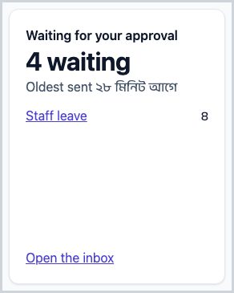

<!-- guide:meta
feature: dashboard.widgets
title: What the widgets mean
summary: What each dashboard widget says, where its number comes from, and what to do after you read it.
roles: [ADMIN, EXECUTIVE, TEACHER, ACCOUNTANT, OFFICE_STAFF, EXAM_CONTROLLER, COMMITTEE]
sources:
  - shared/src/dashboard/widget-catalogue.ts
  - client-admin/src/dashboard/widgets/registry.ts
  - client-admin/src/dashboard/widgets/**/*.widget.tsx
  - client-admin/src/help/guide-gen/dashboard.ts
labels: [dashboard:widgets.*, dashboard:help.widget.*, dashboard:states.*, nav:items.reminderHistory, nav:items.batchDetail, settings:dashboard.risk.absentStreakDays]
helpIds:
  [
    widget.attendance-today,
    widget.staff-today,
    widget.collection-month,
    widget.mark-entry-progress,
    widget.syllabus-progress,
    widget.at-risk-students,
    widget.sms-balance,
    widget.failed-messages,
    widget.upcoming,
    widget.homework-submission-rate,
    widget.recent-activity,
    widget.my-routine-today,
    widget.my-pending-sections,
    widget.my-mark-deadlines,
    widget.homework-to-check,
    widget.class-teacher-streaks,
    widget.my-leave-balance,
    widget.my-syllabus-progress,
    widget.collection-today,
    widget.collection-by-month,
    widget.dues-ageing,
    widget.dues-by-class,
    widget.fee-generation-status,
    widget.reminders-pending,
    widget.recent-payments,
    widget.committee-enrollment,
    widget.committee-attendance,
    widget.committee-finance,
    widget.committee-pass-rate,
    widget.seat-plan-status,
    widget.results-state,
    widget.admissions-today,
    widget.guardians-incomplete,
    widget.students-added-today,
    widget.approvals-pending,
    widget.print-queue,
    widget.setup-checklist,
    widget.syllabus-vs-plan,
    widget.my-lessons-to-mark,
  ]
devices: [desktop, phone]
entry: [sidebar, palette, page:dashboard]
keywords: [widget, card, what the numbers mean, dashboard, dashboard numbers]
appVersion: 0.1.0 (6b36c2549)
owner: tareq89
lastVerified: 2026-10-24
knownIssues: []
-->

# What the widgets mean

What each dashboard widget says, where its number comes from, and what to do after you read it.

**Go to:** **Dashboard** in the left menu, then find the name of the widget you want to understand in the list below.
**Before you start:** nothing.

A **widget** is one card on the dashboard. Each card has a name at the top, a big number or a short list in the middle, and below it a one-line sentence and a link. What the dashboard itself is: [Seeing today's work on the dashboard](dashboard.md).

[Read a widget](#task-main) · [All the widgets](#task-list) · [Problems and fixes](#trouble)

**On this page**

- [How you get here](#arrive)
- [Read a widget](#task-main)
- [How to know the number is right](#confirm)
- [Other situations](#other)
  - [All the widgets, one by one](#task-list)
- [Problems and fixes](#trouble)
- [Who can do what](#roles)
- [Learn more](#more)

---

## How you get here 

**From the dashboard:** in the role list of [Seeing today's work on the dashboard](dashboard.md#task-roles), press the name of a widget. → This page opens, at that widget's section.

**From search:** in the search box at the top (Ctrl+K) type the widget's name.

---

## Read a widget 

1. Read the widget's **name**. For example **Student attendance today**.
2. Look at the big **number**. This is the main news.
3. Read the **sentence** below. It says whether the number is good or bad, or higher or lower than before.
4. If there is something to do, press the **link**.

   → The page where that work is done opens.

In the list below, each widget has three lines:

- **What it means** — exactly what the number counts.
- **Where the number comes from** — which work, on which page.
- **What to do** — the next step after you look.

> **Keep in mind:** a widget only shows. To change a number, go to the page the link opens and do the work there.

---

## How to know the number is right 

A widget saves nothing. But you can tell whether the number is fresh or old like this:

| State                   | How you can tell                                           | What next                                                  |
| ----------------------- | ---------------------------------------------------------- | ---------------------------------------------------------- |
| **Showing old figures** | **Showing the last saved figures.** at the top of the card | New figures arrive by themselves when you are back online. |
| **Did not load**        | **This widget could not load.**                            | Press **Try again**.                                       |
| **All good**            | You can see the number, the sentence and the link          | If you still doubt it, check on the linked page.           |

**If no message appears:** see [Problems and fixes](#trouble).

---

## Other situations 

### All the widgets, one by one 

This list is generated from the app's own text, so it matches the app. Widgets that are not in your role are listed here too.

<!-- guide:generated:widgets:sections -->

### Student attendance today 

- **What it means:** The share of students marked present today in sections whose register is submitted, plus how many sections still have no submitted register. Whether late counts as present follows your school's attendance rules.
- **Where the number comes from:** It comes from today's whole-day attendance registers that teachers submit. The line shows the last 30 days; past days update overnight.
- **What to do:** If sections are left, remind their teachers. The card's link opens Attendance, where you can see which registers are still open.

### Teachers and staff 

- **What it means:** How many active teachers and staff are marked present today, how many are on approved leave, and how many are absent without leave.
- **Where the number comes from:** It comes from today's staff attendance and from leave requests that were approved for today.
- **What to do:** If someone is absent without notice, check with them. View staff attendance opens Staff attendance.

### Collection this month 

- **What it means:** Money received this month so far, compared with the fee bills made for this month. Payments for older dues also count, so the share can pass 100%.
- **Where the number comes from:** It comes from payments recorded this month, minus reversed payments, and from this month's fee bills after discounts.
- **What to do:** If collection is behind last month, follow up on dues. View dues opens Student dues; with no bills yet, Generate fees opens the fee bill page.

### Mark entry 

- **What it means:** For the exam now taking marks, the share of section and subject mark sheets already submitted, class by class. The class furthest behind is named.
- **Where the number comes from:** It comes from the mark sheets teachers submit in Enter marks, for the latest exam that has started and is not yet processed.
- **What to do:** Remind the teachers of the class that is behind before the last day. The link opens Enter marks.

### Syllabus progress 

- **What it means:** For each class this year, the share of syllabus topics marked done. When a class has a study plan, it also shows how far it should be by today.
- **Where the number comes from:** It comes from syllabus topics teachers mark done, and from study plans and the class routine.
- **What to do:** Talk to the teachers of classes that are behind. View syllabus opens Syllabus.

### At-risk students 

- **What it means:** Students who match at least 2 of 4 warning signs: absent days in a row, low attendance in 30 days, failed subjects, an old unpaid bill. Most signs first.
- **Where the number comes from:** It comes from attendance registers, the latest published exam results and unpaid fee bills. The list is rebuilt every night and after you change the limits.
- **What to do:** Talk to the student, the class teacher or the guardian. Change thresholds opens Settings, where the Dashboard section sets the 4 limits.

### SMS balance 

- **What it means:** How many more SMS your school can send, and how many are held for messages being sent right now. Some schools are not metered.
- **Where the number comes from:** It comes from your school's SMS credit, which goes down as messages are sent.
- **What to do:** If the balance is low, top up before sending reminders. View sent messages opens the [Message log](../communications/message-log.md), showing only SMS.

### Failed messages 

- **What it means:** How many SMS could not be sent in the last 7 days, counting today.
- **Where the number comes from:** It comes from the record of every SMS the school sent, such as fee reminders and alerts.
- **What to do:** Check the phone numbers and the SMS balance, then send again. See which ones opens the [Message log](../communications/message-log.md), showing the failed SMS of the same 7 days.

### What's coming up 

- **What it means:** The next holiday and up to five published events in the next 60 days.
- **Where the number comes from:** It comes from the events and holidays entered in the school calendar.
- **What to do:** To add or change an event, open Calendar from the card.

### Homework submission rate 

- **What it means:** The share of homework handed in, out of all homework due in the last 7 days, counting today. The class with the lowest share is named.
- **Where the number comes from:** It comes from homework that teachers set this academic year and the submissions recorded for each student.
- **What to do:** Ask the teachers of the lowest class why work is missing. See homework opens Homework.

### Recent activity 

- **What it means:** The last 8 changes made in the system: who did it, what they did, and to which record.
- **Where the number comes from:** It comes from the activity log, which records each add, change and delete.
- **What to do:** If a change looks wrong, check it. Full activity log opens Activity log.

### My routine today 

- **What it means:** Your periods today, in time order: class, subject and room. It also marks periods you are covering, cancelled periods and your own section.
- **Where the number comes from:** It comes from the class routine and any substitute teacher changes for today.
- **What to do:** Check your next period and room. Whole week's routine opens My routine.

### Attendance left to take 

- **What it means:** How many of your sections still have no submitted attendance register today.
- **Where the number comes from:** It comes from today's attendance registers for the sections you are allowed to mark.
- **What to do:** Take attendance for each section left. The button opens that section's attendance register.

### Mark deadlines 

- **What it means:** How many students still need marks from you in exams now taking marks, with the last day for each section and subject.
- **Where the number comes from:** It comes from the sections and subjects assigned to you and the marks already entered for each student.
- **What to do:** Enter the missing marks before the last day. The button opens that section's mark sheet; you can also open Enter marks.

### Homework to check 

- **What it means:** How many homework submissions are waiting for your check, and in how many homework they are.
- **Where the number comes from:** It comes from homework that students handed in for your sections and subjects.
- **What to do:** Check the work and give feedback. See submissions opens the Check work list of the first homework on the card.

### My class streaks 

- **What it means:** Students of your own section who have been absent several school days in a row, up to the last register. The number of days comes from the Absent in a row (days) setting; it is 3 unless changed.
- **Where the number comes from:** It comes from the whole-day attendance registers of the section where you are class teacher.
- **What to do:** Call the guardian today. Tell guardian and the link both open your section page in My class.

### My leave balance 

- **What it means:** How many leave days you have left this calendar year, out of your total quota, adding all leave types together.
- **Where the number comes from:** It comes from the school's leave quotas and your approved leave requests, counting working days only.
- **What to do:** To take leave, press Apply for leave; it opens the Leave page. If your leave is not set up, ask the office.

### My syllabus progress 

- **What it means:** For each class and subject you teach, the share of syllabus topics marked done. With a study plan it also shows how far you should be.
- **Where the number comes from:** It comes from the syllabus topics you mark done and from your study plans.
- **What to do:** Mark finished topics as done to keep it correct. Open syllabus opens Syllabus.

### Collection today 

- **What it means:** Money received today so far and the number of payments, split into cash, bKash, bank and other mobile. It compares with yesterday at the same time.
- **Where the number comes from:** It comes from payments recorded today, minus reversed payments.
- **What to do:** Check the cash in hand against this total at day end. Collections report opens Fee collection report.

### Collection by month 

- **What it means:** Money collected in each month of the current academic year, from its first month (the calendar year if no year is current). This month's figure is still running and is compared with the same days of last month.
- **Where the number comes from:** It comes from recorded payments, minus reversed payments.
- **What to do:** Look for months that fall behind. Open collections report opens Fee collection report.

### Unpaid bills by age 

- **What it means:** All unpaid fee money, split by how many days past the due date: 0–30, 31–60 and 60+ days. Bills not yet due count as 0–30.
- **Where the number comes from:** It comes from fee bills that are not fully paid, after payments and discounts.
- **What to do:** Follow up first on the oldest dues. See all dues opens Student dues.

### Dues by class 

- **What it means:** Unpaid fee money for each class, largest first, with how many students owe.
- **Where the number comes from:** It comes from fee bills that are not fully paid, grouped by each student's class.
- **What to do:** Start with the class that owes the most. The link opens Student dues for that class.

### Fee generation 

- **What it means:** Whether fee bills for this month are made yet, how many bills were made, and when the next automatic billing runs.
- **Where the number comes from:** It comes from the fee bill runs made this month and the automatic billing rules.
- **What to do:** If bills are not made, press Generate fees. See bills opens Invoices.

### Reminders waiting 

- **What it means:** How many students have overdue fees past their reminder date but have not been sent a reminder since then.
- **Where the number comes from:** It comes from unpaid fee bills and the record of fee reminders already sent.
- **What to do:** Press Send reminders; it opens Fee reminders.

### Recent payments 

- **What it means:** The last 5 payments received: student, class, amount, method and time. Payments that did not go through are shown but not added to the total.
- **Where the number comes from:** It comes from payments recorded in the system, leaving out reversals.
- **What to do:** Check that each payment is right. All payments opens Payments.

### Enrolment 

- **What it means:** Total students this year and the change from last year, with up to 5 years shown.
- **Where the number comes from:** It comes from the students enrolled in each academic year who are active or have graduated.
- **What to do:** This card is for reading; it has no link. Ask the office if a year looks wrong.

### Attendance 

- **What it means:** School-wide attendance for each month of this academic year, and this month's average, against the school's target (90% unless changed).
- **Where the number comes from:** It comes from submitted whole-day attendance registers. The last 7 days are live; older days update overnight.
- **What to do:** If attendance stays below the target, raise it at the meeting. The target is set in Settings, Dashboard section.

### Finance 

- **What it means:** This month's collection against this month's bills, and money still unpaid on this academic year's bills, month by month.
- **Where the number comes from:** It comes from fee bills and recorded payments.
- **What to do:** This card is for reading; it has no link. Ask the accountant about high dues.

### Pass rate 

- **What it means:** The share of students who passed in the latest published exam, class by class, compared with the previous published exam.
- **Where the number comes from:** It comes from published exam results.
- **What to do:** This card is for reading; it has no link. Discuss the class with the lowest pass rate at the meeting.

### Seat plans 

- **What it means:** Upcoming exams of this year that still need a seat plan for one or more sittings. An exam stays on the list until its first sitting day.
- **Where the number comes from:** It comes from the exam schedule and the seat plans made for each sitting.
- **What to do:** Make the missing seat plans before the exam. Open seat plans opens Seat plans.

### Results 

- **What it means:** How many of this year's exams have their results published, and how many are ready and waiting to be published. Each class counts as one exam.
- **Where the number comes from:** It comes from each exam's status: draft, ready to publish or published.
- **What to do:** Publish results that are ready. Open results opens Results.

### Admissions today 

- **What it means:** New admission applications that came in today, how many in all are waiting for review, and the latest 5.
- **Where the number comes from:** It comes from the admission applications your school has received.
- **What to do:** Review the waiting applications. Open applicants opens Admission applicants.

### Guardian details missing 

- **What it means:** How many guardian records are incomplete. A record is incomplete with no name, no relationship, or no phone number at all.
- **Where the number comes from:** It comes from the guardian details entered for students.
- **What to do:** Fill in the missing details so messages reach the guardian. See who opens Guardians.

### Students added today 

- **What it means:** How many students were added to the system today.
- **Where the number comes from:** It comes from student records created today, one at a time or by import.
- **What to do:** Check the new records are complete. Open students opens Students.

### Waiting for your approval 

- **What it means:** How many applications, such as leave, admission or fee waiver requests, are waiting for your decision, and when the oldest was sent.
- **Where the number comes from:** It comes from applications staff, guardians or students sent that are in your inbox.
- **What to do:** Decide the oldest first. Open the inbox opens Applications.

### Print queue 

- **What it means:** How many documents are still waiting to be printed: admit cards for upcoming exams with a published seat plan, and student ID cards.
- **Where the number comes from:** It comes from active students and the record of what was already printed. A failed or cancelled print still counts as waiting.
- **What to do:** Print the waiting cards. Open the print queue opens Print & documents.

### Setup checklist 

- **What it means:** The steps left to set up your school, such as school profile, classes, sections, students, staff and fees. It disappears when all are done or hidden.
- **Where the number comes from:** It comes from what your school has already entered in the system.
- **What to do:** Press a step to finish it, or press Hide to remove the card.

### Syllabus against plan 

- **What it means:** For each class with a study plan, how much is taught against how much should be taught by today, and how many past lessons nobody updated.
- **Where the number comes from:** It comes from study plans, the class routine and the lesson updates teachers make.
- **What to do:** Talk to the teachers of classes behind. The link opens Syllabus on the Study plans tab.

### Lessons to mark done 

- **What it means:** Your past routine periods in a study plan that you have not yet marked as taught or not taught. Today does not count.
- **Where the number comes from:** It comes from your study plans, the class routine and periods you covered for others.
- **What to do:** Mark each lesson's status. Mark lessons opens My routine.

<!-- /guide:generated -->

---

## Problems and fixes 

| What you see                                  | What to do                                                                                                                    | Who can help |
| --------------------------------------------- | ----------------------------------------------------------------------------------------------------------------------------- | ------------ |
| **This widget could not load.**               | Press **Try again**. If it keeps happening, reload the page.                                                                  | Admin        |
| The number does not match the linked page     | Read the widget's **What it means** line above: it says which days the number counts. The linked page may show a longer time. | Admin        |
| A widget in the list is not on your dashboard | Either it is not for your role, or it is hidden. See [Customising the dashboard](customise.md).                               | Yourself     |

---

## Who can do what 

| Role                                                                            | Which widgets they see                                                |
| ------------------------------------------------------------------------------- | --------------------------------------------------------------------- |
| Admin, academic coordinator, teacher, accountant, office staff, exam controller | The widgets set aside for their role that they have permission to see |
| Committee member                                                                | Only the totals widgets; no student's name appears                    |

Which role starts with which widgets: [Dashboard by role](dashboard.md#task-roles).

---

## Learn more 

<strong>How a widget works</strong> — from the number to the page where the work is

<figure>
  
  <figcaption><em>From widget to the page where the work is</em></figcaption>
</figure>

- Each widget loads on its own; if one does not arrive, the others are fine.
- Without internet, it shows the figures fetched last time, with a note.
- On a phone, number-only widgets become small tiles in the **Key numbers** section at the top.

**Related pages**

- [**Seeing today's work on the dashboard**](dashboard.md) — the page the widgets live on, and which role gets which.
- [**Customising the dashboard**](customise.md) — show, hide and resize widgets; the at-risk students limits.
- [**Alerts and notifications**](alerts.md) — the alerts that arrive alongside the widgets.

---

_Version 0.1.0 · Last verified 2026-10-24_
