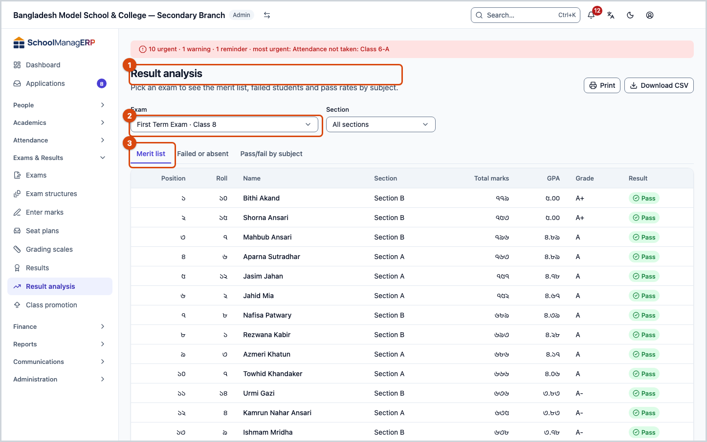
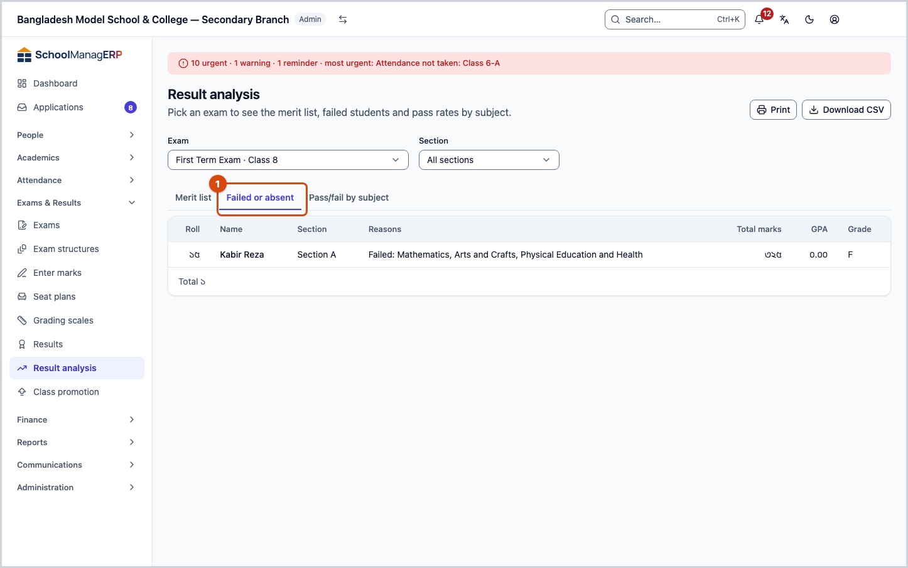

<!-- guide:meta
feature: examsResults.analysis
title: Merit list and result analysis
summary: See an exam's merit list, the students who failed or were absent and the pass/fail by subject, filter by section, print or download a CSV.
roles: [ADMIN, TEACHER, EXECUTIVE, EXAM_CONTROLLER]
sources:
  - client-admin/src/routes/_staff/analysis/index.tsx
  - client-admin/src/routes/_staff/analysis/-merit-tab.tsx
  - client-admin/src/routes/_staff/analysis/-defaulted-tab.tsx
  - client-admin/src/routes/_staff/analysis/-pass-fail-tab.tsx
  - client-admin/src/routes/_staff/exams/-detail/use-result-actions.tsx
  - client-admin/src/route-permissions.ts
  - client-admin/src/nav-tree.ts
  - server/src/modules/exams/analysis.controller.ts
  - server/src/modules/exams/analysis.service.ts
  - server/src/modules/classes/teacher-scope.service.ts
labels:
  [
    grading:analysisPage.*,
    grading:marksEntry.noExams*,
    exams:analysis.*,
    exams:resultsRoute.examLabel,
    exams:resultsRoute.examPlaceholder,
    exams:resultsRoute.loadError,
    exams:resultsRoute.selectExamHint,
    exams:resultsPanel.loadError,
    nav:items.analysis,
    nav:groups.examsResults,
  ]
helpIds:
  [
    examsResults.analysis,
    examsResults.analysis.action.print,
    examsResults.analysis.action.downloadCsv,
    examsResults.analysis.field.byPart,
  ]
devices: [desktop]
entry: [sidebar, palette, page:examsResults.results]
keywords:
  [ফলাফল বিশ্লেষণ, মেধা তালিকা, অকৃতকার্য, অনুপস্থিত, পাস-ফেল, পাসের হার, প্রিন্ট, CSV, result analysis, merit list, failed, absent, pass fail, pass rate, print, analysis, defaulters]
appVersion: 0.1.0 (a25ab3344)
owner: tareq89
lastVerified: 2026-10-25
knownIssues: []
-->

# Merit list and result analysis

From an exam's results, see the merit list, who failed or was absent, and how many passed in each subject. Print it if you need to.

**Where to go:** in the left menu, **Exams & Results → Result analysis**.
**Before you start:** the exam's results must be at least processed ([Processing and publishing results](results.md)). Be an Admin, Exam controller, Academic coordinator or Teacher.

This page is for viewing only. Nothing you press here changes any marks or results. The page has three tabs: **Merit list**, **Failed or absent** and **Pass/fail by subject**.

[See the merit list](#task-main) · [Failed or absent](#task-defaulted) · [Pass/fail by subject](#task-passfail) · [Print and CSV](#task-print) · [Problems and fixes](#trouble)

**On this page**

- [How you get to this page](#arrive)
- [See the merit list](#task-main)
- [How to know you are seeing the right list](#confirm)
- [Other situations](#other)
  - [See the students who failed or were absent](#task-defaulted)
  - [See the pass/fail by subject](#task-passfail)
  - [Print or download a CSV](#task-print)
- [Problems and fixes](#trouble)
- [Who can do what](#roles)
- [Learn more](#more)

---

## How you get to this page 

**From the left menu**

1. In the left menu press **Exams & Results → Result analysis**. → This page opens with the first exam in the list chosen. Start from [See the merit list](#task-main) below.

**From the Results page**

1. On the [Results](results.md) page, choose an exam and press **Result analysis**. → That exam's **Merit list** opens straight away; start from step 3 below.

---

## See the merit list 

1. In the left menu press **Exams & Results**, then press **Result analysis**.

   → The **Result analysis** page opens. Below the title it says **Pick an exam to see the merit list, failed students and pass rates by subject.**

2. In the **Exam** box, choose the exam.

   → If the results have been processed, three tabs appear and **Merit list** is open. If not, you see **Results are not ready yet**.

3. To see all sections together, keep **All sections** in the **Section** box. To see one section, choose that section.

   → The list shows each student's **Position**, **Roll**, **Name**, **Total marks**, **GPA**, **Grade** and **Result** (**Pass** or **Fail**). When you see all sections, there is also a **Section** column. When you choose one section, the first column is **Section position**.

Example: for the Class 8 half-yearly exam, **All sections** shows the position in the whole class, such as 1, 2, 3. If you choose section "A" in the **Section** box, only the students of section A appear, and **Section position** is the order inside that section.

| What you keep in the Section box | First column         | Who appears                             |
| -------------------------------- | -------------------- | --------------------------------------- |
| **All sections**                 | **Position**         | The whole class (with a Section column) |
| One section                      | **Section position** | Only that section                       |

> **Remember:** a student whose **Result** is **Fail** has no position. They come at the end of the list.

---

## How to know you are seeing the right list 

This page saves nothing. It only reads from the school's system and shows it.

| State                         | How you know                                | What next                               |
| ----------------------------- | ------------------------------------------- | --------------------------------------- |
| **The list has appeared**     | Rows are shown under the tabs               | Print or download a CSV if you need to  |
| **Results are not ready yet** | The page says **Results are not ready yet** | First process the [results](results.md) |

**To check:** the page address holds the exam, the section and the tab. If you copy the address and send it, the other person sees the same list, as long as they are allowed to see this page.

**The list appears even if the results are not published.** An exam in the **Processed** state is shown here too. So this page is useful to check before you publish.

---

## Other situations 

### See the students who failed or were absent 

1. Choose the exam, then press the **Failed or absent** tab.

   → Only the students who failed the overall result, or were absent in at least one subject, appear. The **Reasons** column says, for example, **Failed: Maths, English**, and on the next line **Absent: Science**.

2. If there is nobody, you see **Everyone passed** and **No student failed or missed a subject in this exam.**

This list is not split into pages. Everyone appears together.

### See the pass/fail by subject 

1. Choose the exam, then press the **Pass/fail by subject** tab.

   → One row for each subject: **Appeared**, **Passed**, **Failed**, **Absent**, **Pass %**, **Highest**, **Average** and the count for each grade (for example **A+: 12**). At the end is an **Overall** row in bold, counted over the whole result.

2. To see the parts inside a subject (for example written, multiple choice) separately, tick **By part**.

   → The list changes to one row for each **Subject** and **Part**: **Appeared**, **Absent**, **Below pass**, **Highest**, **Average**.

Example: in Maths, 38 of 40 students appeared, 34 passed, 4 failed and 2 were absent. So **Pass %** = 34 ÷ 38 = 89.5%. Absent students are not counted in this.

### Print or download a CSV 

1. Open the tab you want to print. Choose a section if you need to.
2. At the top right, press **Print**.

   → The browser's print window opens. On paper, the top has the exam name and the class (and the section, if one is chosen), and below it the list of the open tab. The **Merit list** is split into pages on screen, but the print has every row.

3. To open it in a spreadsheet, press **Download CSV**.

   → A CSV file of the open tab and the chosen section downloads. If it does not, you see **Could not download the CSV. Please try again.**

| You pressed      | What happens                           | Does anything change? |
| ---------------- | -------------------------------------- | --------------------- |
| **Print**        | The print window of the open tab opens | No                    |
| **Download CSV** | A CSV file of the open tab downloads   | No                    |

These two buttons are not there for an exam whose results are not ready.

---

## Problems and fixes 

| What you see                                                 | What to do                                                                                                                          | Who can help           |
| ------------------------------------------------------------ | ----------------------------------------------------------------------------------------------------------------------------------- | ---------------------- |
| **No exams yet**                                             | First create an exam ([Creating and setting up exams](exams.md)).                                                                   | Admin                  |
| **Results are not ready yet**                                | Process the results ([Results](results.md#task-main)). The Admin and the Exam controller also get an **Open the exam** button here. | Admin, Exam controller |
| **Couldn't load exams.**                                     | Check your internet and try again.                                                                                                  | —                      |
| **Couldn't load results.**                                   | Press the try-again button inside the tab.                                                                                          | —                      |
| **No results for this choice**                               | The chosen section has no results. **Try another section.**                                                                         | —                      |
| **Could not download the CSV. Please try again.**            | Check your internet and press again.                                                                                                | —                      |
| As a Teacher, the **Section** box does not have all sections | This is normal: a Teacher sees only the sections they are responsible for in the current year. Ask the Admin to add a section.      | Admin                  |
| The **Exam** box does not have an old exam                   | This box shows up to 50 exams (from the code; not checked in the app).                                                              | —                      |

---

## Who can do what 

| Role                                       | Open this page | Which students they see                     | Print and CSV |
| ------------------------------------------ | -------------- | ------------------------------------------- | ------------- |
| Admin                                      | Yes            | All                                         | Yes           |
| Exam controller                            | Yes            | All                                         | Yes           |
| Academic coordinator                       | Yes            | All                                         | Yes           |
| Teacher                                    | Yes            | Only their own sections in the current year | Yes           |
| Accountant, Office staff, Committee member | No             | —                                           | No            |

If a Teacher asks for the list of another section, it shows "not found". Even with **All sections**, a Teacher sees only the students of their own sections, but the **Position** column still has the position in the whole class.

---

## Learn more 

<strong>Parts of the page</strong> — top to bottom

1. **Result analysis** — the title, and on the right **Print** and **Download CSV**.
2. The **Exam** and **Section** boxes.
3. The three tabs — **Merit list**, **Failed or absent**, **Pass/fail by subject**.
4. The list. The **Merit list** starts with 25 students per page; the other two tabs show all rows together.

<strong>What each field means</strong>

| Field   | What to choose                                                                                  | Required? |
| ------- | ----------------------------------------------------------------------------------------------- | --------- |
| Exam    | Which exam to analyse. The first time, the first exam in the list is chosen.                    | Yes       |
| Section | **All sections**, or one section. When you change the exam it goes back to **All sections**.    | No        |
| By part | Only in the **Pass/fail by subject** tab. Tick it to see the parts inside a subject separately. | No        |

<strong>Who passed, who failed, who was absent</strong> — how it is worked out

<figure>
  
  <figcaption><em>Three views of the same results</em></figcaption>
</figure>

- **Pass / fail:** shows what was decided when the results were processed ([How results are worked out](results.md#more)). This page does not work anything out again.
- **Absent:** if a subject's grade is **ABS**, the student was absent in that subject. In a subject's row, absent students are not counted in **Appeared**, **Passed**, **Failed**, **Highest** and **Average**.
- **Failed or absent tab:** failed the overall result, or **ABS** in at least one subject.
- **Order and ties:** by **Position**, smallest first; when the position is the same, by name in alphabetical order. The position is set when the results are processed (GPA first, then total marks; if both are equal, the position is the same).
- **Overall row:** **Appeared** means the number of students who have a result; **Highest** and **Average** are of the total marks.

<strong>Short help for the boxes (the (?) button)</strong>

<!-- guide:generated:fields:exams -->

| Field                                   | What to enter                                                                                                                              | Required?                    |
| --------------------------------------- | ------------------------------------------------------------------------------------------------------------------------------------------ | ---------------------------- |
| Name (exam)                             | The exam name, e.g. Half Yearly 2026. Two exams of the same class and year cannot share a name.                                            | Yes                          |
| Kind (exam)                             | Term, monthly, model or other. Cannot change once results are published.                                                                   | No                           |
| Mark entry deadline                     | Teachers see the days left on their dashboard. Leave empty if there is none.                                                               | No                           |
| Academic year                           | The year the exam belongs to. Chosen only when you add the exam.                                                                           | Yes                          |
| Class                                   | The class that sits the exam. Pick the year first; it cannot change later.                                                                 | Yes                          |
| Start from an exam structure (optional) | Pick an exam structure and the parts for the class subjects are made for you. Hidden when there is no structure.                           | No                           |
| Name (part)                             | The part name, e.g. Written. Two parts of one subject cannot share a name.                                                                 | Yes                          |
| Kind (part)                             | Written, MCQ, viva, practical and so on. Attendance is counted for you.                                                                    | No                           |
| Full marks                              | The full marks of the part, e.g. 70; a positive number. Not shown for an attendance part.                                                  | Yes, except attendance parts |
| Pass marks                              | The pass mark of the part, e.g. 23. Not more than the full marks. Leave empty if not needed.                                               | No                           |
| Exam (marks entry)                      | The exam you are entering marks for. Its marks lists for the sections and subjects you may enter show below.                               | Yes                          |
| Marks (marks entry)                     | The marks for that student and part, up to the maximum shown. Type A for absent and E for exempt. Attendance parts are worked out for you. | No                           |
| By part (analysis)                      | On the Pass/fail tab, tick it to see the results for each part of a subject, not only for the whole subject.                               | No                           |

<!-- /guide:generated -->

**Related pages**

- [**Processing and publishing results**](results.md) — results must be processed before the analysis.
- [**Entering and submitting exam marks**](marks-entry.md) — if a mark looks wrong, correct it there.
- [**Setting up grading scales**](grading-scales.md) — which percentage gets which grade.
- [**Promoting students**](promotion.md) — move students up to the next class based on the results.
- [**Creating and setting up exams**](exams.md) — creating and setting up exams

---

_Version 0.1.0 · last verified 2026-10-25_
