<!-- guide:meta
feature: examsResults.examTemplates
title: Building an exam structure
summary: Write the parts and marks of every class and subject once in a structure, then pick the structure when you add an exam to get all the parts at once.
roles: [ADMIN, EXAM_CONTROLLER]
sources:
  - client-admin/src/routes/_staff/exams/templates/index.tsx
  - client-admin/src/routes/_staff/exams/templates/$templateId.tsx
  - client-admin/src/routes/_staff/exams/-templates-list.tsx
  - client-admin/src/routes/_staff/exams/-template-form-dialog.tsx
  - client-admin/src/routes/_staff/exams/-template-detail.tsx
  - client-admin/src/routes/_staff/exams/-template-grid.tsx
  - client-admin/src/routes/_staff/exams/-use-exam-templates.ts
  - server/src/modules/exams/exam-templates.controller.ts
  - server/src/modules/exams/exam-templates.service.ts
  - server/src/modules/exams/exams.service.ts
labels:
  [
    examTemplates:list.*,
    examTemplates:form.*,
    examTemplates:delete.*,
    examTemplates:detail.*,
    examTemplates:grid.*,
    examTemplates:fields.*,
    examTemplates:help.*,
    exams:kind.*,
    exams:componentKind.*,
    examsTemplateField:label,
    examsTemplateField:toast.*,
    nav:items.examTemplates,
    nav:groups.examsResults,
    common:actions.cancel,
    common:accessDenied.*,
  ]
helpIds:
  [
    examsResults.examTemplates,
    examsResults.examTemplates.action.add,
    examsResults.examTemplates.action.delete,
    examsResults.examTemplates.action.addGrade,
    examsResults.examTemplates.action.addSubject,
    examsResults.examTemplates.action.save,
    examsResults.examTemplates.field.grade,
    examsResults.examTemplates.field.fullMarks,
    examsResults.examTemplates.field.passMarks,
  ]
devices: [desktop]
entry: [sidebar, palette]
keywords:
  [exam structure, exam template, structure, template, component, part, full marks, pass marks, class number, written, MCQ, পরীক্ষার কাঠামো, কাঠামো, টেমপ্লেট, অংশ, পূর্ণমান, পাস নম্বর, লিখিত, এমসিকিউ]
appVersion: 0.1.0 (dd9119702)
owner: tareq89
lastVerified: 2026-10-25
knownIssues:
  - { id: template-unsaved-no-warning, checked: 2026-10-25, issue: null }
-->

# Building an exam structure

Write the parts and marks of every class and subject once in a structure, then pick the structure when you add an exam to get all the parts at once.

**Where to go:** in the left menu, **Exams & Results → Exam structures**. Do the work on this page on a computer.
**Before you start:** you must be the school Admin or the exam controller ([who can do what](#roles)). The school's subjects must already exist with their codes, and the [class](../academics/classes.md) you will use the structure for must have its **grade** set.

Say every year the **Half Yearly** exam has **Written 70** and **MCQ 30** in Class 9 Maths. Write it once in a structure, and each time you add a new [exam](exams.md) you only pick the structure and the parts come in. A structure is arranged by **class number** (for example 9) and **subject**.

[Add a structure](#task-main) · [Give classes, subjects and parts](#task-grid) · [Use it in an exam](#task-use) · [Problems and fixes](#trouble)

**On this page**

- [How to reach this page](#arrive)
- [Add a structure](#task-main)
- [How to tell the structure was saved](#confirm)
- [Other situations](#other)
  - [Give classes, subjects and parts](#task-grid)
  - [Add an exam with a structure](#task-use)
  - [Change the name and type](#task-edit)
  - [Delete a structure](#task-delete)
- [Problems and fixes](#trouble)
- [Who can do what](#roles)
- [Known issues](#known-issues)
- [Learn more](#more)

---

## How to reach this page 

**From the left menu:** press **Exams & Results → Exam structures**. Start from step 1 below.

**From the search box:** in the search box at the top (Ctrl+K), type **Add exam structure** and pick it. → The list of structures opens, and the **Add exam structure** dialog is already open. Start from step 3 below. Search rules: [Finding any page](../start/find-anything.md).

---

## Add a structure 

1. In the left menu, press **Exams & Results → Exam structures**.

   → At the top is the title **Exam structures**. The list has the columns **Name**, **Type**, **Classes**, **Subjects**. If there are none, it says **No exam structures yet**.

<!-- image pending: the exam structure list, with the Add exam structure button marked, Admin, desktop -->

2. At the top of the page, press **Add exam structure**.

   → The **Add exam structure** dialog opens.

3. Type the **Name**, for example `Half-yearly`.

   → If you leave it empty, it shows **Name is required.**; if it is longer than 200 characters, **Name can be at most 200 characters.**

4. From **Type**, pick **Term**, **Monthly**, **Model** or **Other**.

5. Press **Create**.

   → The structure's own page opens. At first it says **No classes yet**. Now [give classes, subjects and parts](#task-grid).

---

## How to tell the structure was saved 

Structure details are saved only when you are online; they cannot be kept on the device and sent later. So there is no **Saved on this device** state here.

| State                           | How to tell                                                                          | What next                          |
| ------------------------------- | ------------------------------------------------------------------------------------ | ---------------------------------- |
| **Changed on screen only**      | A **Not saved** mark beside the name, and a **Discard changes** button at the top     | Press **Save** at the top          |
| **Reached the school's system** | The **Not saved** mark is gone; **Subjects** and **Parts** at the top have gone up    | [Use it in an exam](#task-use)     |

**To check:** reload the page. If the parts are as before, it was saved.

**If no message comes:** see [Problems and fixes](#trouble). If you do not leave the page, the changes stay on the screen. If you go to another page before saving, the changes are lost ([Known issues](#known-issues)).

---

## Other situations 

### Give classes, subjects and parts 

1. On the structure's page, press **Add class**.

   → The **Add a class** dialog opens.

2. Type the **Class number**, for example `9`, then press **Add class**.

   → If it is outside 1 to 99, or a fraction, it shows **Enter a whole number from 1 to 99.** If it is right, a tab named **Class 9** appears.

3. In the **Add a subject to class 9** section, pick the **Subject**, then press **Add subject**. A subject already in this class does not show in the list.

   → A card for the subject appears, with one empty part row; the type is **Written**.

4. In the row, type the **Part name**, **Type**, **Full marks** and **Pass marks**. Bangla or English digits both work.

   → At the top of the card it says, for example, **Code {subject code} · 2 parts · full marks 100**.

5. If you need another part, press **Add part**. Pressing Enter in the last cell of a row also adds a new row.

6. Do the same for the other subjects and classes. The changes of all classes stay together.

7. At the top of the page, press **Save**.

   → The **Not saved** mark goes away.

<!-- image pending: the structure page, with the Class 9 tab, a subject card, a part row and the Save button marked, Admin, desktop -->

**To take away:** press **Remove part** on a row, or **Remove subject** for a whole subject. To drop all changes, press **Discard changes** at the top. A removal becomes final only when you press **Save**.

**It will not save if something is wrong.** The top says **Fix the highlighted fields before saving.**, and the tab of a class with a mistake says **Class {number} has errors**. The messages beside the cells:

| Message                                                                          | What it means                                                       |
| -------------------------------------------------------------------------------- | ------------------------------------------------------------------- |
| **Enter a part name.**                                                           | The name is empty                                                   |
| **Two parts of this subject share a name.**                                      | The same name twice in one subject                                  |
| **Full marks must be above 0 and at most 9999.99, with up to 2 decimals.**       | Full marks is empty, zero or too big                                |
| **Pass marks must be between 0 and full marks, with up to 2 decimals.**          | Pass marks is empty or more than full marks. If there is no pass mark, give `0` |
| **Only one Attendance part is allowed per subject.**                             | Two **Attendance** parts                                            |
| **Add at least one part, or remove this subject.**                               | The subject's card has no parts                                     |

A class with no subject loses its tab after saving.

### Add an exam with a structure 

1. In the [Add exam](exams.md#task-main) dialog, after picking the class, pick the structure in the **Start from an exam structure (optional)** field.

2. Press **Save**.

   → A message shows, for example **Exam created with 12 parts**. The parts can be seen on the exam's **Marks breakdown** tab.

What is copied: the structure's parts for the class whose number equals the class's **grade**, only for the subjects attached to the class in that year. Subjects are matched by **subject code**. If nothing matches, the exam is still made, and the message is **Exam created — the structure had nothing for this class's subjects. Add the parts yourself.**

If you change or delete the structure later, the parts of exams already made do not change.

### Change the name and type 

On the structure's page, press **Change name and type** at the top. A dialog with the same fields opens; make the change and press **Save**. This does not wipe the unsaved changes in the grid. Pressing **Edit** in the list opens the structure's page.

### Delete a structure 

1. At the end of the row in the list, press **Delete {name}**.

   → The **Delete this exam structure?** dialog opens: “{name}” and all its parts will be deleted. Exams already created from it do not change.

2. Press **Delete**.

| You pressed | What happens                                                    | Saved? |
| ----------- | --------------------------------------------------------------- | ------ |
| **Delete**  | The structure leaves the list; it cannot be brought back        | Yes    |
| **Cancel**  | Nothing changes                                                 | No     |

A structure can be deleted even if some exams were made from it; those exams stay as they were.

---

## Problems and fixes 

| What you see                                                                  | What to do                                                                                                                                                                  | Who can help |
| ----------------------------------------------------------------------------- | --------------------------------------------------------------------------------------------------------------------------------------------------------------------------- | ------------ |
| **You don't have access to this page.**                                       | Only the Admin and the exam controller see this page. Press **Back to dashboard**.                                                                                          | Admin        |
| **Couldn't load the exam structures.** or **Couldn't load this exam structure.** | Check the internet and reload the page.                                                                                                                                  | Admin        |
| **Another exam structure already has this name.**                             | Give another name.                                                                                                                                                          | Admin        |
| **Couldn't save the exam structure.**                                         | Check the internet and try again.                                                                                                                                           | Admin        |
| **Couldn't save the changes.**                                                | Do not leave the page; check the internet and press **Save** again.                                                                                                         | Admin        |
| **Couldn't delete the exam structure.**                                       | Check the internet and press **Delete** again.                                                                                                                              | Admin        |
| The subject you want is not in the **Subject** list                           | The subject is already added in this class, or it is not in the school's list of subjects.                                                                                  | Admin        |
| The **Start from an exam structure (optional)** field is not there when adding an exam | The school has no structure. First [add a structure](#task-main).                                                                                                  | Admin        |
| No parts came into the exam                                                   | See whether the class's **grade** matches the structure's class number, and whether the subjects are attached to the class ([Classes](../academics/classes.md#task-subjects)). | Admin        |

---

## Who can do what 

| Role                                                                                | See the list and structure page | Add, change, delete structures |
| ----------------------------------------------------------------------------------- | ------------------------------- | ------------------------------ |
| Admin                                                                               | Yes                             | Yes                            |
| Exam controller                                                                     | Yes                             | Yes                            |
| Academic coordinator, teacher, accountant, office assistant, governing board member | No                              | No                             |

For other roles, **Exam structures** is not in the left menu. If they open the page, they see **You don't have access to this page.**

---

## Known issues 

Checked by reading the code in version 0.1.0, 2026-10-25. Not run in the app. It will be removed from this section once fixed.

| Problem                                                                                                          | Whose, when                         | Data saved?                              | What to do for now                       |
| ---------------------------------------------------------------------------------------------------------------- | ----------------------------------- | ---------------------------------------- | ---------------------------------------- |
| If you change the grid and go to another page without pressing **Save**, no warning comes and the changes are lost | Whoever writes the structure's parts | No, changes after the last save are lost | Press **Save** now and then              |

---

## Learn more 

<strong>The parts of the page</strong> — the structure page, top to bottom

1. **Name and state** — the structure's name; **Not saved** if there are unsaved changes.
2. **Facts row** — **Type**, **Classes**, **Subjects**, **Parts**.
3. **Buttons at the top** — **Discard changes**, **Save**, **Change name and type**.
4. **Class tabs** — **Class 9**, **Class 10** …, with **Add class** beside them.
5. **Subject cards** — each with part rows: **Part name**, **Type**, **Full marks**, **Pass marks**, **Actions**.

<!-- image pending: the five parts of the structure page, numbered, Admin, desktop -->

<strong>What the fields mean</strong>

<!-- guide:generated:fields:examTemplates -->

| Field            | What to enter                                                                 | Required? |
| ---------------- | ----------------------------------------------------------------------------- | --------- |
| Name (structure) | E.g. Half-yearly; at most 200 characters. Two structures cannot share a name. | Yes       |
| Type (structure) | Term, monthly, model or other.                                                | No        |
| Class number     | 1 to 99, e.g. 9. The structure is matched to the class grade.                 | Yes       |
| Subject          | One of the school subjects. Exams match it by subject code.                   | Yes       |
| Part name        | E.g. Written; two parts of one subject cannot share a name.                   | Yes       |
| Type (part)      | Written, MCQ, viva and so on. Only one attendance part per subject.           | No        |
| Full marks       | More than 0, at most 9999.99, up to 2 decimal places.                         | Yes       |
| Pass marks       | From 0 to the full marks, up to 2 decimal places.                             | Yes       |

<!-- /guide:generated -->

<strong>How structures work</strong> — from class number to the exam's parts

<figure>
  
  <figcaption><em>Exam parts from a structure</em></figcaption>
</figure>

<figure>
  
  <figcaption><em>From exam to promotion</em></figcaption>
</figure>

- A structure is only a starting point. After the exam is made, change parts on the exam's [Marks breakdown](exams.md#task-components) tab.
- Where to set a class's grade: [Edit a class](../academics/classes.md#task-edit).

**Related pages**

- [**Exams**](exams.md) — add an exam by picking a structure, change parts later.
- [**Seat plans**](seat-plans.md) — arrange seating by exam subject.
- [**Ready-made curriculum**](../administration/curriculum-preset.md) — In a brand-new school, choose a ready-made curriculum and create the academic year, classes, subjects.

---

_Version 0.1.0 · Last checked 2026-10-25_
