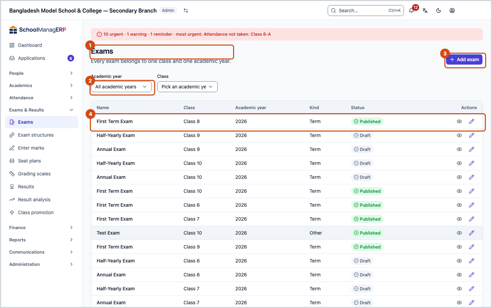
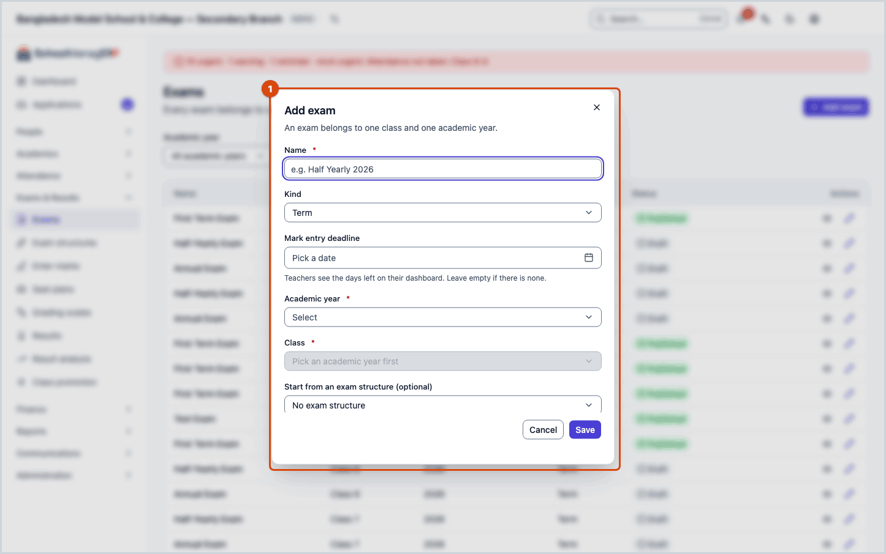
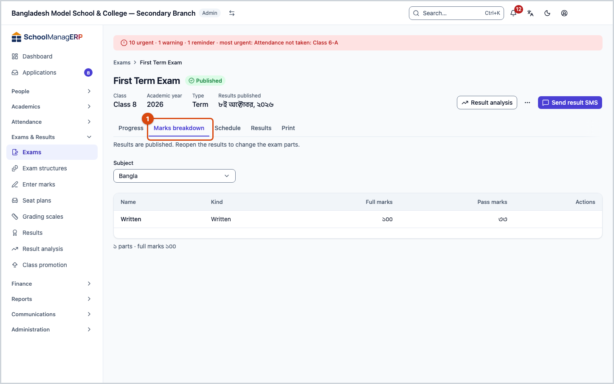

<!-- guide:meta
feature: examsResults.exams
title: Creating and setting up exams
summary: Add an exam for a class, set the parts and marks of each subject, give a schedule, and follow the exam from marks submission to published results.
roles: [ADMIN, EXAM_CONTROLLER]
sources:
  - client-admin/src/routes/_staff/exams/index.tsx
  - client-admin/src/routes/_staff/exams/$examId.tsx
  - client-admin/src/routes/_staff/exams/-exam-form-dialog.tsx
  - client-admin/src/routes/_staff/exams/-exam-status-badge.tsx
  - client-admin/src/routes/_staff/exams/-copy-components-dialog.tsx
  - client-admin/src/routes/_staff/exams/-detail/progress-panel.tsx
  - client-admin/src/routes/_staff/exams/-detail/components-panel.tsx
  - client-admin/src/routes/_staff/exams/-detail/schedule-panel.tsx
  - client-admin/src/routes/_staff/exams/-detail/results-panel.tsx
  - client-admin/src/routes/_staff/exams/-detail/print-panel.tsx
  - client-admin/src/routes/_staff/exams/-detail/use-result-actions.tsx
  - server/src/modules/exams/exams.controller.ts
  - server/src/modules/exams/exams.service.ts
  - server/src/modules/exams/exam-components.controller.ts
  - server/src/modules/exams/exam-components.service.ts
  - server/src/modules/exams/exam-schedules.controller.ts
  - server/src/modules/exams/exam-schedules.service.ts
labels:
  [
    exams:list.*,
    exams:kind.*,
    exams:status.*,
    exams:examForm.*,
    exams:detail.*,
    exams:progressPanel.*,
    exams:componentsPanel.*,
    exams:componentKind.*,
    exams:copyDialog.*,
    exams:schedulePanel.*,
    exams:resultsPanel.*,
    exams:fields.*,
    exams:help.*,
    examsTemplateField:label,
    examsTemplateField:none,
    examsTemplateField:toast.*,
    nav:groups.examsResults,
    common:entities.exam*,
    common:actions.cancel,
    common:accessDenied.*,
  ]
helpIds:
  [
    examsResults.exams,
    examsResults.exams.action.add,
    examsResults.exams.action.edit,
    examsResults.exams.action.addComponent,
    examsResults.exams.action.copyComponents,
    examsResults.exams.action.addSchedule,
    examsResults.exams.field.name,
    examsResults.exams.field.kind,
    examsResults.exams.field.deadline,
    examsResults.exams.field.template,
  ]
devices: [desktop]
entry: [sidebar, palette]
keywords:
  [exam, term exam, monthly test, model test, component, part, full marks, pass marks, marks breakdown, schedule, mark entry deadline, পরীক্ষা, টার্ম, মাসিক, মডেল টেস্ট, অংশ, পূর্ণমান, পাশ নম্বর, সময়সূচি]
appVersion: 0.1.0 (dd9119702)
owner: tareq89
lastVerified: 2026-10-25
knownIssues: []
-->

# Creating and setting up exams

Add an exam for a class, set the parts and marks of each subject, give a schedule, and follow the exam from marks submission to published results.

**Where to go:** in the left menu, **Exams & Results → Exams**. Do the work on this page on a computer.
**Before you start:** you must be the school Admin or the exam controller ([who can do what](#roles)). The [class](../academics/classes.md) must already exist in the academic year, and the class must already have its [subjects](../academics/classes.md#task-subjects).

Every exam belongs to one class and one academic year, for example the **Half Yearly** of **Class 9** in the year **2026**. Inside an exam, each subject has **parts**, for example Maths has **Written 70** and **MCQ 30**. Teachers enter marks by part. So after you add an exam, you need to set its parts.

[Add an exam](#task-main) · [Set the parts](#task-components) · [Give a schedule](#task-schedule) · [Exam states](#task-status) · [Problems and fixes](#trouble)

**On this page**

- [How to reach this page](#arrive)
- [Add an exam](#task-main)
- [How to tell the exam was added](#confirm)
- [Other situations](#other)
  - [Set the parts of a subject](#task-components)
  - [Copy parts from somewhere else](#task-copy)
  - [Give a schedule](#task-schedule)
  - [Edit an exam](#task-edit)
  - [Exam states: draft to published](#task-status)
  - [Delete an exam](#task-delete)
  - [Filter the list](#task-find)
  - [The exam page: the tabs](#task-detail)
- [Problems and fixes](#trouble)
- [Who can do what](#roles)
- [Learn more](#more)

---

## How to reach this page 

**From the left menu:** press **Exams & Results → Exams**. Start from step 1 below.

**From the search box:** in the search box at the top (Ctrl+K), type **Create exam from template** and pick it. → The list of exams opens, and the **Add exam** dialog is already open. Start from step 3 below. Search rules: [Finding any page](../start/find-anything.md).

---

## Add an exam 

1. In the left menu, press **Exams & Results → Exams**.

   → At the top is the title **Exams**, with the line "Every exam belongs to one class and one academic year." The list has the columns **Name**, **Class**, **Academic year**, **Kind**, **Status**. At first it shows the exams of all years.

2. At the top of the page, press **Add exam**.

   → The **Add exam** dialog opens.

3. In the **Name** field, type the name of the exam, for example `Half Yearly 2026`.

   → If you leave it empty and save, it shows **Name is required.**

4. From **Kind**, pick **Term**, **Monthly**, **Model** or **Other**. **Term** is picked at first.

5. If you like, give a **Mark entry deadline**.

   → Teachers see on their dashboard how many days are left. If you picked a wrong date, press **Clear date**.

6. Pick the **Academic year**, then pick the **Class**. If the list was filtered to a year, that year is already picked.

   → Until a year is picked, the **Class** field says **Pick an academic year first**. If either is missing, it shows **Academic year and class are required.** You cannot change the year or class later, so pick the right ones.

7. If the school has [exam structures](exam-templates.md), the **Start from an exam structure (optional)** field shows. If you pick a structure, the parts are made for you; if you do not want that, keep **No exam structure**.

8. Press **Save**.

   → The dialog closes and the new exam appears in the list, with the status **Draft**. If you picked a structure, a message shows at the top, for example **Exam created with 12 parts**.

> **Remember:** without parts, teachers cannot enter marks. If you did not pick a structure, press the exam name now and [set the parts](#task-components).

---

## How to tell the exam was added 

Exam details are saved only when you are online; they cannot be kept on the device and sent later. So there is no **Saved on this device** state here.

| State                           | How to tell                                                      | What next                         |
| ------------------------------- | ---------------------------------------------------------------- | --------------------------------- |
| **Changed on screen only**      | The dialog is open and filled in, but has not closed             | Press **Save**                    |
| **Reached the school's system** | The dialog has closed and the exam is in the list with **Draft** | [Set the parts](#task-components) |

**To check:** reload the page. If the exam does not show, look at the **Academic year** and **Class** filters at the top.

**If no message comes:** see [Problems and fixes](#trouble). The details you typed are still in the dialog.

---

## Other situations 

### Set the parts of a subject 

1. In the list, press the name of the exam, then open the **Marks breakdown** tab.

2. In the **Subject** field, pick a subject.

   → The list of that subject's parts: **Name**, **Kind**, **Full marks**, **Pass marks**. Below it is a line like **2 parts · full marks 100**. If there are none, it says **No parts for this subject yet**.

3. In the **Add a part** section, type the **Name**, for example `Written`, and pick the **Kind**.

4. Give the **Full marks**, for example `70`. If you like, give the **Pass marks**, for example `23`.

   → If full marks is empty or zero, it shows **Full marks must be a positive number.** If you pick the kind **Attendance**, the marks fields go away and this shows: **Attendance parts are computed automatically — marks aren't entered for them.**

5. Press **Add**.

   → The part appears in the list. The full marks of an attendance part shows **Derived**.

**To delete a part:** press **Delete** on its row, then press **Delete** in the **Delete this part?** dialog. There is no button to change a part here; if it is wrong, delete it and add it again.

**Rules:**

- Two parts of one subject cannot have the same name, and there can be only one attendance part.
- Pass marks cannot be more than full marks.
- Once the results are processed (**Processed**), you can add or delete parts; the results are then worked out again by themselves.
- Once the results are **Published**, parts cannot be changed. It says **Results are published. Reopen the results to change the exam parts.**

### Copy parts from somewhere else 

If the same parts are needed in many subjects, copy them instead of adding them one by one.

1. On the **Marks breakdown** tab, press **Copy from elsewhere**.

   → The **Copy parts** dialog opens. It says nothing is created until you confirm.

2. From **Source**, pick one:
   - **Another subject in this exam**: then pick the **Subject**.
   - **The same subject in a different exam**: pick another **Exam** of the same class and its **Subject**.

3. In **Copy into**, tick one or more subjects.

   → In the **Preview** section, next to each subject it says what will be created, for example **2 to create: Written, MCQ**. What is already there is **Skipped**, with the reason: **a part with this name already exists** or **this subject already has an attendance part**.

4. Press **Copy**. If you change your mind, press **Cancel**.

### Give a schedule 

The [seat plan](seat-plans.md) picks its subjects from the schedule, and the exam routine is printed from it.

1. On the exam page, open the **Schedule** tab.

   → The list has **Subject**, **Date**, **Starts at**, **Ends at**, **Venue**. If there are none, it says **No schedule yet**.

2. In the **Add a subject to the schedule** section, pick the **Subject**. A subject that is already there does not show in the list.

3. Give the **Date**, then the **Starts at** and **Ends at** times.

4. Press **Add**.

   → The subject appears in the list. If another subject is at the same time, a **Time clash** mark shows beside it; this is only a warning and does not stop saving.

You can change the date, time or venue by pressing the cell in the list. To take a subject off, press **Remove from schedule**, then press **Remove** in the **Remove from the schedule?** dialog.

**Rules:** the date must fall inside the exam's academic year, and the start time must be before the end time. If a subject is in a **Published** seat plan, its date and time cannot be changed or removed; first [unpublish](seat-plans.md#task-unpublish) the seat plan. The venue can still be changed.

### Edit an exam 

1. At the end of the exam's row in the list, press **Edit**. (There is also an **Edit** at the top of the exam page.)

   → The **Edit exam** dialog opens. It has only the **Name**, **Kind** and **Mark entry deadline**; the year and class cannot be changed.

2. Make your changes and press **Save**.

When the results are **Published**, only the name and deadline can be changed; if you change the **Kind**, it does not save and shows **This exam's results are published. Reopen the results before changing its type.**

### Exam states: draft to published 

The state is written at the top of the exam page, and beside it are only the buttons for what comes next.

| State         | What it means                                                  | Buttons at the top                                   |
| ------------- | -------------------------------------------------------------- | ---------------------------------------------------- |
| **Draft**     | Parts, schedule and marks are being given                      | **Process result**                                   |
| **Processed** | Results worked out from the submitted marks, not yet published | **Result analysis**, **Process again**, **Publish**  |
| **Published** | Results are published; parts are locked                        | **Result analysis**, **Send result SMS**, **Reopen** |

Pressing **Reopen** makes the exam **Processed** again. The full rules for processing, publishing and reopening will be on [the results page](results.md).

### Delete an exam 

Only a **Draft** exam can be deleted, for example one made by mistake. Once its results have been processed, the exam cannot be deleted; **Reopen** and correct the results instead.

1. Open the exam's page and, at the top, press **Delete exam**.

   → The **Delete this exam?** dialog opens: "The exam, its marks breakdown, schedule and any marks entered are removed. This can't be undone from the app."

2. Press **Delete**.

   → The exam is deleted and the exam list opens.

If **This exam has results. Reopen and correct them instead of deleting the exam.** or **Couldn't delete the exam. Please try again.** appears in the dialog, the exam was not deleted.

### Filter the list 

| Field             | What to pick                                                                                                                               |
| ----------------- | ------------------------------------------------------------------------------------------------------------------------------------------ |
| **Academic year** | One year, or **All academic years**                                                                                                        |
| **Class**         | One class, or **All classes**. If no year is picked, it says **Pick an academic year first**. If you change the year, the class is cleared |

If nothing matches, it shows **No exams match these filters**, with a **Clear all** button. Filters are only for viewing; they change nothing.

### The exam page: the tabs 

Press the exam name in the list, or **View**, to open its page. At the top are the name, the state, and the **Class**, **Academic year** and **Type**; once the results are published, the date of **Results published** also shows.

| Tab                 | What is in it                                                                                                                                                                                                |
| ------------------- | ------------------------------------------------------------------------------------------------------------------------------------------------------------------------------------------------------------ |
| **Progress**        | In front when the page opens. **Marks submission progress**, for example **15 of 20 marks lists submitted**, and under **Lists not submitted yet** the section and subject, with **Enter marks** beside each |
| **Marks breakdown** | The parts of a subject; [Set the parts](#task-components)                                                                                                                                                    |
| **Schedule**        | The date and time of each subject; [Give a schedule](#task-schedule)                                                                                                                                         |
| **Results**         | Result by student: **Position**, **Roll · Name**, **Total**, **GPA**, **Grade**, **Status**                                                                                                                  |
| **Print**           | Admit cards, seat lists, mark sheets and so on; [Exam documents](../administration/print-templates/exam-documents.md). The tab shows only if you have the print permission                                   |

---

## Problems and fixes 

| What you see                                                                                    | What to do                                                                                                                                                                                  | Who can help |
| ----------------------------------------------------------------------------------------------- | ------------------------------------------------------------------------------------------------------------------------------------------------------------------------------------------- | ------------ |
| **You don't have access to this page.**                                                         | Only the Admin and the exam controller see this page. Press **Back to dashboard**.                                                                                                          | Admin        |
| **Couldn't load exams.** or **Couldn't load this exam.**                                        | Check the internet and reload the page.                                                                                                                                                     | Admin        |
| **An exam with this name already exists.**                                                      | An exam with this name already exists for the same class and year. Give another name.                                                                                                       | Admin        |
| **This exam's results are published. Reopen the results before changing its type.**             | Keep the **Kind** as it was, or first **Reopen** the results ([Exam states](#task-status)).                                                                                                 | Admin        |
| **This class has no grade set, so an exam structure can't be used. …**                          | Give the class a **grade** ([Edit a class](../academics/classes.md#task-edit)), or pick **No exam structure**.                                                                              | Admin        |
| **Couldn't save the exam.**                                                                     | Check the internet and press **Save** again.                                                                                                                                                | Admin        |
| The **Class** list is empty                                                                     | The picked year has no classes. First [add a class](../academics/classes.md#task-main).                                                                                                     | Admin        |
| **Exam created — the structure had nothing for this class's subjects. Add the parts yourself.** | The structure has no grade or subjects for this class, or the subject codes did not match. [Set the parts](#task-components) yourself, or fix the [structure](exam-templates.md#task-grid). | Admin        |
| **Couldn't save the part.**                                                                     | See whether a part with the same name or a second attendance part already exists in the subject, and whether pass marks are more than full marks.                                           | Admin        |
| **Results are published. Reopen the results to change the exam parts.**                         | The results are published. To change parts, press **Reopen** at the top.                                                                                                                    | Admin        |
| **Couldn't copy the parts.**                                                                    | Check the internet and press **Copy** again.                                                                                                                                                | Admin        |
| **Couldn't save the schedule change.** or **Couldn't remove it.**                               | See whether the date is inside the academic year and the start is before the end. If the subject is in a published seat plan, first [unpublish](seat-plans.md#task-unpublish) it.           | Admin        |
| The **Subject** field is not on the **Schedule** tab                                            | Every subject of the class is already in the schedule, or the class has no subjects ([attach subjects](../academics/classes.md#task-subjects)).                                             | Admin        |

---

## Who can do what 

| Role                                                                                | See the list and exam page | Add, edit, parts and schedule | Process, publish, reopen results | Print tab |
| ----------------------------------------------------------------------------------- | -------------------------- | ----------------------------- | -------------------------------- | --------- |
| Admin                                                                               | Yes                        | Yes                           | Yes                              | Yes       |
| Exam controller                                                                     | Yes                        | Yes                           | Yes                              | Yes       |
| Academic coordinator, teacher, accountant, office assistant, governing board member | No                         | No                            | No                               | No        |

For other roles, **Exams** is not in the left menu; if they open the page, they see **You don't have access to this page.** A teacher and an academic coordinator see the exam name only in the exam picker on the [marks entry](marks-entry.md) and [result analysis](analysis.md) pages.

---

## Learn more 

<strong>The parts of the page</strong> — top to bottom

1. **Exams** — the title, with a one-line explanation below.
2. **Add exam** — the button at the top of the page.
3. **Filter row** — **Academic year** and **Class**.
4. **List** — **Name**, **Class**, **Academic year**, **Kind**, **Status**; at the end of each row, **View** and **Edit**.

<strong>What the fields mean</strong>

<!-- guide:generated:fields:exams -->

| Field                                   | What to enter                                                                                                                              | Required?                                     |
| --------------------------------------- | ------------------------------------------------------------------------------------------------------------------------------------------ | --------------------------------------------- |
| Name (exam)                             | The exam name, e.g. Half Yearly 2026. Two exams of the same class and year cannot share a name.                                            | Yes                                           |
| Kind (exam)                             | Term, monthly, model or other. Cannot change once results are published.                                                                   | No                                            |
| Mark entry deadline                     | Teachers see the days left on their dashboard. Leave empty if there is none.                                                               | No                                            |
| Academic year                           | The year the exam belongs to. Chosen only when you add the exam.                                                                           | Yes                                           |
| Class                                   | The class that sits the exam. Pick the year first; it cannot change later.                                                                 | Yes                                           |
| Start from an exam structure (optional) | Pick an exam structure and the parts for the class subjects are made for you. Hidden when there is no structure.                           | No                                            |
| Name (part)                             | The part name, e.g. Written. Two parts of one subject cannot share a name.                                                                 | Yes                                           |
| Kind (part)                             | Written, MCQ, viva, practical and so on. Attendance is counted for you.                                                                    | No                                            |
| Full marks                              | The full marks of the part, e.g. 70; a positive number. Not shown for an attendance part.                                                  | Yes, except attendance parts                  |
| Pass marks                              | The pass mark of the part, e.g. 23. Not more than the full marks. Leave empty if not needed.                                               | No                                            |
| Exam (marks entry)                      | The exam you are entering marks for. Its marks lists for the sections and subjects you may enter show below.                               | Yes                                           |
| Marks (marks entry)                     | The marks for that student and part, up to the maximum shown. Type A for absent and E for exempt. Attendance parts are worked out for you. | Yes, the list cannot be submitted while blank |
| By part (analysis)                      | On the Pass/fail tab, tick it to see the results for each part of a subject, not only for the whole subject.                               | No                                            |

<!-- /guide:generated -->

<strong>How exams work</strong> — from draft to published, and the whole exam flow

<figure>
  
  <figcaption><em>The three states of an exam</em></figcaption>
</figure>

<figure>
  
  <figcaption><em>From exam to promotion</em></figcaption>
</figure>

- Teachers enter [marks](marks-entry.md) by section and subject, using the exam's parts.
- Grade and GPA come from the school's [grading scale](grading-scales.md).
- If the same parts are needed again and again, make an [exam structure](exam-templates.md).

**Related pages**

- [**Exam structures**](exam-templates.md) — set parts and marks once and use them in every exam.
- [**Seat plans**](seat-plans.md) — who sits in which room and seat, by exam subject.
- [**Classes, sections and subjects**](../academics/classes.md) — where the exam's class and subjects are set.
- [**Printing exam documents**](../administration/print-templates/exam-documents.md) — Print admit cards, seat slips, mark sheets and result documents for an exam, one at a time or in batches.
- [**Entering and submitting exam marks**](marks-entry.md) — Teachers submit the marks lists before the results.
- [**Processing and publishing results**](results.md) — process, publish and reopen the results.
- [**Merit list and result analysis**](analysis.md) — merit list and pass/fail after the results.
- [**Promoting students**](promotion.md) — moving students up to the next class.
- [**Setting up grading scales**](grading-scales.md) — which percentage gets which grade and GPA.

---

_Version 0.1.0 · Last checked 2026-10-25_
