<!-- guide:meta
feature: examsResults.gradingScales
title: Setting up grading scales
summary: Set which percentage of marks gives which grade and GPA for each academic year; start from the NCTB grades, copy to another class or year, and see how many results will be recalculated before you save a change.
roles: [ADMIN]
sources:
  - client-admin/src/routes/_staff/grading-scales/index.tsx
  - client-admin/src/routes/_staff/grading-scales/$scaleId.tsx
  - client-admin/src/routes/_staff/grading-scales/-band-editor.tsx
  - client-admin/src/routes/_staff/grading-scales/-coverage-bar.tsx
  - client-admin/src/routes/_staff/grading-scales/-copy-scale-dialog.tsx
  - client-admin/src/routes/_staff/grading-scales/-recompute-preview-dialog.tsx
  - server/src/modules/grading/grading.controller.ts
  - server/src/modules/grading/grading.service.ts
  - server/src/modules/grading/recompute.service.ts
  - server/src/modules/grading/band-validation.ts
  - server/src/modules/grading/scale-lookup.ts
  - server/src/modules/grading/dto/grading.dto.ts
labels:
  [
    grading:list.*,
    grading:createDialog.*,
    grading:detail.*,
    grading:bandEditor.*,
    grading:coverageBar.*,
    grading:copyDialog.*,
    grading:recomputePreview.*,
    grading:fields.*,
    grading:help.*,
    nav:items.gradingScales,
    nav:groups.examsResults,
  ]
helpIds:
  [
    examsResults.gradingScales,
    examsResults.gradingScales.action.add,
    examsResults.gradingScales.action.startFromNctb,
    examsResults.gradingScales.action.copy,
    examsResults.gradingScales.action.save,
    examsResults.gradingScales.field.appliesTo,
    examsResults.gradingScales.field.failGrade,
  ]
devices: [desktop]
entry: [sidebar, palette]
keywords:
  [গ্রেড, গ্রেডিং, জিপিএ, গ্রেডিং পদ্ধতি, NCTB, ফেল গ্রেড, শতাংশ, grading scale, grade, GPA, bands, NCTB]
appVersion: 0.1.0 (dd9119702)
owner: tareq89
lastVerified: 2026-10-25
knownIssues: []
-->

# Setting up grading scales

Set which percentage of marks gives which grade and GPA, for each academic year.

**Where to go:** in the left menu, **Exams & Results → Grading scales**. Do the work on this page on a computer.
**Before you start:** be the school's Admin. The academic year must already exist ([Academic years](../academics/academic-years.md)). If you want a separate scale for one class, that class must exist too ([Classes](../academics/classes.md)).

This page is about **grading scales**. A scale is a set of **grade rows**. Each row has a range of marks (from % to %), a grade and its GPA, for example 80–100% = A+ = 5. Each academic year has one scale for **All classes**. If a class has its own scale, that one applies to that class. When results are processed, the app looks at this scale to set the grades ([Results](results.md)).

[Create a scale](#task-main) · [Change grades](#task-edit) · [Copy to another class or year](#task-copy) · [Problems and fixes](#trouble)

**On this page**

- [Create a scale and add grades](#task-main)
- [How to know the scale is saved](#confirm)
- [Other situations](#other)
  - [Change the grades of an earlier scale](#task-edit)
  - [Copy to another class or year](#task-copy)
  - [Change a scale used by published results](#task-published)
  - [Leaving the page without saving](#task-leave)
- [Problems and fixes](#trouble)
- [Who can do what](#roles)
- [Learn more](#more)

---

## Create a scale and add grades 

1. In the left menu press **Exams & Results**, then press **Grading scales**.

   → The **Grading scales** list opens: **Name**, **Academic year**, **Applies to**, **Grades**. A scale with no grades shows **No grades yet** beside it.

2. Press **Add grading scale** at the top.

   → The **Add grading scale** window opens.

3. In the **Name** box type a name, for example `National curriculum 2026`.
4. Choose the **Academic year**.
5. For **Applies to**, leave **All classes of the year**. If you want a separate scale for just one class, choose that class.
6. Press **Create**.

   → The new scale's page opens. At the top are **Academic year**, **Applies to** and **Grades**. Below is **No grades yet**.

7. Press **Use NCTB grades**. If you would rather build it from scratch, press **Add row**.

   → Seven rows appear: 80–100 A+ (5), 70–79 A (4), 60–69 A- (3.5), 50–59 B (3), 40–49 C (2), 33–39 D (1), and 0–32 F, which is a **Fail grade** and has no GPA. They are not saved yet.

<!-- image pending: scale page after using the NCTB grades: the 0–100% bar completely filled at the top, seven rows below; 1 · bar 2 · list of rows 3 · Save; admin, desktop -->

8. If needed, change a row's **From (%)**, **To (%)**, **Grade**, **GPA** or **Comment (optional)**. To add a new row press **Add row**; the new row starts from the number after the **To (%)** of the last row and ends at 100, and its grade is blank; fix the range and the grade. To remove a row press **Delete row**.

   → The **0 to 100% — which marks get which grade** bar at the top changes straight away. A red part means no grade for those marks; a striped part means two grades cover those marks.

9. When you see **Every mark from 0 to 100 has exactly one grade.** under the bar, press **Save** at the top right.

   → The **Confirm this change?** window opens. For a new scale it says **This scale isn't used in any result yet — nothing will be recalculated.**

10. In the window press **Save**.

    → An extra approval window may appear; finish the check with what it asks for. Then the window closes and the saved rows show on the page.

| What you press in the window | What happens                                                                                    | Saved? |
| ---------------------------- | ----------------------------------------------------------------------------------------------- | ------ |
| **Save**                     | The rows are saved; processed results that use this scale are recalculated with the new grades. | Yes    |
| **Cancel**                   | Nothing is saved; your changes stay on the screen of the page.                                  | No     |

> **Remember:** no row is saved until you press **Save** in the window. The grade rows are saved all together as a whole, not one by one.

---

## How to know the scale is saved 

| State                           | How you know                                                                                                                    | What next      |
| ------------------------------- | ------------------------------------------------------------------------------------------------------------------------------- | -------------- |
| **Changed on screen only**      | **Save** at the top can be pressed; if you try to leave the page, **Leave without saving?** appears                             | Press **Save** |
| **Reached the school's system** | The window closes, **Save** at the top can no longer be pressed, and the **Grades** column in the list shows the number of rows | Done           |

This page does not keep anything separately on your phone or computer, so there is no "saved on this device" state.

**To check:** go back to the **Grading scales** list. If the scale's row shows a number of rows (for example **7 grades**) instead of **No grades yet**, the grades are saved.

**If the window does not close:** read the red message in the window and see [Problems and fixes](#trouble). Your changes stay on the screen.

---

## Other situations 

### Change the grades of an earlier scale 

1. In the **Grading scales** list, in the scale's row press **Edit**.
2. Change the rows, then press **Save** at the top.

   → The **Confirm this change?** window says **… students' results will be recalculated against the new grades.** This number counts only exams whose results are **Processed** but not yet published.

3. In the window press **Save**, then finish the approval.

   → The rows are saved, and those results are recalculated with the new grades.

### Copy to another class or year 

If you want the same grades for a new year or another class, copy them instead of typing them again.

1. Open the scale you want to copy.
2. At the top press **Copy to another class or year**.

   → The **Copy grading scale** window opens.

3. Choose **To academic year**.
4. Choose **To class**, or leave **All classes**.

   → It says how many grades will be copied. If that year and class already have a scale with grades, a red line says **That class already has grades for this year. Open it to change them.** and nothing is copied.

5. Press **Copy**.

   → The window closes. If that year and class have no scale, a new scale with the same name is created; if they have a scale with no grades, the grades go into it. You can see it in the **Grading scales** list.

If you choose the same year and the same class, nothing is copied, because that is the same scale. A copy needs no approval, because it only puts grades into an empty scale.

### Change a scale used by published results 

If an exam's results have been **Published** with this scale, the grades cannot be changed. When you press **Save**, a red box says **Published results already use this scale. Reopen them before you change the grades.**

1. On the [Results](results.md#task-reopen) page, **Reopen** that exam's results.
2. Come back here, change the grades and press **Save**. The results are recalculated with the new grades.
3. On the [Results](results.md) page, **Publish** again.

### Leaving the page without saving 

| What you press   | What happens                                      | Saved?      |
| ---------------- | ------------------------------------------------- | ----------- |
| **Stay**         | You stay on the page; the changes stay on screen. | No, not yet |
| **Leave anyway** | You leave the page; the changes are lost.         | No          |

---

## Problems and fixes 

| What you see                                                                            | What to do                                                                                                                                                     | Who can help |
| --------------------------------------------------------------------------------------- | -------------------------------------------------------------------------------------------------------------------------------------------------------------- | ------------ |
| **Failed to create grading scale**                                                      | Check your internet. A year can have only one scale for **All classes**, and a class can have only one scale of its own; if one exists, open it and change it. | Admin        |
| **This scale can't be saved yet:** and a list of reasons below                          | Fix each reason: the lowest row starts at 0 and the highest row ends at 100; no gaps and no mark covered twice. Look at the red and striped parts of the bar.  | Admin        |
| **Some marks have no grade — see the red part of the bar.**                             | Set the ranges of the two neighbouring rows so that the next row's **From (%)** is exactly the number after the previous row's **To (%)**.                     | Admin        |
| **Some marks have two grades — see the striped part of the bar.**                       | Make sure two rows do not cover the same mark, for example 60–69 and 70–79.                                                                                    | Admin        |
| **Published results already use this scale. Reopen them before you change the grades.** | See [Change a scale used by published results](#task-published).                                                                                               | Admin        |
| **Couldn't check the grades. Please try again.**                                        | Check your internet. It also appears if a row's **Grade** is blank; write a grade in every row (up to 10 characters).                                          | Admin        |
| **Couldn't save the grade change. Please try again.**                                   | Check your internet, press **Save** again and finish the approval.                                                                                             | Admin        |
| **That class already has grades for this year. Open it to change them.**                | Instead of copying, open that scale and change its grades.                                                                                                     | Admin        |
| **Couldn't copy. Please try again.**                                                    | Check your internet and press **Copy** again.                                                                                                                  | Admin        |
| **Couldn't load this grading scale.**                                                   | Reload the page.                                                                                                                                               | Admin        |
| **You don't have permission to view this.**                                             | This page is only for the Admin. See [Who can do what](#roles).                                                                                                | Admin        |
| Processing results says there is no grading scale                                       | Create a scale for **All classes** for the exam's academic year, or give that class its own scale.                                                             | Admin        |
| You want to rename a scale or delete a scale                                            | This page has no button for that. Keep the old scale.                                                                                                          | —            |

---

## Who can do what 

| Role                                                                                       | View scales | Create, change grades and copy |
| ------------------------------------------------------------------------------------------ | ----------- | ------------------------------ |
| Admin                                                                                      | Yes         | Yes                            |
| Academic coordinator, Teacher, Accountant, Office staff, Exam controller, Committee member | No          | No                             |

**Grading scales** is not in the left menu of the other roles. They can see the grade legend at the bottom of a student's report card ([Results](results.md#task-card)).

---

## Learn more 

<strong>Parts of the page</strong> — the scale page, top to bottom

1. **The scale's name** and details — **Academic year**, **Applies to**, **Grades**.
2. **Copy to another class or year** and **Save** — at the top right.
3. **0 to 100% — which marks get which grade** — the coloured bar; below it one line saying whether it is completely filled.
4. **Grade rows** — **Row**, **From (%)**, **To (%)**, **Grade**, **GPA**, **Fail grade**, **Comment (optional)**, **Actions**; below that **Add row**.

<!-- image pending: the four parts of the scale page marked with numbers, with one red gap shown in the bar, admin, desktop -->

<strong>Keyboard shortcuts</strong>

| Key       | What it does                                                |
| --------- | ----------------------------------------------------------- |
| **Tab**   | Moves to the next cell in the row                           |
| **Enter** | Pressed in the last row's **Grade** cell, it adds a new row |

<strong>What each field means</strong>

<!-- guide:generated:fields:grading -->

| Field              | What to enter                                                                                                                                                                              | Required? |
| ------------------ | ------------------------------------------------------------------------------------------------------------------------------------------------------------------------------------------ | --------- |
| Name               | The scale's name, for example National curriculum 2026; up to 200 characters. It cannot be changed from this page later.                                                                   | Yes       |
| Academic year      | Which academic year the scale is for. It can only be chosen when you create it.                                                                                                            | Yes       |
| Applies to         | All classes of the year, or one class. If a class has its own scale, that one applies to that class. A year has only one scale for all classes, and a class has only one scale of its own. | No        |
| From (%)           | The lowest percentage of the row, a whole number from 0 to 100. The lowest row starts at 0, and each row starts at the number right after the previous row's end.                          | Yes       |
| To (%)             | The highest percentage of the row, a whole number from 0 to 100. The highest row ends at 100.                                                                                              | Yes       |
| Grade              | The grade name, for example A+; up to 10 characters.                                                                                                                                       | Yes       |
| GPA                | The GPA of this grade, for example 3.5; up to two decimals. A fail grade has no GPA.                                                                                                       | No        |
| Fail grade         | A subject that falls in this range counts as failed. Ticking it clears the GPA.                                                                                                            | No        |
| Comment (optional) | Text shown in the grade legend on the report card, for example Outstanding; up to 500 characters.                                                                                          | No        |
| To academic year   | The year the grades will be copied into. At first it is the year of this scale.                                                                                                            | Yes       |
| To class           | The class the grades will be copied into, or all classes. Nothing is copied if it already has a scale with grades.                                                                         | No        |

<!-- /guide:generated -->

<strong>How grading scales work</strong> — which scale applies, and percentage to grade

<figure>
  
  <figcaption><em>Which scale applies to which results</em></figcaption>
</figure>

- **Rounding the percentage:** each subject's percentage is first rounded to a whole number (.5 rounds up), and then the row is matched. For example 79.5% rounds to 80, so it is A+ in the NCTB grades.
- **Fail grade:** a subject that falls in a row with **Fail grade** ticked is failed, and it has no GPA. A subject also gets this fail grade if it scores below the pass mark of any part.
- **When it can be changed:** if results are Processed, changing the grades recalculates those results by itself. Published results do not change; you must reopen the results first.

**Related pages**

- [**Processing and publishing results**](results.md) — the grades and GPA of the results are set with this scale.
- [**Entering and submitting exam marks**](marks-entry.md) — the marks the percentage is worked out from.
- [**Academic years**](../academics/academic-years.md) — each scale belongs to one academic year.
- [**Classes**](../academics/classes.md) — a class can be given a separate scale.
- [**Ready-made curriculum**](../administration/curriculum-preset.md) — In a brand-new school, choose a ready-made curriculum and create the academic year, classes, subjects, grading scale and exam templates in.
- [**Merit list and result analysis**](analysis.md) — See an exam's merit list, the students who failed or were absent and the pass/fail by subject, filter by section, print or download a CSV.

---

_Version 0.1.0 · last verified 2026-10-25_
