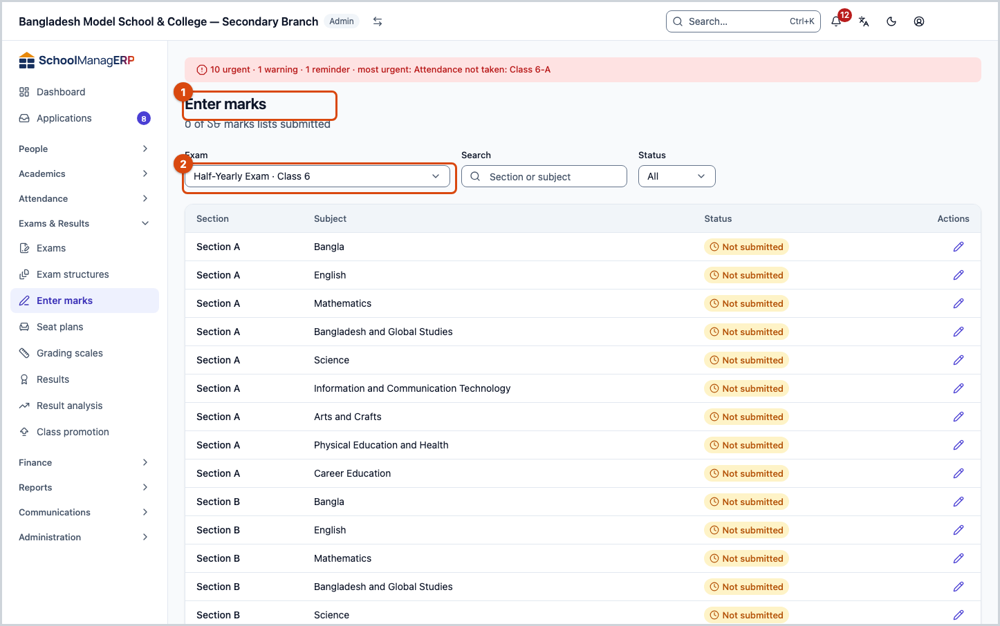
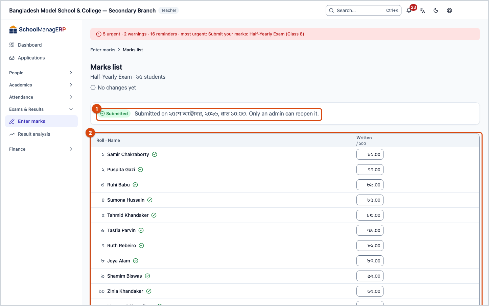
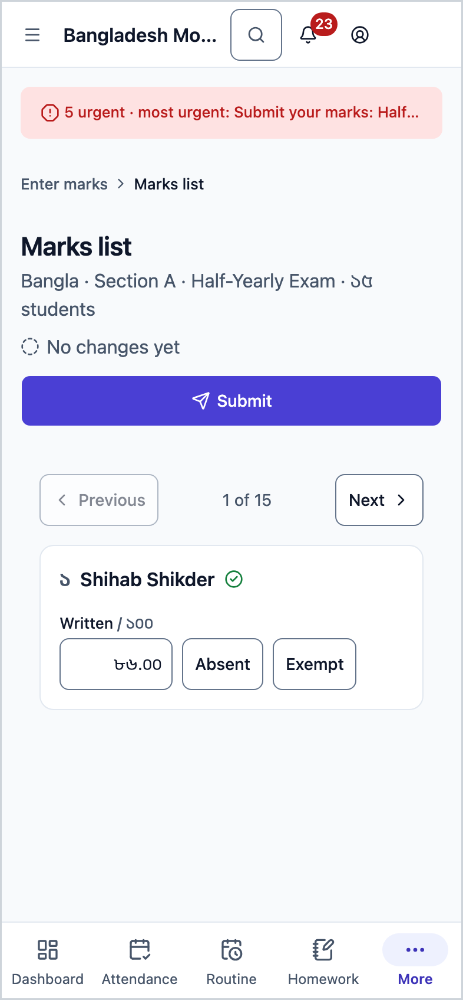

<!-- guide:meta
feature: examsResults.marksEntry
title: Entering and submitting exam marks
summary: Pick an exam, open the marks list for your section and subject, type each student's marks or mark them absent or exempt, then submit the list.
roles: [ADMIN, TEACHER, EXECUTIVE, EXAM_CONTROLLER]
sources:
  - client-admin/src/routes/_staff/marks/index.tsx
  - client-admin/src/routes/_staff/marks/$examId.$sectionId.$subjectId.tsx
  - client-admin/src/routes/_staff/marks/-submit-dialog.tsx
  - ui/src/components/marks-grid.tsx
  - ui/src/components/marks-stepper.tsx
  - ui/src/hooks/autosave.ts
  - client-admin/src/nav-tree.ts
  - server/src/modules/exams/marks.controller.ts
  - server/src/modules/exams/marks.service.ts
  - server/src/modules/exams/mark-grid.service.ts
  - server/src/modules/exams/marks-authorization.util.ts
labels:
  [
    grading:marksEntry.*,
    grading:marksSheet.*,
    exams:marksList.*,
    exams:marksGrid.*,
    exams:marksStepper.*,
    exams:saveState.*,
    exams:submitDialog.*,
    common:marksEntry.*,
    nav:items.marksEntry,
    nav:groups.examsResults,
  ]
helpIds:
  [
    examsResults.marksEntry,
    examsResults.marksEntry.action.submit,
    examsResults.marksEntry.action.reopen,
    examsResults.marksEntry.field.exam,
    examsResults.marksEntry.field.mark,
  ]
devices: [desktop, phone]
entry: [sidebar, palette]
keywords:
  [নম্বর, নম্বর দেওয়া, নম্বর তালিকা, অনুপস্থিত, মওকুফ, জমা দিন, পরীক্ষা, marks, marks entry, grid, submit, absent, exempt]
appVersion: 0.1.0 (dd9119702)
owner: tareq89
lastVerified: 2026-10-25
knownIssues: []
-->

# Entering and submitting exam marks

Enter the marks for your section and subject in an exam, and submit the marks list when you are done.

**Where to go:** in the left menu, **Exams & Results → Enter marks**. On a phone, press **☰** at the top left to open the menu, then follow the same path. It is not in the row of buttons at the bottom.
**Before you start:** the Admin must have [created the exam](exams.md) and set its subjects and mark parts. If you are a Teacher, you must be assigned as the **Subject teacher** for that subject in that section ([Teaching assignments](../people/teaching-assignments.md)).

This page is about the **marks list**. There is one marks list for each subject in each section of an exam, for example "Section A · Mathematics". Each row is a student, and each column is a mark part of the subject (for example written, multiple choice). A marks list is in one of two states: **Not submitted** (you can type marks) or **Submitted** (view only).

[Enter and submit marks](#task-main) · [Enter marks on a phone](#task-phone) · [Reopen a submitted list](#task-reopen) · [Problems and fixes](#trouble)

**On this page**

- [Enter and submit marks](#task-main)
- [How to know the marks are saved and submitted](#confirm)
- [Other situations](#other)
  - [Enter marks on a phone](#task-phone)
  - [Reopen a submitted list (Admin only)](#task-reopen)
  - [Leaving the page before saving finishes](#task-leave)
  - [Open a list to view only](#task-view)
- [Problems and fixes](#trouble)
- [Who can do what](#roles)
- [Learn more](#more)

---

## Enter and submit marks 

1. In the left menu press **Exams & Results**, then press **Enter marks**.

   → The **Marks entry** page opens. At the top it says how many of the marks lists have been submitted, for example "3 of 12 marks lists submitted".

2. In the **Exam** box, choose your exam. Each name looks like "Exam · Class". The first time, the first exam in the list is already chosen.

   → The marks lists appear below: **Section**, **Subject**, **Status**. The lists that are **Not submitted** come first. A Teacher sees only the lists where they can enter marks.

3. At the end of the row for the list you want, press **Enter marks**.

   → The **Marks list** opens. At the top are the subject, section, exam and the number of students, and below that **No changes yet**. The head of each column shows the full marks, for example **/ 50**.

4. Type the marks in the first student's cell. Decimals are fine, for example `34.5`. Bangla or English digits both work.

   → If you type more than the full marks, **max …** appears under the cell and that mark is not accepted.

5. Press **Enter**.

   → The cursor moves to the next student's cell in the same column. Finish one column from top to bottom this way.

6. If a student was absent, press **A** while in their cell. If a student is exempt from this part, press **E**.

   → The cell shows **Abs** or **Exm**. If you made a mistake, type a mark in that cell and it becomes a normal mark again.

7. The app saves by itself a moment after each mark you type. You do not have to do anything.

   → The line at the top first says **Saving…**, then **All changes saved · <time>**. A green tick appears beside the name of each student whose cells are all saved.

8. When every cell for every student is filled, press **Submit** at the top right. Or press **Ctrl+Enter** on the keyboard.

   → The **Submit this marks list?** window opens. If any cell is blank, a red line shows how many are blank, and **Submit** cannot be pressed.

9. In the window, press **Submit**.

   → The app first saves any remaining changes, then submits the list. The window closes, and next to the **Submitted** badge at the top it says **Submitted on <time>. Only an admin can reopen it.** The cells can no longer be changed.

| What you press in the window | What happens                                                                                   | Submitted? |
| ---------------------------- | ---------------------------------------------------------------------------------------------- | ---------- |
| **Submit**                   | Any remaining changes are saved, then the list is submitted and closed.                        | Yes        |
| **Cancel**                   | The window closes. The marks you typed stay as they were (they were already saved by the app). | No         |

> **Remember:** marks save by themselves, but the list is not submitted until you press **Submit**. If a list is still not submitted when the Admin goes to process the results, the Admin gets a warning ([Results](results.md)).

---

## How to know the marks are saved and submitted 

Marks are not kept separately on your phone or computer. If the internet is down, the app keeps trying to send them, but if you close the page, marks that were not sent are lost. So there is no "saved on this device" state here.

| State                           | How you know                                                                                                         | What next                                           |
| ------------------------------- | -------------------------------------------------------------------------------------------------------------------- | --------------------------------------------------- |
| **Changed on screen only**      | **Saving…** in the line at the top, or in red **… changes not saved — retrying**; a coloured outline around the cell | Wait and check your internet; do not leave the page |
| **Reached the school's system** | **All changes saved · <time>** and a green tick beside the name                                                      | When every cell is done, press **Submit**           |
| **Submitted**                   | The **Submitted** badge and **Submitted on <time>. Only an admin can reopen it.**                                    | Done                                                |

**To check:** leave the page, then open the same list again from **Enter marks**. If your marks show in the cells, they are in the system. After you submit, the submitted count at the top goes up by one.

**If no message appears:** see [Problems and fixes](#trouble). If you keep the page open, marks that are not yet saved are not deleted.

---

## Other situations 

### Enter marks on a phone 

On a small screen like a phone, the marks list shows one student at a time.

1. Do steps 1–3 above in the same way.

   → One student's name, and below it a cell for each mark part. At the top are **Previous**, "**… of …**" and **Next**.

2. Type the marks in each cell. If the student was absent, press **Absent** beside the cell. If exempt, press **Exempt**.
3. Press **Next** to go to the next student.
4. At the very end, press **Submit** at the top, then press **Submit** again in the window.

   → The **Submitted** badge appears, as on a computer.

On a phone, **A**, **E** and **Ctrl+Enter** do not work; use the buttons.

### Reopen a submitted list (Admin only) 

If a mistake is found after a Teacher has submitted, only an Admin can reopen the list.

1. As the Admin, open the submitted marks list (from [the exam's page](exams.md), or press **View marks** if it is in the **Enter marks** list).
2. In the row with the **Submitted** badge, press **Reopen**.

   → No window appears. The list goes back to **Not submitted**, and the cells can be typed in again.

3. The Teacher corrects the marks and presses **Submit** again.

If the results are **Published**, the list cannot be reopened. First [reopen the results](results.md#task-reopen). If the results are **Processed**, changing marks in a reopened list recalculates the whole exam's results by itself.

### Leaving the page before saving finishes 

If some marks are not saved yet and you try to go to another page inside the app, the **Leave without saving?** window appears.

| What you press   | What happens                                            | Saved?                    |
| ---------------- | ------------------------------------------------------- | ------------------------- |
| **Stay**         | You stay on the page; the app keeps trying to save.     | In a moment               |
| **Leave anyway** | You leave the page. Marks that were not saved are lost. | No, only the unsent marks |

### Open a list to view only 

The Academic coordinator and the Exam controller can view marks but cannot type them. In their list each row ends with **View marks**. In the open list the cells are grey and there is no **Submit** button.

---

## Problems and fixes 

| What you see                                                                                                  | What to do                                                                                                                                       | Who can help                                                      |
| ------------------------------------------------------------------------------------------------------------- | ------------------------------------------------------------------------------------------------------------------------------------------------ | ----------------------------------------------------------------- |
| **No exams yet**                                                                                              | They will appear here once the Admin [creates an exam](exams.md).                                                                                | Admin                                                             |
| **No marks lists yet**                                                                                        | The exam's subjects and mark parts are not set, or you are not assigned to any subject in this exam.                                             | Admin ([Teaching assignments](../people/teaching-assignments.md)) |
| A section or subject is missing from your list                                                                | A Teacher sees only the lists where they are the **Subject teacher** for that subject. Being the class teacher is not enough to enter marks.     | Admin ([Teaching assignments](../people/teaching-assignments.md)) |
| **Nothing matches**                                                                                           | Press **Clear all** to clear the search and filter.                                                                                              | —                                                                 |
| **Couldn't load marks lists.**                                                                                | Check your internet and try again.                                                                                                               | Admin                                                             |
| **max …**                                                                                                     | You cannot type more than the full marks. Type the correct mark.                                                                                 | —                                                                 |
| **… changes not saved — retrying**                                                                            | Check your internet and keep the page open. The app tries again by itself, and sends again as soon as you type something new.                    | —                                                                 |
| **… blank cells must be filled first. Enter a mark, A (absent) or E (exempt).**                               | Put a mark, **A** or **E** in each blank cell. A blank row for a student who joined late or does not take this subject does not stop the submit. | —                                                                 |
| **Couldn't submit this marks list. Please try again.**                                                        | Check your internet and press **Submit** again. If the results were published in the meantime, it can no longer be submitted; tell the Admin.    | Admin ([Results](results.md))                                     |
| Saving keeps failing, and someone else submitted the list or the results were published while you had it open | When a list or an exam is closed, new marks are not accepted. Reload the page to see the state.                                                  | Admin                                                             |
| **Couldn't reopen this marks list. Please try again.**                                                        | Check your internet. If the results are published, first [reopen the results](results.md#task-reopen).                                           | Admin                                                             |
| You do not see the **Submit** or **Reopen** button                                                            | See [Who can do what](#roles).                                                                                                                   | Admin                                                             |

---

## Who can do what 

| Role                                       | Which lists they see                                                                                                                        | Enter and submit marks   | Reopen a submitted list            |
| ------------------------------------------ | ------------------------------------------------------------------------------------------------------------------------------------------- | ------------------------ | ---------------------------------- |
| Admin                                      | All in the school                                                                                                                           | Yes, in every list       | Yes (if results are not published) |
| Teacher                                    | Only where they are the Subject teacher for that subject, in the current academic year (also a draft exam for a class of the previous year) | Yes, only in those lists | No                                 |
| Academic coordinator, Exam controller      | All in the school                                                                                                                           | No, view only            | No                                 |
| Accountant, Office staff, Committee member | **Enter marks** is not in their menu                                                                                                        | No                       | No                                 |

If a Teacher opens the address of a list in another section directly, the app shows it as "not found", as if the list did not exist.

---

## Learn more 

<strong>Parts of the page</strong> — the marks list, top to bottom

1. **Marks list** — the heading; below it subject · section · exam · number of students.
2. **Saving line** — **No changes yet**, **Saving…** or **All changes saved · <time>**.
3. **Submit** — at the top right; it appears only on a list that is not submitted and only if you may enter marks.
4. **Keyboard help line** — just above the list.
5. **The list** — **Roll · Name**, then each mark part. Grey columns are worked out by the app (for example from attendance); you cannot type in them.

<strong>Keyboard shortcuts</strong>

| Key            | What it does                                        |
| -------------- | --------------------------------------------------- |
| **Enter**      | Moves to the next student's cell in the same column |
| **↑ ↓ ← →**    | Moves up, down, left, right                         |
| **Tab**        | Moves to the next cell along the row                |
| **A**          | Absent (**Abs**)                                    |
| **E**          | Exempt (**Exm**)                                    |
| **Ctrl+Enter** | Opens the **Submit this marks list?** window        |

On a Mac you can press **⌘** instead of **Ctrl**.

<strong>What each field means</strong>

| Field     | What to enter                                                                    | Required?                                      |
| --------- | -------------------------------------------------------------------------------- | ---------------------------------------------- |
| Exam      | Which exam you are entering marks for.                                           | Yes                                            |
| Search    | Part of a section or subject name. Only the Admin sees it.                       | No                                             |
| Status    | **All**, **Not submitted** or **Submitted**.                                     | No                                             |
| Mark cell | From 0 up to the full marks, decimals allowed; **A** if absent, **E** if exempt. | Yes — the list cannot be submitted while blank |

**What happens in the calculation:** if a student is absent in any part of a subject, the whole subject counts as **Absent** and the subject is failed. An exempt part is left out of both the marks obtained and the full marks. If a part has a pass mark set, getting less than it fails the whole subject. More in [Results](results.md#more).

<strong>How marks entry works</strong> — from the exam to the list, then the results

<figure>
  
  <figcaption><em>A marks list from submission to results</em></figcaption>
</figure>

- Every section and subject of every exam has one marks list. The columns come from the [exam's mark parts](exams.md).
- Almost as soon as you type (in under a second), the app sends the marks together; if that fails, it tries again every little while.
- When every list is submitted, the Admin or the Exam controller processes the [results](results.md). The [grading scale](grading-scales.md) decides which grade the results get.

<strong>Short help for the boxes (the (?) button)</strong>

<!-- guide:generated:fields:exams -->

| Field                                   | What to enter                                                                                                                              | Required?                                     |
| --------------------------------------- | ------------------------------------------------------------------------------------------------------------------------------------------ | --------------------------------------------- |
| Name (exam)                             | The exam name, e.g. Half Yearly 2026. Two exams of the same class and year cannot share a name.                                            | Yes                                           |
| Kind (exam)                             | Term, monthly, model or other. Cannot change once results are published.                                                                   | No                                            |
| Mark entry deadline                     | Teachers see the days left on their dashboard. Leave empty if there is none.                                                               | No                                            |
| Academic year                           | The year the exam belongs to. Chosen only when you add the exam.                                                                           | Yes                                           |
| Class                                   | The class that sits the exam. Pick the year first; it cannot change later.                                                                 | Yes                                           |
| Start from an exam structure (optional) | Pick an exam structure and the parts for the class subjects are made for you. Hidden when there is no structure.                           | No                                            |
| Name (part)                             | The part name, e.g. Written. Two parts of one subject cannot share a name.                                                                 | Yes                                           |
| Kind (part)                             | Written, MCQ, viva, practical and so on. Attendance is counted for you.                                                                    | No                                            |
| Full marks                              | The full marks of the part, e.g. 70; a positive number. Not shown for an attendance part.                                                  | Yes, except attendance parts                  |
| Pass marks                              | The pass mark of the part, e.g. 23. Not more than the full marks. Leave empty if not needed.                                               | No                                            |
| Exam (marks entry)                      | The exam you are entering marks for. Its marks lists for the sections and subjects you may enter show below.                               | Yes                                           |
| Marks (marks entry)                     | The marks for that student and part, up to the maximum shown. Type A for absent and E for exempt. Attendance parts are worked out for you. | Yes, the list cannot be submitted while blank |
| By part (analysis)                      | On the Pass/fail tab, tick it to see the results for each part of a subject, not only for the whole subject.                               | No                                            |

<!-- /guide:generated -->

**Related pages**

- [**Processing and publishing results**](results.md) — the results are built from the submitted marks.
- [**Setting up grading scales**](grading-scales.md) — which percentage gets which grade is set here.
- [**Teaching assignments**](../people/teaching-assignments.md) — which Teacher enters marks for which subject in which section.
- [**Creating and setting up exams**](exams.md) — the lists and their columns come from here.
- [**Merit list and result analysis**](analysis.md) — See an exam's merit list, the students who failed or were absent and the pass/fail by subject, filter by section, print or download a CSV.

---

_Version 0.1.0 · last verified 2026-10-25_
