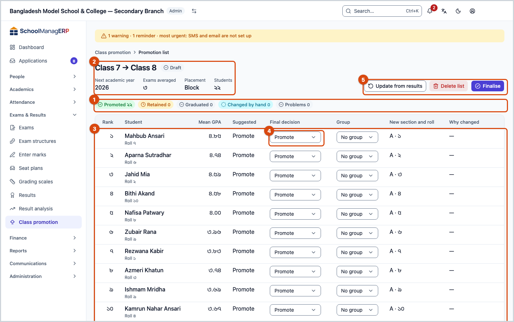
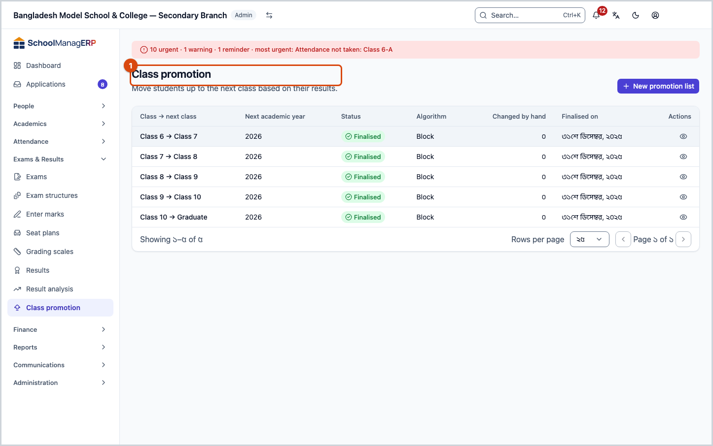

<!-- guide:meta
feature: examsResults.promotion
title: Promoting students
summary: Using published results, move a class's students up to the next class in the new academic year, keep them in the same class or graduate them; first a draft list, then check it and finalise.
roles: [ADMIN]
sources:
  - client-admin/src/routes/_staff/promotions/index.tsx
  - client-admin/src/routes/_staff/promotions/new.tsx
  - client-admin/src/routes/_staff/promotions/$runId.tsx
  - client-admin/src/routes/_staff/promotions/-commit-dialog.tsx
  - client-admin/src/route-permissions.ts
  - client-admin/src/nav-tree.ts
  - server/src/modules/promotions/promotions.controller.ts
  - server/src/modules/promotions/promotions.service.ts
  - server/src/modules/promotions/placement.ts
  - server/src/modules/enrollments/enrollments.service.ts
  - shared/src/enums/permissions.ts
labels:
  [
    promotions:list.*,
    promotions:newRunForm.*,
    promotions:blocking.*,
    promotions:grid.*,
    promotions:outcome.*,
    promotions:overrideNote,
    nav:items.promotion*,
    nav:groups.examsResults,
  ]
helpIds:
  [
    examsResults.promotion,
    examsResults.promotion.action.create,
    examsResults.promotion.action.refresh,
    examsResults.promotion.action.commit,
    examsResults.promotion.action.delete,
    examsResults.promotion.field.targetClass,
    examsResults.promotion.field.exams,
    examsResults.promotion.field.algorithm,
    examsResults.promotion.field.finalOutcome,
    examsResults.promotion.field.overrideNote,
  ]
devices: [desktop]
entry: [sidebar, palette]
keywords:
  [প্রমোশন, উত্তীর্ণ, পরের শ্রেণি, অপরিবর্তিত, গ্র্যাজুয়েট, শর্তসাপেক্ষে, শাখা বিন্যাস, রোল, নতুন শিক্ষাবর্ষ, promotion, promote, retain, graduate, roll, class promotion, next class, new academic year, finalise]
appVersion: 0.1.0 (a25ab3344)
owner: tareq89
lastVerified: 2026-10-25
knownIssues: []
-->

# Promoting students

At the end of the year, move a class's students up to the next class in the new academic year. Keep the students who did not pass in the same class. Graduate the students of the last class.

**Where to go:** in the left menu, **Exams & Results → Class promotion**.
**Before you start:** be the school's Admin. At least one exam of the class must have its results **Published** ([Processing and publishing results](results.md)). The new academic year, its classes and sections must already be created ([Creating and managing academic years](../academics/academic-years.md), [Arranging classes, sections and subjects](../academics/classes.md)).

The work has two steps. First a **Draft** promotion list is made. Nothing changes because of it, and you can look at it, change it or delete it as you like. Then, when you press **Finalise**, all the students move to their new classes together.

> **Be careful:** once you press **Finalise**, it cannot be undone. The students' new class, section and roll are set, and the graduates become "Graduated". There is no "undo" button in the app. Check the list well before you finalise.

[Make the list and finalise](#task-main) · [Change a decision](#task-override) · [Update](#task-refresh) · [Delete a draft](#task-delete) · [Problems and fixes](#trouble)

**On this page**

- [How you get to this page](#arrive)
- [Make a promotion list and finalise it](#task-main)
- [How to know the promotion is done](#confirm)
- [Other situations](#other)
  - [Change one student's decision by hand](#task-override)
  - [Update the list when results or students change](#task-refresh)
  - [Delete a draft list](#task-delete)
  - [Graduate the last class](#task-graduate)
- [Problems and fixes](#trouble)
- [Who can do what](#roles)
- [Learn more](#more)

---

## How you get to this page 

**From the left menu**

1. In the left menu press **Exams & Results → Class promotion**. → All the promotion lists are shown. For a new list, see [Make a promotion list and finalise it](#task-main). To open an old list, press **View** on its row.

---

## Make a promotion list and finalise it 

1. In the left menu press **Exams & Results**, then press **Class promotion**.

   → The **Class promotion** page opens. Below the title it says **Move students up to the next class based on their results.**

2. On the right, press **New promotion list**.

   → The **New promotion list** form opens.

3. In the **Current class** box, choose the class you are moving students from, for example "Class 7, 2026".

   → **Next academic year** fills in by itself (the very next academic year), and **Next class** shows the suggested class, for example "Class 8". Beside it is written **Suggested — you can change it.** If there is no class at the next level, it says **Graduate (no target class)**.

4. If you need to, change **Next academic year** or **Next class**.

5. In **Exams to average**, check which exams will be counted. At first, every **published** exam of this class is ticked. Untick the one you do not want to count.

   → If none is ticked, you see **Select at least one exam.**

6. In **How students are placed in sections**, choose **Block** or **Snake** (see the table below).

7. At the bottom, press **Create list**.

   → The page of the draft list opens. At the top is the summary: **Promoted**, **Retained**, **Graduated**, **Changed by hand**, **Problems**. Below it, for every student, **Rank**, **Student**, **Mean GPA**, **Suggested**, **Final decision**, **New section and roll** and **Why changed**. Nothing has changed for any student yet.

8. Look at the list. To change someone's decision, see [Change one student's decision by hand](#task-override). If there are red **Problems**, fix them first ([Problems and fixes](#trouble)).

9. At the top, press **Finalise** (on the keyboard, Ctrl+Enter).

   → The **Finalise this promotion list?** window opens. It says, for example, **38 promoted, 2 retained, 0 graduated. This cannot be undone.**

10. Check that the numbers match, then press **Finalise** in the window.

    → If any decision was changed by hand, a window for extra approval comes first; finish the check with whatever it asks for. Then the window closes, the list becomes **Finalised**, and it can never be changed again.

| What you pressed in the window | What happens                                                                                | Did the students move?   |
| ------------------------------ | ------------------------------------------------------------------------------------------- | ------------------------ |
| **Finalise**                   | All students move to their new classes together. If even one has a problem, nobody changes. | Yes, it cannot be undone |
| **Cancel**                     | The window closes. The list stays a draft.                                                  | No                       |

You cannot press **Finalise** in the window while you see the red text **Fix every placement error before finalising.** or **Every override needs a note before finalising.**

**Exactly what changes when you finalise**

| Final decision           | What happens                                                                                                                                                                                                          |
| ------------------------ | --------------------------------------------------------------------------------------------------------------------------------------------------------------------------------------------------------------------- |
| **Promote**              | Enrolled in the new academic year, in the chosen section of the new class, with a new roll.                                                                                                                           |
| **Promote on condition** | Goes to the new class just like **Promote**; only the list shows it separately.                                                                                                                                       |
| **Retain**               | Enrolled in the new academic year in a class of the same level (for example Class 7 again). In the section with the old section's name if there is one, otherwise in the first section; the roll is added at the end. |
| **Graduate**             | No new enrolment. Both the student and their current enrolment become "Graduated", and it is written in the student's history.                                                                                        |

Also: students who were already in the new section get their roll moved back (after the new ones). A choice of optional subject group carries over if the same subject is in the same group in the new class. Every change is written in the audit log. No SMS or notice is sent to anyone.

---

## How to know the promotion is done 

Every change to a draft is saved in the school's system at once. But while the list is a draft, no student's class changes.

| State         | How you know                                                                                                       | What next                        |
| ------------- | ------------------------------------------------------------------------------------------------------------------ | -------------------------------- |
| **Draft**     | The **Status** in the list is **Draft**; the **Finalise** button is at the top                                     | Check and finalise, or delete    |
| **Finalised** | The **Status** is **Finalised**; the facts show **Finalised on**, **Finalised by** (and **Approved by** if needed) | Nothing to do; you can only view |

**To check:** open the page of a promoted student from the [Students](../people/students.md) list. You will see the new class, section and roll.

**If the window does not close:** nothing is half done. Either everyone is promoted, or nobody is. Read the message on the page and see [Problems and fixes](#trouble).

---

## Other situations 

### Change one student's decision by hand 

The system suggests: if the student has a result in all the chosen exams and failed none, it is **Promote** (**Graduate** in the last class). Otherwise it is **Retain**. You can change this if you want.

1. In the draft list, in the student's **Final decision** box, choose the new decision: **Promote**, **Retain**, **Graduate** or **Promote on condition**. You can also press P, R or G on the box.

   → A **Changed by hand** mark appears under the box, and the cursor moves to the **Why changed** box.

2. In the **Why changed** box, write the reason, for example "Could not sit the annual exam because of illness; promoted on condition on the guardian's application".

   → If you leave the reason empty, you see **Write why you changed it.** You cannot finalise until you write a reason.

3. If you go back to the suggested decision, the **Changed by hand** mark goes away, and the reason is cleared.

If any decision was changed by hand, extra approval is needed when you finalise. Later, on the student's page, you can see the reason for this change, the year and who changed it. If the sections of the new class are group-based, you can change the group in the **Group** column. You cannot clear a group to leave it empty (**Clearing a group is not yet supported**).

### Update the list when results or students change 

After the draft is made, if a result is processed again, or someone leaves or joins the class, the list is out of date.

1. In the draft list, at the top, press **Update from results**.

   → It shows **Updating…**, and then the list is worked out again.

What an update does:

- The rows of students who left the class are removed, together with any decisions changed by hand.
- Students who newly joined appear in the list.
- For students whose decision was not changed by hand, the suggestion and the decision are set again using the new results.
- Decisions changed by hand, their reasons and the groups stay as they were.

### Delete a draft list 

1. In the draft list, at the top, press the red **Delete list**.

   → The **Delete this promotion draft?** window says **This removes every entry in the list. This cannot be undone.**

2. Press **Delete**.

   → The list is deleted and you are back on the **Class promotion** page. Nothing changes for any student.

| You pressed | What happens                                                       | Deleted? |
| ----------- | ------------------------------------------------------------------ | -------- |
| **Delete**  | The draft and all its rows are deleted; students stay as they were | Yes      |
| **Cancel**  | Nothing changes                                                    | No       |

Only a draft can be deleted. A **Finalised** list cannot be deleted.

### Graduate the last class 

If the new academic year has no class of the next level (for example after Class 10), the form shows **Graduate (no target class)** in place of **Next class**. Then the suggestion for those who passed is **Graduate**, and **Promote on condition** cannot be chosen. The other steps are the same as above. Those who failed are **Retain**, that is, in the same class again in the new year.

---

## Problems and fixes 

| What you see                                                                                          | What to do                                                                                                                                                                            | Who can help |
| ----------------------------------------------------------------------------------------------------- | ------------------------------------------------------------------------------------------------------------------------------------------------------------------------------------- | ------------ |
| **This class has no published exams yet.**                                                            | First [publish](results.md#task-publish) the results of at least one exam of this class.                                                                                              | Admin        |
| **Choose a target class, or graduate the source class.**                                              | The class has no level (number) set, so the next class could not be guessed. Choose **Next class** yourself.                                                                          | Admin        |
| **The target class has no sections yet — create at least one before running this.**                   | Create a section in the new class ([Arranging classes, sections and subjects](../academics/classes.md)), then try again.                                                              | Admin        |
| **No class is set up to retain students who didn't pass — add one first.**                            | Create a class of the same level in the new academic year (for example Class 7 again, same shift and version). It is needed only when the list keeps some students in the same class. | Admin        |
| **Couldn't create the list. Please try again.**                                                       | Check that the new academic year starts after the current class's academic year; check your internet.                                                                                 | Admin        |
| Red **No room in any section**                                                                        | The new sections are full to capacity. Raise the section capacity or open a new section, then press **Update from results**. Or change that student's decision.                       | Admin        |
| Red **No matching section**                                                                           | The new class has no section that matches the student's group. Change the **Group**, or open a section for that group and update.                                                     | Admin        |
| **Results changed since this preview — refresh**                                                      | Press **Update from results** beside it, check the list again, then finalise.                                                                                                         | Admin        |
| **Some students left or joined this class since the list was last refreshed. …**                      | Press **Update from results** beside it, check the list, and finalise again.                                                                                                          | Admin        |
| **Could not finalise this list. Please try again.**                                                   | Check that approval is complete and that you have an internet connection. It can also appear if a student is already enrolled in the new academic year.                               | Admin        |
| **Could not save this change. Please try again.**                                                     | Choose the decision again. If it was changed by hand, check that a reason is written.                                                                                                 | —            |
| **This list can't be deleted any more — someone may have finalised it. The page has been refreshed.** | The list has been finalised in the meantime. Now you can only view it.                                                                                                                | —            |
| **Couldn't load promotion lists.** or **Couldn't load this promotion list.**                          | Check your internet and try again.                                                                                                                                                    | —            |

---

## Who can do what 

| Role       | Open this page and make a draft | Finalise, including decisions changed by hand |
| ---------- | ------------------------------- | --------------------------------------------- |
| Admin      | Yes                             | Yes (with extra approval)                     |
| All others | No                              | No                                            |

**Class promotion** is not in the left menu of the other roles. The mark for a promotion changed by hand on a student's page can still be seen by anyone who is allowed to view students.

---

## Learn more 

<strong>Parts of the page</strong> — the list page and one list's page

The **Class promotion** page:

1. **Class promotion** — the title, and on the right **New promotion list**.
2. The list — **Class → next class**, **Next academic year**, **Status**, **Algorithm**, **Changed by hand**, **Finalised on**, and **View**.

One list's page:

1. In the title, the class and the next class; on the right **Update from results**, **Finalise**, **Delete list** (only on a draft).
2. The facts — **Next academic year**, **Exams averaged**, **Placement**, **Students**.
3. The summary badges.
4. The students' rows, in rank order.

<strong>What each field means</strong>

| Field                               | What to choose or write                                                                                                                                      | Required?               |
| ----------------------------------- | ------------------------------------------------------------------------------------------------------------------------------------------------------------ | ----------------------- |
| Current class                       | The class whose students you will move up.                                                                                                                   | Yes                     |
| Next academic year                  | The year they go to. It must start after the current class's academic year. At first, the very next year is filled in.                                       | Yes                     |
| Next class                          | Which class in the new year. At first, the next-level class of the same shift and version is filled in. If there is none, the whole class graduates.         | No, if one is suggested |
| Exams to average                    | Which published exams count for pass/fail and rank. At first, all are ticked.                                                                                | At least one            |
| How students are placed in sections | **Block** or **Snake**. At first, **Block**.                                                                                                                 | Yes                     |
| Final decision                      | **Promote**, **Retain**, **Graduate**, **Promote on condition**. At first, the same as the suggestion.                                                       | Yes                     |
| Group                               | Which group's section the student goes to in the new class. At first, the group of the current section. If there are no groups, this column does not appear. | No                      |
| Why changed                         | The reason for changing the suggestion.                                                                                                                      | Yes, if changed         |

<strong>How rank, section and roll are decided</strong>

<figure>
  
  <figcaption><em>From draft to finalised</em></figcaption>
</figure>

- **Who is in the list:** the students whose enrolment in the current class is active when the list is made.
- **Suggestion:** the student has a result in every chosen exam and failed none → **Promote**. If even one exam has no result for them → **Retain**.
- **Rank:** the higher mean GPA of the chosen exams comes first; if equal, the higher total marks of all the exams comes first. If both are equal, a fixed internal order is used; no two students are given the same rank.
- **Choosing the section** (only for **Promote** and **Promote on condition**), in rank order:
  - **Block:** section A fills first, then B. Example: two sections A and B, 60 students, no capacity set → ranks 1–30 go to A, ranks 31–60 go to B.
  - **Snake:** they take turns like a snake: A, B, B, A, A, B… So every section gets a mix of strong and weak students, evenly.
  - If a section has a capacity, as many students sit there as there are free places, not counting those already enrolled. If there is a section without a capacity, the extra students go there; if there is none, you see **No room in any section**.
  - If any section of the new class has a group, a student sits only in a section of their own group; if none matches, you see **No matching section**.
- **Roll:** in each new section, those who pass get 1, 2, 3… in rank order. The students who were already in that section have their roll moved after the new ones (keeping their earlier order).

<strong>What can be undone and what cannot</strong>

- **Draft:** fully reversible. Change decisions, update, or delete it; nothing changes for any student.
- **Finalising:** all at once, or nothing. If there is any problem, nobody changes.
- **After finalising:** there is no way in the app to cancel a promotion. The list can no longer be changed or deleted, and it cannot be finalised again. The new enrolments, the new rolls, the rolls moved for other students, the carried-over subject choices, the "Graduated" status and the graduation entry in the student's history all stay. To fix one student's mistake, you have to change their class or section separately (how is outside this page; not checked in the app).
- The earlier year's enrolment record is not deleted; for those who were promoted or retained, last year's enrolment stays as it was.

<strong>Short help for the boxes (the (?) button)</strong>

<!-- guide:generated:fields:promotions -->

| Field                               | What to enter                                                                                                                                   | Required?                           |
| ----------------------------------- | ----------------------------------------------------------------------------------------------------------------------------------------------- | ----------------------------------- |
| Next class                          | The class the students move to. It fills in by itself when you pick the current class; you can change it, or choose Graduate for no next class. | No, if one is suggested             |
| Exams to average                    | Tick the published exams to average. The merit order comes from their average GPA. Pick at least one.                                           | Yes, at least one                   |
| How students are placed in sections | Block fills section A in merit order first, then B. Snake takes turns across sections in merit order, so all sections stay even.                | Yes                                 |
| Outcome                             | Promote, Retain, Graduate or Promote on condition for each student. It starts as the system’s suggestion; if you change it, a note is required. | Yes                                 |
| Why changed                         | Why you changed the system’s suggestion for this student. Needed whenever the outcome differs from the suggestion.                              | Yes, when you change the suggestion |

<!-- /guide:generated -->

**Related pages**

- [**Processing and publishing results**](results.md) — results must be published before the promotion.
- [**Merit list and result analysis**](analysis.md) — check who passed and who failed first.
- [**Adding students and viewing their details**](../people/students.md) — after the promotion, see a student's new class and roll.
- [**Creating and setting up exams**](exams.md) — creating and setting up exams

---

_Version 0.1.0 · last verified 2026-10-25_
