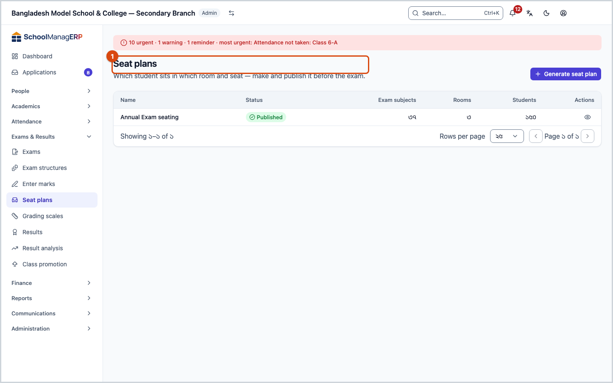
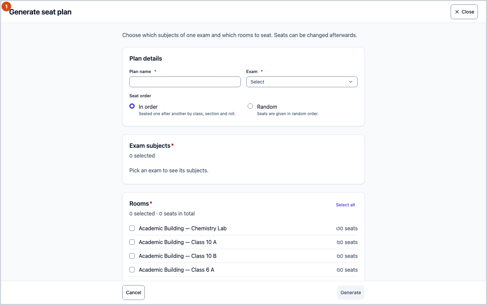

<!-- guide:meta
feature: examsResults.seatPlans
title: Making and publishing seat plans
summary: Pick the subjects of an exam and the rooms to make who sits in which room and seat, change seats if needed, give rooms an invigilator, then publish.
roles: [ADMIN, EXAM_CONTROLLER]
sources:
  - client-admin/src/routes/_staff/exams/seat-plans/index.tsx
  - client-admin/src/routes/_staff/exams/seat-plans/$planId.tsx
  - client-admin/src/routes/_staff/exams/seat-plans/-generate-seat-plan-modal.tsx
  - client-admin/src/routes/_staff/exams/seat-plans/-invigilator-picker.tsx
  - client-admin/src/routes/_staff/exams/seat-plans/-publish-dialog.tsx
  - client-admin/src/routes/_staff/exams/seat-plans/-reseat-dialog.tsx
  - client-admin/src/routes/_staff/exams/seat-plans/-seat-plan-status-badge.tsx
  - server/src/modules/seat-plans/seat-plans.controller.ts
  - server/src/modules/seat-plans/seat-plans.service.ts
  - server/src/modules/seat-plans/allocation.ts
labels:
  [
    seatPlans:list.*,
    seatPlans:status.*,
    seatPlans:generate.*,
    seatPlans:errors.*,
    seatPlans:fields.*,
    seatPlans:help.*,
    seatPlansDetail:detail.*,
    seatPlansDetail:room.*,
    seatPlansDetail:reseat.*,
    seatPlansDetail:publish.*,
    seatPlansDetail:reshuffle.*,
    seatPlansDetail:unpublish.*,
    seatPlansDetail:delete.*,
    seatPlansDetail:errors.*,
    seatPlansDetail:fields.*,
    seatPlansDetail:help.*,
    nav:items.seatPlans,
    nav:groups.examsResults,
    common:actions.cancel,
    common:accessDenied.*,
  ]
helpIds:
  [
    examsResults.seatPlans,
    examsResults.seatPlans.action.generate,
    examsResults.seatPlans.action.publish,
    examsResults.seatPlans.action.unpublish,
    examsResults.seatPlans.action.reshuffle,
    examsResults.seatPlans.action.reseat,
    examsResults.seatPlans.action.delete,
    examsResults.seatPlans.field.rooms,
    examsResults.seatPlans.field.seatOrder,
    examsResults.seatPlans.field.invigilator,
  ]
devices: [desktop]
entry: [sidebar, palette]
keywords:
  [seat plan, seating, seats, room, invigilator, seat order, random, reshuffle, publish, সিট প্ল্যান, আসন, আসন বিন্যাস, কক্ষ, পরিদর্শক, ইনভিজিলেটর, আসন ক্রম, এলোমেলো, প্রকাশ]
appVersion: 0.1.0 (dd9119702)
owner: tareq89
lastVerified: 2026-10-25
knownIssues:
  - { id: seat-plan-claimed-sitting-generic-error, checked: 2026-10-25, issue: 2918 }
  - { id: seat-plan-publish-conflict-generic-error, checked: 2026-10-25, issue: 2919 }
  - { id: seat-plan-invigilator-busy-generic-error, checked: 2026-10-25, issue: 2920 }
-->

# Making and publishing seat plans

Pick the subjects of an exam and the rooms to make who sits in which room and seat, change seats if needed, give rooms an invigilator, then publish.

**Where to go:** in the left menu, **Exams & Results → Seat plans**. Do the work on this page on a computer.
**Before you start:** you must be the school Admin or the exam controller ([who can do what](#roles)). The [exam](exams.md) you are seating must already have a [schedule](exams.md#task-schedule). The rooms must already be added with their capacity ([add rooms](../academics/routine-setup.md#task-rooms)).

A seat plan is made by exam **subject**, for example the **Bangla 1st Paper** of the **Half Yearly**, on 12 March at 10 am. Students of all sections of the exam's class get seats in the rooms you pick. Before you publish, the plan is a **Draft**, and seats can be changed. After you publish, the plan can only be viewed.

[Generate a seat plan](#task-main) · [Change a seat](#task-reseat) · [Publish](#task-publish) · [Unpublish](#task-unpublish) · [Problems and fixes](#trouble)

**On this page**

- [How to reach this page](#arrive)
- [Generate a seat plan](#task-main)
- [How to tell the seat plan was made](#confirm)
- [Other situations](#other)
  - [When there are not enough seats](#task-shortfall)
  - [Give a room an invigilator](#task-invigilator)
  - [Change one student's seat](#task-reseat)
  - [Reseat a whole room](#task-reshuffle)
  - [Publish a seat plan](#task-publish)
  - [Unpublish](#task-unpublish)
  - [Delete a seat plan](#task-delete)
  - [The plan page](#task-detail)
- [Problems and fixes](#trouble)
- [Who can do what](#roles)
- [Known issues](#known-issues)
- [Learn more](#more)

---

## How to reach this page 

**From the left menu:** press **Exams & Results → Seat plans**. Start from step 1 below.

**From the search box:** in the search box at the top (Ctrl+K), type **Generate seat plan** and pick it. → The list of seat plans opens, and the **Generate seat plan** dialog is already open. Start from step 3 below. If you pick **Publish seat plan** instead, only the list opens; open a plan from there and [publish it](#task-publish). Search rules: [Finding any page](../start/find-anything.md).

---

## Generate a seat plan 

1. In the left menu, press **Exams & Results → Seat plans**.

   → At the top is the title **Seat plans**. The list has the columns **Name**, **Status**, **Exam subjects**, **Rooms**, **Students**. If there are none, it says **No seat plans yet**.

2. At the top of the page, press **Generate seat plan**.

   → The **Generate seat plan** dialog opens.

3. In the **Plan details** section, type the **Plan name**, for example `Half-yearly, first week`.

4. Pick the **Exam**.

   → In the **Exam subjects** section, the subjects of that exam's schedule come in, with the date and time under each. If there is no schedule, it says **This exam has no schedule yet.**

5. Pick the **Seat order**: **In order** (seated one after another by class, section and roll) or **Random**. **In order** is picked at first.

6. From **Exam subjects**, tick one or more subjects. To pick all at once, press **Select all**.

7. From **Rooms**, tick the rooms. Rooms fill in the order you tick them.

   → At the top it says, for example, **3 selected · 120 seats in total**. If there is no room, it says **No rooms are set up yet.**

8. Press **Generate**. The button cannot be pressed until you give a name, at least one subject and one room.

   → A message **Seat plan generated.** shows and the plan's page opens, with the state **Draft**.

> **Remember:** a draft plan is not final for students or invigilators. Check the seats, then [publish](#task-publish).

---

## How to tell the seat plan was made 

Seat plans are saved only when you are online; they cannot be kept on the device and sent later. So there is no **Saved on this device** state here.

| State                           | How to tell                                                                     | What next                                                               |
| ------------------------------- | ------------------------------------------------------------------------------- | ----------------------------------------------------------------------- |
| **Changed on screen only**      | The dialog is open with subjects and rooms picked, but the plan page has not opened | Press **Generate**                                                  |
| **Reached the school's system** | The plan page has opened, the state is **Draft**, and the room cards list students | Check the seats, then [publish](#task-publish)                       |
| **Published**                   | The state is **Published**; it says the plan can no longer be changed           | [Print admit cards and seat lists](../administration/print-templates/exam-documents.md)       |

**To check:** go back to the list and see whether the plan is there, and whether the number in the **Students** column is right.

**If no message comes:** see [Problems and fixes](#trouble). Your picks stay in the dialog.

---

## Other situations 

### When there are not enough seats 

If the picked rooms cannot seat everyone, the plan is not made. It says so in the dialog, for example **Not enough seats: 150 students need seats but only 120 are available (short by 30). Add a suggested room and try again.**

1. Press **Add** beside a suggested room below.
2. Press **Generate** again.

If you pick several subjects at the same time, everyone needs a seat together; subjects at different times can each use the whole of the same room. A room with no capacity given counts no seats.

**When times clash:** if a picked room is also in another **Published** plan at the same time, the plan is still made, but first a box shows: **This plan was created, but 1 room booking overlaps with another published plan.**, and a line for each room, for example **Room 101 · also in “Annual” at the same time**. Press **Open the plan** to go to the plan, or **Close**. In this situation the plan cannot be published until you change the room ([Known issues](#known-issues)).

### Give a room an invigilator 

1. On the page of a draft plan, press the **Invigilator** field on the room's card.
2. Pick a staff member. To leave nobody, pick **Unassigned**.

   → It saves at once. If not, it shows **Couldn't change the invigilator.**

Only the school's staff can be invigilators. Someone who is busy with other work during any exam time in that room cannot be given.

### Change one student's seat 

1. In the room's list, on the student's row, press **Change seat — {name}**.

   → The **Change seat** dialog opens: "Move {name} to another room or seat."

2. Pick the **Room** and type the **Seat number**.

3. Press **Save**.

   → If someone already has the seat, it shows **Someone already sits in this seat.**; if the room is full, **This room has no free seat.**

A seat change applies only to the subject picked at the top. If the plan has several subjects, pick one from the **Show seats for** field at the top.

### Reseat a whole room 

1. On the room's card, press **Reseat this room**.

   → The **Reseat this room?** dialog: "Every seat in {room} will be given again. Manual changes will be lost."

2. Press **Reseat**.

   → The room's students get seats again by the plan's **Seat order**. Students do not change rooms.

### Publish a seat plan 

1. On the page of a draft plan, press **Publish seat plan** at the top.

   → The **Publish seat plan** dialog: once published, seats, rooms and invigilators can no longer be changed.

2. Press **Publish**.

   → The state is **Published**. It says **This seat plan is published — seats, rooms and invigilators can no longer be changed.** All the seat-change buttons go away.

A subject cannot be in two published plans at once. After publishing, the exam date and time of those subjects cannot be changed ([Give a schedule](exams.md#task-schedule)).

### Unpublish 

1. On the page of a published plan, press **Unpublish** at the top.

   → The **Unpublish seat plan** dialog: the plan goes back to draft so you can change seats, rooms and invigilators. You can publish it again afterwards.

2. Press **Unpublish**.

   → The state is **Draft** again; seats, rooms and invigilators can be changed.

Once the day of the plan's first exam has come (counted by the school's time, from that very day), it cannot be unpublished. It shows **The first exam of this plan has started, so it can no longer be changed.**

### Delete a seat plan 

Only a **Draft** plan can be deleted. To delete a published plan, first [unpublish](#task-unpublish) it.

1. On the plan's page, press **Delete plan** at the top.

   → The **Delete seat plan** dialog: this draft plan is deleted, and its exam subjects can then be put into a new seat plan.

2. Press **Delete**.

| You pressed | What happens                                                    | Saved? |
| ----------- | --------------------------------------------------------------- | ------ |
| **Delete**  | The plan goes and you return to the list; it cannot be brought back | Yes |
| **Cancel**  | Nothing changes                                                 | No     |

### The plan page 

Press the plan's name in the list, or **View**, to open its page. At the top are the name, the state, and **Exam subjects**, **Rooms**, **Students**, **Seat order**. Each room's card says how many are seated, for example **38 seated · capacity 40**, and the list has **Seat**, **Student**, **Section**, **Roll**. If nobody sits in that room for the subject, it says **Nobody sits in this room for this subject.**

---

## Problems and fixes 

| What you see                                                                  | What to do                                                                                                                                                              | Who can help |
| ----------------------------------------------------------------------------- | ----------------------------------------------------------------------------------------------------------------------------------------------------------------------- | ------------ |
| **You don't have access to this page.**                                       | Only the Admin and the exam controller see this page. Press **Back to dashboard**.                                                                                      | Admin        |
| **Could not load seat plans.** or **Could not load this seat plan.**          | Check the internet and reload the page.                                                                                                                                 | Admin        |
| **This exam has no schedule yet.**                                            | First [give a schedule](exams.md#task-schedule) to the exam.                                                                                                            | Admin        |
| **No rooms are set up yet.**                                                  | First [add rooms](../academics/routine-setup.md#task-rooms), with their capacity.                                                                                       | Admin        |
| **Not enough seats: …**                                                       | See [When there are not enough seats](#task-shortfall).                                                                                                                 | Admin        |
| **Something went wrong. Please try again.** (while generating)                | A picked subject may already be in another published plan; look at the list and leave that subject out ([Known issues](#known-issues)). If not, check the internet.      | Admin        |
| **Couldn't publish the seat plan.**                                           | See whether a room is in another published plan at the same time; if so, move those students to another room ([Change one student's seat](#task-reseat)).                | Admin        |
| **Couldn't change the invigilator.**                                          | They may be busy with other work at that time; pick someone else.                                                                                                       | Admin        |
| **Someone already sits in this seat.** or **This room has no free seat.**     | Give another seat number or another room.                                                                                                                               | Admin        |
| **The first exam of this plan has started, so it can no longer be changed.**  | Once the exam has started, the plan cannot be changed. If needed, write the change by hand at the centre.                                                               | Admin        |
| **Couldn't delete the seat plan.**                                            | See whether the plan is a draft, then check the internet and try again.                                                                                                 | Admin        |

---

## Who can do what 

| Role                                                                                | See the list and plans | Generate, change seats, invigilators, delete | Publish and unpublish |
| ----------------------------------------------------------------------------------- | ---------------------- | -------------------------------------------- | --------------------- |
| Admin                                                                               | Yes                    | Yes                                          | Yes                   |
| Exam controller                                                                     | Yes                    | Yes                                          | Yes                   |
| Academic coordinator, teacher, accountant, office assistant, governing board member | No                     | No                                           | No                    |

For other roles, **Seat plans** is not in the left menu; if they open the page, they see **You don't have access to this page.** There is no separate view-only permission. Seat lists and invigilator sheets are printed from the exam's **Print** tab ([Exam documents](../administration/print-templates/exam-documents.md)).

---

## Known issues 

Checked by reading the code in version 0.1.0, 2026-10-25. Not run in the app. It will be removed from this section once fixed.

| Problem                                                                                                                                                | Whose, when                         | Data saved?                 | What to do for now                                                                         |
| ------------------------------------------------------------------------------------------------------------------------------------------------------ | ----------------------------------- | --------------------------- | ------------------------------------------------------------------------------------------ |
| Generating with a subject already in another published plan shows only **Something went wrong. Please try again.**; it does not say which subject      | Whoever generates a seat plan       | No, the plan is not made    | Open the published plans in the list, see which subject is there, and leave it out         |
| When a room is in another published plan at the same time, publishing shows only **Couldn't publish the seat plan.**; it does not say which room       | Whoever publishes                   | No, the plan stays a draft  | Remember the **Time clash** list from generating; empty that room                          |
| Picking a busy person as invigilator shows only **Couldn't change the invigilator.**; it does not say why                                              | Whoever gives an invigilator        | No, the old invigilator stays | Pick someone else                                                                        |

---

## Learn more 

<strong>The parts of the page</strong> — the plan page, top to bottom

1. **Name and state** — **Draft** or **Published**.
2. **Facts row** — **Exam subjects**, **Rooms**, **Students**, **Seat order**.
3. **Buttons at the top** — **Publish seat plan** and **Delete plan** (on a draft), **Unpublish** (when published).
4. **Show seats for** — when the plan has more than one subject.
5. **Room cards** — the invigilator, **Reseat this room**, the list of students.

<!-- image pending: the five parts of a draft plan page, numbered, Admin, desktop -->

<strong>What the fields mean</strong>

<!-- guide:generated:fields:seatPlans -->

| Field         | What to enter                                                                          | Required? |
| ------------- | -------------------------------------------------------------------------------------- | --------- |
| Plan name     | E.g. Half-yearly, first week.                                                          | Yes       |
| Exam          | The exam whose subjects you are seating.                                               | Yes       |
| Exam subjects | Subjects on the exam schedule; at least one.                                           | Yes       |
| Rooms         | At least one room. Rooms fill in the order you pick them.                              | Yes       |
| Seat order    | In order: one after another by class, section and roll. Random: seats in random order. | No        |

<!-- /guide:generated -->

<!-- guide:generated:fields:seatPlansDetail -->

| Field       | What to enter                                                             | Required? |
| ----------- | ------------------------------------------------------------------------- | --------- |
| Invigilator | A staff member who watches the room. Cannot be someone busy at that time. | No        |
| Room        | The room you move the student to when changing a seat.                    | Yes       |
| Seat number | The number of a free seat in that room.                                   | Yes       |

<!-- /guide:generated -->

<strong>How seat plans work</strong> — from draft to published, and the whole exam flow

<figure>
  
  <figcaption><em>The two states of a seat plan</em></figcaption>
</figure>

<figure>
  
  <figcaption><em>From exam to promotion</em></figcaption>
</figure>

- A seat plan goes by subject, not by whole exam. Subjects of one week can go in one plan, and subjects of the next week in another.
- After publishing, print the seat list, invigilator sheet and seat stickers: [Exam documents](../administration/print-templates/exam-documents.md).

**Related pages**

- [**Exams**](exams.md) — the exam schedule, which the plan's subjects come from.
- [**Exam structures**](exam-templates.md) — set exam parts once.
- [**Routine setup**](../academics/routine-setup.md) — add rooms and their capacity.
- [**Printing exam documents**](../administration/print-templates/exam-documents.md) — Print admit cards, seat slips, mark sheets and result documents for an exam, one at a time or in batches.
- [**Exam schedule**](../portal/exam-schedule.md) — where guardians and students see exam dates and the seat.

---

_Version 0.1.0 · Last checked 2026-10-25_
