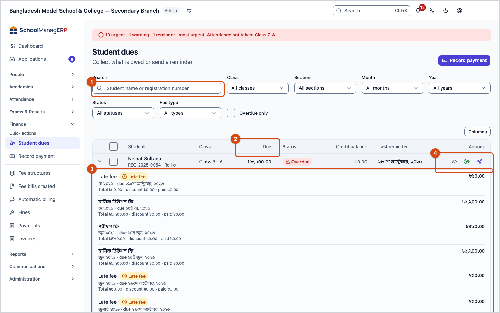
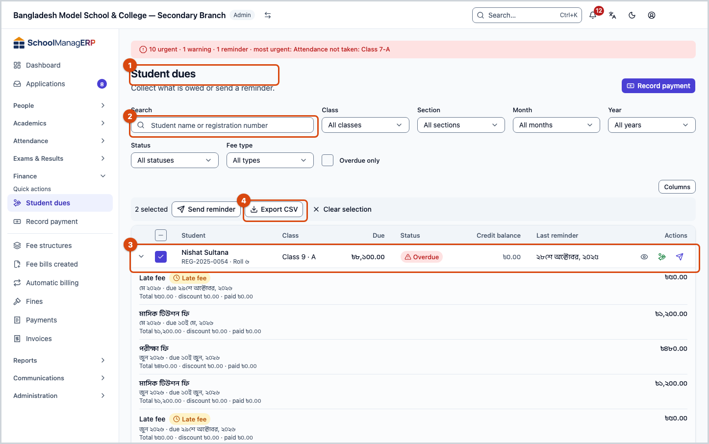

<!-- guide:meta
feature: finance.dues
title: Student dues
summary: See in one list how much each student still owes, set the overdue ones apart, then collect the fee, send a reminder or export the list as CSV from there.
roles: [ADMIN, ACCOUNTANT]
sources:
  - client-admin/src/routes/_staff/fees/dues.tsx
  - server/src/modules/fees/fees.controller.ts
  - server/src/modules/fees/fee-dues.service.ts
labels:
  [
    fees:dues.*,
    nav:items.studentDues,
    nav:groups.finance,
  ]
helpIds:
  [
    finance.dues,
    finance.dues.action.collect,
    finance.dues.action.sendReminder,
    finance.dues.action.exportCsv,
    finance.dues.field.flagged,
  ]
devices: [desktop, phone]
entry: [sidebar, palette]
keywords:
  [dues, outstanding, overdue, arrears, collect, balance, unpaid, reminder, credit balance, collect fee]
appVersion: 0.1.0 (978d9b96a)
owner: tareq89
lastVerified: 2026-10-25
knownIssues: []
-->

# Student dues

See who owes how much in one place, and take the money from there.

**Where to go:** in the left menu, **Finance → Student dues**.
**Before you start:** you must be an admin or an accountant. Dues only show up once bills exist ([**Creating fee bills**](generate-fees.md)).

Each row in the list is one student who has at least one bill that is not fully paid yet. Open a row to see each of their open bills separately. To take money, go to [**Record payment**](record-payment.md).

[Find dues](#task-main) · [Collect a fee](#task-collect) · [Reminders](#task-remind) · [Troubleshooting](#trouble)

**On this page**

- [Find one student's dues](#task-main)
- [How to know you are looking at the right thing](#confirm)
- [Other situations](#other)
  - [Collect a fee from the list](#task-collect)
  - [See overdue students only](#task-overdue)
  - [Send a reminder](#task-remind)
  - [Export CSV](#task-export)
- [Troubleshooting](#trouble)
- [Who can do what](#roles)
- [Learn more](#more)

---

## Find one student's dues 

1. In the left menu press **Finance**, then **Student dues**.

   → The **Student dues** list opens. Each row shows **Student**, **Class**, **Due**, **Status**, **Credit balance** and **Last reminder**. The student who owes the most comes first. 25 rows show per page at first; you can raise it up to 100.

2. In the **Search** box type the student's name or registration number. If needed, filter by **Class**, **Section**, **Month**, **Year**, **Status** or **Fee type**.
3. Press the arrow on the left of the row.

   → Under the row, each open bill opens: the fee name, the period, the **due date**, the amount still owed, and **Total … · discount … · paid …**. A bill added for lateness is marked **Late fee**.

> **Remember:** **Due** means what is still owed, not the total bill. To see the total bill and the amount paid, press **Columns** and turn on the **Total** and **Paid** columns; both are hidden at first.

---

## How to know you are looking at the right thing 

| In the **Status** column | Meaning                                                                    |
| ------------------------ | -------------------------------------------------------------------------- |
| **Overdue**              | At least one bill's due date has passed and money is still owed            |
| **Partially paid**       | Some money has gone into a bill, but not all of it                         |
| **Pending**              | There is a bill, no money has gone in yet, and the due date has not passed |

If even one of a student's bills is overdue, the whole row shows **Overdue**.

This page only shows; nothing changes here. When you take money, the list shrinks by itself; once a student has paid in full, they leave the list.

---

## Other situations 

### Collect a fee from the list 

1. In the student's row menu press **Collect fee**.

   → The [**Record payment**](record-payment.md) page opens with the student already chosen.

2. Take the money there. When you come back, the dues have gone down.

To start without picking anyone, press [**Record payment**](record-payment.md) at the top. To see all of a student's bills and payments, press **View** on the row; the fees section of the [**Students**](../people/students.md) page opens.

### See overdue students only 

In the filter, tick **Overdue only**. Only students with at least one bill past its due date remain (the due date itself is not yet overdue). The student with the most such bills comes first; if two are equal, the one who owes more comes first.

In this mode **Search**, **Month**, **Year**, **Status** and **Fee type** are hidden, and you cannot sort by pressing a column. **Class** and **Section** stay.

### Send a reminder 

1. To send to one student, press **Remind** in the row menu. To send to several, tick them, then press **Send reminder** at the top.
2. In the reminder window, check the message and send it.

   → Once sent, today's date appears in the **Last reminder** column. If one was never sent, it says **Never**.

When you send to several students at once, the ticks clear after sending.

### Export CSV 

Tick the students, then press **Export CSV**. The file is named `dues.csv` and has: **Student**, **Class**, **Section**, **Total**, **Paid**, **Due**, **Status**, **Last reminder**.

> **Remember:** the tick box at the top of the list ticks only the rows on this page. Your ticks stay when you go to another page or change a filter, so you can tick across pages. Reloading the page clears all ticks. To tick many at once, raise the number of rows per page (up to 100).

---

## Troubleshooting 

| What you see                                                          | What to do                                                                                                                 | Who can help |
| --------------------------------------------------------------------- | -------------------------------------------------------------------------------------------------------------------------- | ------------ |
| **No outstanding dues found**                                         | Clear the filters and look again. It also shows when everyone has truly paid.                                              | —            |
| **Couldn't load student dues**                                        | Reload the page.                                                                                                           | Admin        |
| **Collect fee** or [**Record payment**](record-payment.md) is missing | You need both the collect-fee and the record-payment permissions. Ask the admin.                                           | Admin        |
| **Credit balance** column shows —                                     | The student's credit balance did not load. Reload the page.                                                                | —            |
| You are looking for a student but the **Search** box is gone          | Untick **Overdue only**.                                                                                                   | —            |
| Fewer rows in the export file                                         | Only ticked rows come in, and a reload clears the ticks. Go through the pages again and tick. ([Export CSV](#task-export)) | —            |

---

## Who can do what 

| Role                                                                                    | See dues | Collect fee | Reminder |
| --------------------------------------------------------------------------------------- | -------- | ----------- | -------- |
| Admin                                                                                   | Yes      | Yes         | Yes      |
| Accountant                                                                              | Yes      | Yes         | Yes      |
| Academic coordinator, teacher, office assistant, exam controller, governing body member | No       | No          | No       |

**Admin:** can do everything.

**Accountant:** can do everything. Looking at dues and taking money is usually the accountant's everyday job.

For other roles, **Student dues** is not in the left menu.

---

## Learn more 

<strong>Parts of the page</strong> — the student dues list

1. The **Student dues** heading and the [**Record payment**](record-payment.md) button.
2. The filters: **Search**, **Class**, **Section**, **Month**, **Year**, **Status**, **Fee type**, **Overdue only**.
3. The list: press the arrow to open the bills; the row menu has **View**, **Collect fee**, **Remind**.
4. When you tick rows, **Send reminder**, **Export CSV** and **Clear selection** appear at the top.

<strong>How dues are worked out</strong>

<figure>
  
  <figcaption><em>The path of dues, from bill to collection</em></figcaption>
</figure>

- **What is left on each bill:** total − discount − paid. A student's **Due** is the sum of all their open bills.
- **Which bills count:** only pending, partially paid or overdue bills. Bills that are fully paid or waived do not.
- **Credit balance:** money paid in advance that is held in the student's name. It does not come off the dues by itself; when taking money you have to choose [**Use credit balance**](record-payment.md#task-wallet).
- **Two bills for the same period:** the fee name has (2) next to it.

<strong>Short help for the boxes (the (?) button)</strong>

<!-- guide:generated:fields:fees:flagged -->

| Field        | What to enter                                                                        | Required? |
| ------------ | ------------------------------------------------------------------------------------ | --------- |
| Overdue only | Shows students with a fee past its due date. Leave it off to see everyone with dues. | No        |

<!-- /guide:generated -->

**Related pages**

- [**Fees and invoices**](../portal/fees.md) — how a guardian sees the same fees.

- [**Record payment**](record-payment.md) — taking money against dues.
- [**Payments**](payments.md) — all payments taken, receipts and reversals.
- [**Creating fee bills**](generate-fees.md) — where dues come from.
- [**Students**](../people/students.md) — all of one student's bills and payments.

- [**Fee reminders**](../communications/fee-reminders.md) — send fee reminders to those who owe

- [**Fines**](fines.md) — fine bills also show as owed here.
- [**Invoices**](invoices.md) — find and send payment receipts.
- [**Setting up fee structures**](fee-structures.md) — setting up fee structures
- [**Automatic billing rules**](recurring-schedules.md) — automatic billing rules
- [**Fee collection report**](../reports/collections-report.md) — the collection report built from payments
