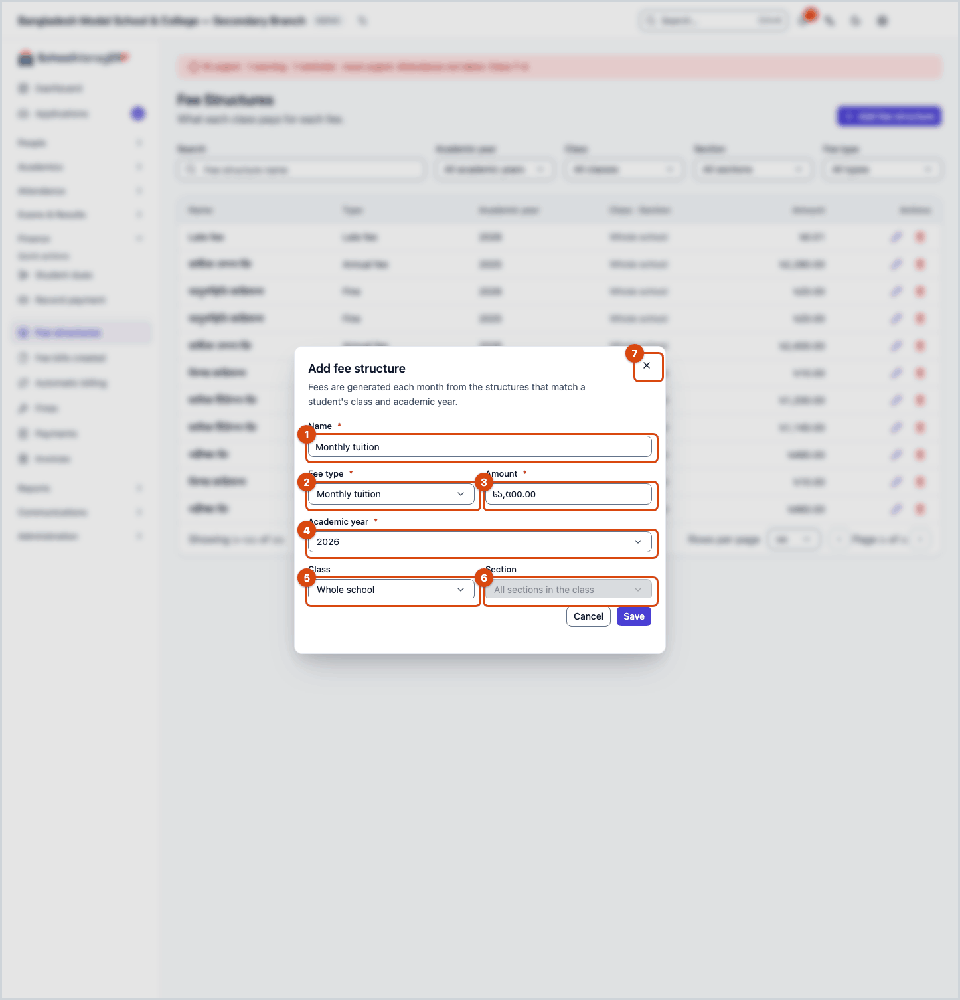
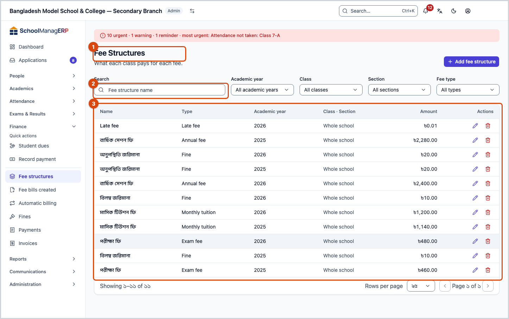

<!-- guide:meta
feature: finance.feeStructures
title: Setting up fee structures
summary: Write down which fee costs how much for each academic year; set a fee for the whole school, one class or one section, then change the amount later or delete a structure you no longer need.
roles: [ADMIN, ACCOUNTANT]
sources:
  - client-admin/src/routes/_staff/fee-structures/index.tsx
  - client-admin/src/routes/_staff/fee-structures/-structure-form-dialog.tsx
  - client-admin/src/routes/_staff/fee-structures/-delete-structure-dialog.tsx
  - server/src/modules/fees/fees.controller.ts
  - server/src/modules/fees/fees.service.ts
  - server/src/modules/fees/dto/fees.dto.ts
labels:
  [
    feeStructures:list.*,
    feeStructures:form.*,
    feeStructures:deleteDialog.*,
    feeStructures:feeTypes.*,
    feeStructures:fields.*,
    feeStructures:help.*,
    nav:items.feeStructures,
    nav:groups.finance,
  ]
helpIds:
  [
    finance.feeStructures,
    finance.feeStructures.action.add,
    finance.feeStructures.action.edit,
    finance.feeStructures.action.delete,
    finance.feeStructures.field.amount,
    finance.feeStructures.field.feeType,
    finance.feeStructures.field.academicYear,
    finance.feeStructures.field.class,
  ]
devices: [desktop]
entry: [sidebar, palette]
keywords:
  [fee, fee structure, tuition, monthly tuition, exam fee, admission fee, fee amount, amount]
appVersion: 0.1.0 (a25ab3344)
owner: tareq89
lastVerified: 2026-10-25
knownIssues:
  - { id: delete-blocked-wrong-reason, checked: 2026-10-25, issue: null } # delete-blocked red text names payments, but a fine rule or automatic billing rule is the real cause
  - { id: window-text-says-monthly-fees, checked: 2026-10-25, issue: null } # window text says fees are generated monthly; bills are created only by Create bills or an automatic billing rule
-->

# Setting up fee structures

Write down here which fee costs how much, for each academic year.

**Where to go:** in the left menu, **Finance → Fee structures**. Do the work on this page on a computer.
**Before you start:** be an Admin or Accountant. The academic year must already exist ([Academic years](../academics/academic-years.md)). To set a fee for a class, that class must exist too ([Classes](../academics/classes.md)).

A **fee structure** is a price label: a name, a fee type and an amount, for example `Monthly tuition — Monthly tuition — ৳1,500`. A structure does not create any bills by itself. Bills are made when you run [**Create bills**](generate-fees.md) or an [**Automatic billing**](recurring-schedules.md) rule runs. At that moment the structure's amount is copied into the bill.

[Add a structure](#task-main) · [Change an amount](#task-edit) · [Delete a structure](#task-delete) · [Problems and fixes](#trouble)

**On this page**

- [Add a fee structure](#task-main)
- [How to know the structure is saved](#confirm)
- [Other situations](#other)
  - [Change the amount or name](#task-edit)
  - [Delete a structure](#task-delete)
  - [Find a structure in the list](#task-filter)
- [Problems and fixes](#trouble)
- [Who can do what](#roles)
- [Learn more](#more)

---

## Add a fee structure 

1. In the left menu press **Finance**, then press **Fee structures**.

   → The **Fee structures** list opens: **Name**, **Type**, **Academic year**, **Class · Section**, **Amount**.

2. At the top press **Add fee structure**.

   → The **Add fee structure** window opens.

3. In the **Name** box type a name, for example `Monthly tuition`.
4. Choose the **Fee type**, for example **Monthly tuition** or **Exam fee**.
5. In the **Amount** box type the amount, for example `1500`. If you need paisa, type up to two digits after the decimal point.
6. Choose the **Academic year**.
7. If you leave the **Class** box as it is, the structure is for the **Whole school**. To set it for one class, choose that class.
8. If you chose a class, keep **All sections in the class** in the **Section** box, or choose one section.

9. Press **Save**.

   → The window closes. The new structure appears in the list.

> **Remember:** the class or section on a structure is only a label. In [**Create bills**](generate-fees.md), every student and every fee you pick get a bill, even if the class does not match. So pick the right fee when you create bills.

---

## How to know the structure is saved 

| State                         | How you know                                                              | What next             |
| ----------------------------- | ------------------------------------------------------------------------- | --------------------- |
| **Only typed on screen**      | The window is open and **Save** has not been pressed                      | Press **Save**        |
| **Reached the school's system** | The window closes, and the structure appears in the list with its amount | You are done          |

This page does not keep anything separately on your phone or computer, so there is no "saved on this device" state.

**If the window does not close:** read the red message in the window and see [Problems and fixes](#trouble). What you typed stays in the window.

---

## Other situations 

### Change the amount or name 

1. In the structure's row in the list press **Edit**.

   → The **Edit fee structure** window opens. The **Academic year** box is locked, and the text below says **The academic year can't be changed later.**

2. Change the **Name**, **Amount**, **Class** or **Section**.
3. Press **Save**.

   → The new amount applies only to bills created from now on. The money on bills already created does not change. Every change, who made it and when, is kept in the school's audit log.

Once even one bill has been created from this structure, the **Fee type** can no longer be changed. Add a new structure for the new type.

### Delete a structure 

Only an Admin can delete.

1. In the structure's row in the list press **Delete**.

   → The **Delete fee structure** window opens. It says that fees already generated from this structure stay exactly as they are; nothing is removed and nothing is refunded.

2. Press **Delete**.

| What you pressed in the window | What happens                                                                                    | Deleted? |
| ------------------------------ | ----------------------------------------------------------------------------------------------- | -------- |
| **Delete**                     | The structure leaves the list and can no longer be picked for future bills. Old bills stay.     | Yes      |
| **Cancel**                     | Nothing changes.                                                                                | No       |

A structure cannot be deleted while a fine rule or an [**Automatic billing**](recurring-schedules.md) rule uses it. First remove the structure from that rule.

### Find a structure in the list 

In the **Search** box above the list, type a name. You can also filter by **Academic year**, **Class**, **Section** and **Fee type**. If nothing matches, **No fee structures match these filters** appears; clear the filters.

---

## Problems and fixes 

| What you see                                                                                                                                                      | What to do                                                                                                                                                                      | Who can help |
| ----------------------------------------------------------------------------------------------------------------------------------------------------------------- | ------------------------------------------------------------------------------------------------------------------------------------------------------------------------------- | ------------ |
| **Name is required**                                                                                                                                              | Type a name in the **Name** box (up to 100 characters).                                                                                                                         | —            |
| **Amount must be greater than zero**                                                                                                                              | Type an amount above 0.                                                                                                                                                         | —            |
| **Academic year is required**                                                                                                                                     | Choose an academic year. If the list is empty, first add an [academic year](../academics/academic-years.md).                                                                    | Admin        |
| **Failed to save fee structure**                                                                                                                                  | Check your internet and press again. If bills already exist for this structure, the **Fee type** cannot be changed; keep the old type, or add a new structure.                 | Admin        |
| **This fee structure can't be deleted because payments have already been recorded against the fees generated from it.**                                           | The text is not fully right: in fact a fine rule or an [automatic billing rule](recurring-schedules.md) is using the structure. Change that rule, then delete.                  | Admin        |
| **Failed to delete fee structure**                                                                                                                                | Check your internet and try again.                                                                                                                                              | Admin        |
| **Failed to load fee structures**                                                                                                                                 | Reload the page.                                                                                                                                                                | Admin        |
| The **Delete** button is not shown                                                                                                                                | An Accountant cannot delete. Ask an Admin.                                                                                                                                      | Admin        |
| I changed the amount, but the old bills still show the old amount                                                                                                 | That is the rule; a bill keeps the amount from when it was created. To fix old bills, see the [Create bills](generate-fees.md#task-batch) page.                                 | Accountant   |

---

## Who can do what 

| Role                                                                          | See structures | Add and edit | Delete |
| ----------------------------------------------------------------------------- | -------------- | ------------ | ------ |
| Admin                                                                         | Yes            | Yes          | Yes    |
| Accountant                                                                    | Yes            | Yes          | No     |
| Academic coordinator, Teacher, Office staff, Exam controller, Committee member | No             | No           | No     |

**Admin:** can do everything, including delete.

**Accountant:** can add and change structures. **Delete** is not shown in their list.

**Fee structures** is not in the left menu of the other roles. A guardian sees the fee's name beside their dues in their portal, not the whole list.

---

## Learn more 

<strong>Parts of the page</strong> — top to bottom

1. The **Fee structures** heading and the **Add fee structure** button.
2. The filters — **Search**, **Academic year**, **Class**, **Section**, **Fee type**.
3. The list — **Name**, **Type**, **Academic year**, **Class · Section**, **Amount**; **Edit** and **Delete** at the end of each row.

<strong>What each field means</strong>

<!-- guide:generated:fields:feeStructures -->

| Field         | What to enter                                                                                                                  | Required? |
| ------------- | ------------------------------------------------------------------------------------------------------------------------------ | --------- |
| Name          | Name shown in the list and on bills, for example Monthly tuition; up to 100 characters.                                        | Required. |
| Fee type      | The kind of fee, for example Monthly tuition or Exam fee. Once any bill uses this structure the type can no longer change.     | No        |
| Amount        | Amount per student; more than 0, up to two decimals. A change applies only to bills created afterwards, not to existing bills. | Required. |
| Academic year | The academic year this fee belongs to. Chosen only when creating; it cannot change later.                                      | Required. |
| Class         | The class this fee is for; leave empty for the whole school. It is a label only; generating bills charges whoever you pick.    | No        |
| Section       | One section of the class; leave empty for all sections of the class. Pick a class first.                                       | No        |

<!-- /guide:generated -->

<strong>How fee structures work</strong> — who they are for, and when the money goes into a bill

<figure>
  
  <figcaption><em>What a fee structure is made of</em></figcaption>
</figure>

- **Money limits:** the amount is above 0, has up to two digits after the decimal point, and is at most ৳9,99,99,999.99.
- **When the money goes into a bill:** at the moment a bill is created, the structure's amount is copied into the bill. Changing or deleting the structure later does not change that bill.
- **Discounts:** if a student has a discount rule, it is taken off this amount when the bill is created.
- **[Fine rules](fines.md):** a fine rule also uses a fee structure.

**Related pages**

- [**Create bills**](generate-fees.md) — pick this structure and create bills for students.
- [**Automatic billing**](recurring-schedules.md) — bills from this structure every month or week, on their own.
- [**Academic years**](../academics/academic-years.md) — every structure belongs to one academic year.
- [**Classes**](../academics/classes.md) — a structure can be set for a class or section.
- [**Fines**](fines.md) — Add a student's fine by hand, make the month's fines at month end from absence or lateness rules, set the fine rules.
- [**Student dues**](dues.md) — see who owes what

---

_Version 0.1.0 · last verified 2026-10-25_
