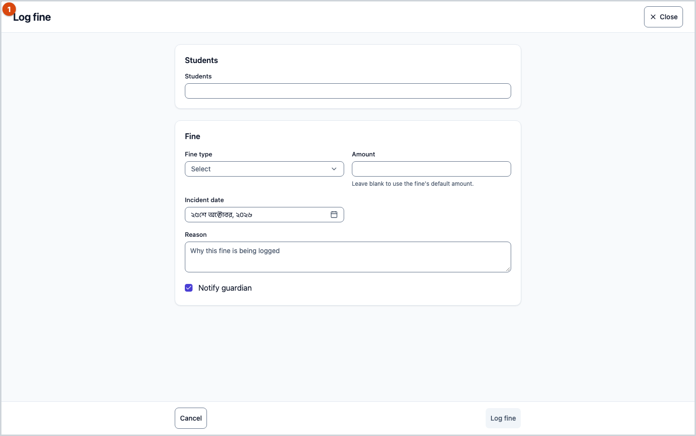
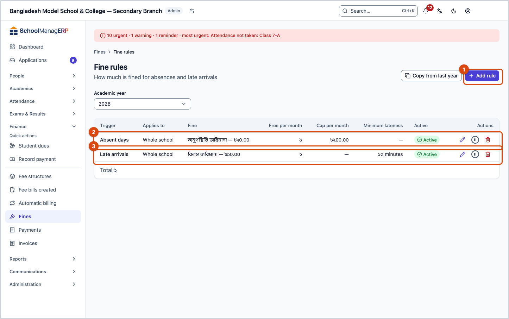
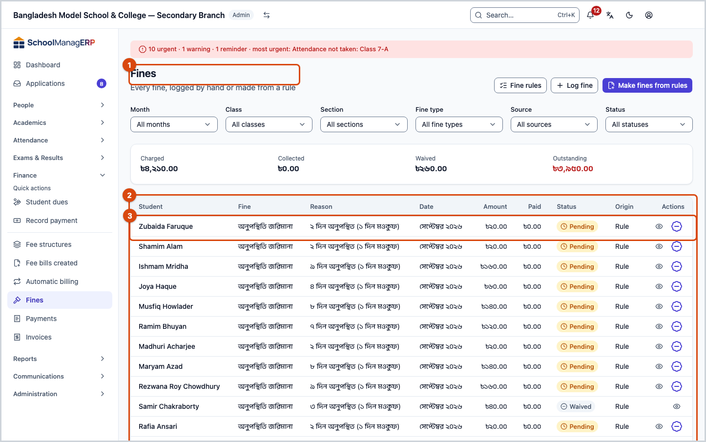

<!-- guide:meta
feature: finance.fines
title: Fines
summary: Add a student's fine by hand, make the month's fines at month end from absence or lateness rules, set the fine rules, and waive a fine in full or in part when needed.
roles: [ADMIN, ACCOUNTANT, TEACHER, EXECUTIVE, OFFICE_STAFF]
sources:
  - client-admin/src/routes/_staff/fees/fines/index.tsx
  - client-admin/src/routes/_staff/fees/fines/rules.tsx
  - client-admin/src/routes/_staff/fees/fines/-modals/log-fine-modal.tsx
  - client-admin/src/routes/_staff/fees/fines/-modals/generate-fines-modal.tsx
  - client-admin/src/routes/_staff/fees/fines/-modals/waive-fine-dialog.tsx
  - client-admin/src/routes/_staff/fees/fines/-rules/rules-panel.tsx
  - client-admin/src/routes/_staff/fees/fines/-rules/rule-form-dialog.tsx
  - server/src/modules/fees/fines/fines.controller.ts
  - server/src/modules/fees/fines/fines.service.ts
  - server/src/modules/fees/fines/fine-sweep.service.ts
  - server/src/modules/fees/fines/fine-rules.controller.ts
labels:
  [
    fines:title,
    fines:subtitle,
    fines:filters.*,
    fines:totals.*,
    fines:columns.*,
    fines:logForm.*,
    fines:generate.*,
    fines:waiveDialog.*,
    fines:deleteRuleDialog.*,
    fees:fines.rules.*,
    nav:items.fines,
    nav:groups.finance,
  ]
helpIds:
  [
    finance.fines,
    finance.fines.action.log,
    finance.fines.action.generate,
    finance.fines.action.waive,
    finance.fines.action.rules,
    finance.fines.field.waiveReason,
  ]
devices: [desktop, phone]
entry: [sidebar, palette]
keywords:
  [fines, fine, penalty, waive, forgive, absent, late, fine rules, absence, lateness]
appVersion: 0.1.0 (978d9b96a)
owner: tareq89
lastVerified: 2026-10-25
knownIssues: []
-->

# Fines

Add a student's fine, make fines from rules, and waive them when needed.

**Where to go:** in the left menu, **Finance → Fines**.
**Before you start:** admins and accountants add or make fines. There must first be at least one fee of the "fine" type ([**Fee structures**](fee-structures.md)).

Every fine is really a bill for the student. So it shows in the [**Student dues**](dues.md) list, and the money is taken with [**Record payment**](record-payment.md).

[Add a fine](#task-main) · [Make from rules](#task-generate) · [Waive](#task-waive) · [Set the rules](#task-rules) · [Troubleshooting](#trouble)

**On this page**

- [Add a fine for one or several students](#task-main)
- [How to know the fine was made](#confirm)
- [Other situations](#other)
  - [Make the month's fines from the rules](#task-generate)
  - [Waive a fine](#task-waive)
  - [Add or change a fine rule](#task-rules)
  - [Copy last year's rules](#task-copy)
- [Troubleshooting](#trouble)
- [Who can do what](#roles)
- [Learn more](#more)

---

## Add a fine for one or several students 

For example: someone lost a library book, or broke something.

1. In the left menu press **Finance**, then **Fines**.
2. At the top press [**Log fine**](#task-main) (keyboard `l`).

   → The **Log fine** window opens.

3. In the **Students** box type a name and pick one or more students. Up to 200 at a time.
4. Choose the **Fine type**.
5. If you leave **Amount** empty, the fine type's own amount is used. Type a figure if you want a different one.
6. Give the **Incident date**. It cannot be a date after today.
7. Write the **Reason**, for example "Lost library book". 3 to 280 characters.
8. **Notify guardian** is on at first; turn it off if you do not want to notify.
9. Press **Log fine**.

   → A message like "**2 fines logged**" appears. A separate bill is made for each student.

> **Remember:** if you add a fine for the same student again in the same month, the earlier one does not change; another new bill is made. A fine's due date is 7 days after the day you add it (not after the incident date).

---

## How to know the fine was made 

In the list each fine is one row: **Student**, **Fine**, **Reason**, **Date**, **Month**, **Amount**, **Paid**, **Status**, **Origin**.

| Box        | What it means                                              |
| ---------- | ---------------------------------------------------------- |
| **Origin** | **Manual** (added by hand) or **Rule** (made from a rule)  |
| **Status** | The bill's state — pending, partially paid, paid or waived |

At the top, **Totals for this list** — **Charged**, **Collected**, **Waived**, **Outstanding** for whatever the filters are showing.

To filter, use **Month**, **Class**, **Section**, **Source**, **Fine type**, **Status**.

---

## Other situations 

### Make the month's fines from the rules 

If there are [fine rules](#task-rules), the app counts one month's attendance and works out the fines.

1. At the top press [**Make fines from rules**](#task-generate) (keyboard `g`).
2. Choose the **Month**. If needed, choose a **Class** and **Section**.
3. Press **See what will be made**.

   → The **What will be made** part shows each student, the fine, **Times** and **Amount**.

4. If some of this month's fines already exist, choose one:
   - **Skip duplicates** — the safe choice.
   - **Remove the older fine first** — the old one is deleted and a new one made.
   - **Create anyway** — a second fine for the same month; needs admin approval.
5. Turn **Notify families when fines are generated** on or off.
6. Press **Generate fines**.

   → **Fine generation finished**: how many were created and how many skipped.

**How a fine is worked out, with an example:**

The rule: absent days, fine type 50 taka, **Free per month** 2, **Cap per month** 200 taka.

| Absent in the month | Counted for a fine (absent − free) | Working      | Fine                          |
| ------------------- | ---------------------------------- | ------------ | ----------------------------- |
| 2 days              | 0                                  | —            | No fine                       |
| 5 days              | 3                                  | 3 × 50 = 150 | 150 taka                      |
| 9 days              | 7                                  | 7 × 50 = 350 | 200 taka (stopped by the cap) |

- The due date of these fines is 7 days after the day they are made.
- Fines for a month can only be made after that month has ended; if you pick the current month, the app stops you.
- Holidays, closed days and days on leave (LEAVE) are not counted.
- Only whole-day attendance is counted; if a student is absent in a class period but present for the day, it does not count.
- For a lateness rule, a day counts only if the student was at least **Minimum minutes late** late. If no minutes are set, it always counts.

> **Remember:** the app also makes the previous month's fines by itself every day, but only after the time allowed for fixing attendance after month end has passed (2 days unless the attendance settings change it). With 2 days, the 1st and 2nd of the month are for fixing attendance, and the fines are made from the 3rd. This automatic run always skips fines that already exist, and notifies families.

The same options exist for fee bills; see [**Creating fee bills**](generate-fees.md) for details.

### Waive a fine 

Only an admin can waive, and every time it needs approval.

1. On the fine's row press [**Waive fine**](#task-waive). It does not appear on a fine that is fully paid or already waived.

   → The window says: **The amount you waive comes off the student's balance.**

2. Choose **Waive in full** or **Waive part of it**.
3. For part, type the **Amount to waive**. You cannot type more than what is left.
4. Write the **Reason**. 3 to 280 characters.
5. Press **Waive fine**.

   → The approval window opens; the approver enters their password or code there.

   → When it succeeds, the amount left goes down. If it was waived in full with nothing paid, the status becomes waived; if part was paid and the rest is waived, the status becomes paid.

Any active admin can approve, including the admin doing the waiving with their own password or code.

### Add or change a fine rule 

1. At the top of the Fines page press [**Fine rules**](#task-rules).

   → The list of rules opens. At the top choose the **academic year**; rules are separate for each academic year.

2. Press **Add rule**.
3. **Trigger** — **Absent days** or **Late arrivals**. You cannot change this later.
4. Choose the **Fine type**; each time, the fine is for that fine type's amount.
5. Choose a **Class**, or keep **Whole school**.
6. Type **Free per month** (0 means a fine from the very first time).
7. If needed, type **Cap per month** in taka; leave it empty for no limit.
8. For lateness, type **Minimum minutes late**, 0 to 240.
9. Press **Save**.

If an active rule already exists for the same academic year, trigger and class, the new one is not saved.

From the row's menu you can **Edit**, **Deactivate** / **Activate**, and **Delete**. When you delete, a window asks first; a deleted rule cannot be brought back. An inactive rule makes no new fines.

### Copy last year's rules 

1. On the rules page press **Copy from last year**.
2. Choose the year to copy from.
3. Press **Copy**.

   → It shows how many fine types and rules were copied and how many were skipped. Things already copied are not copied again.

---

## Troubleshooting 

| What you see                                                     | What to do                                                                                                                | Who can help |
| ---------------------------------------------------------------- | ------------------------------------------------------------------------------------------------------------------------- | ------------ |
| **No fines yet**                                                 | No fine has been added or made.                                                                                           | Accountant   |
| **No fines match these filters**                                 | Pick another month or status, or clear the filters.                                                                       | —            |
| **Couldn't load fines.**                                         | Reload the page.                                                                                                          | Admin        |
| The **Fine type** list is empty                                  | First make a fee of the "fine" type ([**Fee structures**](fee-structures.md)).                                            | Admin        |
| **Failed to log fine**                                           | Check that the incident date is inside the fine type's academic year.                                                     | Accountant   |
| **No fines would be generated for this month.**                  | Nobody has more absences or lateness than the free count, or there is no active rule. Pick another month or class.        | —            |
| **Failed to generate fines**                                     | Check whether the month has ended; the current month's fines cannot be made.                                              | Accountant   |
| **This fine has already been paid — reverse the payment first.** | Nothing is left to pay. If it was a mistake, first [**reverse the payment**](payments.md#task-reverse).                   | Admin        |
| **Waive fine** is missing                                        | Only an admin sees it; it does not appear on a paid or waived fine.                                                       | Admin        |
| An active fine rule already exists for this year, trigger and class | Change the old rule, or deactivate it first.                                                                              | Accountant   |
| The fine rules cannot be loaded                                  | If you are a teacher, academic coordinator or office assistant, the rules page does not open for you. For others: reload. | Admin        |

More help with this: [What to do when something goes wrong](../help/troubleshooting.md#fees).

---

## Who can do what 

| Role                 | See fines                           | Add and make | Waive              | See rules | Add / change rules | Delete rules |
| -------------------- | ----------------------------------- | ------------ | ------------------ | --------- | ------------------ | ------------ |
| Admin                | All                                 | Yes          | Yes, with approval | Yes       | Yes                | Yes          |
| Accountant           | All                                 | Yes          | No                 | Yes       | Yes                | No           |
| Teacher              | Only students in their own sections | No           | No                 | No        | No                 | No           |
| Academic coordinator | All                                 | No           | No                 | No        | No                 | No           |
| Office assistant     | All                                 | No           | No                 | No        | No                 | No           |

### Admin 

Sees all fines, adds and makes them, waives them (with approval every time), and adds, changes and deletes rules.

### Accountant 

Sees all fines, adds and makes them, and adds and changes rules. Cannot waive or delete rules; ask an admin.

### Teacher 

Sees the **Finance → Fines** list, but only of students in the sections given to you this year. If no section is given to you, the list is empty. Cannot add, make or waive.

### Academic coordinator 

Only sees all fines and the totals. Cannot make any change.

### Office assistant 

Only sees all fines, for example when a guardian asks. Cannot make any change.

---

## Learn more 

<strong>Parts of the page</strong> — the fines list

1. The **Fines** heading, and the **Fine rules**, **Log fine** and **Make fines from rules** buttons.
2. **Totals for this list** — charged, collected, waived, outstanding.
3. The filters — **Month**, **Class**, **Section**, **Source**, **Fine type**, **Status**.
4. The list — the row menu has **Open student** and **Waive fine**.

<strong>What the boxes mean</strong>

<!-- guide:generated:fields:fines -->

| Field                | What to enter                                                                                                                         | Required? |
| -------------------- | ------------------------------------------------------------------------------------------------------------------------------------- | --------- |
| Trigger              | Whether to count absent days or late arrivals. This cannot be changed after the rule is made.                                         | Required. |
| Fine type            | Which fine type applies; its own amount is used each time. Only fees of the fine type appear here.                                    | Required. |
| Class                | For one class, or for the whole school.                                                                                               | No        |
| Free per month       | The first this-many times in a month are not fined; every time after that is. 0 means fined from the very first time.                 | No        |
| Cap per month        | A student's total fine under this rule in one month will not go above this. Leave empty for no limit.                                 | No        |
| Minimum minutes late | Late-arrival rules only: counts only if at least this many minutes late, 0 to 240. If no late minutes are recorded, it always counts. | No        |
| Students             | One or more students, up to 200 at a time. A separate bill is made for each.                                                          | Required. |
| Fine type            | Which fine type; only fees of the fine type appear here.                                                                              | Required. |
| Amount               | If left empty, the fine type's own amount is used. More than zero, up to two decimals.                                                | No        |
| Incident date        | When it happened. It cannot be a date after today, and it must be inside the fine type's academic year.                               | Required. |
| Reason               | Why the fine; 3 to 280 characters. The bill carries this reason.                                                                      | Required. |
| Notify guardian      | When on, the guardian is told about the fine.                                                                                         | No        |
| In full or part      | Whether to waive everything that is left, or only part of it.                                                                         | No        |
| Amount to waive      | How much, when waiving part. It cannot be more than what is left.                                                                     | No        |
| Reason               | Why you are waiving it; 3 to 280 characters.                                                                                          | Required. |

<!-- /guide:generated -->

<strong>How fines work</strong>

<figure>
  
  <figcaption><em>From a fine to payment or waiver</em></figcaption>
</figure>

- **A fine is a bill:** whether added by hand or from a rule, each fine is an ordinary bill; dues, reminders and payments all work the same way.
- **Waiving is a discount:** the waived amount is added to the bill's discount; the bill is not deleted, so it stays in the books.
- **Two people at once:** if two people try to waive the same fine at the same time, one goes after the other, and no more than what is left can be waived.
- **Limit:** no amount can be more than 99,999,999.99 taka or have more than two decimals.

**Related pages**

- [**Fees and invoices**](../portal/fees.md) — how a guardian sees fines.

- [**Student dues**](dues.md) — fine bills show as owed here.
- [**Record payment**](record-payment.md) — taking the fine money.
- [**Payments**](payments.md) — reversing a wrong payment.
- [**Invoices**](invoices.md) — the receipt for a payment.
- [**Creating fee bills**](generate-fees.md) — the options for bills that already exist.
- [**Fee structures**](fee-structures.md) — making a fee of the "fine" type.
