<!-- guide:meta
feature: finance.generateFees
title: Creating fee bills
summary: Create fee bills for chosen students for one month or week in one go; decide what happens when bills for the same period already exist, and view, change or delete an earlier billing round.
roles: [ADMIN, ACCOUNTANT]
sources:
  - client-admin/src/routes/_staff/fees/generate.tsx
  - client-admin/src/routes/_staff/fees/-generate/generate-fees-modal.tsx
  - client-admin/src/routes/_staff/fees/-generate/audience-picker.tsx
  - client-admin/src/routes/_staff/fees/-generate/fee-picker.tsx
  - client-admin/src/routes/_staff/fees/-generate/duplicates-step.tsx
  - client-admin/src/routes/_staff/fees/-generations/batch-table.tsx
  - client-admin/src/routes/_staff/fees/-generations/batch-actions.tsx
  - client-admin/src/routes/_staff/fees/-generations/edit-batch-dialog.tsx
  - client-admin/src/routes/_staff/fees/-generations/batch-bills-drawer.tsx
  - server/src/modules/fees/fees.controller.ts
  - server/src/modules/fees/fee-generation.service.ts
  - server/src/modules/fees/fee-generations.controller.ts
  - server/src/modules/fees/fee-generation-batch.service.ts
labels:
  [
    feeGeneration:title,
    feeGeneration:modal.*,
    feeGeneration:audience.*,
    feeGeneration:fees.*,
    feeGeneration:notify.*,
    feeGeneration:summary.*,
    feeGeneration:duplicates.*,
    feeGeneration:year.*,
    feeGeneration:period.*,
    feeGeneration:errors.*,
    feeGeneration:notifications.*,
    feeGeneration:section.*,
    feeGeneration:fields.*,
    feeGeneration:help.*,
    fees:generations.*,
    nav:items.generateFees,
    nav:groups.finance,
  ]
helpIds:
  [
    finance.generateFees,
    finance.generateFees.action.generate,
    finance.generateFees.action.createAnyway,
    finance.generateFees.action.removeOlder,
    finance.generateFees.action.deleteBatch,
    finance.generateFees.action.removeUncollected,
    finance.generateFees.action.editPeriod,
    finance.generateFees.field.duplicateDecision,
    finance.generateFees.field.dueDate,
    finance.generateFees.field.fees,
  ]
devices: [desktop]
entry: [sidebar, palette]
keywords:
  [bill, fee bill, create bills, monthly bill, dues, billing round, duplicate bill, generate fees, billing, invoice, batch, duplicate]
appVersion: 0.1.0 (a25ab3344)
owner: tareq89
lastVerified: 2026-10-25
knownIssues: []
-->

# Creating fee bills

Create fee bills for one month or week for many students in one go.

**Where to go:** in the left menu, **Finance → Fee bills created**. Do the work on this page on a computer.
**Before you start:** be an Admin or Accountant. The academic year must already have [**Fee structures**](fee-structures.md). The students must be enrolled ([Students](../people/students.md)).

Each time you create bills you get one **billing round**. A round records the period, the fee, how many students and the total amount. Every bill is added to the student's dues. When a payment is taken later, a receipt is made. To have bills made on their own every month, see [**Automatic billing**](recurring-schedules.md).

[Create bills](#task-main) · [If bills already exist](#task-duplicates) · [Change or delete a round](#task-batch) · [Problems and fixes](#trouble)

**On this page**

- [Create bills for one month](#task-main)
- [How to know the bills are created](#confirm)
- [Other situations](#other)
  - [If bills for this period already exist](#task-duplicates)
  - [Weekly bills](#task-week)
  - [View the bills of one round](#task-view)
  - [Change a round's period, remove uncollected bills or delete a round](#task-batch)
- [Problems and fixes](#trouble)
- [Who can do what](#roles)
- [Learn more](#more)

---

## Create bills for one month 

1. In the left menu press **Finance**, then press **Fee bills created**.

   → The **Fee bills created** list opens. Each earlier round is one row: **Period**, **Fees**, **Students**, **Billed**, **Collected**, **Status**, **How created**, **Created on**.

2. At the top press **Create bills**.

   → The **Create fee bills** page opens. It has three parts: **Period**, **Students**, **Fees**; below them, **Check this before generating**.

3. In the **Period** part, choose the **Academic year**.
4. Keep **Period type** on **Month**. In the **Month** box choose the month and year, for example January 2026.

   → The **Due date** fills in on its own: 9 days after the period starts. For a January bill, the due date is 10 January.

5. If you want a different due date, change the **Due date**.
6. In the **Students** part, filter by **Class** and **Section**, then tick the students. To pick everyone at once, press **Select all … matching**.

   → The text at the top shows **… selected**.

7. In the **Fees** part, tick one or more fees. Beside each one it says **৳… per student**.

   → The **Check this before generating** part shows **… bills will be created** and **… students × … fees**.

<!-- image pending: Create fee bills page with everything filled; 1 · Period 2 · Students 3 · Fees 4 · Check this before generating and the bill count 5 · Notify families when bills are created 6 · Create bills; accountant, desktop -->

8. If you do not want to tell families, untick **Notify families when bills are created**. It is ticked at the start.
9. Press **Create bills**.

   → The app checks first. If no bills exist for this period yet and no student is inactive, the bills are created straight away. The page closes and the message **Generated … bills for … students (… skipped).** appears.

   → If bills already exist, the section **Some bills for this period already exist** appears on the page. See [If bills for this period already exist](#task-duplicates).

> **Remember:** every student and every fee you pick gets one bill per fee. The fee structure's class is not checked against the student. So for Class 7 tuition, pick only Class 7 students.

---

## How to know the bills are created 

| State                           | How you know                                                                                       | What next                   |
| ------------------------------- | -------------------------------------------------------------------------------------------------- | --------------------------- |
| **Only picked on screen**       | The **Create fee bills** page is open; if you try to leave, a warning appears                      | Press **Create bills**      |
| **Reached the school's system** | The page closes, a green message appears, and a new round shows at the top of the list             | You are done                |

This page does not keep anything separately on your phone or computer, so there is no "saved on this device" state.

**If no message appears, or the wrong one does:** running it again is safe. Students who already have the same fee for the same period are skipped automatically, unless you choose something else. One student never gets the same fee twice for the same period.

---

## Other situations 

### If bills for this period already exist 

In the **Some bills for this period already exist** section, each match is one line: **student — fee**. If a selected student is not active, it says **… of the selected students are not active.**

1. Choose one of the options under **What to do with existing bills**. The first one is chosen at the start.
2. Press **Create bills** again.

| You chose                                    | What happens                                                                                           | Approval needed?                                  |
| -------------------------------------------- | ------------------------------------------------------------------------------------------------------ | ------------------------------------------------- |
| **Skip duplicates**                          | Only students who have no bill for this period get one. Old bills stay as they were.                   | No                                                |
| **Delete the old bill and create a new one** | The old bill is deleted and a new bill is made, with the new amount.                                   | Only if the old bill has any money paid on it     |
| **Create anyway**                            | A second bill is made for the same period; the student will pay twice.                                 | Always                                            |

When approval is needed, an extra approval window appears. Only an Admin can approve: an Admin gives their password or code in that window. If you do not give approval, nothing is created and nothing is deleted.

> **Remember:** even if you run it twice by mistake, the first option is already chosen, so nobody is charged twice. Choose **Create anyway** only when you really want a second bill in the same month.

### Weekly bills 

In **Period type** choose **Week**, then give the **Week starting** date. The other steps are the same. The **Due date** is still set to 9 days after the week starts.

### View the bills of one round 

In the list, press the round's row. **Billing round — …** opens beside it: for each student, the **Class**, **Fee**, **Amount**, **Paid** and **Status**. At the top it says **… students · … in total**.

### Change a round's period, remove uncollected bills or delete a round 

In the round's row, open the **Billing round actions** menu.

| What you pressed in the menu         | What happens                                                                                              | Approval needed?                              |
| ------------------------------------ | --------------------------------------------------------------------------------------------------------- | --------------------------------------------- |
| **Edit period / due date**           | The **Period start** and **Due date** of all the bills in the round change together.                      | If any bill in the round has a payment         |
| **Remove uncollected**               | Only bills with no money paid yet are removed. Bills that have been paid stay.                            | No                                            |
| **Delete billing round**             | The round and all its bills are deleted.                                                                  | If any bill in the round has a payment         |

When approval is needed, the window says so first, for example **… of … bills already have payments — admin approval will be required to delete this billing round.**

---

## Problems and fixes 

| What you see                                                                                                                      | What to do                                                                                                                       | Who can help |
| --------------------------------------------------------------------------------------------------------------------------------- | -------------------------------------------------------------------------------------------------------------------------------- | ------------ |
| **No fee structures exist for this academic year yet.**                                                                           | First add a [**fee structure**](fee-structures.md#task-main).                                                                    | Accountant   |
| **… is outside … (… to …).**                                                                                                      | Choose a month inside the academic year, or choose a different academic year.                                                    | —            |
| **Create bills** cannot be pressed                                                                                                | Check that you have chosen the academic year, month, due date, at least one student (or one program) and at least one fee.       | —            |
| **Fee generation is limited to 5 runs per minute — wait a moment and try again.**                                                 | Wait a minute and press again.                                                                                                   | —            |
| **We couldn't confirm the result of this run. Re-running is safe — anything already created will be skipped.**                    | See whether a new round has appeared in the list. If not, run it again; with the first option chosen, nobody gets two bills.     | Admin        |
| **Too many matches — narrow your filters and try again.**                                                                         | Choose a class or section to get fewer students, then create the bills in a few runs.                                            | —            |
| **This period already conflicts with an existing billing round for:**                                                             | A round for the same period already exists. Choose a different period, or look at the earlier round.                             | Accountant   |
| **This billing round could not be deleted — refresh and try again.**                                                              | Reload the page and try again; someone may have taken a payment in the meantime.                                                 | Admin        |
| **Failed to load the generated fees log**                                                                                         | Reload the page.                                                                                                                 | Admin        |
| One student has two bills for the same fee in one month                                                                           | Someone chose **Create anyway**. If it was a mistake and no money has been paid on the second round, press **Remove uncollected**. | Admin        |

---

## Who can do what 

| Role                                                                          | See rounds | Create bills and change rounds | Delete a second bill or a bill with money paid |
| ----------------------------------------------------------------------------- | ---------- | ------------------------------ | ---------------------------------------------- |
| Admin                                                                         | Yes        | Yes                            | Yes, with approval                             |
| Accountant                                                                    | Yes        | Yes                            | Yes, with approval                             |
| Academic coordinator, Teacher, Office staff, Exam controller, Committee member | No         | No                             | No                                             |

**Admin and Accountant:** both can do everything on this page. Risky actions that involve money (a second bill, deleting or changing a bill with money paid) need extra approval. The **Created by** filter is shown only to someone who is allowed to see the staff list.

**Fee bills created** is not in the left menu of the other roles.

---

## Learn more 

<strong>Parts of the page</strong> — the Fee bills created list

1. The **Fee bills created** heading and the **Create bills** button.
2. The filters — **Period** (**From**, **To**), **Fee type**, **How created** (**Manual**, **Automatic billing**, **Fine rule**), **Created by**, **Collection status**.
3. The list of rounds — press a row to open its bills; the **Billing round actions** menu is at the end.

<!-- image pending: Fee bills created list, the three parts marked with numbers, one round showing "Partly collected"; accountant, desktop -->

<strong>What each field means</strong>

<!-- guide:generated:fields:feeGeneration -->

| Field                                  | What to enter                                                                                                                                                                                 | Required?     |
| -------------------------------------- | --------------------------------------------------------------------------------------------------------------------------------------------------------------------------------------------- | ------------- |
| Academic year                          | The academic year whose fee structures are billed. The period must fall inside this year.                                                                                                     | Required.     |
| Period type                            | Bill for a month or for a week.                                                                                                                                                               | No            |
| Month                                  | The month and year being billed. It must fall inside the academic year.                                                                                                                       | Required.     |
| Week start                             | First day of the week for a weekly bill.                                                                                                                                                      | No            |
| Due date                               | The date payment is due. Defaults to 9 days after the period starts; change it if needed.                                                                                                     | Required.     |
| Class                                  | Filters the student list by class. It selects nobody by itself.                                                                                                                               | No            |
| Section                                | Filters the student list by section.                                                                                                                                                          | No            |
| Program                                | Picking a program bills every active student in it, even without ticking each one.                                                                                                            | No            |
| Show inactive students too             | When ticked, inactive students appear in the list and are billed if picked.                                                                                                                   | No            |
| Students                               | Who gets billed. Up to 5,000 at a time.                                                                                                                                                       | No            |
| Fees                                   | Which fee structures to bill; one bill per picked student per fee. Up to 20 at a time. The class is not checked.                                                                              | At least one. |
| What to do with existing bills         | When a bill for the same fee and period exists: skip (no approval), remove the older one and create new (approval if money was paid), or create a second bill anyway (always needs approval). | No            |
| Notify families when bills are created | When ticked, families get a message once bills are created. Ticked by default.                                                                                                                | No            |

<!-- /guide:generated -->

<strong>How bill creation works</strong> — the check, earlier bills and approval

<figure>
  
  <figcaption><em>The steps of creating bills</em></figcaption>
</figure>

- **The same bill is never made twice:** one student, one fee and one period make one bill. If you run it again, the earlier bill is found and skipped. Even if two people run it at the same moment, the school's system keeps only one.
- **Where the money comes from:** the bill's amount comes from the fee structure, at the moment the bill is created. If the student has a discount rule, the discount is applied to the bill at that time.
- **Due date:** unless you change it, 9 days after the period starts.
- **Limits:** you can pick at most 20 fees and 5,000 students at a time.
- **Inactive students:** they are not billed unless you tick **Include inactive students**.

<figure>
  
  <figcaption><em>The path of the money, from fee structure to receipt</em></figcaption>
</figure>

**Related pages**

- [**Fee structures**](fee-structures.md) — which fee costs how much is set here.
- [**Automatic billing**](recurring-schedules.md) — bills every month or week, on their own.
- [**Students**](../people/students.md) — the people who get the bills.
- [**Changing the school's settings**](../administration/settings.md) — Set the school's profile, academic rules, fee rules, communication, printing, sign-in, backup and alerts on one page, in nine categories.
- [**Fee reminders**](../communications/fee-reminders.md) — Remind the guardians of one student, or of up to 500 students at once, about unpaid fees.
- [**Student dues**](dues.md) — See in one list how much each student still owes, set the overdue ones apart, then collect the fee.
- [**Fines**](fines.md) — Add a student's fine by hand, make the month's fines at month end from absence or lateness rules, set the fine rules.
- [**Payments**](payments.md) — Find every payment taken at the school, open one to see which bills the money went to, print the receipt again, and reverse a wrong payment.
- [**Record payment**](record-payment.md) — Take money against the open bills of one or more students — the money is split across the oldest bills, give a discount if needed, work out.

---

_Version 0.1.0 · last verified 2026-10-25_
