<!-- guide:meta
feature: finance.invoices
title: Invoices
summary: Find the invoice and credit note of every payment, print them, send them to a guardian by WhatsApp or SMS, and give a 30-day share link that opens without signing in.
roles: [ADMIN, ACCOUNTANT, OFFICE_STAFF]
sources:
  - client-admin/src/routes/_staff/invoices/index.tsx
  - client-admin/src/routes/_staff/invoices/$invoiceId.tsx
  - client-admin/src/routes/i/$token.tsx
  - server/src/modules/invoices/invoices.controller.ts
  - server/src/modules/invoices/invoice-share.service.ts
  - server/src/modules/invoices/public-invoice.controller.ts
  - server/src/modules/invoices/invoice-numbering.util.ts
labels:
  [
    fees:invoices.*,
    fees:invoiceDetail.*,
    payments:invoices.*,
    payments:invoiceDetail.*,
    payments:printFormat.*,
    nav:items.invoices,
    nav:groups.finance,
  ]
helpIds:
  [
    finance.invoices,
    finance.invoices.action.print,
    finance.invoices.action.send,
    finance.invoices.action.share,
    finance.invoices.action.regenerate,
    finance.invoices.action.revoke,
  ]
devices: [desktop, phone]
entry: [sidebar, palette]
keywords:
  [invoices, invoice, receipt, credit note, share link, print, WhatsApp, SMS]
appVersion: 0.1.0 (978d9b96a)
owner: tareq89
lastVerified: 2026-10-25
knownIssues: []
-->

# Invoices

Find the invoice of every payment, print it, and send it to the guardian.

**Where to go:** in the left menu, **Finance → Invoices**.
**Before you start:** you must be an admin or an accountant. An office assistant can only look.

You never make an invoice by hand. When you take money with [**Record payment**](record-payment.md), an invoice is made. When you [**reverse**](payments.md#task-reverse) a payment, the original invoice is cancelled and a **credit note** is made against it.

[Find an invoice](#task-main) · [Print](#task-print) · [Send to guardian](#task-send) · [Share link](#task-share) · [Troubleshooting](#trouble)

**On this page**

- [Find and open an invoice](#task-main)
- [Invoice or credit note: how to tell](#confirm)
- [Other situations](#other)
  - [Print an invoice](#task-print)
  - [Send to the guardian by WhatsApp or SMS](#task-send)
  - [Create a share link](#task-share)
  - [Make a new link or turn it off](#task-regenerate)
  - [What the guardian sees when they open the link](#task-guardian)
- [Troubleshooting](#trouble)
- [Who can do what](#roles)
- [Learn more](#more)

---

## Find and open an invoice 

1. In the left menu press **Finance**, then **Invoices**.

   → The list opens, newest first: **Invoice no.**, **Student**, **Amount**, **Status**, **Issue date**, **Due date**.

2. In the **Search invoices** box type the invoice number or the student's name. If needed, filter by **Status**, **Issue date** (**Issue from**, **Issue to**) and **Amount (৳)** (**Minimum**, **Maximum**).
3. Press **View** on the row.

   → The invoice page opens: **Student**, **Issue date**, **Due date**, **Total**, **Payment**. Below, for each bill, the **Fee**, **Period**, **Bill**, **Discount**, **Paid now**, **Left to pay**; then **Total billed**, **Discount**, **From wallet**, **Paid**, **Change given**.

An invoice number looks like this: `INV-2026-00042`. Each school counts from 1 again every year; the year means the calendar year in Bangladesh time.

<!-- image pending: one invoice's page; 1 · Invoice details 2 · List of bills 3 · Totals 4 · Print 5 · Send to guardian 6 · Share link; accountant, desktop -->

---

## Invoice or credit note: how to tell 

| What            | How you can tell                                                             | Number           |
| --------------- | ---------------------------------------------------------------------------- | ---------------- |
| **Invoice**     | The normal page; the **Payment** row shows the method and date               | `INV-2026-00042` |
| **Credit note** | A **Credit note** label next to the number, and an **Original invoice** link | `CN-2026-000007` |

Credit note numbers run in a separate series, one digit wider than invoices. There is no button to delete an invoice or cancel it by hand; if there is a mistake, reverse the payment ([**Payments**](payments.md#task-reverse)).

---

## Other situations 

### Print an invoice 

1. On the invoice page, in the **Print** part, choose a **Paper size**: **A4 page**, **Receipt printer — 80 mm**, or **Receipt printer — 58 mm**.
2. Press **Print**.

   → The invoice opens for printing; print from there.

The app remembers the size you pick. You can also print straight from the list with **Print** on the row. To fix the printer, see [**Setting up printers and sizes**](../administration/print-templates/printers-and-calibration.md).

### Send to the guardian by WhatsApp or SMS 

1. On the invoice page, in the **Send to guardian** part, press **WhatsApp** or **SMS**.
2. If there is more than one guardian, the **Pick a guardian** window opens; choose one. If there is one, it sends straight away.

   → **Receipt sent.** The message carries a new [share link](#task-share) to the receipt.

- If there is no guardian, the button cannot be pressed and it says **This student has no guardian to send a receipt to.**
- If siblings were paid on one invoice, each student's guardians appear in the list.
- SMS uses up the school's SMS credit. If the credit is low, it is not sent.
- Each send makes a new link; the earlier link stays active.

### Create a share link 

With the link, anyone can see the receipt without signing in. So give it only to the guardian.

1. On the invoice page, in the **Share link** part, press **Create share link**.

   → The **Shareable receipt link** appears, for example `https://<your school's address>/i/…`. Below it, **Link works until …** — 30 days from today.

2. Press **Copy link**, then send it to the guardian.

> **Remember:** the link only shows right when it is created. If you reload the page it is gone; the app does not keep the link itself. If you need it again later, [**regenerate the link**](#task-regenerate).

After 30 days the link stops by itself. Then **Create share link** comes back on the page.

### Make a new link or turn it off 

When there is an active link, two buttons appear:

| Button              | What happens                                                                                                                              |
| ------------------- | ----------------------------------------------------------------------------------------------------------------------------------------- |
| **Regenerate link** | All the old links of this invoice stop, and a new 30-day link is made. Message: **New link made. The old link no longer works.**          |
| **Turn off link**   | This link stops. Message: **Share link revoked.**                                                                                         |

Both ask first, because nobody holding an old link can open the receipt any more. If a link went to the wrong person, press **Regenerate link**, then give the new one to the right guardian.

### What the guardian sees when they open the link 

When a guardian opens the link on a phone, they see the **Invoice receipt** page without signing in:

- At the top, the school's name (with its logo and address if set), then the invoice number and the **Issue date**.
- Each bill, **Billed**, **Discount**, **Paid**, **Change**.
- The **payment method**, the **payment date**, and the amount **in words**.
- If it is a credit note, it says **Credit note**.
- At the bottom, **Save as PDF** — the phone's print opens, and from there the PDF can be kept.

<!-- image pending: the invoice receipt page on a guardian's phone, 390 pixels wide; the Save as PDF button visible; guardian, phone -->

If the link is turned off, expired or wrong, the guardian sees **This link isn't valid** — **The receipt may have been revoked, or the link may be mistyped.** The page does not say which reason it is. Then give a new link from the school.

---

## Troubleshooting 

| What you see                                                                    | What to do                                                                         | Who can help |
| ------------------------------------------------------------------------------- | ---------------------------------------------------------------------------------- | ------------ |
| **No invoices found**                                                           | No payment has been made, or a filter is hiding them all. Clear the filters.       | —            |
| **The invoice list could not be loaded**                                        | Reload the page.                                                                   | Admin        |
| **Couldn't load this invoice.**                                                 | Press **Retry**.                                                                   | Admin        |
| **Couldn't open the printable invoice. Try again.**                             | Check whether pop-ups are allowed in the browser, then press again.                | —            |
| The **Print** part is missing                                                   | Only an admin and an accountant print.                                             | Admin        |
| **Couldn't send the receipt.**                                                  | Check that the guardian's phone number is right, then try again.                   | Admin        |
| **Couldn't send the receipt.** when sending by SMS                              | The school's SMS credit may have run out. Send by WhatsApp, or buy SMS credit.     | Admin        |
| The share link is not visible any more                                          | The link only shows when it is created. Press **Regenerate link**.                 | —            |
| **Couldn't copy the link. You can select and copy it below.**                   | Select the link's text yourself and copy it.                                       | —            |
| **The share link couldn't be created.** / **The link couldn't be turned off.**  | Try again. If you are an office assistant this is not for you; ask the accountant. | Admin        |
| A guardian says **This link isn't valid**                                       | The link's 30 days are over, or it was turned off. Make a new link and send it.    | Accountant   |

More help with this: [What to do when something goes wrong](../help/troubleshooting.md#fees).

---

## Who can do what 

| Role                                                                  | See invoices | Print | Send to guardian | Share link |
| --------------------------------------------------------------------- | ------------ | ----- | ---------------- | ---------- |
| Admin                                                                 | Yes          | Yes   | Yes              | Yes        |
| Accountant                                                            | Yes          | Yes   | Yes              | Yes        |
| Office assistant                                                      | Yes          | No    | No               | No         |
| Academic coordinator, teacher, exam controller, governing body member | No           | No    | No               | No         |

**Admin and accountant:** see all invoices, print them, send them to the guardian, and create, renew or turn off share links.

**Office assistant:** sees all invoices and credit notes, for example when a guardian asks. Even if the send and share buttons show on the page, the app does not let you use them; ask the accountant.

For other roles, **Invoices** is not in the left menu.

---

## Learn more 

<strong>Parts of the page</strong> — the invoice list

1. The **Invoices** heading.
2. The filters — **Search invoices**, **Status**, **Issue date**, **Amount (৳)**.
3. The list — **View** and **Print** on each row. A credit note's row has a **Credit note** label.

<!-- image pending: invoice list with one normal invoice and one credit note; the three parts numbered; accountant, desktop -->

<strong>How invoices and share links work</strong>

<figure>
  
  <figcaption><em>From payment to invoice, printing and share link</em></figcaption>
</figure>

- **The link is not kept:** the app keeps only a secret fingerprint of the link, not the whole link. That is why a link cannot be shown again later; a new one has to be made.
- **Two people at once:** if two people press **Regenerate link** on the same invoice at the same time, only one active link is left in the end.
- **Off means off:** a link that is turned off or expired never works again.

**Related pages**

- [**Record payment**](record-payment.md) — where invoices are made.
- [**Payments**](payments.md) — reversing a payment, and credit notes.
- [**Student dues**](dues.md) — seeing what is still owed.
- [**Fines**](fines.md) — fine bills and waiving.
- [**Setting up printers and sizes**](../administration/print-templates/printers-and-calibration.md) — fixing the receipt printer.
