<!-- guide:meta
feature: finance.onlinePayments
title: Check and confirm online payments
summary: Check the payment proofs guardians send and confirm or reject them, see the online payments that came in by bKash, and find where the money of an unmatched receipt went.
roles: [ADMIN, ACCOUNTANT]
sources:
  - client-admin/src/routes/_staff/payments/online/index.tsx
  - client-admin/src/routes/_staff/payments/online/$id.tsx
  - client-admin/src/routes/_staff/payments/online/-online-tab.tsx
  - client-admin/src/routes/_staff/payments/online/-unmatched-tab.tsx
  - client-admin/src/routes/_staff/payments/online/-reject-dialog.tsx
  - server/src/modules/payment-submissions/proof-review.controller.ts
  - server/src/modules/payment-submissions/proof-review.service.ts
labels:
  [
    onlinePayments:*,
    nav:items.onlinePayments,
    nav:groups.finance,
  ]
helpIds: [finance.onlinePayments]
devices: [desktop, phone]
entry: [sidebar, palette]
keywords:
  [অনলাইন পেমেন্ট, পেমেন্টের প্রমাণ, লেনদেন নম্বর, TrxID, বিকাশ, নিশ্চিত করা বাকি, অমিল রসিদ, ওয়ালেট, online payments, payment proof, bKash, unmatched receipt, wallet]
appVersion: 0.1.0 (4fa6d3d1b)
owner: tareq89
lastVerified: 2026-11-15
knownIssues: []
-->

# Check and confirm online payments

Check the payment proofs guardians have sent, confirm or reject them, and see the online payments that came in by bKash.

**Where to go:** in the left menu, **Finance → Online payments**.
**Before you start:** you must be an admin or an accountant. Guardians can send a proof or pay with bKash only after an admin has turned on **Finance → Online payments** in [**Settings**](../administration/settings.md#task-online-payments).

Two kinds of money come to this page. **Payment proof**: the guardian paid by hand earlier, then sent the **Transaction ID (TrxID)** and a photo; you check it and confirm it. **Online payment**: the guardian paid with bKash from the portal; the money went straight to the school's bKash account and you have nothing to confirm.

[Confirm a proof](#task-main) · [Reject one](#task-reject) · [See online payments](#task-online) · [Unmatched receipts](#task-unmatched) · [Problems and fixes](#trouble)

**On this page**

- [Check a payment proof and confirm it](#task-main)
- [How to know it worked](#confirm)
- [Other situations](#other)
  - [Reject a proof](#task-reject)
  - [See the online payments that came in by bKash](#task-online)
  - [See unmatched receipts](#task-unmatched)
  - [Reverse a confirmed payment](#task-reverse)
- [Problems and fixes](#trouble)
- [Who can do what](#roles)
- [Learn more](#more)

---

## Check a payment proof and confirm it 

1. In the left menu, press **Finance → Online payments**.

   → The first tab, **Waiting for confirmation**, opens. Under the title it says how many proofs are waiting. Each row shows **Guardian**, **Sent**, **Bills**, **Method**, **Transaction ID (TrxID)** and **Amount**.

2. Next to the row you want to open, press **Review**.

   → The **Check payment proof** page opens. On the left are the photos the guardian sent; on the right "Guardian of …", their name, phone number and when it was sent. Below are **Method**, **Transaction ID (TrxID)**, **Amount**, **Paid on**, then **Which bills** (each student's amount and the **Total**) and **History**.

3. Match the transaction ID, the amount and the date against the school's bKash or bank statement. Use **Zoom in** and **Zoom out** on a photo; with more than one photo, use **Next file**.
4. If everything is right, press **Confirm & next**. When this is the last proof, the button just says **Confirm**.

   → The message **Confirmed.** appears. The money goes onto the bills and a receipt is made. The next waiting proof opens; if there is none, you go back to the list.

While you check, a warning may appear:

| Message                                                                                     | What to do                                                                                                                     |
| ------------------------------------------------------------------------------------------- | ------------------------------------------------------------------------------------------------------------------------------ |
| **This transaction ID is already on a confirmed payment. Check before you confirm.**        | Check that the same money is not being counted twice. If unsure, press **Call** to ask the guardian.                           |
| **This transaction ID is on another proof that is also waiting. Check before you confirm.** | Compare the two proofs and keep one; **Reject** the other with the reason **Already submitted**.                               |
| **A bill here was already paid. Confirming will discard this proof and no money moves.**    | The bill was paid another way. If you press **Confirm**, the proof becomes **Discarded — already paid** and no money is added. |

> **Remember:** no money goes onto a bill until you press **Confirm**. After you press it the money is on the bill; if it was a mistake, see [Reverse a confirmed payment](#task-reverse).

**On a phone:** the photos and the details come one under the other, and the **Confirm** button stays stuck at the bottom. The other steps are the same.

---

## How to know it worked 

| State                           | How you know                                                                                                          | What next                 |
| ------------------------------- | --------------------------------------------------------------------------------------------------------------------- | ------------------------- |
| **Changed on screen only**      | Until you press **Confirm** on the proof page, everything is as before and the proof is **Waiting for confirmation**. | Press **Confirm & next**. |
| **Reached the school's system** | The message **Confirmed.** appears and the proof leaves the list.                                                     | Done.                     |

Nothing on this page is kept on the device while you are offline, so there is no **Saved on this device** state. Without internet you get **Could not confirm. Reload to check the proof status before you try again.**

**To check for yourself:** in the menu open **Finance → Payments**. The new payment is in the list, newest first. Open it to see which bills the money went to. [**Payments**](payments.md) has more. The student's bill shows paid.

**If the message does not appear:** see [Problems and fixes](#trouble). Confirming again is safe, so no money can be counted twice.

<figure>
  
  <figcaption><em>The path of an online payment, from guardian to receipt</em></figcaption>
</figure>

---

## Other situations 

### Reject a proof 

1. On the **Check payment proof** page, press **Reject**.

   → The **Reject this payment proof** box opens. It says the guardian sees the reason in the portal and gets a message.

2. In **Reason**, choose one: **Transaction ID not found**, **Amount does not match**, **Image is unclear**, **Already submitted** or **Other**.
3. If you chose **Other**, write a short note for the guardian in **Note**. It cannot be left empty. A note written with another reason is shown to the guardian too.
4. Press **Reject**.

   → The proof becomes **Rejected**. The next waiting proof opens. The guardian sees the reason under **My payment proofs** in the portal.

| You pressed | What happens                                                                                       | Is it saved? |
| ----------- | -------------------------------------------------------------------------------------------------- | ------------ |
| **Reject**  | The proof becomes **Rejected** and the guardian is shown the reason. No money goes onto the bills. | Yes          |
| **Cancel**  | The box closes; the proof is still **Waiting for confirmation**.                                   | No, not yet  |

**Reject** stays off until you choose a **Reason**. A proof that was already confirmed cannot be rejected; it has to be [reversed](#task-reverse).

### See the online payments that came in by bKash 

1. On the **Online payments** page, press the **Online** tab.

   → Every online payment guardians made from the portal, one per row: **Date**, **Students**, **Status**. If there are none, it says **No online payments yet**.

2. To see only one state, choose it in **Status**, for example **Waiting for confirmation**, **Confirmed**, **Failed**, **Cancelled**, **Expired** or **Reversed**. To see all, choose **All statuses**.
3. Press **Open payment** beside a row to open that payment. If the payment has not been made yet, **Open details** shows instead.

There is nothing for you to confirm here. When bKash answers, the bills show paid. If a row stays **Waiting for confirmation**, bKash has not answered yet; reload the page and look again.

### See unmatched receipts 

Sometimes the bill is paid another way while the guardian is paying with bKash. Then the bill's share goes to the bill and the rest goes to the student's **wallet**. In the guardian's portal the wallet is called **Credit balance**.

1. Press the **Unmatched receipts** tab.

   → Each row shows **Students**, **Paid**, **Put on bills**, **Put in wallet** and **Status**. If there are none, it says **No unmatched receipts**.

2. To see the money, press **Open payment**. To see the student's wallet, press **Open wallet**; with more than one student, **Open wallet of …** with the name.

   → The student's page opens on the fees tab, where the wallet and paying money back out are.

The guardian sees this money as **Credit balance** on the **Fees and invoices** page of the portal. When you take money, the school can pay bills from it.

### Reverse a confirmed payment 

If you confirmed by mistake, open the proof (it is now **Confirmed**) and press **Reverse this payment**. It takes you to that payment on the [**Payments**](payments.md#task-reverse) page. Only an admin can reverse; the rules are on that page.

---

## Problems and fixes 

| What you see                                                                  | What to do                                                                                                                                                                                                | Who can help |
| ----------------------------------------------------------------------------- | --------------------------------------------------------------------------------------------------------------------------------------------------------------------------------------------------------- | ------------ |
| **Nothing is waiting for confirmation**                                       | No guardian has sent a proof yet. When one does, it shows here.                                                                                                                                           | —            |
| **Could not load the payment proofs. Try again.**                             | Check your connection and reload the page.                                                                                                                                                                | Admin        |
| **Could not load this payment proof.**                                        | Press **Try again**.                                                                                                                                                                                      | Admin        |
| **Could not load the proof files.**                                           | Reload the page. Do not confirm without the photo; call the guardian and check the transaction ID.                                                                                                        | Admin        |
| **This proof is not waiting any more. Reload to see where it stands.**        | Someone else confirmed or rejected it first, or the guardian pressed **Withdraw**. Reload the page.                                                                                                       | —            |
| **Could not confirm. Reload to check the proof status before you try again.** | Reload the page and check the proof status. If it is still waiting, press **Confirm** again; the money is never counted twice.                                                                            | Admin        |
| **Could not reject. Reload to check the proof status before you try again.**  | Reload the page and check the proof status. If it is still waiting, press **Reject** again.                                                                                                               | Admin        |
| **This bill was paid already. The proof is discarded and no money moved.**    | The bill was already paid, so nothing was added. Tell the guardian.                                                                                                                                       | Accountant   |
| A guardian says bKash took the money but the bill is still due                | On the **Online** tab, see whether that payment is **Waiting for confirmation**. The bill is paid as soon as bKash answers. If it takes long, check whether the money reached the school's bKash account. | Accountant   |
| No **Call** button                                                            | The guardian has no phone number on file. Fix the guardian's details on the student's page.                                                                                                               | Admin        |

---

## Who can do what 

| Role                             | See proofs, confirm or reject | See online payments and unmatched receipts | Turn the connection on                                               |
| -------------------------------- | ----------------------------- | ------------------------------------------ | -------------------------------------------------------------------- |
| Admin                            | Yes                           | Yes                                        | Yes ([Settings](../administration/settings.md#task-online-payments)) |
| Accountant                       | Yes                           | Yes                                        | No                                                                   |
| Office staff, teacher and others | No                            | No                                         | No                                                                   |

**Admin and accountant:** both confirm or reject proofs. Only an admin can reverse a confirmed payment.

**Others:** **Online payments** is not in the left menu.

---

## Learn more 

<strong>Parts of the page</strong> — Online payments

1. Three tabs at the top: **Waiting for confirmation**, **Online**, **Unmatched receipts**.
2. Each row has **Review** (proofs), **Open payment** (online) or **Open wallet** (unmatched receipts).
3. On the check page: photos on the left, details on the right, and buttons stuck at the bottom: **Reject**, **Call**, **Send SMS**, **Confirm & next**.

<strong>How online payments work</strong>

<figure>
  
  <figcaption><em>Two paths: bKash directly, or send a proof and wait for confirmation</em></figcaption>
</figure>

- **Pay with bKash:** the money goes straight to the school's bKash account; you do nothing.
- **Payment proof:** the bill stays due until you confirm.
- **What the guardian sees:** the proof goes from **Waiting for confirmation** to **Confirmed** or **Rejected**, with the reason if rejected. More in [**Fees and invoices**](../portal/fees.md).

**Related pages**

- [**Fees and invoices**](../portal/fees.md) — where the guardian pays and sees the state of a proof.
- [**Invoices**](invoices.md) — the receipt and its **How it was paid** part.
- [**Changing the school's settings**](../administration/settings.md#task-online-payments) — set up the bKash connection and the proof methods.

---

_Version 0.1.0 · last checked 2026-11-15_
