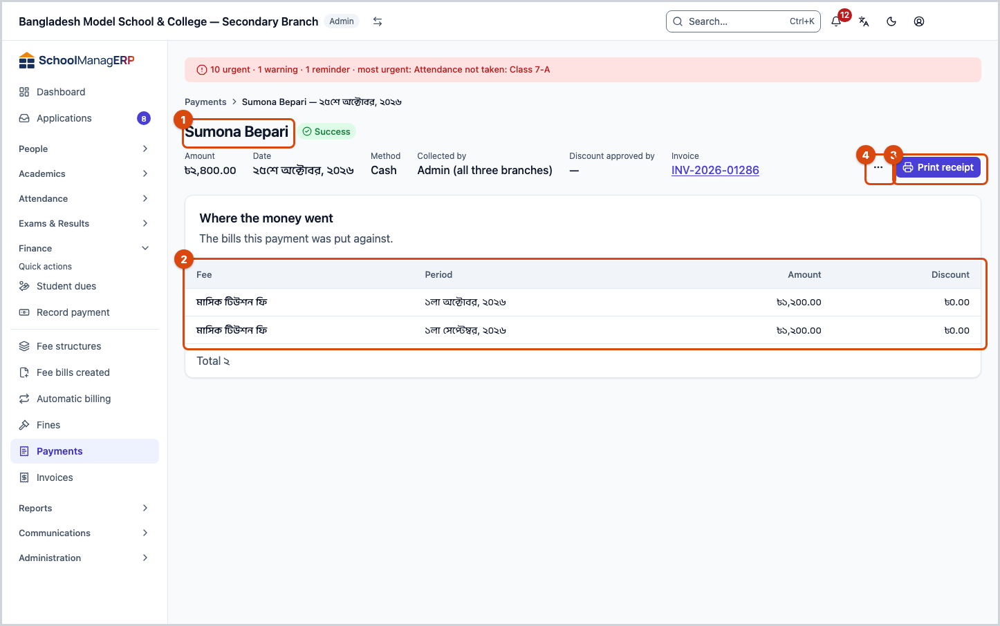
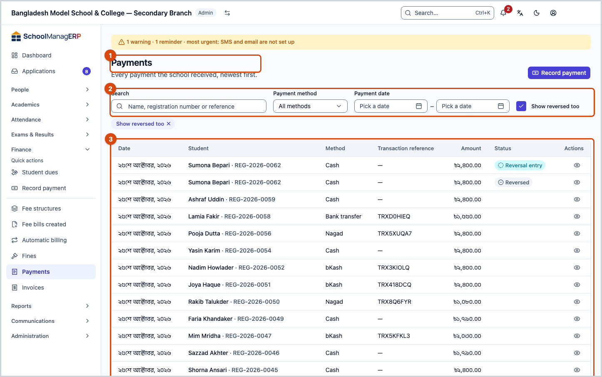

<!-- guide:meta
feature: finance.payments
title: Payments
summary: Find every payment taken at the school, open one to see which bills the money went to, print the receipt again, and reverse a wrong payment in full.
roles: [ADMIN, ACCOUNTANT]
sources:
  - client-admin/src/routes/_staff/payments/index.tsx
  - client-admin/src/routes/_staff/payments/$id.tsx
  - client-admin/src/routes/_staff/payments/-reverse-payment-dialog.tsx
  - client-admin/src/routes/_staff/payments/-list/use-payments-list.ts
  - server/src/modules/fees/checkout.controller.ts
  - server/src/modules/fees/payments-query.service.ts
  - server/src/modules/fees/payment-reversal.service.ts
labels:
  [
    payments:title,
    payments:subtitle,
    payments:list.*,
    payments:detail.*,
    payments:recordAction,
    nav:items.payments,
    nav:items.paymentDetail,
    nav:groups.finance,
  ]
helpIds:
  [
    finance.payments,
    finance.payments.action.reverse,
    finance.payments.action.printReceipt,
    finance.payments.field.reverseReason,
    finance.payments.field.includeReversed,
  ]
devices: [desktop, phone]
entry: [sidebar, palette]
keywords:
  [payments, receipt, invoice, reverse, reverse payment, credit note, transaction reference, reversal, refund]
appVersion: 0.1.0 (978d9b96a)
owner: tareq89
lastVerified: 2026-10-25
knownIssues: []
-->

# Payments

See every payment taken at the school, give the receipt again, and reverse a wrong payment.

**Where to go:** in the left menu, **Finance → Payments**.
**Before you start:** you must be an admin or an accountant. Only an admin can reverse a payment.

Each payment is one row in the list, newest first. To take new money, see [**Record payment**](record-payment.md).

[Find a payment](#task-main) · [Print receipt](#task-print) · [Reverse a payment](#task-reverse) · [Troubleshooting](#trouble)

**On this page**

- [Find and open a payment](#task-main)
- [How to know if it was reversed](#confirm)
- [Other situations](#other)
  - [Print the receipt again](#task-print)
  - [Reverse a payment](#task-reverse)
  - [When it asks you to reverse later payments first](#task-later)
  - [See reversed payments](#task-reversed)
- [Troubleshooting](#trouble)
- [Who can do what](#roles)
- [Learn more](#more)

---

## Find and open a payment 

1. In the left menu press **Finance**, then **Payments**.

   → The **Payments** list opens: **Date**, **Student**, **Method**, **Transaction reference**, **Amount**.

2. In the **Search** box type a name, registration number or reference. If needed, filter by **Payment method** and **Payment date** (**From**, **To**).
3. Press **View** on the row.

   → The payment's page opens: **Amount**, **Date**, **Method**, **Transaction reference**, **Collected by**, **Discount approved by**, **Invoice**. Below is **Where the money went** — how much money and how much discount landed on which bill.

---

## How to know if it was reversed 

| State              | How you can tell                                                                                           |
| ------------------ | ---------------------------------------------------------------------------------------------------------- |
| **Normal payment** | No banner on the page; an admin sees **Reverse payment**                                                   |
| **Reversed**       | **Reversed** next to the name, **This payment has been reversed.** at the top, and **View reversal entry** |
| **Reversal entry** | **This is a reversal entry.** at the top and **View original payment**                                     |

A reversal never deletes the original payment. A new **Reversal entry** is added, and the two stay linked to each other. So the books always show what happened.

---

## Other situations 

### Print the receipt again 

On the payment's page press **Print receipt**. The invoice opens in a new place for printing; print from there.

If the payment has no invoice (**No invoice**), this button does not appear. To see the full invoice, press [**View invoice**](invoices.md#task-main) — from there you can also send it to a guardian and give a [share link](invoices.md#task-share); to go to the student's page, press **Student page**. To fix the printer, see [**Setting up printers and sizes**](../administration/print-templates/printers-and-calibration.md).

### Reverse a payment 

If it was recorded for the wrong student, with the wrong amount or the wrong method, reverse the whole payment, then record it again correctly. A partial reversal is not possible.

1. On the payment's page press **Reverse payment**.

   → The **Reverse this payment?** window opens and tells you:
   - **Any credit balance this payment created will be unwound.**
   - **A credit note is issued against the linked invoice.**
   - **This cannot be undone once confirmed.**

2. In the **Reason** box write why you are reversing it, for example "Recorded under the wrong student". 3 to 500 characters.
3. Press **Reverse payment**.

   → An extra approval window opens. An admin enters their password or code there.

   → When it succeeds the window closes and the page shows **Reversed**.

**What happens when a payment is reversed, step by step:**

1. The money paid on the bills this payment went to goes back. The bills owe money again and return to the [**Student dues**](dues.md) list.
2. If this payment's change was kept as credit balance, that amount is taken off the credit balance.
3. If this payment used credit balance, that money goes back to the student's credit balance.
4. The invoice is cancelled and a credit note is made against it; the reason you wrote is on it.
5. A new **Reversal entry** is created, and the original payment is marked **Reversed**.

**What cannot be reversed:**

- A payment that has already been reversed cannot be reversed again.
- A **Reversal entry** cannot itself be reversed. If you reversed by mistake, record the payment again as new.
- A payment that did not complete successfully cannot be reversed.

There is no time limit: an older payment can be reversed too, as long as none of the above applies.

> **Remember:** if the school has another active admin who can approve, or the school's settings have a second approver switched on, you cannot approve your own reversal. Ask another admin to enter their code. If the school has only one admin and no second approver is switched on, that admin can approve it themselves.

### When it asks you to reverse later payments first 

Sometimes the window says **Later payments must be reversed first:**, with links below: **Later payment 1**, **Later payment 2** …

This means: this payment put some money into the student's credit balance, and a later payment has already spent that credit balance. If you reverse the earlier one, the credit balance would go below zero, so the app stops you.

1. Open each link and reverse those payments first.
2. Then come back to this payment and reverse it again.

### See reversed payments 

At first the list does not show reversed payments. In the filter, tick **Show reversed too**. A **Status** column then appears: **Reversed** (the original payment) or **Reversal entry**.

A **Reversal entry** shows the same amount as the original payment, not a minus figure; tell them apart by the **Status** column.

---

## Troubleshooting 

| What you see                                                                | What to do                                                                                          | Who can help |
| --------------------------------------------------------------------------- | --------------------------------------------------------------------------------------------------- | ------------ |
| **No payments yet**                                                         | No payment has been recorded, or a filter is hiding them all. Clear the filters.                    | —            |
| **Payments could not be loaded.**                                           | Reload the page.                                                                                    | Admin        |
| **Couldn't load this payment.**                                             | Press **Retry**.                                                                                    | Admin        |
| **Reverse payment** is missing                                              | Only an admin sees it. The payment may already be reversed, or it may itself be a reversal entry.   | Admin        |
| **Another admin must approve this reversal. Ask them to enter their code.** | Call another admin and press **Reverse payment** again; they enter the code in the approval window. | Admin        |
| **Later payments must be reversed first:**                                  | [Reverse the later payments first](#task-later).                                                    | Admin        |
| **Reverse payment** (confirm) cannot be pressed                             | Write at least 3 characters in **Reason**.                                                          | —            |
| **Reversing this payment failed.**                                          | Reload the page and see whether it was already reversed; if not, try again.                         | Admin        |
| **The receipt could not be opened for printing.**                           | Allow pop-ups for this site and check the connection, then press again.                             | —            |
| **Deleted student**                                                         | The student has been deleted; the payment stays in the books.                                       | Admin        |

More help with this: [What to do when something goes wrong](../help/troubleshooting.md#fees).

---

## Who can do what 

| Role                                                                                    | See payments | Print receipt | Reverse payment    | Approve reversal |
| --------------------------------------------------------------------------------------- | ------------ | ------------- | ------------------ | ---------------- |
| Admin                                                                                   | Yes          | Yes           | Yes, with approval | Yes              |
| Accountant                                                                              | Yes          | Yes           | No                 | No               |
| Academic coordinator, teacher, office assistant, exam controller, governing body member | No           | No            | No                 | No               |

**Admin:** sees all payments, prints receipts and reverses payments. A reversal always needs approval.

**Accountant:** sees all payments and prints receipts. Cannot reverse a payment; if there is a mistake, ask an admin.

For other roles, **Payments** is not in the left menu. A teacher can see one student's payments only on that [**Students**](../people/students.md) page, if they have permission.

---

## Learn more 

<strong>Parts of the page</strong> — the payments list

1. The **Payments** heading and the [**Record payment**](record-payment.md) button.
2. The filters — **Search**, **Payment method**, **Payment date**, **Show reversed too**.
3. The list — press **View** on a row to open the payment's page.

<strong>What the boxes mean</strong>

<!-- guide:generated:fields:payments:reverseReason,includeReversed -->

| Field             | What to enter                                                                                                                            | Required? |
| ----------------- | ---------------------------------------------------------------------------------------------------------------------------------------- | --------- |
| Reason            | Why you are reversing the payment; 3 to 500 characters. The reversal entry and the credit note carry this reason.                        | Required. |
| Show reversed too | Off: a payment that was reversed is hidden. On: reversed payments and the reversal entries show too, marked Reversed and Reversal entry. | No        |

<!-- /guide:generated -->

<strong>How reversal works</strong>

<figure>
  
  <figcaption><em>From a payment to its reversal</em></figcaption>
</figure>

- **Only added, never deleted:** a reversal is a new entry; the original payment and invoice stay, only marked.
- **Two people at once:** if two people try to reverse the same payment at the same time, only one goes through; the other sees it was already reversed.
- **Credit balance never goes below zero:** that is why a payment whose credit balance was spent later has to wait until the later payments are reversed first.
- **Approval:** every reversal needs a fresh approval; one approval is used only once.

**Related pages**

- [**Record payment**](record-payment.md) — taking new money.
- [**Student dues**](dues.md) — after a reversal the bills come back here.
- [**Creating fee bills**](generate-fees.md) — where bills come from.
- [**Setting up printers and sizes**](../administration/print-templates/printers-and-calibration.md) — fixing the receipt printer.
- [**Invoices**](invoices.md) — see invoices and credit notes, share links.
- [**Fines**](fines.md) — waiving a fine.
- [**Adding students and viewing their details**](../people/students.md) — Add a new student, import many at once, and use each student's profile to handle class, guardians, fees, notes and leaving the school.
- [**Fee collection report**](../reports/collections-report.md) — the collection report built from payments
