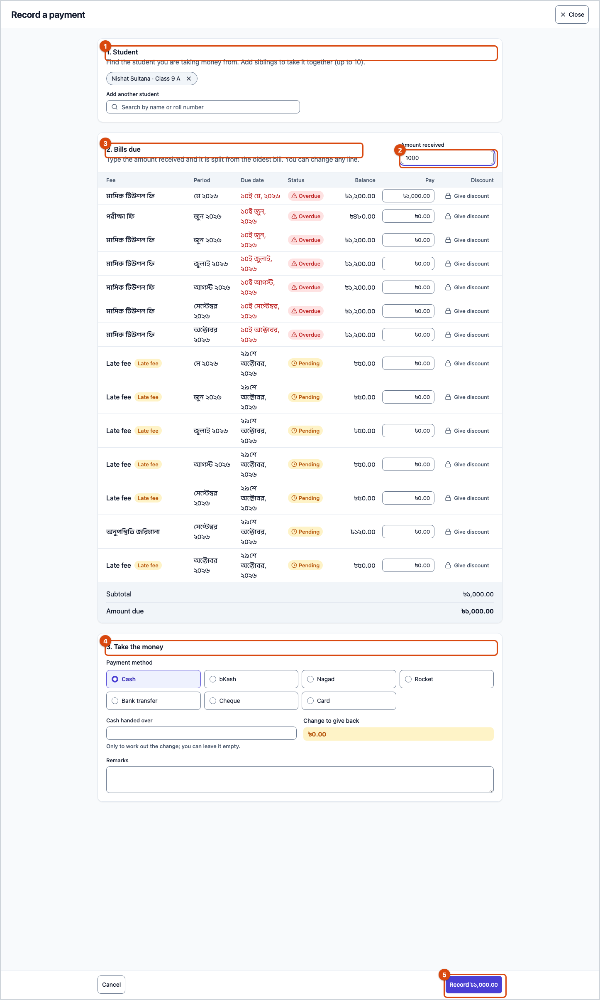
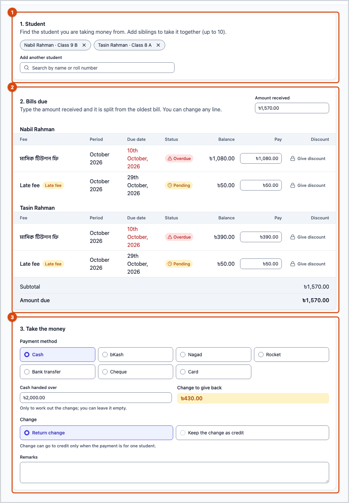

<!-- guide:meta
feature: finance.recordPayment
title: Record payment
summary: Take money against the open bills of one or more students — the money is split across the oldest bills, give a discount if needed, work out change in cash or keep it as credit, then print or send the receipt.
roles: [ADMIN, ACCOUNTANT]
sources:
  - client-admin/src/routes/_staff/payments/record.tsx
  - client-admin/src/routes/_staff/payments/-record/record-payment-modal.tsx
  - client-admin/src/routes/_staff/payments/-record/cart-table.tsx
  - client-admin/src/routes/_staff/payments/-record/discount-cell.tsx
  - client-admin/src/routes/_staff/payments/-record/tender-section.tsx
  - client-admin/src/routes/_staff/payments/-record/checkout-success.tsx
  - server/src/modules/fees/checkout.controller.ts
  - server/src/modules/fees/checkout.service.ts
  - server/src/modules/fees/checkout-cart.service.ts
labels:
  [
    payments:record.*,
    payments:recordAction,
    payments:printFormat.*,
    payments:fields.*,
    payments:help.*,
    nav:items.recordPayment,
    nav:groups.finance,
  ]
helpIds:
  [
    finance.recordPayment,
    finance.recordPayment.action.submit,
    finance.recordPayment.action.discountTheRest,
    finance.recordPayment.action.print,
    finance.recordPayment.field.amountReceived,
    finance.recordPayment.field.discount,
    finance.recordPayment.field.walletUse,
    finance.recordPayment.field.tendered,
    finance.recordPayment.field.changeHandling,
  ]
devices: [desktop, phone]
entry: [sidebar, palette]
keywords:
  [payment, take money, collect fee, receipt, invoice, discount, change, credit balance, siblings, bKash, Nagad, record payment, collect, wallet]
appVersion: 0.1.0 (978d9b96a)
owner: tareq89
lastVerified: 2026-10-25
knownIssues: []
-->

# Record payment

Take a student's fee money at the counter, and hand over the receipt right away.

**Where to go:** in the left menu, **Finance → Record payment**. Or **Collect fee** on a row in the [**Student dues**](dues.md) list.
**Before you start:** you must be an admin or an accountant. The student must have open bills ([**Creating fee bills**](generate-fees.md)).

One submit makes one payment and one invoice (the receipt). The bills the money lands on owe less afterwards. If there is a mistake, you later reverse the whole payment from the [**Payments**](payments.md#task-reverse) page; you cannot change part of it.

[Take money](#task-main) · [Siblings together](#task-siblings) · [Discount](#task-discount) · [Cash and change](#task-change) · [Troubleshooting](#trouble)

**On this page**

- [Take money from one student](#task-main)
- [How to know the payment went through](#confirm)
- [Other situations](#other)
  - [Money for siblings together](#task-siblings)
  - [Give a discount](#task-discount)
  - [Got more in cash: give change or keep it as credit](#task-change)
  - [Deduct from credit balance](#task-wallet)
  - [Money by bKash, bank or cheque](#task-method)
  - [Print or send the receipt](#task-print)
- [Troubleshooting](#trouble)
- [Who can do what](#roles)
- [Learn more](#more)

---

## Take money from one student 

1. In the left menu press **Finance**, then **Record payment**.

   → The **Record a payment** page opens. It has three parts: **1. Student**, **2. Bills due**, **3. Take the money**.

2. In the **Search for student** box type a name or roll number, then press the student in the list.

   → The **2. Bills due** part shows each of their open bills: **Fee**, **Period**, **Due date**, **Balance**, **Pay**, **Discount**. If the due date has passed it says **Overdue**.

3. In the **Amount received** box type how much money you got.

   → The money splits by itself: the bill with the oldest due date is paid in full first, then the next. Each bill's **Pay** box gets its share. Below you see **Subtotal** and **Amount due**.

4. If you like, change any bill's **Pay** box yourself.
5. In part **3. Take the money**, choose a **Payment method**. **Cash** is chosen at first.
6. If needed, write **Remarks**.
7. Press **Record …** (the button shows the amount).

   → The **Payment recorded** page appears: the **Invoice** number, the **Amount paid**, and the **Change due** if there is change.

> **Remember:** on one bill, **Pay** and **Discount** together cannot be more than that bill's **Balance**. If you got more money than the bills, [give change or keep it as credit](#task-change).

---

## How to know the payment went through 

| State                           | How you can tell                                                                            | What next             |
| ------------------------------- | ------------------------------------------------------------------------------------------- | --------------------- |
| **Only written on the screen**  | The **Record a payment** page is open; if you try to close it, a warning appears            | Press **Record …**    |
| **Reached the school's system** | The **Payment recorded** page and the **Invoice** number; the green message **… recorded.** | Hand over the receipt |

This page does not hold anything on a phone or computer by itself, so there is no "saved on this device" state.

**If no message comes, or the connection drops:** do not close, reload or change the page. First look in the [**Payments**](payments.md) list (in a new tab) to see whether the payment is already there. If it is not, press **Record …** once more. The filled-in page carries a marker; pressing again with the same marker does not make a new payment, it brings back the earlier one. A reloaded or new page gets a new marker, so it could take the money twice.

---

## Other situations 

### Money for siblings together 

1. After choosing the first student, find the next one in the **Add another student** box and pick them. If you came from a guardian's page, all their children are already chosen; if you remove one, press **+ add sibling** to bring them back.
2. Type the **Amount received**. Across everyone's bills, the oldest due date is paid first.

Up to 10 students at a time. To remove someone, press the ✕ next to their name. One payment and one invoice are made for everyone.

> **Remember:** when several students are together, **Use credit balance** and **Keep the change as credit** do not work. Do those for one student at a time.

### Give a discount 

1. On the bill's row press **Give discount**.
2. Type the discount amount. To discount everything left on the bill, press **Discount the rest**.

   → Below it says **This discount needs admin approval to submit.**

3. Press **Record …**.

   → An extra approval window opens. The admin enters their password or code there. If approval is not given, it says **Approval was cancelled.** and nothing is recorded.

If you discount a whole bill, you can submit even when that bill's **Pay** is zero.

### Got more in cash: give change or keep it as credit 

When **Cash** is chosen, **Cash handed over** appears below.

1. In **Cash handed over** type the money you actually received, for example 1,000. You may leave it empty.

   → The **Change to give back** part shows the change amount.

2. Under **Change** choose:
   - **Return change** — give the change back. This is chosen at first.
   - **Keep the change as credit** — the change stays as the student's **credit balance** and is used on later bills.

If **Cash handed over** is less than the amount due, it says **Tendered amount plus credit balance doesn't cover the amount due.** and you cannot submit.

### Deduct from credit balance 

If the student has a **credit balance**, **Use credit balance (… available)** appears below the bill list, with a tick box. Tick it. The smaller of the credit balance and the **Subtotal** is deducted, and **Amount due** goes down by that amount. You cannot type your own amount; untick to stop deducting.

When you type **Amount received**, the split also counts the student's credit balance against the oldest bills. So the **Pay** boxes can add up to more than the cash in hand. Then tick the box so that **Amount due** comes back down to the cash.

### Money by bKash, bank or cheque 

Under **Payment method** choose **bKash**, **Nagad**, **Rocket**, **Bank transfer**, **Cheque** or **Card**. **Cash handed over** then goes away and **Transaction reference** appears; type the transaction number.

With these methods you cannot take more than the amount due; change is only possible in cash. If you read the reference with a barcode scanner, the Enter at the end does not submit the page.

### Print or send the receipt 

On the **Payment recorded** page:

1. Choose a **Paper size**: **A4 page**, **Receipt printer — 80 mm** or **Receipt printer — 58 mm**. This computer remembers your choice for next time.
2. Press **Print**.
3. To send it to the guardian, press **WhatsApp** or **SMS**. If there is more than one guardian, it asks you to pick one.

After that, **Record another** opens an empty page; **View invoice** opens the invoice. If you need the receipt again later, print it from the [**Payments**](payments.md#task-print) page. To fix the printer, see [**Setting up printers and sizes**](../administration/print-templates/printers-and-calibration.md).

---

## Troubleshooting 

| What you see                                                          | What to do                                                                                                                                                                                                | Who can help |
| --------------------------------------------------------------------- | --------------------------------------------------------------------------------------------------------------------------------------------------------------------------------------------------------- | ------------ |
| **This student has no open bills.**                                   | All their bills are paid. If you need new bills, see [**Creating fee bills**](generate-fees.md).                                                                                                          | Accountant   |
| **Couldn't load open bills.**                                         | Press **Retry**.                                                                                                                                                                                          | Admin        |
| **Pay plus discount can't exceed the balance.**                       | Lower that bill's **Pay** or **Discount**.                                                                                                                                                                | —            |
| **Tendered amount plus credit balance doesn't cover the amount due.** | Correct **Cash handed over**, or clear the box.                                                                                                                                                           | —            |
| **Change can go to credit only when the payment is for one student.** | Give the change back in hand, or take each student's money separately.                                                                                                                                    | —            |
| **Up to 10 students can be paid for in one checkout.**                | Take the first 10 now, the rest next time.                                                                                                                                                                | —            |
| **Approval was cancelled.**                                           | Nothing was recorded. Bring the admin and press again, or remove the discount.                                                                                                                            | Admin        |
| **Recording payment failed.**                                         | Do not close or change the page. First check the [**Payments**](payments.md) list; if the payment is not there, press again once. If someone else took money on the same bill meanwhile, reload the page. | Admin        |
| **Record …** cannot be pressed                                        | Check that a student is chosen, at least one bill has a Pay or Discount, and the bills have finished loading.                                                                                             | —            |
| This student has no guardian to send a receipt to.                    | Add a phone number on the [**Guardians**](../people/guardians.md) page, or print it and hand it over.                                                                                                     | Admin        |
| Sending the receipt by SMS fails                                      | The school's SMS credit may have run out. Send by WhatsApp or print. Ask the admin to buy SMS credit.                                                                                                     | Admin        |

If the school's system refuses the payment for any reason, the screen shows only **Recording payment failed.**; it does not say which rule was broken.

More help with this: [What to do when something goes wrong](../help/troubleshooting.md#fees).

---

## Who can do what 

| Role                                                                                    | Take money | Give discount      | Approve discount | Print and send receipt |
| --------------------------------------------------------------------------------------- | ---------- | ------------------ | ---------------- | ---------------------- |
| Admin                                                                                   | Yes        | Yes                | Yes              | Yes                    |
| Accountant                                                                              | Yes        | Yes, with approval | No               | Yes                    |
| Academic coordinator, teacher, office assistant, exam controller, governing body member | No         | No                 | No               | No                     |

**Admin:** can take money and can also approve discounts.

**Accountant:** can take money. If you give a discount, an admin's approval is needed when you submit.

For other roles, **Record payment** is not in the left menu.

---

## Learn more 

<strong>Parts of the page</strong> — Record payment

1. **1. Student** — search and pick; up to 10.
2. **2. Bills due** — **Amount received**, the bill list, **Subtotal**, **Use credit balance**, **Amount due**.
3. **3. Take the money** — **Payment method**, **Cash handed over** and **Change** for cash, **Transaction reference** for other methods, **Remarks**.
4. At the bottom, **Cancel** and **Record …**.

<strong>What the boxes mean</strong>

<!-- guide:generated:fields:payments:amountReceived,discount,walletUse,tendered,changeHandling -->

| Field              | What to enter                                                                                                                                                                                      | Required? |
| ------------------ | -------------------------------------------------------------------------------------------------------------------------------------------------------------------------------------------------- | --------- |
| Amount received    | How much money you received in total. When you type it, the money is split across the bills with the oldest due dates first and fills the Pay boxes; or leave it empty and fill each box yourself. | No        |
| Discount           | A one-off discount on this bill. Any discount needs an admin's approval when you submit.                                                                                                           | No        |
| Use credit balance | Tick to deduct from the student's earlier credit balance: the smaller of the credit balance and the subtotal comes off; credit balance cannot be used when paying for several students.            | No        |
| Cash handed over   | Cash only: how much the payer handed over. Used to work out the change; you can leave it empty. If it falls short of the amount due after credit balance, you cannot submit.                       | No        |
| Change             | Whether to give the change back in hand or keep it as the student's credit balance. It can be kept as credit only when the payment is for one student.                                             | No        |

<!-- /guide:generated -->

<strong>How the money is split</strong> — the split rule, change and approval

<figure>
  
  <figcaption><em>The steps of recording a payment</em></figcaption>
</figure>

- **Order of the split:** the money received is split across the bills of all chosen students — oldest due date first. Bills with no due date go last. A student's credit balance only goes to their own bills, not a sibling's.
- **Counted in paisa:** the school's system matches every figure to the whole paisa; not even one paisa of difference is accepted. If pay and discount together exceed the balance by even one paisa, the payment is sent back.
- **Two people at once:** if two people take money on the same bill at the same time, the bill is locked and worked out one after the other. The second person sees the bill has nothing left, and their payment does not go through.
- **Discount approval:** any one-off discount needs an admin's approval. The approval is used only once; it is spent in the last step after all checks pass, so if the payment is stopped by a mistake the approval is not wasted.
- **Invoice:** the payment is made final first, then the invoice. If something goes wrong while making the invoice, pressing again makes the invoice; the payment is not made a second time.

**Related pages**

- [**Student dues**](dues.md) — who owes how much, **Collect fee** from there.
- [**Payments**](payments.md) — see payments taken, print receipts again, and reversals.
- [**Creating fee bills**](generate-fees.md) — where open bills come from.
- [**Setting up printers and sizes**](../administration/print-templates/printers-and-calibration.md) — fixing the receipt printer.
- [**Fines**](fines.md) — fine money is taken here too.
- [**Invoices**](invoices.md) — print receipts again, send to guardians, share links.
- [**Fee collection report**](../reports/collections-report.md) — the collection report built from payments
