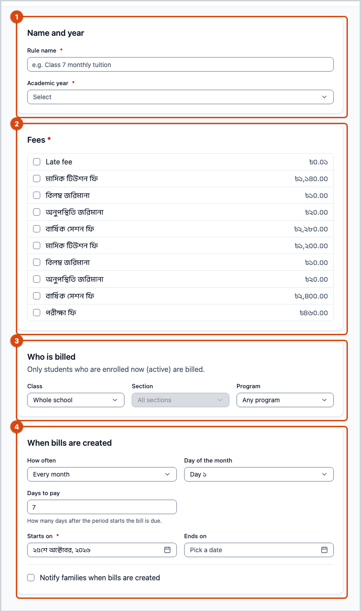
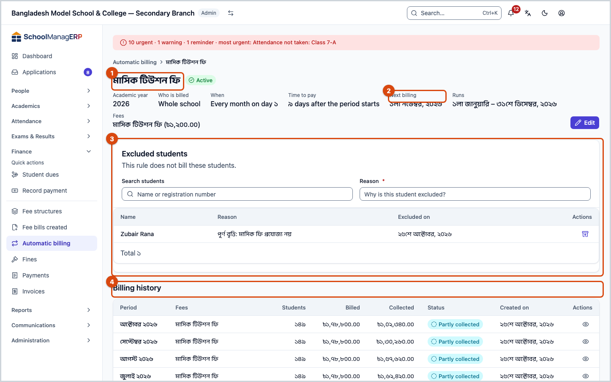

<!-- guide:meta
feature: finance.recurringSchedules
title: Automatic billing rules
summary: Set a rule so fee bills for active students are created on their own on a fixed day each month or week; exclude someone, switch a rule off, or copy it to a new academic year.
roles: [ADMIN, ACCOUNTANT]
sources:
  - client-admin/src/routes/_staff/fees/schedules/index.tsx
  - client-admin/src/routes/_staff/fees/schedules/$id.tsx
  - client-admin/src/routes/_staff/fees/schedules/-schedule-form-dialog.tsx
  - client-admin/src/routes/_staff/fees/schedules/-clone-dialog.tsx
  - client-admin/src/routes/_staff/fees/schedules/-exclusions-table.tsx
  - server/src/modules/fees/recurring-schedules.controller.ts
  - server/src/modules/fees/recurring-schedules.service.ts
  - server/src/modules/fees/fees-daily.scheduler.ts
  - server/src/modules/fees/dto/recurring-schedules.dto.ts
labels:
  [
    fees:schedules.*,
    nav:items.recurringSchedules,
    nav:items.scheduleDetail,
    nav:groups.finance,
  ]
helpIds:
  [
    finance.recurringSchedules,
    finance.recurringSchedules.action.add,
    finance.recurringSchedules.action.deactivate,
    finance.recurringSchedules.action.clone,
    finance.recurringSchedules.action.exclude,
    finance.recurringSchedules.field.rule,
    finance.recurringSchedules.field.dueDays,
    finance.recurringSchedules.field.audience,
  ]
devices: [desktop]
entry: [sidebar, palette]
keywords:
  [automatic billing, rule, monthly bill, weekly bill, schedule, exclude, recurring, automatic billing, monthly]
appVersion: 0.1.0 (a25ab3344)
owner: tareq89
lastVerified: 2026-10-25
knownIssues: []
-->

# Automatic billing rules

Set a rule so bills are created on their own every month or every week.

**Where to go:** in the left menu, **Finance → Automatic billing**. Do the work on this page on a computer.
**Before you start:** be an Admin or Accountant. The academic year must already have [**Fee structures**](fee-structures.md).

A **rule** says: which academic year, for whom, which fee, and on which day. When the day comes, the app creates bills just like [**Create bills**](generate-fees.md) does. Only active (currently enrolled) students are billed. Bills are made only once for each period.

[Add a rule](#task-main) · [Exclude someone](#task-exclude) · [Switch a rule off](#task-deactivate) · [Copy to a new year](#task-clone) · [Problems and fixes](#trouble)

**On this page**

- [Add a monthly billing rule](#task-main)
- [How to know the rule is saved](#confirm)
- [Other situations](#other)
  - [Change a rule](#task-edit)
  - [Exclude one student from a rule](#task-exclude)
  - [Switch a rule off or on again](#task-deactivate)
  - [Copy to a new academic year](#task-clone)
- [Problems and fixes](#trouble)
- [Who can do what](#roles)
- [Learn more](#more)

---

## Add a monthly billing rule 

1. In the left menu press **Finance**, then press **Automatic billing**.

   → The **Automatic billing** list opens: **Name**, **Who is billed**, **When**, **Next billing**, **Last billed**, **Status**.

2. At the top press **Add rule**.

   → The **New automatic billing rule** page opens.

3. Type the **Rule name**, for example `Class 7 monthly tuition`.
4. Choose the **Academic year**.
5. In **Fees**, tick one or more fees.
6. In the **Who is billed** part, choose a **Class**, or leave **Whole school**. If you like, narrow it further with **Section** and **Program**.
7. In the **When bills are created** part, keep **Every month**. From **Day of the month**, choose a date (1 to 28) or **Last day**.
8. Fill in **Days to pay**. It starts at 9, which means the money is due within 9 days after the period starts.
9. Check the **Starts on** and **Ends on** dates. The end date cannot be after the last day of the academic year.
10. If you do not want to tell families, untick **Notify families when bills are created**.

11. Press **Save**.

    → The page closes. The new rule appears in the list, with **Status** **Active**, and the next date under **Next billing**.

> **Remember:** the rules run every day at 12:30 a.m. (Dhaka time). So a rule for the 5th makes its bills at the very start of the night of the 5th. If you need bills today, create them yourself with [**Create bills**](generate-fees.md); when the rule runs later, anyone who already has a bill for that period is skipped.

---

## How to know the rule is saved 

| State                           | How you know                                                                 | What next      |
| ------------------------------- | ---------------------------------------------------------------------------- | -------------- |
| **Only typed on screen**        | The rule page is open; if you try to leave, a warning appears                | Press **Save** |
| **Reached the school's system** | The page closes, and the rule appears in the list with **Status** **Active** | You are done   |

This page does not keep anything separately on your phone or computer, so there is no "saved on this device" state.

**To see whether bills were made:** in the rule's row press **View**. Each round appears under **Billing history**. The round is also in the [**Fee bills created**](generate-fees.md#task-view) list, with **How created** = **Automatic billing**.

---

## Other situations 

### Change a rule 

1. In the rule's row in the list press **Edit**.

   → The **Edit automatic billing rule** page opens. The **Academic year** is locked: **The year can't be changed after saving.**

2. Change what you want, then press **Save**.

   → The change applies only to the next bills. Bills already created do not change.

When you press **View**, the part **Who gets billed now** shows **Applies to … students today**. It shows the saved rule, not unsaved changes.

### Exclude one student from a rule 

For example, a student does not use the transport service, so exclude them from the transport fee rule.

1. In the rule's row in the list press **View**.
2. In the **Excluded students** part, type a name or registration number in the **Search students** box and pick the student.
3. Type a **Reason**, then press **Exclude**.

   → The student appears in the list, with **Excluded on** beside them. This rule no longer bills them. Their earlier bills stay.

To add them back, press **Include again** in the student's row. They are billed again from the next period.

### Switch a rule off or on again 

1. In the rule's row in the list press **Deactivate**.

   → The **Deactivate this schedule?** window appears.

| What you pressed in the window | What happens                                                                          |
| ------------------------------ | ------------------------------------------------------------------------------------- |
| **Deactivate**                 | New bills stop being created. Earlier bills and the exclusion list stay as they were. |
| **Cancel**                     | Nothing changes.                                                                      |

To turn it on again press **Activate**. Bills are made again from the next scheduled day. This page has no button to delete a rule; if you do not need one, leave it deactivated.

### Copy to a new academic year 

1. In the rule's row in the list press **Copy to another year**.

   → The **Copy this rule to another year** window opens.

2. Choose the **Academic year**, then press **Copy**.

   → A rule is made for the whole of the new year, with the same fees, the same students and the same days.

Before you copy, have classes with the same names and fee structures with the same names and types ready in the new year. A fee that has no match in the new year is not copied. If a class or section has no match, the rule is made **Inactive**; open it, fix it and press **Activate**. You cannot copy to the same academic year, because the same student would be billed twice.

---

## Problems and fixes 

| What you see                                       | What to do                                                                                                                             | Who can help |
| -------------------------------------------------- | -------------------------------------------------------------------------------------------------------------------------------------- | ------------ |
| **Name is required**                               | Type a **Rule name** (up to 100 characters).                                                                                           | —            |
| **Select at least one fee**                        | Tick at least one fee in **Fees**. If the list is empty, first add a [**fee structure**](fee-structures.md#task-main).                 | Accountant   |
| **Select at least one day**                        | If you chose **Every week**, tick at least one day in **Days of the week**.                                                            | —            |
| **Days to pay must be between 0 and 60**           | Type a number from 0 to 60.                                                                                                            | —            |
| **Could not save this schedule. Try again.**       | Check your internet. Make sure the start date is not after the end date, and that the class and fees are from the same academic year.  | Admin        |
| **Couldn't copy this rule. Try again.**            | Choose a different academic year; copying into the same year does not work.                                                            | Admin        |
| **Couldn't change this rule's status. Try again.** | Check your internet and press again.                                                                                                   | Admin        |
| **That rule no longer exists.**                    | Someone else may have removed it. Reload the list.                                                                                     | Admin        |
| **Couldn't load automatic billing rules**          | Reload the page.                                                                                                                       | Admin        |
| The rule's day has passed, but no bills were made  | Check that the rule is **Active**, that today is between its start and end dates, and that it covers some active students.             | Admin        |
| One student did not get a bill                     | Check whether they are on the excluded list, or are inactive. If needed, bill them yourself with [**Create bills**](generate-fees.md). | Accountant   |

---

## Who can do what 

| Role                                                                           | See rules | Add, change, exclude, switch off and copy |
| ------------------------------------------------------------------------------ | --------- | ----------------------------------------- |
| Admin                                                                          | Yes       | Yes                                       |
| Accountant                                                                     | Yes       | Yes                                       |
| Academic coordinator, Teacher, Office staff, Exam controller, Committee member | No        | No                                        |

**Admin and Accountant:** both can do everything on this page. No approval is needed here, because a rule never touches earlier bills.

**Automatic billing** is not in the left menu of the other roles.

---

## Learn more 

<strong>Parts of the page</strong> — the rule's page (after you press View)

1. The rule's name, its **Status** and **Edit**.
2. The facts — **Academic year**, **Who is billed**, **When**, **Time to pay**, **Runs**, **Fees**, **Next billing**.
3. **Excluded students** — the search box, **Reason**, **Exclude**; the list below.
4. **Billing history** — every round made by this rule, with **View bills** beside it.

<strong>What each field means</strong>

| Field                                       | Meaning                                                                                                            |
| ------------------------------------------- | ------------------------------------------------------------------------------------------------------------------ |
| **Rule name**                               | The name shown in the list; up to 100 characters. Required.                                                        |
| **Academic year**                           | Which year the rule is for. It can be chosen only when creating.                                                   |
| **Fees**                                    | Which fee structures are billed. They must be from the same academic year. At least one.                           |
| **Who is billed** (Class, Section, Program) | Who is billed. **Whole school** means every active student of the year. If you give a section, give the class too. |
| **How often**                               | **Every month** or **Every week**.                                                                                 |
| **Day of the month**                        | Day 1 to 28, or **Last day**. There is no 29–31, so that the day exists in every month.                            |
| **Days of the week**                        | One or more days; a bill is made only once a week.                                                                 |
| **Days to pay**                             | Within how many days after the period starts the money is due; 0 to 60, 9 at the start.                            |
| **Starts on** / **Ends on**                 | The rule runs only between these dates. The end date is not after the last day of the academic year.               |
| **Notify families when bills are created**  | When ticked, families get a message when bills are made. Ticked at the start.                                      |

<strong>How automatic billing runs</strong> — when, for whom, and why nobody is billed twice

<figure>
  
  <figcaption><em>How automatic billing runs</em></figcaption>
</figure>

- **Once for each period:** the app remembers which period has been billed. It does not run again in the same month.
- **If an earlier bill exists:** if a student already has a bill for the same fee in that period (for example, you created it yourself), they do not get another.
- **The money:** the bill's amount comes from the fee structure of that day. If the student has a discount rule, the discount is applied too.
- **Active students only:** inactive or excluded students are not billed.

<strong>Short help for the boxes (the (?) button)</strong>

<!-- guide:generated:fields:fees -->

| Field                  | What to enter                                                                                          | Required? |
| ---------------------- | ------------------------------------------------------------------------------------------------------ | --------- |
| Overdue only           | Shows only the students who have a fee past its reminder date. Leave it off to see everyone with dues. | No        |
| When bills are created | Every month on a day you pick (or the last day), or every week on the days you pick.                   | Yes       |
| Days to pay            | How many days after the period starts the bill is due. A number from 0 to 60.                          | Yes       |
| Who is billed          | The whole school, or one class, section or program. Only students who are enrolled now are billed.     | No        |

<!-- /guide:generated -->

**Related pages**

- [**Fee structures**](fee-structures.md) — the rule's fees come from here.
- [**Create bills**](generate-fees.md) — create one month's bills yourself, and see the rounds.
- [**Programs**](../people/programs.md) — a program can narrow the rule's scope.
- [**Student dues**](dues.md) — see who owes what

---

_Version 0.1.0 · last verified 2026-10-25_
