<!-- guide:meta
feature: help.cantSeeThis
title: Why can't I see this?
summary: A page missing from the menu, an empty list or a missing widget? Check your role, permission, section duty, school, academic year and dashboard layout one by one.
roles: [TEACHER, ADMIN, EXECUTIVE, ACCOUNTANT, OFFICE_STAFF, EXAM_CONTROLLER, COMMITTEE, PARENT, STUDENT]
sources:
  - client-admin/src/nav-tree.ts
  - client-admin/src/routes/_staff.tsx
  - ui/src/components/tenant-bar.tsx
  - server/src/modules/classes/teacher-scope.service.ts
  - ui/src/i18n/locales/en/common.json
  - ui/src/i18n/locales/en/nav.json
  - ui/src/i18n/locales/en/dashboard.json
labels: [common:accessDenied.*, nav:tenantBar.*, dashboard:states.allHidden.*]
helpIds: [help.cantSeeThis]
devices: [desktop, phone]
entry: [sidebar]
keywords:
  [দেখতে পাচ্ছি না, মেনুতে নেই, অনুমতি নেই, তালিকা খালি, শাখা দেখছি না, লুকানো, ভূমিকা, শিক্ষাবর্ষ, permission, access denied, missing menu, hidden]
appVersion: 0.1.0 (21aad534a)
owner: tareq89
lastVerified: 2026-10-25
knownIssues: []
-->

# Why can't I see this?

A page is missing from the menu, a button is missing, a list is empty, or a widget is missing from the dashboard? Most of the time this is not a mistake. The app shows each person only the things for their work. Go through the questions below in order. The first one where the answer is "no" is your answer.

<figure>
  
</figure>

**On this page**

- [Find it in five questions](#steps)
- [Why this happens](#why)
- [See also](#more)

---

## Find it in five questions 

1. **Are you in the right role?**
   One person can have more than one role in the same school, for example teacher and accountant. The app shows only the pages of the role selected now. <!-- source: client-admin/src/routes/_staff.tsx (activeRole); ui/src/i18n/locales/en/nav.json tenantBar.switchRole -->
   - **If not:** Pick the other role from the **Switch school or role** menu at the top. Which role sees what: [Roles and permissions](../administration/roles.md#matrix).
   - If you are a guardian or a student, you do not see the staff pages. If you open a link to a staff page, the app takes you to your own portal. <!-- source: client-admin/src/routes/_staff.tsx (RequireRole) -->

2. **Does your role have permission for this work?**
   Almost every page in the menu needs a permission. If the role does not have it, the page does not appear in the menu at all. The same rule applies to the bottom menu on a phone. <!-- source: client-admin/src/nav-tree.ts (permission); client-admin/src/routes/_staff.tsx (hasPermission filter) --> If you open the page directly from a link, the screen says **You don't have access to this page.** <!-- source: ui/src/i18n/locales/en/common.json accessDenied.title -->
   - **If not:** Ask the school admin. The permissions of each role are fixed, and you cannot make your own. If needed, the admin will give you another role. See [Roles and permissions](../administration/roles.md). <!-- source: docs/user-guide/en/administration/roles.md#trouble -->

3. **If you are a teacher, have you been given a section duty?**
   A teacher sees only the students, attendance and marks of the sections given to them. With no duty, the lists are empty, and the attendance page says **No sections assigned yet**. <!-- source: server/src/modules/classes/teacher-scope.service.ts; docs/user-guide/en/attendance/attendance.md#trouble -->
   - **If not:** The admin gives you a section from the [Giving teachers class and section duties](../people/teaching-assignments.md) page. The duty must be for a class in the current academic year. <!-- source: docs/user-guide/en/people/teaching-assignments.md#after -->

4. **Is the right school selected?**
   Each branch is a separate school in the app. Students, fees or staff of one school are not shown in another. <!-- source: docs/user-guide/en/admin/how-it-works.md#task-branches -->
   - **If not:** Pick the right school from the **Switch school or role** menu at the top. When you switch, the pages you had open in the old school close. <!-- source: ui/src/i18n/locales/en/nav.json tenantBar.confirmDescription; ui/src/components/tenant-bar.tsx --> More: [If you are in more than one school](../start/sign-in.md#task-school), [A school and its branches](../admin/how-it-works.md#task-branches).

5. **Are you looking at the right academic year?**
   Classes, fee structures, admissions and exams all live inside one academic year. When you open a list, the app usually picks the **current** year first. <!-- source: docs/user-guide/en/academics/academic-years.md -->
   - **If not:** If the page has an **Academic year** box (for example the page for creating fee bills), pick the right year there. <!-- source: docs/user-guide/en/finance/generate-fees.md#trouble --> When a new year starts, the admin makes the new year the current one: [Change the current academic year](../academics/academic-years.md#task-current).

**All five are "yes", but a widget is missing from the dashboard?**
You may have hidden the widget yourself. Each role keeps its own layout, saved separately. <!-- source: docs/user-guide/en/dashboard/customise.md#trouble --> If everything is hidden, the screen says **All widgets are hidden**. <!-- source: ui/src/i18n/locales/en/dashboard.json states.allHidden.title --> Press **Customise**, tick it in the hidden list, then press **Save**: [Customise the dashboard](../dashboard/customise.md#task-main). If the widget is not in the hidden list either, it is not for your role. <!-- source: docs/user-guide/en/dashboard/customise.md#trouble -->

**If it is still not fixed:** Tell the school admin: which page or thing you are looking for, and which role and school you are in. See [What to do when something goes wrong](troubleshooting.md#help).

---

## Why this happens 

- **The role decides who sees what.** The admin sees everything. A teacher sees their own sections, an accountant sees fees and payments, and guardians and students see only their own information. <!-- source: docs/user-guide/en/admin/how-it-works.md#task-roles -->
- **This is for safety.** No one sees another section's students, or another school's money records, even by mistake.
- **If it looks wrong,** do not change anything yourself. Tell the admin. What the words mean: [Role](glossary.md#role), [Teacher assignment](glossary.md#teacher-assignment), [Academic year](glossary.md#academic-year).

---

## See also 

- [What to do when something goes wrong](troubleshooting.md): fixes by the message on the screen.
- [Roles and permissions](../administration/roles.md): what each role can do.
- [Giving teachers class and section duties](../people/teaching-assignments.md): which sections a teacher sees.
- [Finding any page](../start/find-anything.md): open a page by typing its name.

---

_Version 0.1.0 · Last verified 2026-10-25_
