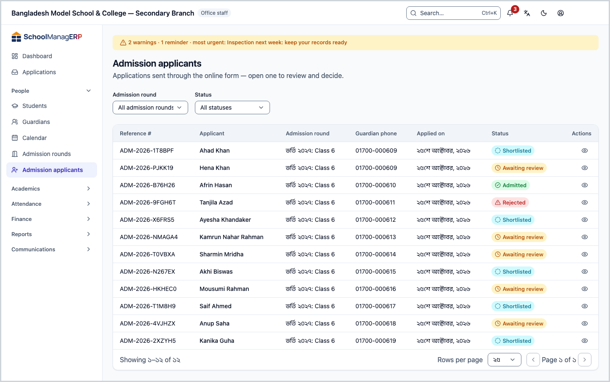
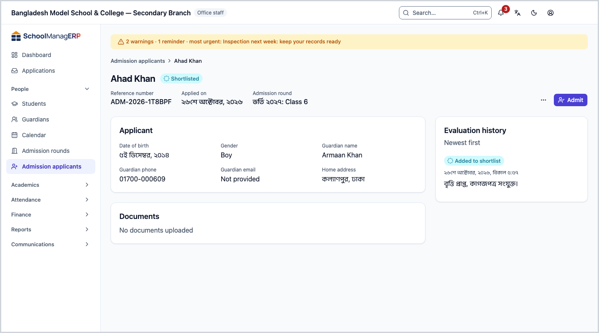
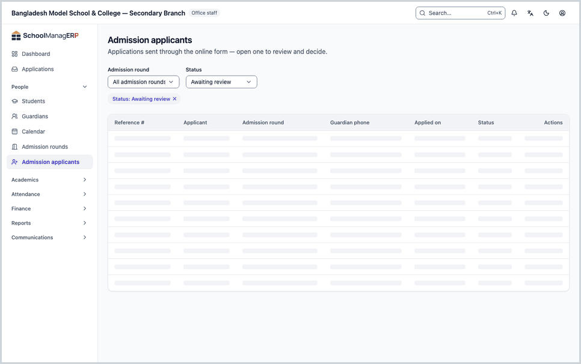

<!-- guide:meta
feature: people.admissionApplicants
title: Reviewing admission applications and admitting students
summary: Open applications submitted online, check the documents, add them to the shortlist, then admit or reject them.
roles: [ADMIN, OFFICE_STAFF]
sources:
  - client-admin/src/routes/_staff/admissions/applicants/index.tsx
  - client-admin/src/routes/_staff/admissions/applicants/$applicantId.tsx
  - client-admin/src/features/admission/ApplicantList.tsx
  - client-admin/src/features/admission/ApplicantDetail.tsx
  - client-admin/src/features/admission/AdmitApplicantModal.tsx
  - client-admin/src/features/admission/EvaluateApplicantForm.tsx
  - client-admin/src/features/admission/applicantStatus.ts
  - server/src/modules/admission/applicant-review.controller.ts
  - server/src/modules/admission/applicant-review.service.ts
  - server/src/modules/admission/admission-notification.service.ts
labels:
  [
    admission-staff-applicants:list.*,
    admission-staff-applicants:detail.*,
    admission-staff-applicants:evaluate.*,
    admission-staff-applicants:admitModal.*,
    nav:items.admissionApplicants,
    nav:groups.people,
    common:accessDenied.*,
    common:actions.cancel,
    common:actions.retry,
    common:actions.moreActions,
  ]
helpIds:
  [
    people.admissionApplicants,
    people.admissionApplicants.action.shortlist,
    people.admissionApplicants.action.admit,
    people.admissionApplicants.action.reject,
    people.admissionApplicants.action.deleteDocuments,
    people.admissionApplicants.field.guardianChoice,
    people.admissionApplicants.field.notes,
  ]
devices: [desktop]
entry: [sidebar, palette, page:people.admissionIntakes]
keywords:
  [applicant, admission, admission application, shortlist, admit, reject, reference number, guardian]
appVersion: 0.1.0 (fb8af6c63)
owner: tareq89
lastVerified: 2026-10-24
knownIssues: []
-->

# Reviewing admission applications and admitting students

Open an application submitted online, then admit the child or turn the application down.

**Go to:** **People → Admission applicants** in the left menu. Do the work on this page on a computer.
**Before you start:** be an Admin or Office staff ([who can do what](#roles)). Applications arrive from the guardian's online form while an [Admission round](admission-intakes.md) is open.

Every application has a **Status**: **Awaiting review** (new), **Shortlisted**, **Admitted** or **Rejected**. The last two are final; you cannot go back from them. Pressing **Admit** creates a real student.

[Open an application and admit](#task-main) · [Add to shortlist](#task-shortlist) · [Reject](#task-reject) · [Problems and fixes](#trouble)

**On this page**

- [How you get here](#arrive)
- [Open an application and admit](#task-main)
- [How to tell the child was admitted](#confirm)
- [Other situations](#other)
  - [Filter the list](#task-find)
  - [When the phone number matches an earlier guardian](#task-guardian)
  - [Add to shortlist](#task-shortlist)
  - [Add a note](#task-note)
  - [Reject an application](#task-reject)
  - [Delete the documents of a rejected application](#task-delete-docs)
  - [What the guardian can learn](#task-notify)
- [Problems and fixes](#trouble)
- [Who can do what](#roles)
- [Learn more](#more)

---

## How you get here 

**From the left menu:** press **People → Admission applicants**. Start at step 1 below.

**From search:** in the search box at the top (Ctrl+K) type **Admission applicants** and choose it. How search works: [Find any page](../start/find-anything.md).

**From the admission rounds page:** in the [Admission rounds](admission-intakes.md) list, at the end of a row, or at the top of a round's page, press **View applicants**. → This page opens with that round already chosen in the **Admission round** filter. Start at step 2.

---

## Open an application and admit 

1. In the left menu press **People → Admission applicants**.

   → The heading **Admission applicants** appears, and under it "Applications sent through the online form — open one to review and decide." The list columns are **Reference #**, **Applicant**, **Admission round**, **Guardian phone**, **Applied on**, **Status**. New applications are at the top.

2. At the end of the row of the application you want, press **View**.

   → The application page opens. At the top are the child's name, the status badge, and the **Reference number**, **Applied on** and **Admission round**.

3. In the **Applicant** card check the details: **Date of birth**, **Gender**, **Guardian name**, **Guardian phone**, **Guardian email**, **Home address**. Anything the guardian left out says **Not provided**.

4. In the **Documents** card press **Open** next to each document.

   → The document opens in a new tab. With none, it says **No documents uploaded**.

5. At the top press **Admit**.

   → The **Admit applicant** dialog opens: "Admitting creates a student record and links or creates a guardian by phone number." Below are **Guardian name** and **Guardian phone**.

6. Look at what the dialog says:

   - "If a guardian with this phone number already exists, they'll be linked instead of creating a duplicate." → No guardian has this number yet. Go to step 7.
   - A box that says **Existing guardian: …** → A guardian with this number already exists. First [choose one](#task-guardian), then step 7.

7. In the dialog press **Admit**.

   → The dialog shows **{name} has been admitted.** Press **Close**. The page status becomes **Admitted** and the action buttons go away.

| You pressed | What happens                                                                                                                                                                   | Can you undo it? |
| ----------- | ------------------------------------------------------------------------------------------------------------------------------------------------------------------------------ | ---------------- |
| **Admit**   | A new student is created in the round's section; the registration and roll numbers are filled in automatically; the guardian is linked or created; an SMS goes to the guardian | No               |
| **Cancel**  | Nothing changes                                                                                                                                                                | —                |

> **Remember:** an admission cannot be undone. If you admitted by mistake, deal with it from the student's profile: [Students](students.md). When the seats are full, nobody else can be admitted; raise **Seat count** on the [Admission round](admission-intakes.md#task-edit). You can admit an application that is still **Awaiting review**; shortlisting first is not required.

---

## How to tell the child was admitted 

A decision is saved only while you are online; it cannot be kept on the device and sent later.

| State                           | How you know                                                                          | What next                                              |
| ------------------------------- | ------------------------------------------------------------------------------------- | ------------------------------------------------------ |
| **Changed only on the screen**  | The **Admit applicant** dialog is open and **{name} has been admitted.** has not come | Press **Admit** in the dialog                          |
| **Reached the school's system** | **{name} has been admitted.** appeared and the page status is **Admitted**            | Find the name in the students list and check the class |

**To check:** go to [Students](students.md) and search for the child's name; the child will be in the round's section. The **Evaluation history** also shows **Admitted**.

**If no message came:** if the dialog says **Failed to admit applicant**, nothing was created; see [Problems and fixes](#trouble).

---

## Other situations 

### Filter the list 

Two fields above the list:

| Field               | What to choose                                                                                                   |
| ------------------- | ---------------------------------------------------------------------------------------------------------------- |
| **Admission round** | One round. If you choose none, it says **All admission rounds**                                                  |
| **Status**          | **Awaiting review**, **Shortlisted**, **Admitted** or **Rejected**. If you choose none, it says **All statuses** |

Before you start work, choose **Awaiting review** under **Status** to see only the applications nobody has looked at yet. With no applications at all, it says **No applications yet**.

### When the phone number matches an earlier guardian 

This often happens when a brother or sister already studies at the school. The app does not join anything by itself; you have to choose.

1. In the **Admit applicant** dialog read the box: **Existing guardian: {name}, {phone}.** and their children's names (**Children: …**), or **No children linked yet.**

2. Under **This phone number already belongs to a guardian** choose one:

   | Choice                                   | When to choose it                                                   | What happens                                                             |
   | ---------------------------------------- | ------------------------------------------------------------------- | ------------------------------------------------------------------------ |
   | **Link this child to this family**       | The name in the box and the children belong to this child's family  | The new student is linked to that guardian                               |
   | **Create a new guardian for this child** | Same number but a different family (for example a relative's phone) | A separate new guardian is created from the application's name and phone |

   → **Admit** cannot be pressed until you choose one.

3. In the dialog press **Admit**.

If the earlier guardian could not be looked up, the box says **Could not check for an existing guardian. Try again before admitting.**; press **Retry** next to it. You cannot admit until the check finishes.

### Add to shortlist 

Shortlist the children you will call for an admission test or interview. The button appears only on applications that are **Awaiting review**.

1. At the top of the application page press **Add to shortlist**.

   → A dialog with the same name opens, with a **Note** field.

2. In **Note** write the reason or next step, for example `Interview Friday 10 am`. **Save** cannot be pressed without a note.

3. Press **Save**.

   → The dialog closes, the status becomes **Shortlisted**, and the **Evaluation history** shows the note with **Added to shortlist**. An SMS goes to the guardian's mobile.

### Add a note 

To write something down without changing the status (for example "Guardian was phoned"):

1. At the top of the application page open the **More actions** menu and press **Add note**.
2. Write the **Note** and press **Save**.

   → The text appears in **Evaluation history** with the **Note** badge, newest on top. The guardian is not told anything.

A note can be added only while the status is **Awaiting review** or **Shortlisted**.

### Reject an application 

1. At the top of the application page open the **More actions** menu and press **Reject**.

   → The **Reject applicant** dialog opens: "{name} will be told the application was not accepted. This cannot be undone."

2. If you want, write a reason in **Reason (optional)**. The reason stays in the history inside the school; the guardian does not see it.

3. In the dialog press **Reject**.

| You pressed | What happens                                                                                      | Can you undo it? |
| ----------- | ------------------------------------------------------------------------------------------------- | ---------------- |
| **Reject**  | Status becomes **Rejected**; the history shows **Rejected**; an SMS goes to the guardian's mobile | No               |
| **Cancel**  | Nothing changes                                                                                   | —                |

### Delete the documents of a rejected application 

You should not keep a child's birth certificate or photo you no longer need. When a rejected application still has documents, a **Delete documents** button appears under the **Documents** card.

1. Press **Delete documents**.

   → The dialog says: "All uploaded documents of this rejected applicant will be permanently removed from storage. This cannot be undone."

2. In the dialog press **Delete documents**.

   → All documents are removed; the card says **No documents uploaded**. The rest of the application stays.

### What the guardian can learn 

| Your decision             | SMS to the guardian                                                                  | What the guardian sees on the status page |
| ------------------------- | ------------------------------------------------------------------------------------ | ----------------------------------------- |
| Nothing (new application) | None                                                                                 | **Being reviewed**                        |
| **Add to shortlist**      | The application is provisionally selected; the next step will be told                | **Shortlisted**                           |
| **Admit**                 | Selected for admission; asked to contact the school office to complete the admission | **Admitted**                              |
| **Reject**                | The application was not successful this time                                         | **Not accepted**                          |
| **Add note**              | None                                                                                 | No change                                 |

If the school has no SMS balance, the message does not go, but the decision is still saved. How a guardian checks their status: [How a guardian checks the application status](admission-intakes.md#task-status).

<!-- unverified: whether staff can see a failed/unsent SMS for an admission decision anywhere in the communications log UI -->

---

## Problems and fixes 

| What you see                                                              | What to do                                                                                                                                                                                                                                                      | Who can help |
| ------------------------------------------------------------------------- | --------------------------------------------------------------------------------------------------------------------------------------------------------------------------------------------------------------------------------------------------------------- | ------------ |
| **You don't have access to this page.**                                   | Only Admin and Office staff see applicants. Press **Back to dashboard**.                                                                                                                                                                                        | Admin        |
| **Failed to load admission applicants**                                   | Check your internet and reload the page.                                                                                                                                                                                                                        | Admin        |
| **Failed to load applicant**                                              | Press **Try again**. If it keeps coming, go back to the list and open it again.                                                                                                                                                                                 | Admin        |
| **Failed to admit applicant**                                             | Check whether the round's seats are full (raise **Seat count** on the [Admission round](admission-intakes.md#task-edit)). Reload the page to see whether someone else decided at the same time. If the guardian choice changed, close the dialog and reopen it. | Admin        |
| **Could not check for an existing guardian. Try again before admitting.** | Press **Retry** next to it.                                                                                                                                                                                                                                     | Admin        |
| **Failed to record evaluation**                                           | Reload the page and look at the status: someone may have admitted or rejected in the meantime. If not, press **Save** again.                                                                                                                                    | Admin        |
| **Failed to reject applicant**                                            | Reload the page and look at the status, then try again.                                                                                                                                                                                                         | Admin        |
| **Could not open the document. Try again.**                               | Press **Open** again. Check whether your browser is blocking the new tab.                                                                                                                                                                                       | Admin        |
| **Could not delete the documents. Try again.**                            | Check your internet and press **Delete documents** again.                                                                                                                                                                                                       | Admin        |
| There is no **Add to shortlist** button                                   | The application is no longer **Awaiting review**. A shortlisted application is admitted directly with **Admit**.                                                                                                                                                | —            |
| There are no action buttons at all                                        | The application is **Admitted** or **Rejected**; both are final.                                                                                                                                                                                                | —            |

---

## Who can do what 

| Role                                                                         | See the list and applications | Note, shortlist, admit, reject | Delete documents |
| ---------------------------------------------------------------------------- | ----------------------------- | ------------------------------ | ---------------- |
| Admin                                                                        | Yes                           | Yes                            | Yes              |
| Office staff                                                                 | Yes                           | Yes                            | Yes              |
| Academic coordinator, Teacher, Accountant, Exam controller, Committee member | No                            | No                             | No               |

**Admin** and **Office staff** can do exactly the same on this page. Someone without permission who opens the page sees **You don't have access to this page.**, and **Admission applicants** is not in their left menu.

---

## Learn more 

<strong>The parts of the page</strong> — the application page, top to bottom

1. **Name and status** — the child's name, the status badge, **Reference number**, **Applied on**, **Admission round**.
2. **Action buttons** — **Add to shortlist** (only when awaiting review), **Admit**, and in the **More actions** menu **Add note** and **Reject**.
3. **Applicant** — the child's and guardian's details.
4. **Documents** — the uploaded documents, **Open** beside each.
5. **Evaluation history** — "Newest first"; every decision and note with date and time. With nothing, it says **No evaluations recorded yet**.

<strong>What the fields mean</strong>

<!-- guide:generated:fields:admission-staff-applicants -->

| Field                                           | What to enter                                                                                                               | Required?                    |
| ----------------------------------------------- | --------------------------------------------------------------------------------------------------------------------------- | ---------------------------- |
| Note                                            | The reason for the shortlist or note, or the next step. It stays in the history inside the school only.                     | Yes                          |
| Reason (optional)                               | Why you are rejecting. The guardian does not see it.                                                                        | No                           |
| This phone number already belongs to a guardian | "Link" if it is the same family, "Create a new guardian" if it is a different family. Appears only when the number matches. | Yes, when the number matches |

<!-- /guide:generated -->

<strong>How an application's status changes</strong>

<figure>
  
  <figcaption><em>From awaiting review to admitted or rejected</em></figcaption>
</figure>

- **Admitted** and **Rejected** are final; no buttons remain after them.
- If two people decide on the same application at the same time, only one decision counts; the other person gets an error message.
- An admitted student is counted by year on [Admission reports](admission-reports.md).

<strong>The whole task in one go</strong>

<figure>
  
  <figcaption><em>From opening an application to admitting the student</em></figcaption>
</figure>

**Related pages**

- [**Admission rounds**](admission-intakes.md) — seats, dates and the guardian's online form.
- [**Admission reports**](admission-reports.md) — how many were admitted in a year and how many left.

---

_Version 0.1.0 · Last checked 2026-10-24_
