<!-- guide:meta
feature: people.admissionClerkEntry
title: Entering an application for a guardian who comes to the office
summary: Fill an admission application at the office for a walk-in guardian, with papers and the fee, and get a reference number.
roles: [ADMIN, OFFICE_STAFF]
sources:
  - client-admin/src/routes/_staff/admissions/applicants/new.tsx
  - client-admin/src/features/admission/desk/ClerkEntryPage.tsx
  - client-admin/src/features/admission/desk/ApplicantsPanel.tsx
labels: [admission-desk:clerk.*, admission-desk:applicantsPanel.newApplication]
helpIds: [people.admissionClerkEntry]
devices: [desktop]
entry: [page:people.admissionIntakes]
keywords: [walk-in, clerk entry, new application, admission, office, reference number]
appVersion: 0.1.0 (fb8af6c63)
owner: tareq89
lastVerified: 2026-11-16
knownIssues: []
-->

# Entering an application for a guardian who comes to the office

A guardian who cannot apply online comes to the office. You fill the same application for them.

**Go to:** **People → Admission rounds**, open the round, then in "Applications" press **New application**. Do this on a computer.
**Before you start:** be an Admin or Office staff ([who can do what](#roles)). The round must exist ([Admission rounds](admission-intakes.md)). Have the guardian's papers and fee slip at hand.

The boxes on this form are exactly the boxes the round asks for, so two rounds can show different forms.

[Enter an application](#task-main) · [Enter another](#task-another) · [Problems and fixes](#trouble)

<figure>
  
  <figcaption><em>From the office desk to the fee check</em></figcaption>
</figure>

---

## How you get here 

**From the admission desk:** open the round from the [Admission rounds](admission-intakes.md) list. In the "Applications" step press **New application**. The round is already chosen.

---

## Enter an application 

1. Press **New application**. If the round is not chosen, pick it in **Admission round**.

   → The page **New application** opens with the boxes of that round, for example the child's name, date of birth, gender and guardian phone.

2. Fill the boxes. The guardian phone has 11 digits and starts with 01. A box marked with a red line says what is wrong, for example **This box must be filled.**

3. Add the papers the round asks for (for example **Photo**, **Birth certificate**). If the guardian did not bring them, tick **Add documents later**.

4. If the round has a fee, fill **Application fee**: **Sent by** (for example bKash), **Payment reference (optional)** and **Proof of payment (photo or PDF)**.

   → Without the way it was sent and the proof, the application is not saved.

5. Press **Save application**, or press Ctrl and Enter in any box.

   → The page says **Application saved. Reference: …**. Give this number to the guardian.

> **Remember:** the application joins no list until its fee is checked: [Checking an application fee](admission-fee-verify.md).

---

## How to tell it was saved 

- The message **Application saved. Reference: …** shows the reference number.
- The application appears in the round's "Applications" step. If the round has a fee, it waits in the fee queue.

---

## Other situations 

### Enter another application 

Press **Enter another**. The boxes are cleared and the same round stays chosen.

### The last date has passed 

A tick box says **The last date has passed. Take this application anyway.** Tick it only if the school decides to take the application.

### The payment reference was used before 

The page says **This payment reference was used before. The application is saved; check the fee file carefully.** Nothing is lost; look at the proof closely when you check the fee.

---

## Problems and fixes 

| What you see | What to do | Who can help |
| --- | --- | --- |
| **Could not save the application. Try again.** | Check the internet and press **Save application** again. | Admin |
| **This box is not part of the round.** | Pick the right **Admission round**. | Admin |
| **This box is not right. Check it.** | Read the help line under the box and fix the value. | — |
| You cannot find **New application** | Your role may not review admissions. | Admin |

---

## Who can do what 

| Role | Enter an application |
| --- | --- |
| Admin | Yes |
| Office staff | Yes |
| Other roles | No |

---

## Learn more 

<strong>The same person on the website</strong>

A guardian can also apply online on the school website. Both ways give the same application with the same reference number: [Admission rounds](admission-intakes.md#task-site).

**Related pages**

- [**Admission rounds**](admission-intakes.md) — create the round and see its desk.
- [**Checking an application fee**](admission-fee-verify.md) — the next step for an application with a fee.
- [**Admission applicants**](admission-applicants.md) — review and admit.

---

_Version 0.1.0 · Last checked 2026-11-16_
