<!-- guide:meta
feature: people.admissionFeeVerify
title: Checking an application fee
summary: Open the fee proof of an application, then mark the fee ok or send it back with a reason, so the application can join a list.
roles: [ADMIN, OFFICE_STAFF]
sources:
  - client-admin/src/features/admission/desk/FeeVerifyDialog.tsx
  - client-admin/src/features/admission/desk/ApplicantsPanel.tsx
  - client-admin/src/features/admission/hooks/useFeeProofAttachment.ts
labels: [admission-desk:fee.*, admission-desk:applicantsPanel.*, admission-desk:desk.facts.feePending]
helpIds: [people.admissionFeeVerify]
devices: [desktop]
entry: [page:people.admissionIntakes]
keywords: [fee, verify fee, payment proof, bkash, nagad, fee check, admission]
appVersion: 0.1.0 (fb8af6c63)
owner: tareq89
lastVerified: 2026-11-16
knownIssues: []
-->

# Checking an application fee

An application with a fee joins no list until you say the fee is ok. Do this for each one.

**Go to:** **People → Admission rounds**, open the round, then in "Applications" press **Check fees**. Do this on a computer.
**Before you start:** be an Admin or Office staff ([who can do what](#roles)). Have your bKash, Nagad, Rocket or bank record open to compare.

[Check a fee](#task-main) · [Send a fee back](#task-back) · [Problems and fixes](#trouble)

<figure>
  
  <figcaption><em>Two outcomes of a fee check</em></figcaption>
</figure>

---

## How you get here 

**From the admission desk:** open the round from the [Admission rounds](admission-intakes.md) list. The card **Fee check pending** or the button **Check fees (3)** opens the queue **Fees waiting to be checked**.

---

## Check a fee 

1. In the queue, press **Check** at the end of a row.

   → A window opens: **Fee of …** and **Application …**. It shows the **Fee**, **Sent by**, **Reference** and the proof (**Fee proof**).

2. Compare the proof and the reference with your own payment record.

3. Press **Fee is ok**.

   → The window closes. The application now counts as **Fee ok** and can join the merit list.

> **Remember:** an application whose fee is not ok never gets a roll number or a place in a list.

---

## How to tell it worked 

- The row leaves the queue, and **Fee check pending** on the desk goes down by one.
- In [Admission applicants](admission-applicants.md) the application says **Fee ok** in the **Fee** column.

---

## Other situations 

### Send a fee back 

1. In the window, write the **Reason (needed only to send back)**. It can have up to 300 letters; the page counts them.
2. Press **Send back**.

   → The application says **Fee sent back**, and your reason shows in its fee history ([Admission applicants](admission-applicants.md)).

### The payment reference was seen before 

The window says **This payment reference was used before. Look at the file carefully.** It may be the same slip used twice. Look at the proof, then decide.

### The file does not open 

The window says **Could not open the file.** Close it and press **Check** again. If it still fails, send the fee back with a reason, or ask the guardian to bring the slip.

---

## Problems and fixes 

| What you see | What to do | Who can help |
| --- | --- | --- |
| **Could not save. Try again.** | Check the internet and press the button again. | Admin |
| **Could not open the file.** | Press **Check** again; if it still fails, send the fee back with a reason. | Admin |
| The queue is empty but an application has no list | Open it in [Admission applicants](admission-applicants.md); its fee may have no proof (**No fee proof**). | — |

---

## Who can do what 

| Role | Check a fee |
| --- | --- |
| Admin | Yes |
| Office staff | Yes |
| Other roles | No |

---

## Learn more 

<strong>Where the fee comes from</strong>

The fee amount and the ways to send it are set when you create the round ([Admission rounds](admission-intakes.md)). A guardian online or a clerk at the desk ([Entering an application](admission-clerk-entry.md)) gives the proof.

**Related pages**

- [**Entering an application**](admission-clerk-entry.md) — where a walk-in fee proof is taken.
- [**Admission applicants**](admission-applicants.md) — the **Fee** column and fee history.
- [**Admission rounds**](admission-intakes.md) — the fee and ways to send it.
- [**The admission desk, test marks and cut-off**](admission-stages.md) — the steps after fees.

---

_Version 0.1.0 · Last checked 2026-11-16_
