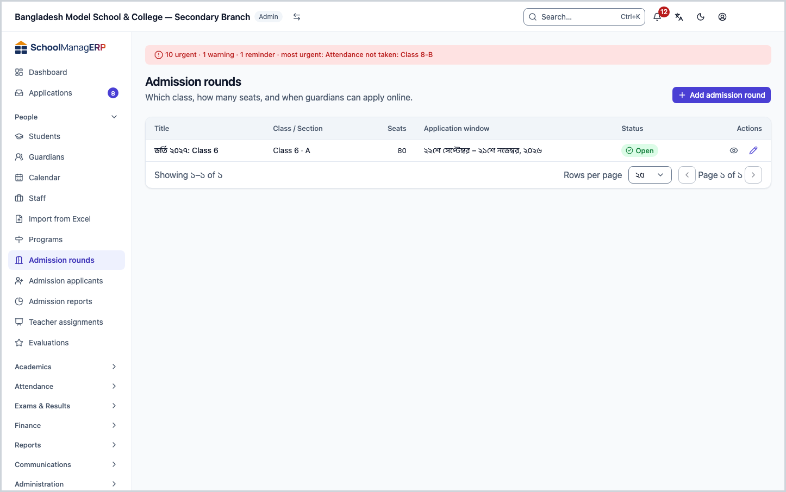
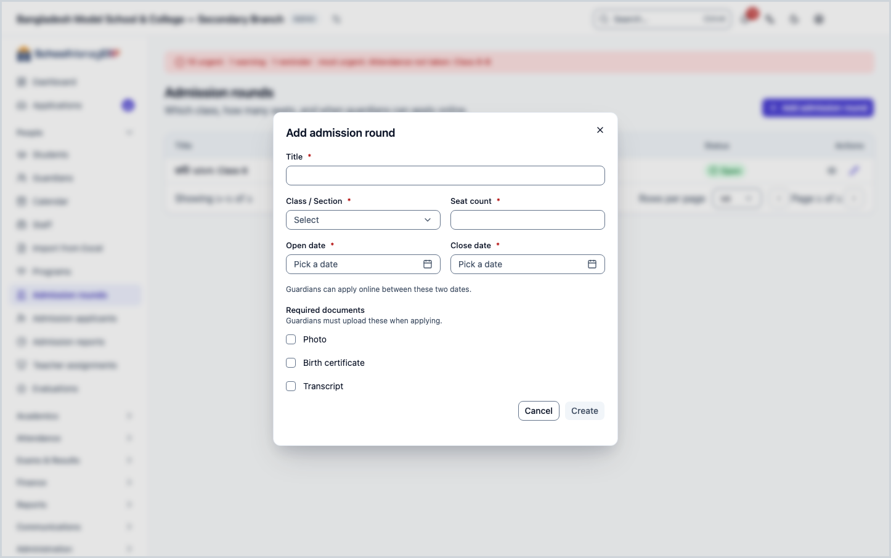
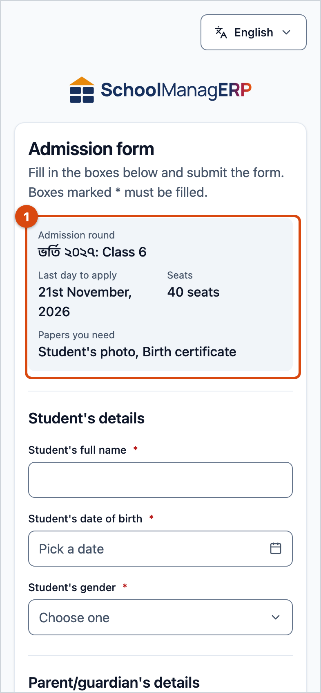
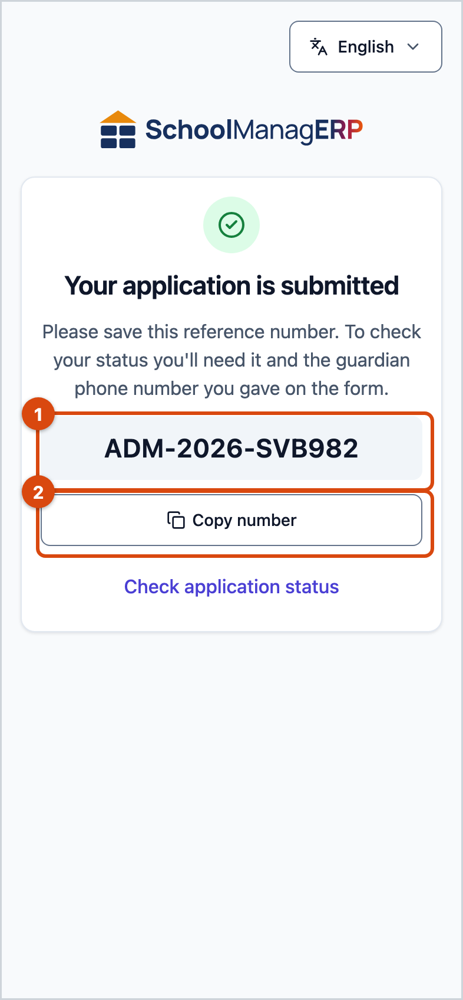
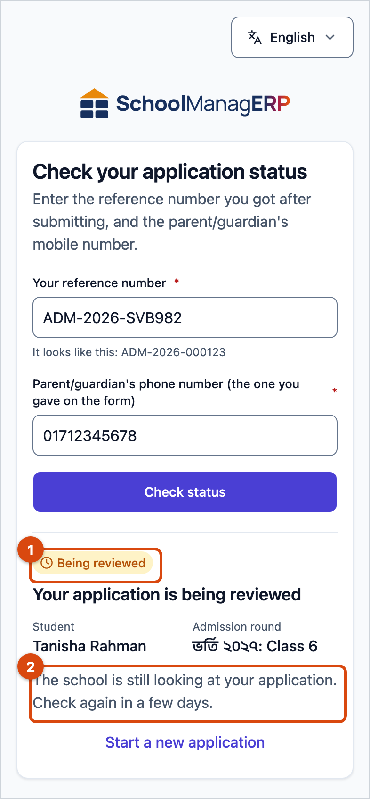
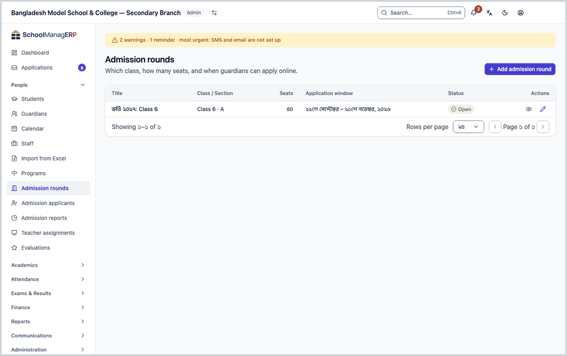
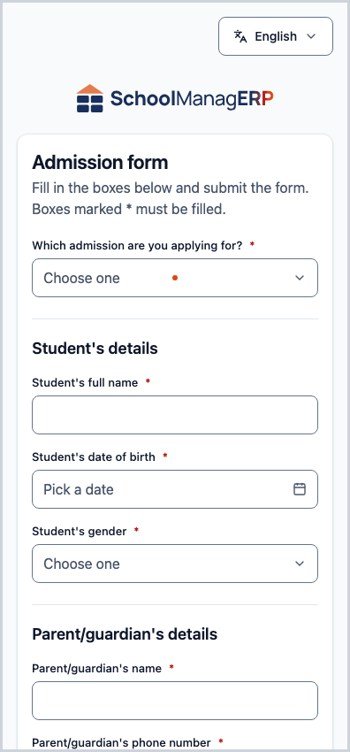

<!-- guide:meta
feature: people.admissionIntakes
title: Admission rounds and the online admission form
summary: Decide which class takes how many seats, and from when to when applications are open online; guardians fill in the form on their phone, get a reference number and check their application status later.
roles: [ADMIN, OFFICE_STAFF]
sources:
  - client-admin/src/routes/_staff/admissions/intakes/index.tsx
  - client-admin/src/routes/_staff/admissions/intakes/$intakeId.tsx
  - client-admin/src/routes/admission/$slug/index.tsx
  - client-admin/src/routes/admission/$slug/status.tsx
  - client-admin/src/features/admission/IntakeList.tsx
  - client-admin/src/features/admission/IntakeForm.tsx
  - client-admin/src/features/admission/PublicAdmissionForm.tsx
  - client-admin/src/features/admission/AdmissionConfirmation.tsx
  - server/src/modules/admission/intake.controller.ts
  - server/src/modules/admission/intake.service.ts
  - server/src/modules/admission/public-admission.controller.ts
  - server/src/modules/admission/admission-applicant.service.ts
labels:
  [
    admission-staff-intakes:list.*,
    admission-staff-intakes:createDialog.*,
    admission-staff-intakes:form.*,
    admission-staff-intakes:detail.*,
    admission-public:form.*,
    admission-public:confirmation.*,
    admission-public:status.*,
    nav:items.admissionIntakes,
    nav:groups.people,
    common:accessDenied.*,
    common:recordNotFound.*,
    common:actions.cancel,
  ]
helpIds:
  [
    people.admissionIntakes,
    people.admissionIntakes.action.add,
    people.admissionIntakes.field.classSection,
    people.admissionIntakes.field.seatCount,
    people.admissionIntakes.field.dates,
    people.admissionIntakes.field.requiredDocuments,
  ]
devices: [desktop]
entry: [sidebar, palette]
keywords:
  [admission, admission round, intake, online admission, admission form, apply, seats, reference number, application status]
appVersion: 0.1.0 (fb8af6c63)
owner: tareq89
lastVerified: 2026-10-24
knownIssues: []
-->

# Admission rounds and the online admission form

Open an admission round so guardians can apply for admission online, straight from their phone.

**Go to:** **People → Admission rounds** in the left menu. Set up rounds on a computer; the guardian's form works on a phone.
**Before you start:** be an Admin or Office staff ([who can do what](#roles)). The class and section you will admit into must already exist.

An **admission round** is one batch of admissions: which **Class / Section**, how many **Seats**, and from which date to which date applications are taken. While a round is open, guardians open the school's admission link and fill in the **Admission form**. Submitted applications go to the [Admission applicants](admission-applicants.md) page, and admitting one creates a student.

[Add an admission round](#task-main) · [Change a round or close it early](#task-edit) · [How a guardian applies](#task-public) · [Checking application status](#task-status) · [Problems and fixes](#trouble)

**On this page**

- [Add an admission round](#task-main)
- [How to tell the round was created](#confirm)
- [Other situations](#other)
  - [Change a round or close it early](#task-edit)
  - [See the applicants of one round](#task-applicants)
  - [How a guardian applies from a phone](#task-public)
  - [How a guardian checks the application status](#task-status)
  - [From application to admitted student](#task-flow)
- [Problems and fixes](#trouble)
- [Who can do what](#roles)
- [Learn more](#more)

---

## Add an admission round 

1. In the left menu press **People → Admission rounds**. You can also type **Admission rounds** in the search box (Ctrl+K).

   → The heading **Admission rounds** appears, and under it "Which class, how many seats, and when guardians can apply online." The list columns are **Title**, **Class / Section**, **Seats**, **Application window**, **Status**. With no rounds, it says **No admission rounds yet**.

2. At the top press **Add admission round**.

   → The **Add admission round** dialog opens. Fields marked with a star (\*) must be filled in.

3. In **Title** enter a name guardians will recognise, for example `Class 6 Admission 2027`.

   → This name is what guardians see on the form and on the status page.

4. In **Class / Section** choose the section you will admit into.

   → When you admit an applicant, the student joins this section directly. One round has one section; to admit into two sections, open two rounds.

5. Enter the **Seat count** (1 or more).

   → When the number of applicants who are **Admitted** reaches this number, the round disappears from the guardian's form and nobody else can be admitted.

6. Choose the **Open date** and the **Close date**.

   → "Guardians can apply online between these two dates." The close date itself counts. If the close date is before the open date, it says **Close date must not be before open date.**

7. Under **Required documents** tick what you need: **Photo**, **Birth certificate**, **Transcript**. Leave all empty if you need nothing.

   → Every ticked document must be uploaded by the guardian with the form.

8. Press **Create**. The button stays disabled until every required field is filled in correctly.

   → The dialog closes and the new round appears in the list. If today falls between the open and close dates, **Status** is **Open**; otherwise **Closed**.

> **Remember:** an **Open** round can take applications, but you must still tell guardians the school's admission link. The link looks like `…/admission/<school-link-name>`. To copy it, press **Copy public link** at the top of the rounds list; the message **Public admission link copied.** appears.

---

## How to tell the round was created 

A round is saved only while you are online; it cannot be kept on the device and sent later.

| State                           | How you know                                                     | What next                         |
| ------------------------------- | ---------------------------------------------------------------- | --------------------------------- |
| **Changed only on the screen**  | The dialog is open and filled in, but **Create** was not pressed | Press **Create**                  |
| **Reached the school's system** | The dialog closed and the list has a row for the new round       | Tell guardians the admission link |

**To check:** reload the page. If the round is in the list, it is in the system. To see what a guardian sees, open the admission link on your own phone: the **Open** round should be there.

**If no message came:** if the dialog says **Failed to create admission round**, what you typed stays in the dialog; check your internet and press **Create** again.

---

## Other situations 

### Change a round or close it early 

1. At the end of the round's row in the list press **Edit**.

   → The round's page opens. At the top is the round's name, beside it **Open** or **Closed**, and below how many applications came in (for example "12 applications received"). Under that, the **Round details** card has the same fields as when you created it.

2. Change what you need, then press **Save**.

   → The message **Saved** appears. Press **Cancel** to go back to the list without changing anything.

**To close early:** on the page of an **Open** round, press **Close now**. The **Close this admission round now?** dialog says: "The public form stops taking applications for this round today. Applications already sent are kept." Press **Close now** in the dialog. → The message **Admission round closed.** appears, the status becomes **Closed** and the round leaves the guardian's form. If **Could not close the round. Please try again.** appears, check your internet and press again.

> **Remember:** there is no way to delete a round. If you change **Required documents**, it applies to later applications; applications already submitted stay as they are.

<!-- unverified: editing required documents affects only later submissions — inferred from the submit path checking the intake's current list; not run in the app -->

### See the applicants of one round 

At the end of the row in the list press **View applicants** (the same button is at the top of the round's page). → The [Admission applicants](admission-applicants.md) page opens with this round already chosen in the **Admission round** filter.

### How a guardian applies from a phone 

This part is written from the guardian's side, so the office can talk them through it on the phone. The form needs no sign-in.

1. The guardian opens the school's admission link on their phone.

   → The heading **Admission form** appears, and under it "Fill in the boxes below and submit the form. Boxes marked \* must be filled."

   - If no round is open, or every seat is taken: **This school isn't accepting new applications right now.** and "Please check back later or contact the school."
   - If the link is wrong: **We couldn't find this school. Please check the link and try again.**

2. If more than one round is open, they choose one under **Which admission are you applying for?**. If only one is open, it is already chosen.

   → A grey box shows the **Last day to apply**, **Seats** (total seats, not seats left) and **Papers you need**.

3. Under **Student's details** they enter **Student's full name**, **Student's date of birth** and **Student's gender** (**Boy**, **Girl**, **Other**).

4. Under **Parent/guardian's details** they enter **Parent/guardian's name** and **Parent/guardian's phone number**. The email and home address are optional.

   → Under the phone number it says: "You will use this number later to check your status." A wrong number shows **Enter a correct mobile number, like 01711-000004.** Messages about the application are sent by SMS to this number.

5. If the round asks for documents, under **Papers** they press **Choose file** for each one and add a photo (JPG, PNG) or a PDF. To remove a wrong file, they use the remove button next to it.

   → If a document is missing, **Please add this file.** appears under that box. Each file can be at most 5 MB.

6. They finish the robot check at the bottom, then press **Submit application**.

   → If a box is missing, the page jumps to the first wrong box. If the check is not done, it says **Please complete the check above.**

7. When it is sent, the **Your application is submitted** page appears, with the reference number large in the middle.

   → "Please save this reference number." **Copy number** shows **Copied!** when pressed. Below is the **Check application status** link.

> **Remember:** if the same child (same round, same mobile number, same name and date of birth) is submitted a second time, no new application is created; the form shows **This application could not be accepted. If you already applied for this child, contact the school with your reference number.** Ask the guardian to contact the school with their earlier reference number.

### How a guardian checks the application status 

1. The guardian presses **Check application status** on the submitted page, or the **Applied before? Check your status** link under the form. When no round is open the form and that link are hidden; give the guardian the direct address `https://<your school's address>/admission/<school>/status`.

   → The **Check your application status** page opens. If they came from the submitted page, the reference number is already filled in.

2. They enter **Your reference number** and **Parent/guardian's phone number (the one you gave on the form)**, then press **Check status**.

   → A card below shows the status, the student's name, the admission round and what to do next:

   | Badge              | Text                                          | What next                                                                   |
   | ------------------ | --------------------------------------------- | --------------------------------------------------------------------------- |
   | **Being reviewed** | Your application is being reviewed            | The school is still looking at your application. Check again in a few days. |
   | **Shortlisted**    | Your child has been shortlisted               | The school will contact you soon. Keep your phone close.                    |
   | **Admitted**       | Your child has been admitted                  | Please contact the school to finish the admission.                          |
   | **Not accepted**   | Your application was not successful this time | If you have any questions, please contact the school.                       |

   If the number or phone does not match: **We couldn't find an application with this reference number and phone number. Please check both and try again.** It does not say which one is wrong; this is on purpose, so nobody can guess numbers and search.

Guardians do not see staff notes or the reason for a rejection on this page.

### From application to admitted student 

1. A guardian submits the form. → The application appears in the [Admission applicants](admission-applicants.md) list as **Awaiting review**.
2. The office opens the application and chooses **Add to shortlist**, **Admit** or **Reject**. Each time, an SMS goes to the guardian's mobile (if the school has SMS balance).
3. When you press **Admit**, a new student is created in the round's section, the registration and roll numbers are filled in automatically, and the guardian is linked or created. You can find the student in the [Students](students.md) list.
4. How many were admitted online in a year is shown on [Admission reports](admission-reports.md).

---

## Problems and fixes 

| What you see                                                                                                            | What to do                                                                                                                                                          | Who can help |
| ----------------------------------------------------------------------------------------------------------------------- | ------------------------------------------------------------------------------------------------------------------------------------------------------------------- | ------------ |
| **You don't have access to this page.**                                                                                 | Only Admin and Office staff see admission rounds. Press **Back to dashboard**.                                                                                      | Admin        |
| **Failed to load admission rounds**                                                                                     | Check your internet and reload the page.                                                                                                                            | Admin        |
| **Failed to create admission round**                                                                                    | Check your internet and press **Create** again. First look in the list to see whether the round already arrived.                                                    | Admin        |
| **Failed to save admission round**                                                                                      | Check your internet and press **Save** again. What you typed stays in the fields.                                                                                   | Admin        |
| **We could not find this record**                                                                                       | The link to the round is old or wrong. Press **Go back** and open it from the list.                                                                                 | Admin        |
| The section is missing from the **Class / Section** list                                                                | Create the section first, then open the round again.                                                                                                                | Admin        |
| **Create** will not press                                                                                               | Fill in every starred field; **Seat count** must be 1 or more; the close date must not be before the open date.                                                     | —            |
| A guardian says **This school isn't accepting new applications right now.**                                             | Check whether the round's **Status** is **Open**. If it is, check whether the seats are full (**Admitted** count = **Seat count**); raise **Seat count** if needed. | Office staff |
| A guardian says **We couldn't find this school. Please check the link and try again.**                                  | The school name part of the link has a typo. Send the correct link again.                                                                                           | Admin        |
| A guardian says **This application could not be accepted. If you already applied for this child, …**                    | They already applied for this child. Look for them in the applicants list by the reference number.                                                                  | Office staff |
| A guardian says **This admission round is not taking applications now.** or **This admission round has no seats left.** | The round's last day or its seats have run out. Check the round's **Status** and **Seat count**.                                                                    | Office staff |
| A guardian says **We couldn't submit your form. Please check your answers and try again.**                              | Ask them to check what they typed and their internet, then submit again.                                                                                            | Office staff |
| A guardian says **The robot check didn't go through. Please complete the check below again, then submit.**              | They complete the check box again and press **Submit application**. What they typed is not lost.                                                                    | —            |
| A guardian says **Applications can't be sent right now. Please try again in a little while.**                           | The site's check service is not running right now; changing the form will not help. Tell support.                                                                   | Support team |
| A guardian says **We couldn't find an application with this reference number and phone number.**                        | Ask them to use the phone number they gave on the form. Compare the reference number with the applicants list.                                                      | Office staff |

---

## Who can do what 

| Role                                                                         | See rounds | Add and edit rounds | Fill in the admission form |
| ---------------------------------------------------------------------------- | ---------- | ------------------- | -------------------------- |
| Admin                                                                        | Yes        | Yes                 | —                          |
| Office staff                                                                 | Yes        | Yes                 | —                          |
| Academic coordinator, Teacher, Accountant, Exam controller, Committee member | No         | No                  | —                          |
| A guardian or anyone (not signed in)                                         | No         | No                  | Yes, while a round is open |

**Admin** and **Office staff** see and do exactly the same on this page. Someone without permission who opens the page sees **You don't have access to this page.**, and **Admission rounds** is not in their left menu.

---

## Learn more 

<strong>The parts of the page</strong> — top to bottom

1. **Admission rounds** — the heading and the short text under it.
2. **Add admission round** — the button at the top of the page.
3. **The list** — **Title**, **Class / Section**, **Seats**, **Application window**, **Status**; at the end of each row, **View applicants** and **Edit**.

<strong>What the fields mean</strong>

<!-- guide:generated:fields:admission-staff-intakes -->

| Field                | What to enter                                                                                                                   | Required? |
| -------------------- | ------------------------------------------------------------------------------------------------------------------------------- | --------- |
| Title                | The name guardians will recognise the round by, for example Class 6 Admission 2027.                                             | Yes       |
| Class / Section      | The section to admit into. The student joins this section when admitted.                                                        | Yes       |
| Seat count           | How many can be admitted. Once that many are admitted, the round leaves the form. The number of applications does not block it. | Yes       |
| Open date            | The day applications start.                                                                                                     | Yes       |
| Close date           | The last day to apply; the day itself counts. It cannot be before the open date.                                                | Yes       |
| Required documents   | Which of Photo, Birth certificate and Transcript the guardian must upload.                                                      | No        |
| Open and close dates | The first and last day applications are open. Both days count; the close date cannot be before the open date.                   | Yes       |

<!-- /guide:generated -->

Fields on the guardian's form:

<!-- guide:generated:fields:admission-public -->

| Field                                 | What to enter                                                                    | Required?         |
| ------------------------------------- | -------------------------------------------------------------------------------- | ----------------- |
| Which admission are you applying for? | The round you are applying to. Chosen for you when only one is open.             | Yes               |
| Student's full name                   | The child's full name.                                                           | Yes               |
| Student's date of birth               | The child's date of birth.                                                       | Yes               |
| Student's gender                      | Boy, Girl or Other.                                                              | Yes               |
| Parent/guardian's name                | The person applying.                                                             | Yes               |
| Parent/guardian's phone number        | A correct mobile number. SMS messages and the status check both use this number. | Yes               |
| Parent/guardian's email (optional)    | A correct email address.                                                         | No                |
| Home address (optional)               | The home address. When admitted, it goes to the student's address.               | No                |
| Papers                                | One photo (JPG, PNG) or PDF for each document the round asks for, at most 5 MB.  | If the round asks |

<!-- /guide:generated -->

<strong>How online admission works</strong> — from opening a round to a student

<figure>
  
  <figcaption><em>From opening a round to an admitted student</em></figcaption>
</figure>

- Whether a round is **Open** is decided only by the dates, using the school's own day.
- Seats are counted by applications that are **Admitted**, not by applications submitted. So more applications than seats can arrive.
- Every decision on an application is sent to the guardian by SMS: [Admission applicants](admission-applicants.md).

<strong>The whole task in one go</strong>

<figure>
  
  <figcaption><em>The office opens a round</em></figcaption>
</figure>

<figure>
  
  <figcaption><em>A guardian applies on a phone</em></figcaption>
</figure>

**Related pages**

- [**Admission applicants**](admission-applicants.md) — review submitted applications, then admit or reject them.
- [**Admission reports**](admission-reports.md) — how many were admitted in a year and how many left.

---

_Version 0.1.0 · Last checked 2026-10-24_
