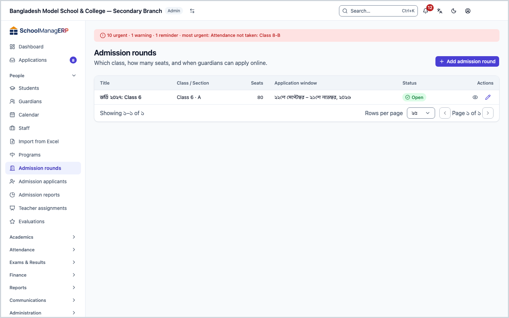

<!-- guide:meta
feature: people.admissionIntakes
title: Admission rounds and the online admission form
summary: Decide which class takes how many seats, and from when to when applications are open online; guardians fill in the form on their phone, get a reference number and check their application status later.
roles: [ADMIN, OFFICE_STAFF]
sources:
  - site/src/pages/[lang]/admission.astro
  - site/src/pages/[lang]/admission-status.astro
  - site/src/pages/[lang]/admission-result.astro
  - site/src/pages/[lang]/admission-lists.astro
  - site/src/islands/admission-form.ts
  - server/src/modules/admission/applicant-review.service.ts
  - site/src/islands/admission-result.ts
  - site/src/themes/basic/AdmissionRibbon.astro
  - client-admin/src/routes/_staff/admissions/intakes/index.tsx
  - client-admin/src/routes/_staff/admissions/intakes/$intakeId.tsx
  - client-admin/src/routes/admission/$slug/index.tsx
  - client-admin/src/routes/admission/$slug/status.tsx
  - client-admin/src/features/admission/IntakeList.tsx
  - client-admin/src/features/admission/IntakeForm.tsx
  - client-admin/src/features/admission/PublicAdmissionForm.tsx
  - client-admin/src/features/admission/AdmissionConfirmation.tsx
  - server/src/modules/admission/intake.controller.ts
  - server/src/modules/admission/intake.service.ts
  - server/src/modules/admission/public-admission.controller.ts
  - server/src/modules/admission/admission-applicant.service.ts
labels:
  [
    admission-staff-intakes:list.*,
    admission-desk:wizard.*,
    admission-staff-intakes:form.*,
    admission-staff-intakes:detail.*,
    admission-public:form.*,
    admission-public:confirmation.*,
    admission-public:status.*,
    nav:items.admissionIntakes,
    nav:groups.people,
    common:accessDenied.*,
    common:recordNotFound.*,
    common:actions.cancel,
  ]
helpIds:
  [
    people.admissionIntakes,
    people.admissionIntakes.action.add,
    people.admissionIntakes.field.classSection,
    people.admissionIntakes.field.seatCount,
    people.admissionIntakes.field.dates,
    people.admissionIntakes.field.requiredDocuments,
  ]
devices: [desktop]
entry: [sidebar, palette]
keywords:
  [admission, admission round, intake, online admission, admission form, apply, seats, reference number, application status]
appVersion: 0.1.0 (fb8af6c63)
owner: tareq89
lastVerified: 2026-10-24
knownIssues: []
-->

# Admission rounds and the online admission form

Open an admission round so guardians can apply for admission online, straight from their phone.

**Go to:** **People → Admission rounds** in the left menu. Set up rounds on a computer; the guardian's form works on a phone.
**Before you start:** be an Admin or Office staff ([who can do what](#roles)). The class and section you will admit into must already exist.

An **admission round** is one batch of admissions: which **Class / Section**, how many **Seats**, and from which date to which date applications are taken. While a round is open, guardians open the school's admission link and fill in the **Admission form**. Submitted applications go to the [Admission applicants](admission-applicants.md) page, and admitting one creates a student.

[Add an admission round](#task-main) · [Change a round or close it early](#task-edit) · [Problems and fixes](#trouble)

**On this page**

- [Add an admission round](#task-main)
- [How to tell the round was created](#confirm)
- [Other situations](#other)
  - [Change a round or close it early](#task-edit)
  - [See the applicants of one round](#task-applicants)
  - [On the school's website: apply, status, result and lists](#task-site)
  - [Photo choice on the form: Yes / No](#task-photo-choice)
  - [From application to admitted student](#task-flow)
- [Problems and fixes](#trouble)
- [Who can do what](#roles)
- [Learn more](#more)

---

## Add an admission round 

1. In the left menu press **People → Admission rounds**. You can also type **Admission rounds** in the search box (Ctrl+K).

   → The heading **Admission rounds** appears. The list columns are **Title**, **Class**, **Seats**, **Kind**, **Application window**, **Status**. With no rounds, it says **No admission rounds yet**. Pressing a row's **Open desk** takes you to that round's desk.

2. At the top press **Add admission round**.

   → A page with four steps opens. Every box is already filled in, so you can press **Next** without typing anything.

3. Step 1, **Class and kind**: choose the **Class** and **Academic year**, then pick one of the six kinds (**Apply only**, **Written test**, **Written and viva**, **Lottery**, **First come first served**, **GPA merit**).

   → The round is named from the class and year, for example "Class 6 admission 2027". If no class is chosen, it says **Choose a class.** and **Next** stays off.

4. Step 2, **Seats and dates**: enter the number of **Seats** (1 to 100,000), the **Applications open** date and the **Last date to apply**. If you want, add a **Roll number prefix** (optional).

   → Guardians can apply online between these two dates, and the last date is included. If the last date is before the start, it says **The last date cannot be before the start.**

5. Step 3, **Fee and form**: leave **Fee (taka, leave empty for no fee)** empty if there is no fee. Otherwise write the amount in taka, with at most 2 digits after the point, and tick at least one of **Ways to send the fee** (**bKash**, **Nagad**, **Rocket**, **Bank**). Under **Which boxes the form has**, the boxes that suit the chosen kind are already ticked; tick or untick others as you need.

   → You check that each fee is ok; until then the application joins no list.

6. Step 4, **Publish**: under **How results are told**, switch on what you want: **List on the school website**, **SMS**, **See result with roll and phone**, **Call list (for the office)**. Under **On the website**, switch **Always show on the website** on to show the round all the time; off shows it only while it is open. **Choose where it shows on the website** opens the website editor.

7. Press **Create round**.

   → The desk for this round opens. If creating fails, the page says **Could not create the round. Try again.** and what you entered stays.

> **Remember:** guardians can apply online only when the school website is published. The form link is your school website's address with `/admission` added at the end. While the website is not published, the rounds list shows **Publish the school website to open the form** where the copy button would be. Once it is published, press **Copy public link** and the message **Public admission link copied.** appears. The older edit page still changes dates and seats, and its **Go to desk** button opens the desk.

---

## How to tell the round was created 

A round is saved only while you are online; it cannot be kept on the device and sent later.

| State                           | How you know                                                 | What next                         |
| ------------------------------- | ------------------------------------------------------------ | --------------------------------- |
| **Changed only on the screen**  | The wizard is still open, **Create round** was not pressed   | Press **Create round**            |
| **Reached the school's system** | The desk for the round opened, and the list has a row for it | Tell guardians the admission link |

**To check:** reload the rounds list. If the round is there, it is in the system.

**If no message came:** if the page says **Could not create the round. Try again.**, what you entered stays on the page; check your internet and press **Create round** again.

---

## Other situations 

### Change a round or close it early 

1. At the end of the round's row in the list press **Edit**.

   → The round's page opens. At the top is the round's name, beside it **Open** or **Closed**, and below how many applications came in (for example "12 applications received"). Under that, the **Round details** card has the same fields as when you created it.

2. Change what you need, then press **Save**.

   → The message **Saved** appears. Press **Cancel** to go back to the list without changing anything.

**To close early:** on the page of an **Open** round, press **Close now**. The **Close this admission round now?** dialog says: "The public form stops taking applications for this round today. Applications already sent are kept." Press **Close now** in the dialog. → The message **Admission round closed.** appears, the status becomes **Closed** and the round leaves the guardian's form. If **Could not close the round. Please try again.** appears, check your internet and press again.

> **Remember:** there is no way to delete a round. If you change **Required documents**, it applies to later applications; applications already submitted stay as they are.

<!-- unverified: editing required documents affects only later submissions — inferred from the submit path checking the intake's current list; not run in the app -->

### See the applicants of one round 

At the end of the round's row in the list press **Edit**, then press **View applicants** at the top of the round's page. (The desk's **Applicants** step also lists this round's applicants.) → The [Admission applicants](admission-applicants.md) page opens with this round already chosen in the **Admission round** filter.

### On the school's website: apply, status, result and lists 

The school's public website has four pages for admission. None needs a sign-in. Each works in Bangla and English (`/bn/…` and `/en/…`).

| Page | Address ends with | Who uses it | What it does |
| ---- | ----------------- | ----------- | ------------ |
| Admission application | `/admission` | Guardian | Shows the open **admission rounds**. The guardian picks one, fills the form and submits. |
| Application status | `/admission-status` | Guardian | **Reference number** + **Phone given in the application** → **See status**. |
| See your admission result | `/admission-result` | Guardian | **Roll number** + **Phone given in the application** → **See result**. |
| Admission lists | `/admission-lists` | Anyone | Shows the published lists. **Roll numbers** are always shown. Names are shown too when the round's **show names publicly** setting is on. |

1. The guardian opens `/admission` and, if more than one round is open, presses **Choose** under the round they want.

   → The form for that round opens. The boxes are the ones this round asks for, so two rounds can show different forms. A box marked required must be filled; a wrong one shows a red note such as **This is needed** or **The mobile number is not right (for example 017…)**.

2. If the round has a fee, a **Fee** box says "The fee is … taka. Send it, then fill in the details below. The school will do the fee check." The guardian chooses **How you sent it** (bKash, Nagad, Rocket or Bank), enters **The number or transaction ID you sent from**, and adds a **Screenshot or slip** (photo or PDF, up to 5 MB).

   → Without the way you sent it and the screenshot or slip, the form says **Give how you sent the fee, and a screenshot or slip.**

3. They press **Submit application**.

   → The page says **Your application is in. Your reference number:** and shows the number large. **Write this down. You need this number and your phone number to see the status.** A link **See your application status** opens `/admission-status`. If the round has a fee: **The school will do the fee check. You will be told when it is done.**

4. Later, on `/admission-status`, the guardian enters the reference number and phone, then presses **See status**.

   → One line: "<name>, your application status: …". The words are: **Being checked**, **Picked**, **Admitted**, **Application not accepted**, **Fee check pending**, **A seat has been offered**, **On a waiting list**, **The admission date has passed**.

5. When the school has published results, on `/admission-result` the guardian enters **Roll number** and **Phone given in the application**, then presses **See result**.

   → They see **Stage results** (**Passed** or **Not passed** for each stage), and "You are number … in the merit list." or "You are number … in waiting list …", with **Last date to take admission**. If nothing is published yet: **No stage result has been published yet.**

6. Under the result, **Print admit card** opens the print view and the browser's print box.

   → The **Admit card** shows **Name**, **Guardian**, **Date of birth**, **Admission round**, the **Date**, **Time** and **Place** of each stage, and an empty **Photo** box. If the school has not set an exam time: **The exam time has not been told yet.**

7. On `/admission-lists` anyone sees the published **Merit list**, **Waiting list 1/2/3** and **Call list** of each round, with **Last date to take admission**. Each place shows the roll number only. If none is published: **No list has been published yet**. A link **Give your roll and phone to see the name** goes to `/admission-result`.

> **Remember:** a wrong roll number or phone gets the same answer, **It does not match. Please look again.**, so nobody can guess. If a round has been closed or no round exists: **There is no admission round yet**. These pages need the website to be [published](../administration/website.md#task-publish) first.

<!-- unverified: not run in the app; written from the site pages and their texts -->

### Photo choice on the form: Yes / No 

Near the end of the admission form on the school's website there is a question: **May the school keep and print your child's photo?** The guardian must choose an answer.

1. Choose **Yes, I agree** or **No, I do not agree**.

   → If nothing is chosen, **Submit application** shows a red note: **Please choose one.** The application is not sent.

2. If **No, I do not agree** is chosen, the photo box disappears. No photo is needed. Choose **Yes, I agree** again and the box comes back.

When the application becomes a student (you press **Admit**), this answer goes to the student's **Photo consent**: **Yes** becomes **Given**, **No** becomes **Refused**. An old application with no answer becomes **Not recorded**. You can change it later on the [student's profile](students.md#task-photo-consent).

<!-- unverified: not run in the app; written from the screen code and texts -->

### From application to admitted student 

1. A guardian submits the form. → The application appears in the [Admission applicants](admission-applicants.md) list as **Awaiting review**.
2. The office opens the application and chooses **Add to shortlist**, **Admit** or **Reject**. Each time, an SMS goes to the guardian's mobile (if the school has SMS balance).
3. When you press **Admit**, a new student is created in the round's section, the registration and roll numbers are filled in automatically, and the guardian is linked or created. You can find the student in the [Students](students.md) list. The applicant's photo choice goes with the student ([see](#task-photo-choice)).
4. How many were admitted online in a year is shown on [Admission reports](admission-reports.md).

---

## Problems and fixes 

| What you see                                                                                                            | What to do                                                                                                                                                          | Who can help |
| ----------------------------------------------------------------------------------------------------------------------- | ------------------------------------------------------------------------------------------------------------------------------------------------------------------- | ------------ |
| **You don't have access to this page.**                                                                                 | Only Admin and Office staff see admission rounds. Press **Back to dashboard**.                                                                                      | Admin        |
| **Failed to load admission rounds**                                                                                     | Check your internet and reload the page.                                                                                                                            | Admin        |
| **Failed to create admission round**                                                                                    | Check your internet and press **Create** again. First look in the list to see whether the round already arrived.                                                    | Admin        |
| **Failed to save admission round**                                                                                      | Check your internet and press **Save** again. What you typed stays in the fields.                                                                                   | Admin        |
| **We could not find this record**                                                                                       | The link to the round is old or wrong. Press **Go back** and open it from the list.                                                                                 | Admin        |
| The section is missing from the **Class / Section** list                                                                | Create the section first, then open the round again.                                                                                                                | Admin        |
| **Create** will not press                                                                                               | Fill in every starred field; **Seat count** must be 1 or more; the close date must not be before the open date.                                                     | —            |
| A guardian says **This school isn't accepting new applications right now.**                                             | Check whether the round's **Status** is **Open**. If it is, check whether the seats are full (**Admitted** count = **Seat count**); raise **Seat count** if needed. | Office staff |
| A guardian says **We couldn't find this school. Please check the link and try again.**                                  | The school name part of the link has a typo. Send the correct link again.                                                                                           | Admin        |
| A guardian says **This application could not be accepted. If you already applied for this child, …**                    | They already applied for this child. Look for them in the applicants list by the reference number.                                                                  | Office staff |
| A guardian says **This admission round is not taking applications now.** or **This admission round has no seats left.** | The round's last day or its seats have run out. Check the round's **Status** and **Seat count**.                                                                    | Office staff |
| A guardian says **We couldn't submit your form. Please check your answers and try again.**                              | Ask them to check what they typed and their internet, then submit again.                                                                                            | Office staff |
| A guardian says **The robot check didn't go through. Please complete the check below again, then submit.**              | They complete the check box again and press **Submit application**. What they typed is not lost.                                                                    | —            |
| A guardian says **Applications can't be sent right now. Please try again in a little while.**                           | The site's check service is not running right now; changing the form will not help. Tell support.                                                                   | Support team |
| A guardian says **We couldn't find an application with this reference number and phone number.**                        | Ask them to use the phone number they gave on the form. Compare the reference number with the applicants list.                                                      | Office staff |
| A guardian says **This file looks harmful. Choose another file.** | The file was not saved. Ask them to choose another file. | — |
| A guardian says **We can't check files right now. Try again shortly.** | The file was not saved. Ask them to send it again in a little while. If it keeps happening, tell support. | Support team |

---

## Who can do what 

| Role                                                                         | See rounds | Add and edit rounds | Fill in the admission form |
| ---------------------------------------------------------------------------- | ---------- | ------------------- | -------------------------- |
| Admin                                                                        | Yes        | Yes                 | —                          |
| Office staff                                                                 | Yes        | Yes                 | —                          |
| Academic coordinator, Teacher, Accountant, Exam controller, Committee member | No         | No                  | —                          |
| A guardian or anyone (not signed in)                                         | No         | No                  | Yes, while a round is open |

**Admin** and **Office staff** see and do exactly the same on this page. Someone without permission who opens the page sees **You don't have access to this page.**, and **Admission rounds** is not in their left menu.

---

## Learn more 

<strong>The parts of the page</strong> — top to bottom

1. **Admission rounds** — the heading and the short text under it.
2. **Add admission round** — the button at the top of the page.
3. **The list** — **Title**, **Class / Section**, **Seats**, **Application window**, **Status**; at the end of each row, **Open desk** and **Edit**.

<strong>What the fields mean</strong>

<!-- guide:generated:fields:admission-staff-intakes -->

| Field                | What to enter                                                                                                                   | Required? |
| -------------------- | ------------------------------------------------------------------------------------------------------------------------------- | --------- |
| Title                | The name guardians will recognise the round by, for example Class 6 Admission 2027.                                             | Yes       |
| Class / Section      | The section to admit into. The student joins this section when admitted.                                                        | Yes       |
| Seat count           | How many can be admitted. Once that many are admitted, the round leaves the form. The number of applications does not block it. | Yes       |
| Open date            | The day applications start.                                                                                                     | Yes       |
| Close date           | The last day to apply; the day itself counts. It cannot be before the open date.                                                | Yes       |
| Required documents   | Which of Photo, Birth certificate and Transcript the guardian must upload.                                                      | No        |
| Open and close dates | The first and last day applications are open. Both days count; the close date cannot be before the open date.                   | Yes       |

<!-- /guide:generated -->

Fields on the guardian's form:

<!-- guide:generated:fields:admission-public -->

| Field                                 | What to enter                                                                    | Required?         |
| ------------------------------------- | -------------------------------------------------------------------------------- | ----------------- |
| Which admission are you applying for? | The round you are applying to. Chosen for you when only one is open.             | Yes               |
| Student's full name                   | The child's full name.                                                           | Yes               |
| Student's date of birth               | The child's date of birth.                                                       | Yes               |
| Student's gender                      | Boy, Girl or Other.                                                              | Yes               |
| Parent/guardian's name                | The person applying.                                                             | Yes               |
| Parent/guardian's phone number        | A correct mobile number. SMS messages and the status check both use this number. | Yes               |
| Parent/guardian's email (optional)    | A correct email address.                                                         | No                |
| Home address (optional)               | The home address. When admitted, it goes to the student's address.               | No                |
| Papers                                | One photo (JPG, PNG) or PDF for each document the round asks for, at most 5 MB.  | If the round asks |

<!-- /guide:generated -->

<strong>How online admission works</strong> — from opening a round to a student

<figure>
  
  <figcaption><em>From opening a round to an admitted student</em></figcaption>
</figure>

- Whether a round is **Open** is decided only by the dates, using the school's own day.
- Seats are counted by applications that are **Admitted**, not by applications submitted. So more applications than seats can arrive.
- Every decision on an application is sent to the guardian by SMS: [Admission applicants](admission-applicants.md).

**Related pages**

- [**Entering an application**](admission-clerk-entry.md) — add an application for a walk-in guardian.
- [**Checking an application fee**](admission-fee-verify.md) — mark a fee ok or send it back.
- [**Admission applicants**](admission-applicants.md) — review submitted applications, then admit or reject them.
- [**Admission reports**](admission-reports.md) — how many were admitted in a year and how many left.
- [**The admission desk, test marks and cut-off**](admission-stages.md) — walk a round step by step.
- [**Admission on the school website**](../administration/admission-widgets.md) — switch the website sections on.

---

_Version 0.1.0 · Last checked 2026-10-24_
