<!-- guide:meta
feature: people.admissionLists
title: Merit and waiting lists
summary: Make the merit list, open waiting lists when seats are still free, call people and admit them to a section.
roles: [ADMIN, OFFICE_STAFF]
sources:
  - client-admin/src/features/admission/desk/ListsPanel.tsx
  - client-admin/src/features/admission/desk/ListBuildDialog.tsx
  - client-admin/src/features/admission/desk/CallListDialog.tsx
labels: [admission-lists:panel.*, admission-lists:card.*, admission-lists:actions.*, admission-lists:build.*, admission-lists:call.*, admission-lists:confirm.*, admission-lists:reasons.*]
helpIds: [people.admissionLists]
devices: [desktop]
entry: [page:people.admissionStages]
keywords: [merit list, waiting list, call list, admit, seats, offer, deadline]
appVersion: 0.1.0 (fb8af6c63)
owner: tareq89
lastVerified: 2026-11-16
knownIssues: []
-->

# Merit and waiting lists

The merit list is the first group offered seats. If seats stay free after its last date, you open a waiting list, and so on.

**Go to:** **People → Admission rounds**, open the round, then the step **Merit list** or **Waiting list**. Do this on a computer.
**Before you start:** be an Admin or Office staff ([who can do what](#roles)). Fees must be checked and test steps finished ([the admission desk](admission-stages.md)).

[Make the merit list](#task-main) · [Open a waiting list](#task-waiting) · [Call people](#task-call) · [Problems and fixes](#trouble)

<figure>
  
  <figcaption><em>From the merit list to waiting lists</em></figcaption>
</figure>

---

## How you get here 

On the [desk](admission-stages.md) the card **Make the merit list** opens this step.

---

## Make the merit list 

1. Press **Make merit list**. A window opens.
2. Write **Seats in this list** (at most the seats left) and pick **Last date to take admission**.
3. Choose **Choose people by**: **Merit order**, **First come, first served**, **Pick by hand** or **Filter**.

   - **Pick by hand:** tick people, then use the arrows to set the order.
   - **Filter:** choose a **Quota** (for example **Freedom fighter child**), **Lowest score** or **Gender**.

4. Press **Make list**.

   → "List made. … people added." A card **Merit list** shows **Seats**, **Last date**, and the counts **Offered**, **Admitted**, **Expired**, **Waiting**, **Seats left**.

Only applications whose fee is ok can be added.

---

## How to tell it worked 

- The card shows **Seats: …** and the people under **People in this list**, each with **No. …**.
- On the desk the card moves to **Publish the result**, or to **Start waiting list …** later.

---

## Other situations 

### Open a waiting list 

1. Press **New waiting list** and make it the same way as the merit list.
2. When its turn comes, press **Open this list**, then **Yes, continue**.

   → "List opened." Offers go to the people in the list.

The page tells you when you cannot yet: "You can open this list after …, the last date of the list before it." or "No seat is free, so there is nobody to offer."

### Mark time over 

After a list's last date press **Mark time over**, then **Yes, continue**. People who were offered a seat and are not admitted lose their offer. The seats become free for the next waiting list.

### Call people 

Press **Call list** on a list. A table shows **Name**, **Phone** and **Roll**. Press a number to call, tick **Called**, and write a **Note**.

### Admit from a list 

Press **Admit** beside a person, then choose the section: [Admission applicants](admission-applicants.md).

---

## Problems and fixes 

| What you see | What to do | Who can help |
| --- | --- | --- |
| **Seats must be from 1 to …** | Write a number up to the seats left. | — |
| **Choose the last date.** | Pick **Last date to take admission**. | — |
| **Pick at least one person.** | Tick someone in **Pick by hand**. | — |
| **No applicant can be added now.** | Check fees and test steps. | — |
| **Could not do that. Try again.** | Check the internet and try again. | Admin |

---

## Who can do what 

| Role | Make and open lists |
| --- | --- |
| Admin | Yes |
| Office staff | Yes |
| Other roles | No |

---

## Learn more 

<strong>Merit list or lottery order</strong>

With **Merit order** the list follows marks. In a [lottery](admission-lottery.md) round it follows the lottery number.

**Related pages**

- [**The admission desk**](admission-stages.md) — all steps of a round.
- [**Publishing admission results**](admission-publish.md) — tell guardians.
- [**Admission applicants**](admission-applicants.md) — admit a person.
- [**Admission lottery**](admission-lottery.md) — the order for a lottery round.

---

_Version 0.1.0 · Last checked 2026-11-16_
