<!-- guide:meta
feature: people.admissionLottery
title: Admission lottery
summary: Draw the lottery in the app once, or upload an Excel list made outside, so every applicant has a lottery number.
roles: [ADMIN, OFFICE_STAFF]
sources:
  - client-admin/src/features/admission/desk/LotteryPanel.tsx
  - client-admin/src/features/admission/desk/LotteryImportDialog.tsx
labels: [admission-stages:lottery.*, admission-stages:lotteryImport.*]
helpIds: [people.admissionLottery]
devices: [desktop]
entry: [page:people.admissionStages]
keywords: [lottery, draw, lottery number, upload, excel, admission]
appVersion: 0.1.0 (fb8af6c63)
owner: tareq89
lastVerified: 2026-11-16
knownIssues: []
-->

# Admission lottery

When seats are fewer than applicants and the school decides by lottery, the lottery step gives each applicant a number. The merit list then follows that order.

**Go to:** **People → Admission rounds**, open the round, then the step **Lottery**. Do this on a computer.
**Before you start:** be an Admin or Office staff ([who can do what](#roles)). All fees must be checked: [Checking an application fee](admission-fee-verify.md). The round must be of the kind **Lottery**.

[Draw in the app](#task-main) · [Upload a list](#task-upload) · [Problems and fixes](#trouble)

<figure>
  
  <figcaption><em>Two ways to get the order</em></figcaption>
</figure>

---

## How you get here 

On the [desk](admission-stages.md) the card **Draw the lottery** opens this step.

---

## Draw in the app 

1. In the card **Draw the lottery in the app** press **Draw the lottery**.

   → A question: **Draw the lottery?** "There are … applicants. This can be done once, and cannot be done again."

2. Press **Draw now**.

   → The page says **The lottery is done** and "… applicants have a lottery number." A table lists **Lottery no.**, **Roll** and **Name**.

> **Remember:** the lottery can be drawn only once. After that the page says **The lottery is already drawn. Nothing more can be drawn.**

---

## How to tell it worked 

The table is filled and the desk card moves to **Make the merit list**.

---

## Other situations 

### Upload a list made outside 

1. Press **Upload a list**. A window **Upload a lottery list** opens.
2. Press **Choose the file** and pick one Excel file (.xlsx, up to 5 MB). Columns: `rank`, and `reference_number` or `roll_number`. Every applicant of this step must be in it once.
3. Press **Check the file**.

   → "… rows read." and **The file is correct. Save the list.** If not, the window says **Fix these and upload again** with each row.

4. Press **Save the list**.

   → The same result as drawing.

---

## Problems and fixes 

| What you see | What to do | Who can help |
| --- | --- | --- |
| **This applicant is not in this step** | Remove that row, or check the applicant's fee. | — |
| **This applicant is in the file more than once** | Keep one row. | — |
| **The lottery number must be a whole number from 1 to the number of applicants** | Fix the number. | — |
| **Two applicants have the same lottery number** | Give each a different number. | — |
| **Some applicants of this step are not in the file** | Add the missing applicants. | — |
| **The checked file is gone. Check the file again.** | Press **Check the file** again. | — |
| **This step is not a lottery.** | Open the right step. | Admin |
| **Open this on a computer to draw the lottery or upload a list.** | Use a computer. | — |

---

## Who can do what 

| Role | Draw or upload |
| --- | --- |
| Admin | Yes |
| Office staff | Yes |
| Other roles | No |

---

## Learn more 

<strong>Why only once</strong>

A second draw could give a different order after guardians were told. So the app allows one draw. Upload a list only when the school drew the lottery in public outside the app.

**Related pages**

- [**The admission desk**](admission-stages.md) — all steps of a round.
- [**Merit and waiting lists**](admission-lists.md) — the next step.

---

_Version 0.1.0 · Last checked 2026-11-16_
